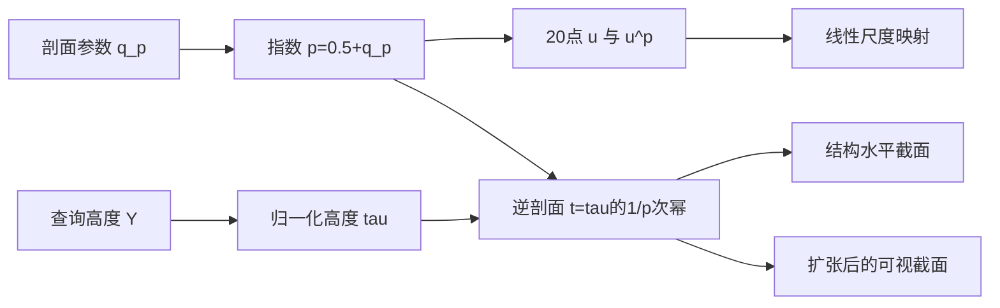

# Tiny Glade 屋顶形状：幂剖面、屋脊与高度截面

本轮已从匹配的 release 指令中确认：屋顶剖面使用幂函数取样，水平截面通过该函数的逆变换求缩进量；结构截面与可视截面具有不同的底部扩张和尖端处理。高度与屋脊参数还受到建筑尺度影响。以下公式来自具体 `movss/mulss/addss/divss/minss/maxss`、分支和已核对的数学函数调用，超出了之前仅凭符号名得到的候选结论。

这是静态指令阅读与数学推导；没有恢复原始源码或完整 Rust 类型，也没有执行游戏。配套阅读：[建筑相交](04-tiny-glade-intersections.md)、[接缝显示](05-tiny-glade-seams.md)、[证据账本](06-tiny-glade-evidence-ledger.md)。



图中展示本篇已确认的局部数学关系，不能代表 UI 输入到最终铺瓦的完整调用顺序。

## 身份与证据

- EXE：`E:\Steam\steamapps\common\Tiny Glade\tiny-glade.exe`；SHA256 `4627ec9f9a8abe03dd30751f6a8e22868e0dfddf9f40029a1b848a3773495fe5`。
- PDB：`tiny_glade.pdb`；SHA256 `ca8b5f18fcf5a79e282db9af9178b6ec8cecb776ea41f68435b543079d34dcf2`。
- PE RSDS 与 PDB Info Stream 的 GUID `d8d61d04-9e31-5b47-4c4c-44205044422e`、age `1` 一致。
- 地址均为 **RVA**，preferred VA 为 `0x140000000 + RVA`。不是运行时地址。
- 解码工具：Capstone 5.0.3；在 PDB 给定函数范围内完整线性解码。线性解码不等于所有字节均可达，也不等于获得完整调用图。
- 主证据：本聊天分析产物目录的 `tinyglade-native/roof_intersection_entrypoints-decode.json` 及各函数 `.asm.txt`；辅助证据：`tinyglade-symbols/roof_helper_symbols.json`、`powf-import.json`、`tinyglade-native/roof_helper_entrypoints-decode.json`。完整根路径见证据账本与总身份文档。
- 数字示例：`roof-formula-examples.json`，为独立计算的说明性示例，不是原游戏执行结果，不保证逐位复现 float32。

| 函数 | RVA | 字节数 | 编译器记录的源行 |
|---|---:|---:|---|
| `Roof::profile_curve_normalized` | `0xb772d0` | 842 | `roof_shape.rs:249` |
| `profile_curve_ws` | `0xb768b0` | 687 | `roof_shape.rs:504` |
| `Roof::height` | `0xb77a00` | 335 | `roof_shape.rs:210` |
| `ridge_length_01_from_rectangle_ratio` | `0xb770a0` | 205 | `roof_shape.rs:403` |
| `Roof::roof_shape_at_intersection_y` | `0xb77620` | 868 | `roof_shape.rs:284` |
| `Roof::get_roof_shape` | `0xb77bc0` | 458 | `roof_visual_shape.rs:51` |
| `utils::inverse_lerp` | `0xde8220` | 16 | 本轮未读取源行 |
| `Rectangle2d::new` | `0xdf3380` | 194 | 本轮未读取源行 |
| `Circle2d::new_rotated` | `0xdef2a0` | 29 | 本轮未读取源行 |

源路径是 PDB 中的编译器记录，不代表取得了 `/home/h3/code/pouncelight/country-slice-private/...` 的源文件。

`powf` 的身份做了两种核对：其 RVA `0x2e32ad0` 在完整 DbgHelp 符号查询中只有一个对应符号；PE 字节 `ff25eaff8a00` 是跳向 IAT `0x36e2ac0` 的 thunk，该槽的导入名称为 `api-ms-win-crt-math-l1-1-0.dll!powf`。PDB 未给该 thunk 非零函数长度，因此未伪造其完整函数范围，也未读取或执行 CRT 数学实现。

## 1. 归一化剖面：20 个幂函数样本

将 `roof + 0x2c` 的 float32 输入记为 `q_p`。这是本文的记号，不是恢复出来的字段名。`0xb77311–0xb77331` 的算术得到：

```text
p = 0.5 * (1 - q_p) + 1.5 * q_p
  ≈ 0.5 + q_p
```

`0xb772f6–0xb77300` 分配 `0xa0 = 160` 字节、对齐 4 的区域。随后写入 20 对相邻的 float32 值，每对 8 字节：

```text
u_i = i / 19, i = 0..19
point_i = (u_i, powf(u_i, p))
```

证据包括：`0xb7733b` 以 `u=0` 调用 `powf`；从 `0xb7734b` 开始显式载入 `1/19, 2/19, ... 18/19`；`0xb77555–0xb7755d` 直接写入最后一对 `(1,1)`；`0xb77565` 和 `0xb77573` 写入长度 20。之后调用 `Curve::try_new_from_points<...Vec2...>` 并检查返回结果。该地址有四条同名同址记录；不是四种已确认的不同算法。

例如只用公式计算 `u=0.25`：

| 假定 `q_p` | `p` | `y = u^p` |
|---:|---:|---:|
| 0 | 0.5 | 0.5 |
| 0.5 | 1 | 0.25 |
| 1 | 1.5 | 0.125 |

**观察**：函数实际生成离散样本，不是仅存一个解析函数。续查已确认矩形装配消费者按折线弧长定位并线性插值，见下一段；其他消费者仍未逐一检查。有效输入域是否由调用者限制为 `[0,1]` 未确认，本函数未对 `q_p` 做局部 clamp。

### 20 点怎样成为可采样的曲线

剖面函数实际调用 `Curve::try_new_from_points<...Vec2...>`，RVA `0x80C90`，682 字节。`0x80D30–0x80D9F` 对相邻点计算 `sqrt(dx²+dy²)` 并累加；`0x80DC5–0x80DD3` 用总长度归一化，得到折线的弧长表：

```text
s_0 = 0
s_i = sum(length(P_j-P_(j-1)), j=1..i)
U_i = s_i / s_19
```

矩形装配消费者调用 `Curve::get_coord_at_u<...Vec2...>`，`0x2802660`，454 字节。它二分查询相邻 `U_i,U_(i+1)`，算 `f=(u-U_i)/(U_(i+1)-U_i)` 并钳制到 `[0,1]`。有限 `u<=0`、`u>=1` 分别返回首、末段端点；非有限查询有诊断失败路径。装配函数的 `0x2813342–0x28133EA` 随后确实做：

`P(u) = (1-f)*P_i + f*P_(i+1)`。

因此这个消费者中的查询 `u` 是归一化折线弧长，不能再解释为采样点横坐标，也不是每次直接计算 `(u,u^p)`。曲线构造器对零总长度及非有限值还有错误路径；本文正常输入简化不覆盖它们。

**独立演算。** `p=1.5` 的 20 点折线长度约为 `1.4394494323`。查询一半弧长时得到约 `(0.5662490208,0.4263544599)`；直接把横坐标设为 0.5 则得到 `(0.5,0.3535533906)`。这两种“中间位置”在弯曲剖面上不同。

## 2. 从归一化剖面映射到实际尺度

`profile_curve_ws` 读取输入容器 `+0x08` 的点数据地址和 `+0x10` 的数量。对每对 `(u,v)`，标量路径 `0xb76954–0xb76982` 明确计算：

```text
x = (1-u) * A + u * B
y = v * C
```

其中 `A`、`B` 分别来自入口 `xmm2`、`xmm3`；`C` 来自对应栈实参。本轮没有把这些参数恢复成原始类型或命名。四点一组的 SIMD 路径 `0xb76ac0–0xb76b0e` 执行同样的映射，并将结果再次交给 `Curve::try_new_from_points`。

若独立取 `A=4, B=0, C=6`、点 `(0.25,0.125)`，输出为 `(3,0.75)`。这个例子仅说明函数怎样重映射坐标，不表示游戏采用了这些实参。

## 3. 高度：有 flat 阈值，有随底面尺度变化的上限

将 `roof + 0x30` 的值记为 `q_h`，与剖面参数 `q_p` 是不同偏移。令：

```text
clamp01(x) = min(1,max(0,x))
S(x) = c*c*(3-2*c), c=clamp01(x)
```

对于普通有限输入，`Roof::height` 的公式可简化为：

```text
q_h <= approximately 0.1: H = 0
otherwise:
  desired = max(0, 0.4*(1-q_h) + 12*q_h)
  rectangle cap = 9 + 3*S(((max(D1,D2)-2.25)/12.75)/0.4)
  circle cap    = 8 + 4*S(((R-0.9000000358)/7.099999905)/0.4)
  H = min(desired, cap)
```

`0xb77a19–0xb77a1c` 实现阈值；`0xb77a22` 按输入 `+0x08` 的整数值是否为 `1` 分支；矩形分支读取 `+0x1c,+0x20`，圆形分支读取 `+0x14`；`0xb77aa2–0xb77ad0` 执行三次多项式 smoothstep 与上限插值；`0xb77ad9–0xb77af5` 得到期望值并限制在上限以内。

常量的真实 float32 值包括 `0.10000000149`、`0.40000000596` 和 `7.09999990463`。上面的数学公式为便于理解做了常数显示与代数简化；严格复现应保留指令中的单精度运算次序。

例如尺寸 `(4,6)`、`q_h=0.5` 得到 `H≈6.2`；半径 `3`、`q_h=0.5` 也得到 `H≈6.2`。`q_h=0.1` 走零高度分支。这个局部分支存在阈值；不能由此宣称拖动 UI 时必然出现高度跳变，因为 UI 到 `q_h` 的映射尚未追踪。

## 4. 屋脊参数不仅取决于长宽比

把入口两个有限、正的标量记为 `a,b`。`0xb770a8–0xb770cb` 计算两个比值并取最大值；`0xb770ce–0xb7712d` 根据较大的尺度建立一次 smoothstep；`0xb77135–0xb77160` 再做归一化和第二次 smoothstep：

```text
r = max(a/b,b/a)
k = S((max(a,b)-2.25)/5.25)
ridge01 = S((r + 1.5*k - 1.5)/1.5)
```

因此即便长宽比都是 1，输入 `(3,3)` 的结果约为 `0`，`(8,8)` 的结果约为 `0.740741`；`(4,6)` 约为 `0.897674`，`(3,6)` 为 `1`。这是从实际运算得到的尺度效应，不能仅看函数名将它缩成一个纯长宽比函数。

## 5. 指定世界高度的结构截面

`Roof::roof_shape_at_intersection_y` 入口的查询标量来自 `xmm2`。将 `roof + 0x4c` 的值记为 `Y0`。`0xb77659` 读 `Y0`，并内联与上述 `height` 相同的高度运算得到 `H`。

对于正常有限数值，分支为：

```text
Y == Y0:                 复制原始底面形状
Y < Y0 or Y >= Y0+H:     输出整数标记 2，没有写入新的形状 payload
Y0 < Y < Y0+H:           计算缩小的截面
```

`Y==Y0` 的复制路径在 `0xb77753–0xb77769`；范围拒绝路径到 `0xb778c9`。标记 `2` 在这里有“无截面”的行为，但本轮没有恢复它的原始 enum variant 名称。

内部有效截面先由唯一目标 `utils::inverse_lerp` 求：

```text
tau = (Y-Y0)/H
t = powf(tau, 1/p)
```

`inverse_lerp` 的 16 字节指令明确是 `(xmm2-xmm0)/(xmm1-xmm0)`。调用它时 `xmm0=Y0`，`xmm1=Y0+H`，`xmm2=Y`。`0xb77787–0xb777be` 构造相同的 `p` 并取倒数作为 `powf` 指数。这里并不是猜测“可能通过剖面求截面”，而是两个已核对函数和相同参数的实际连接。

### 圆形截面

输入 `+0x08 != 1` 的路径调用唯一符号 `Circle2d::new_rotated`；其 29 字节指令把四个传入 float32 连续存入输出。结合调用前的实参流，可确认该路径保持两个定位分量和另一个原有标量，且把原 `+0x14` 数值乘以 `1-t`：

```text
R_section = R*(1-t)
```

将这个量解释为半径有 constructor 符号及后续一致运算支持，但仍是基于指令语义的推导，不是 TPI 字段恢复。

### 矩形截面

输入 `+0x08 == 1` 的路径调用唯一符号 `Rectangle2d::new`。令 `r_tip = roof[+0x34]`、`axis_flag = byte roof[+0x3c]`：

```text
axis_flag == 0:
  T = (0.1*(1-r_tip) + D1*r_tip, 0.1)
axis_flag != 0:
  T = (0.1, 0.1*(1-r_tip) + D2*r_tip)
dimensions_section = (1-t)*D + t*T
```

`0xb777e1–0xb77850` 选择终点尺寸并按轴交换；`0xb77855–0xb77875` 混合原尺寸和终点尺寸；`0xb77885–0xb778a4` 将原方向/位置实参传给矩形构造器。构造器实际将方向、位置、两尺寸按自身布局写出，并检查两尺寸有限及方向长度误差。这里能追到结构截面几何，但无法确认完整的建筑相交、接缝检测、polygon Boolean 或裁剪流程。

## 6. 可视截面使用额外扩张

`Roof::get_roof_shape` 入口额外标量经过相同的 `powf(U,1/p)` 得到 `t`，但底部、顶部的几何值与结构截面不同。令 `e = roof[+0x38]`，只将它称为本函数使用的扩张参数；是否是原项目的某个 slider 或风格配置尚未确定。

### 矩形可视截面

从 `0xb77d03–0xb77d4e` 的 SIMD lanes 逐项展开，两个底部尺寸均添加同一偏移：

```text
B = D + [0.28 + 1.5*e*(0.5 + 0.5*sqrt(q_p))]
dimensions_visual = (1-t)*B + t*T
```

`T` 与结构截面的终点矩形相同。`movsldup/movshdup/shufps` 将 `sqrt(q_p)` 与 `1.5*e` 的乘积项广播到两轴；不是两轴各使用不同的 `e`。

### 圆形可视截面

`0xb77c51–0xb77cc2` 给出：

```text
B_R = R + 0.5*(0.28 + 1.2*(1.5*e)*(0.5 + 0.5*sqrt(q_p)))
R_visual = (1-t)*B_R + t*0.2
```

这里存在可视尖端的 `0.2` 半径，结构截面的圆半径则趋向 `0`。矩形与圆的底部扩张也有不同系数。不能把两种 representation 混为同一个“真实碰撞尺寸”。

### 一个说明性对比

独立假设：矩形 `D=(4,6)`、圆半径 `R=3`、`q_p=1`、`q_h=0.5`、`r_tip=0.5`、`axis_flag=0`、`e=0.2`、`Y0=2`、`Y=5.1`。得到 `H=6.2`，`tau=0.5`，`t=0.5^(1/1.5)≈0.629961`。

| 输出 | 结构截面 | 可视截面 |
|---|---:|---:|
| 矩形两尺寸 | `(2.771577, 2.283233)` | `(2.986200, 2.497856)` |
| 圆半径 | `1.110118` | `1.354523` |

这些数字说明可视构件可以覆盖或伸出结构截面。**推断**：分离结构几何和可视几何有利于保留檐口、重叠和尖端厚度。其原开发者意图、与瓦片 seam plane 的关系仍未由本轮建立。

## 7. 矩形屋顶怎样控制铺瓦分段

装配入口为 `assemble_rectangular_roof<...>`，RVA `0x2812C70`，15015 字节。它调用世界尺度曲线映射，再读取该曲线总长 `L_ws`。`0x2813123–0x28131A0` 在合理的有限正长度范围内得到：

```text
N = max(2, roundf(L_ws/0.625))
requested_jitter = 0.125/L_ws
```

`roundf` 的身份经 PE 导入表、IAT 和跳板核对：RVA `0x2E32B00` 跳转到 `api-ms-win-crt-math-l1-1-0.dll!roundf`。随后调用 `random_splits`，`0xDE8290`，及 `random_splits_into`，`0xDE8BB0`。

**发行版指令。** `N=2` 时直接返回 `[0,1]`；`N>=3` 时保留端点，只扰动内部边界：

```text
j = min(requested_jitter, 0.495/(N-1))
u_0 = 0
u_i = i/(N-1) + (r_i-0.5)*j, i=1..N-2
u_(N-1) = 1
```

随机调用的精确入口是 `fastrand::Rng::f32`。第十一轮确认选定矩形/圆形装配的局部RNG初始化零，实例seed另用counter；调用次序和几何变化会影响对应关系，跨版本稳定性仍未知。详见[44 稳定随机](44-tiny-glade-stable-randomness.md)，不能称所有瓦片每次编辑都重新随机。

**N 是边界点数。** 装配循环在 `0x2813297–0x281329E` 与 `0x281387B–0x2813882` 按 `len-1` 控制，读取相邻两个边界。每个区间在 `0x2813872` 调一次输出闭包。这一个循环得到 `N-1` 个区间；屋顶还有其他边、循环和后续处理，不能把这个数当整座屋顶的瓦片总数。

**独立演算。** `L_ws=5` 时，N=8，要求扰动为 0.025，cap 为 `0.495/7≈0.0707143`，实际 j=0.025。两个固定端点加六个内部点，形成 7 个区间。某次 `r_i=0.5` 时，内部边界正好为 `i/7`。

长度与采样位置还有一个区别：`L_ws` 决定分段数量/扰动，但上文查点用的是原归一化剖面的弧长表。已核对数据流不足以宣称瓦片严格按**世界空间等弧长**排列。后续已看到两次插值、方向归一化、距离和打包运算；尚未把完整输出与 GPU 瓦片字段一一关联，也未恢复 CPU 裁剪平面的生成式。

## 8. 本轮可追到的偏移语义

以下是所分析调用路径内的读写角色，**不是已恢复的 Rust struct 定义或稳定 ABI**。

| 相对传入 roof 指针的偏移 | 观察 / 推导 |
|---|---|
| `+0x08` | u32 比较值；`1` 路径调用矩形构造器，其余路径调用圆构造器 |
| `+0x0c,+0x10` | 圆的定位分量；矩形的方向分量，随形状分支解释 |
| `+0x14,+0x18` | 圆的半径相关量和旋转实参；矩形的定位分量 |
| `+0x1c,+0x20` | 矩形两尺寸；用于高度上限与水平截面缩进 |
| `+0x2c` | float32 `q_p`：幂指数与可视底部扩张的平方根输入 |
| `+0x30` | float32 `q_h`：零高度阈值与期望高度混合输入 |
| `+0x34` | float32 `r_tip`：矩形顶端长度混合输入 |
| `+0x38` | float32 `e`：可视底部扩张输入 |
| `+0x3c` | u8 轴选择标记，改变矩形顶端的两尺寸排列 |
| `+0x4c` | float32 `Y0`：与查询高度比较，并作为 inverse lerp 起点 |

## 未做与原因

- 未恢复原始源码、原始字段名、完整类型或 enum。PDB 的游戏 TPI 类型查询没有给出这些信息；偏移语义来自本轮指令数据流。
- 未运行、附加或修改游戏；没有做运行时参数采样、单位校准、视觉误差或性能验证。
- 屋顶瓦片装配已部分分析：确认矩形消费者的弧长查点、线性插值、边界数量与扰动。未分析圆形装配全部分支、接缝 plane 生成、建筑间完整 clipping/Boolean，不能由局部函数外推完整生成模型。
- 未运行导入 CRT 的 `powf`；未研究 NaN、无穷、负输入和异常输入的完整路径。本文公式限定为常规有限输入，例子默认有效正尺寸。
- 独立示例计算不是原程序执行或自动回归测试，只验证所写数学表达式的示例算术。

## 风险与下一步

主要风险是将静态偏移语义误称为原始类型，或把结构截面、可视截面、GPU shingle 数据当成同一表示。另一个风险是把代数简化的公式当作 float32 逐位复刻。本文保留具体偏移、RVA、运算次序边界和未确认项。

下一步应继续将 rectangular/circular 瓦片 producer 的姿态、打包数据及 clipping-plane 输出与 GPU 消费者对齐，再核对 roof/roof、wall/roof 接触检测。可用本轮公式作为实际 release 的局部基线；不能把公开历史版本的生成规则直接代入本机 release。
