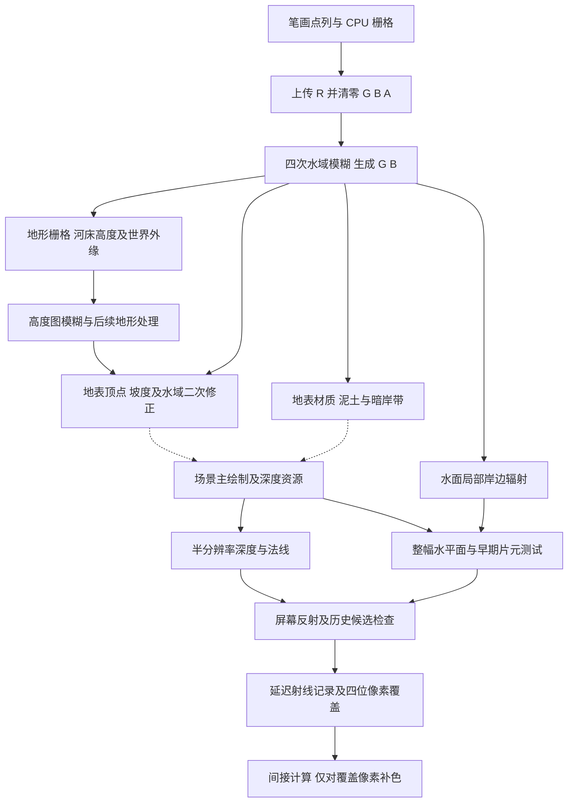

# Tiny Glade：水面可见边界、河岸过渡与绘制管线

本篇继续 [水域与河床](07-tiny-glade-water-shape-and-banks.md) 和 [水面细节](08-tiny-glade-water-vegetation-and-surface.md)，重点区分水域输入、地形形状、地表显示、片元覆盖和反射补色。发行版确认了两项关键结构：水面是覆盖地图的两个三角形，而河岸会经过多次高度和颜色处理；延迟反射保留逐像素覆盖，不会无条件给整个半分辨率像素组补色。

调查时间锚点：**2026-10-12 14:54:33 PDT，America/Los_Angeles**。沿用匹配的 EXE/PDB，[证据账本](09-tiny-glade-water-evidence-ledger.md) 保留身份和本轮复核结果。CPU 地址均为 RVA；shader 地址是原 `.precomp` 文件字节偏移。指令观察支持局部公式，跨阶段结论另外列出绑定与调用证据；没有执行游戏或 GPU。

## 1. 从输入到画面的职责链

下图串联已恢复的局部算法、资源传递与 CPU 节点。地表生成到主绘制的虚线表示显示职责关系：主绘制内部通用 material 回调尚未逐个绑定到 floor draw。主深度视图复用已确认，attachment 的 load/store 与实际 GPU 调度仍单独列为核对项。图没有声称 GPU 执行顺序等于 CPU 添加节点的顺序。



`render_world`，RVA `0xF9F00`，提供以下**CPU 节点构造顺序**。条件分支可能跳过某些节点；资源依赖、调度器重排、barrier 与 GPU 时间线尚未完整恢复。

| 调用处 RVA | 入口 RVA | 职责与确认范围 |
| --- | --- | --- |
| `0xFA113` | `0x5E5700` | 水域 CPU 栅格上传；调用者选择 preset `0x12` |
| `0xFA145` | `0xB31C80` | 四次水域遮罩模糊，发布软通道 |
| `0xFA150` | `0x9B16B0` | 地形笔画栅格与后续高度模糊 |
| `0xFA15B` | `0x9AFFF0` | 路径遮罩节点；完整算法不在本篇 |
| `0xFA166` | `0xB39070` | 岩地地形位移入口；不能只凭名称补全位移公式 |
| `0xFA171` | `0x9AEDE0` | 地形显示/读取相关入口；全部输出语义仍未恢复 |
| `0xFA244` | `0xB31710` | 水生植物生成，详见 08 |
| `0xFABCD` | `0x9AC8E0` | 主绘制节点及深度 attachment |
| `0xFABEC` | `0x9AD100` | 从主绘制深度生成 HZB |
| `0xFAF8F` | `0x9ABE20` | 后续主绘制 `main_pass_oc2` |
| `0xFBC6F` | `0x9AC420` | 后续 forward/deferred 绘制入口 |
| `0xFBC8C` | `0xB05100` | 抽取半分辨率深度与法线 |
| `0xFC314` | `0x9EA3B0` | deferred raster 入口 |
| `0xFC364` | `0xB02C60` | 条件折射来源复制 |
| `0xFC44C` | `0xAAC8D0` | 体积效果入口 |
| `0xFC52E` | 间接调用 | 按标志选择水面 `0xB025A0` 或冰面 `0xB012E0` |

最后一项不是直接 `call water_surface_pass`：`0xFC4C2–0xFC4D4` 把水/冰入口放入寄存器并条件选择，`0xFC52E call r10` 才执行。另有 `0xFC454` 分支可跳过此段。选择标志的全部产品含义未恢复，不能据函数名或数字自行补上季节名称。

## 2. 河床输出、高度图和最终地表顶点是三层状态

07 的中央河床公式是地形栅格 pass 的输出，不能叫作最终可见高度。令 `S(a,b,v)=smoothstep(a,b,v)`，`mix(a,b,t)=a*(1-t)+b*t`。水域 R 非零时：

```text
a = S(0,0.3,G)
b = S(0.5,1,B)
h_body = mix(mix(h_stroke,-0.04,a),-0.125,b)
H_raster = 20*h_final
encoded = (H_raster+2.5)/26.5
```

中央 `|x|≤60 && |z|≤60` 时，`h_final=h_body`。因此 −0.8 与 −2.5 是这一计算阶段的世界高度目标。外缘另有下一节的混合。R 为零时没有这条河床分支，而使用 `max(h_stroke,0.035*N(p))` 的地面基线。

**高度图后处理。** `rasterize_terrain_stroke` 的实参选择 preset `0xA` 为高度输出、`0x12` 为水域；专用 binder `0xC177E0` 的图像尺寸写入与 shader 的 GlobalParams 字段对应。实际节点随后把 preset `0xA` 送入临时图，再把临时图送回 preset `0xA`：第一次 bind/dispatch 为 `0x9B275E/0x9B279B`，第二次为 `0x9B2857/0x9B2894`。

独立 `gauss_blur.precomp` 的两个计算模块函数体相同，输出图像格式声明不同。它的算法为 `K=ceil(2σ)`、`w_i=exp(-i²/(2σ²))`，逐 tap 读取输入 R，加权平均；每个坐标都 clamp 到图像边缘，因此边缘像素会重复参与，分母使用完整核权重和。它与 07 水域模糊的“排除越界 tap 后重新归一化”不同。

CPU helper `0x179FC20` 在 `0x179FD1B` 调用专用 binder `0xB6E140`。binder 将 CPU 参数 `+0x14` 的 f32 写入 uniform `+12`，将 CPU `+0x19` 的方向 byte 写入已清零 uniform `+8`。所以 packed qword `0x4000000000000001` 的低 32 位是通道数 N=1、高 32 位是 σ=2；尾 word `0x0103` 的方向为 1、`0x000E` 的方向为 0。它们的格式枚举另经 permutation 表恢复为 `r32f` 和 `r16`，并与 SPIR-V 图像格式声明对应；这里没有水域 mask 的 output_channel=G/B selector。

因此略去图像格式量化，实际关系为 **`A_after=Vσ2(Hσ2(A_raster))`**。中间输出 r32f，最后回写 r16；每方向半核长 4、9 tap。在 512 格覆盖 130 世界单位的模型下，σ约为 0.5078125 世界单位，半支撑约 1.015625。这个滤波尺度的独立推导不能替代画面测量。

后续还有岩地处理入口。地表 VS 最后又改变位置，因而存在：

```text
栅格输出高度 → 后处理高度图 → 地表 VS 输出位置 → 投影与场景遮挡
```

## 3. 地表顶点会再次调整岸边形状

`terrain_editing/floor.precomp` 的 VS 模块 0 和 2，全部 `OpFunction` 指令体的 opcode、ID、参数与立即量相同，只有容器位置不同。模块 0 的关键区间为 `0x1F61–0x259D`，模块 2 对应 `0x122C8–0x12904`。

该入口从 `VertexIndex-BaseVertex` 求 `ix=index%93`、`iz=index/93`，生成格点 XZ；用 `XZ/130+0.5` 采样高度图，并以 `mix(-2.5,24,R)` 解码。`93` 是入口中的格点寻址常量，尚不能单凭它声明实际 draw 一定有 `93²` 个顶点。

四点高度 gather 产生坡度长度 `s`。从 rocky.R+rocky.B 夹到 `[0,1]`，得到 `A=mix(0,0.5,clamp(...))`。当 `s<2` 时，沿交叉产生的法向调整 `P1=P0-normal*A`；否则 `P1=P0`。此处交叉法向没有再次归一化，所以 A 不自动等于世界位移长度。

随后在可能改变过的 XZ 位置采样水域 G，并执行：

```text
w_water = S(0.2,0.6,G)
w_slope = S(2,3,s)
w = w_water*w_slope
P2.y = mix(P1.y,-0.8,w)
P2.xz = P1.xz
```

证据：`0x2469` 水采样，`0x2499` 水系数，`0x24B9` 坡度系数，`0x24ED` 相乘，`0x2501` 改 Y，`0x259D` 写 world position。坡度≤2时这条水权重不改变 Y；坡度≥3、G≥0.6时选择约 −0.8。它并没有同样的二值 R 门控：即使原始 R 为零，扩散到这里的 G 仍可能影响显示。

**构造算例。** 给定 `G=0.4,s=2.5,P1.y=0.2`，两个 smoothstep 都为 0.5，乘积为 0.25，输出 Y=−0.05。整幅水面 Y=−0.01，在这个点的竖直高度比较中已高于调整后的地面；调整前则低于地面。这个例子说明最终岸线可能受 VS 修正影响，**不等于真实相机下已观察到该像素被水覆盖**。可见性还要经过投影和实际深度/模板状态。

格点最外侧两圈还存在背景高度处理，不能把本节中央岸边公式推广为整个地表入口的全部边界行为。

## 4. 地表颜色有独立的泥土混合与暗岸带

floor fragment 模块 1 的 `0xA296–0xA58E` 使用 G 和泥材质 RGB：

```text
width = mix(0.1,0.2,S(0.05,0.2,mud.r))
band = 1-S(0,width,abs(G-0.4))
C1 = mix(C_before,mud,S(0.4,0.5,G))
C2 = mix(C1,0.75*mud,band)
```

这里有两件事：G 从 0.4 到 0.5 逐渐混泥；另一个对称项围绕 **G=0.4** 压暗。泥纹理 R 改变暗带宽度。width 是遮罩数值域的宽度，实际世界宽度取决于 G 的空间梯度、模糊与形状，不能直接当作 0.1–0.2 世界单位。

例如 `mud.r=0.1` 时，width≈0.125926；G=0.4 的 band=1，G=0.35 或 0.45 的 band≈0.652230，G=0.3 或 0.5 的 band≈0.109709。地形形状不变，颜色也能形成明显岸边。后面还有其他材质混合，所以 C2 是局部中间色；本链没有建立物理湿度、粗糙度或含水量模拟。

## 5. 地图外缘五单位带属于另一种过渡

`rasterize_terrain_stroke.precomp` 的 `0xE340–0xE3BC` 检查 `|x|>60 || |z|>60`。只有满足时才进入世界外缘分支，它围绕 `[-65,65]²`，并非围绕用户画的每一段河流。

```text
d = min(65-abs(z),65-abs(x))
bgUV = (0.001*z+0.5,0.5-0.001*x)
bg = 0.05*SampleLod0(bg_terrain_heightmap,bgUV).r
bg0 = max(bg,0)
bg_deep = mix(mix(bg0,-0.04,a),-0.125,b)
base = R>0 ? max(bg,bg_deep) : bg0
h_blend = mix(base,h_body,S(0,5,d))
```

`0xE418–0xE5E8` 确认背景 UV、采样、max 与 mix。d=5 时选择主体，d=0 时选择背景基线。R≤0 的外缘到此结束；R>0 还有：

```text
bg_raised = mix(bg,max(bg,0.01),S(-0.125,-0.04,bg))
h_raised = max(bg_raised,h_blend)
edge1 = 2*N(p)+0.5
w_edge = 1-S(0.5,edge1,d)
h_final = mix(h_blend,h_raised,w_edge)
```

`0xE63C–0xE8A8` 及后续二层噪声链支持这次外缘抬高。这里的 max 总是选择较大的高度，背景图控制基线，噪声影响过渡宽度；不能统一写成河岸 SDF。

`N` 来自二层二维 **value noise**：`q0=0.2*p+(34,436)`，`q1=1.9*(0.8*q0.x-0.6*q0.y,0.6*q0.x+0.8*q0.y)`，单层 V 对四个整数格点随机标量做三次权重双线性插值；`N=0.5+0.5*(2*V(q0)-1)+0.275*(2*V(q1)-1)`。没有梯度点积证据，不能改叫 Perlin。

单层 V 的一般范围给出 N 的一般界限 `[−0.275,1.275]`，其中包含使 edge1≤0.5 的值。指令没有在此把 edge1 夹到 0.5 以上；本报告保留边界，不自行交换 smoothstep 两端或假设退化情况下的稳定结果，也没有观察真实场景曾产生这类输入。

## 6. 水面几何和最初可见覆盖

发行资源 `assets/meshes/water_plane.json` 为 418 字节，6 个位置条目、4 个独特位置、6 个 index，组成两个三角形；所有 Y 为 0，XZ 范围 `[−0.5,0.5]`，`double_sided=false`。CPU 水面 raster helper 使用 water_plane mesh 和 `country_core/water_plane` 管线；VS `0xACD–0xBD1` 将 XZ 乘 130，Y 固定为 **−0.01**。两个 VS 变体全部 opcode/参数一致。该资源没有随湖岸变化的动态边界网格。

水面颜色和延迟射线片元都声明 `EarlyFragmentTests`：原文件 `0xCFE`、`0x12F00` 的 `OpExecutionMode %2 9`。[SPIR-V 规范](https://registry.khronos.org/SPIR-V/specs/unified1/SPIRV.html)规定此模式安排片元测试先于 shader 执行；它不同时规定深度启用、比较方向、深度写入或模板状态。

颜色片元 G 的唯一数值消费者是 `0x1060A` 的局部岸边辐射链。最终 `0x10AA6–0x10ABA` 写 `float4(rgb,0)`。两种水面 fragment 都没有 Kill、Terminate 或 Demote 指令。因而已经排除“这份 shader 用 G 作为 alpha/discard 直接裁出湖形”这一解释。

**深度 attachment 的资源身份已经串联。** 主绘制第三参指向 `render_world` 栈对象 `+0x7B0`；主绘制内部 depth 指向该对象 `+0x18`，即 `+0x7C8`。调用者后续的两段连续拷贝 `0xFB89C–0xFB8D3`、`0xFBA1D–0xFBA52` 将这个 24 字节 TexView 值带到 `+0x1B0`，`0xFBBEA` 取其地址。`0xFC38E–0xFC39D` 再复制到 `+0x840`，`0xFC51D` 把它作为水面第四参 r9。水面 `0xB02994–0xB029A8` 将第四参放入 depth attachment。这个链确认水面传入主场景的深度视图值，而不是把半分辨率 depth 纹理误当作 raster attachment。

**固定管线创建状态已追到实际 shader 分支。** `preload` 入口 `0x25D37D0` 在 `0x25D7275–0x25D729F` 精确比较完整 24 字节名字 `country_core/water_plane`，命中后进入 `0x25D75C4`。实参合成 packed 状态 `0x1C21FF68`，`0x25D5BCA` 传给 creator `0x25DB760`，后者在 `0x25DBAA1` 写 descriptor+8，`0x25DBABF` 调用后端 `create_raster_pipeline`，RVA `0x15D28F0`。不是把 `.precomp` 尾部原始字节当成运行时 descriptor。PDB 的泛型显示名存在同址别名，实际调用和参数流提供身份依据。

| 状态 | 发行指令及后端映射 | 结果/限制 |
| --- | --- | --- |
| 深度测试 | `0x15D34B5` 检查低字节 bits4..5 | 启用 |
| 深度比较 | 内部值 2，经 `0x331F150` 表 `[0,1,4,2]` 转换 | Vulkan `GREATER`，严格比较 |
| 深度写入 | `0x15D34C1`，bit6 | 启用 |
| 颜色混合 | `0xE39FE0`，最高字节 bits5..6 为 0 | blendEnable=0，RGBA 写掩码=15 |
| 剔除 | 低字节 bits2..3 为 2；mesh 非双面分支调用 `0xE25450` | 创建和实际 draw packet 都为 BACK=2；命令加载桥另见下文 |
| 模板测试 | `0x15D34D7–0x15D3574` | 启用，compare ALWAYS；depth-pass REPLACE，fail/depth-fail KEEP |
| 模板 reference | 管线结构初值 0；动态状态列表含 STENCIL_REFERENCE | 不能仅据初值声称实际写 0 |
| Alpha-to-coverage | `0x15D3474` 两字段明确写 0 | 关闭；alpha=0 不在此转成覆盖裁剪 |
| Depth bounds | `0x15D350C` 明确写 0 | 关闭 |

内部比较值 2 并非 Vulkan 的 Equal=2；实际转换后是 Greater=4。[VkCompareOp](https://docs.vulkan.org/refpages/latest/refpages/source/VkCompareOp.html)与 [Vulkan 片元操作](https://docs.vulkan.org/spec/latest/chapters/fragops.html)支持最终后端枚举的意义。这里不从枚举独立断言相机投影矩阵的完整深度约定。

令片元深度为 `z_water`，已有 attachment 值为 `z_scene`，比较条件是 **`z_water>z_scene`**。不通过时不进入水面片元；通过时按这份管线写水深度，模板 ALWAYS 本身不额外裁出河岸。blend 关闭意味着 shader 的 alpha=0 不会触发基于源 alpha 的透明混合。因此静态链已支持：整幅平面通过场景深度形成屏幕覆盖，水域形状通过挖地和地表修正间接影响岸线，而非在水面 shader 中执行 G discard。下面的 attachment 保留语义和实际 GPU 顺序限制仍需保留，不能冒称已核对整个实际帧。

**LOAD/STORE 不能由附件 tag 推断。** 水面传入 attachment 的原始枚举 tag=0，clear float=0；这些不等于执行清深度。`0x174C335/0x174C340` 读取 TexView+11/+12，打包成 render-pass cache key；后端 `0xE51832/0xE51837` 从缓存输出描述符+58/+59取值，在 `0xE5187C/0xE51880` 写实际 Vulkan loadOp/storeOp。视图的最早源是 render_world 调用者传入值，中间 cache helper 尚未完全解码。因此字段传播已确认，具体 LOAD/STORE 初值及缓存规范化仍未知；本篇的覆盖说明以已有 attachment 深度为输入条件。

**动态剔除记录值已确认，命令地址所有权桥还不完整。** `0x1758E8B–0x1758EB8` 检查 double_sided=false 后取得管线默认 BACK=2，写 packet；`0xE22A06–0xE22B55` 在录制流执行时读取它并作为参数调用 device dispatch+720。加载端 `0x1E7828E` 精确解析 `vkCmdSetCullModeEXT`，但返回字段到 device+720 的中间复制链尚未全部追出。它不是 draw cull 值未知，也不能称为完整 loader-to-draw 证明。动态 stencil reference 的最终值仍未知。

## 7. 屏幕反射深度与初始岸线深度测试不同

在 CPU 构造顺序中，`extract_half_res_depth_normals` 早于水面入口。其 shader 工作组为 `8×8×1`，每个输出像素从一个全分辨率像素取样：

```text
offsets = [(0,0),(0,1),(1,1),(1,0)]
offset = offsets[frame_counter.index & 3]
samplePixel = 2*outputPixel+offset
tag = ((stencil & 7)==1 || (stencil & 7)==2) ? 1 : 0
bits_out = (floatBits(depth)&~1) | tag
```

证据 `0xFD0–0x127C`。这不是四像素平均或 min/max 降采样。材质 ID 1/2 的含义没有恢复，不能将标签直接命名为水体。最低一位既携带标签，也略改动作为 float 使用的深度编码。

水面延迟射线片元在 `0x18EEC` 读 half-depth，计算 `1.0000020265579224/d_scene-1/z_ray<0` 等区间条件；后续还有迭代更新。deferred compute 的 `0xC05A–0xC0B2` 使用 `d_sample<1.1*projected_hit.z` 检查重投影候选。这些分别服务屏幕射线/历史有效性，不是初次绘制的湖岸深度比较；不能用这些常数替代固定管线的 compareOp。

折射复制 fragment 的 `0xEBD–0xF51` 只按 FragCoord XY 取 `refraction_source_tex` RGB，输出 alpha 1，没有 mask/depth/kill。复制在哪些片元发生仍由 draw 与固定状态决定。反射和折射的完整材质、阴影及所有历史分支不在本篇恢复范围内。

## 8. 延迟反射保留 2×2 像素组的真实覆盖

水面延迟射线片元模块 3 的追加路径已经经过屏幕反射/历史结果分支；下面不是所有水面像素都会无条件执行。`0x167EC` 读 helper 标记，`0x16808–0x16834` 读 FragCoord XY，`0x182FC` 取实际片元深度 Z。

```text
i = (pixel_x&1)+2*(pixel_y&1)
lane_bit = helper ? 0 : 1<<i
M = quad 中四个 lane_bit 的和
owner = FindUMsb(M)
```

`0x1A018–0x1A26C` 用 QuadSwap 和加法汇集四位；不同组内像素对应不同位，故这里加法等价于 OR。helper 不贡献覆盖。仅组内索引等于 owner 的 lane 对射线计数器原子加 1，写一条记录（`0x1A280–0x1A2E8`）。

半分辨率位置是 `pixel.xy/2`，X 存低 16 位、Y 存高 16 位。另一个字段把深度最低四个编码位改成覆盖：

```text
depth_mask = (floatBits(FragCoord.z)&0xfffffff0)+M
```

证据 `0x1A304–0x1A588`、`0x1A840–0x1A878`。它同时携带深度与覆盖，不是水域画笔值。`calc_deferred_rt_args` 的 `0x2AE–0x316` 从射线数 n 写 `(ceil(n/64),1,1,n)`；`deferred_rt` 的工作组为 `64×1×1`，global X≥n 时退出。

计算阶段解出半分辨率位置，`depth_mask&15` 得 M。深度直接 bitcast 为 float 参与逆变换，**没有先清除覆盖最低位**。随后四个目标分别受位判断保护：

| 目标像素 | 所需位 | 条件区间 | 一条对应颜色写入 |
| --- | ---: | --- | --- |
| `2*halfPixel+(0,0)` | 0 | `0x1303E–0x13086` | `0x13482` |
| `2*halfPixel+(1,0)` | 1 | `0x138C2–0x1390A` | `0x13D1A` |
| `2*halfPixel+(0,1)` | 2 | `0x1415A–0x141A2` | `0x145B2` |
| `2*halfPixel+(1,1)` | 3 | `0x149F2–0x14A3A` | `0x14E4A` |

只有 `(M & (1<<i))!=0` 的目标才进入颜色读写。还有同目标的历史稳定分支，表中没有冒称只有四条 ImageWrite。这样既能按组追踪反射，又能保留岸边或遮挡处不规则的逐像素覆盖。

**构造算例。** 合格 lane 为 0、2 时，M=5，owner=2；halfPixel=(10,15)，只补 `(20,30)`、`(20,31)` 两个像素。给定 Z=0.5，原始编码 `0x3F000000` 变成 `0x3F000005`，重新作为 float 约为 0.500000298。数量 n=65 时派发 2 组，第二组大部分 invocation 通过 n 上界退出。这些都是独立算术复核，未测量原作 GPU。

## 9. 自研规格和目前的边界

可以独立设计成：编辑软场控制挖地和岸边材质，地形后处理负责平顺，地表 VS 修正局部陡岸，独立水平面消费场景深度；反射计算用覆盖位保持屏幕边缘准确。实际自研需要明确自己的深度约定、blend、模板、资源依赖和容量，使用自己的实现与资产。这里交付的是分层行为规格和证据，没有交付原作网格数组或可复用恢复代码。

已回答：水面网格规模/固定高度、无 mask discard 的局部证据、主深度视图到水面 attachment 的拷贝链、地表顶点岸边修正、暗泥岸带、世界外缘公式、半分辨率深度编码，以及延迟反射的逐像素覆盖。

部分回答：完整反射/折射、全部地形后处理及跨 pass 调度。剩余关键项：attachment load/store 的最终实参、cull 命令加载地址的中间复制链、动态 stencil reference、通用 material 到 floor draw 的完整映射、render graph barrier/实际 GPU 顺序、计数 reset/缓冲容量，以及真实场景中边界结果。

未做：没有启动、附加或修改游戏，没有读取私人存档，没有 GPU 捕获或实际场景对照；没有运行官方 SPIR-V validator 或 REA 构建测试。本任务沿用发行版静态研究，独立算术及摘要检查不能证明运行等价性。

风险：静态选择路径并非每帧必经；f32/半精度、取样状态、深度编码最低位及后续材质会改变结果。明确标出的动态状态和资源调度缺口仍会限制实际画面结论；没有目标文件变更风险。
