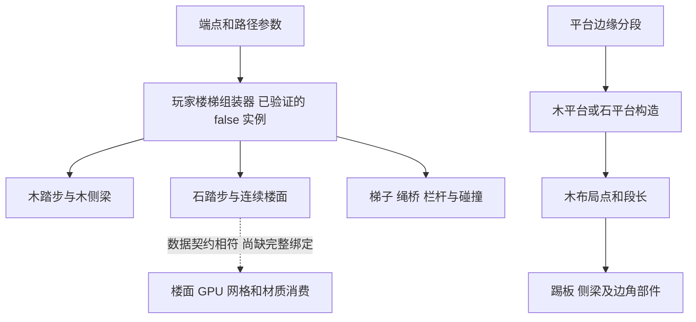

# Tiny Glade：踏步、平台与显示部件

这一部分最重要的区别是：玩家绘制楼梯与平台边缘楼梯有不同的构造入口。发行版同时包含路径采样、石砖实例、木板实例、连续楼面、踢板和侧梁；不能用一个“总高度除以固定步高”的公式解释所有结果。

本文采用匹配 EXE/PDB 的离线指令证据。坐标与常数使用游戏内部单位，没有证据将它们等同于米。RVA、制品身份与复核范围见 [楼梯证据账本](15-tiny-glade-stair-evidence-ledger.md)。前置路径和端点规则见 [端点与路径](11-tiny-glade-stair-anchors-and-paths.md)，支撑与更新分别见 [支撑](13-tiny-glade-stair-supports.md)、[局部重建](14-tiny-glade-stair-local-rebuild.md)。

## 1. 发行版中的职责划分

| 系统 | 已验证的入口或直接调用 | 本轮可以确认什么 |
| --- | --- | --- |
| 玩家楼梯视觉组装 | `playermade_stairs_assemble<false>`，RVA `0x5AB920` | 同一组装器调用木踏步、石踏步、楼面、侧梁、栏杆、梯子、绳桥和碰撞构造；它按不同分支组合这些部件 |
| 玩家木踏步 | `construct_wooden_stair_steps_impl`，`0x8B3700` | 消费相邻路径点和其他并行数组，计算踏板位置，选择性采样地形，并写木板实例 |
| 玩家石踏步 | `construct_stone_stair_steps`，`0x8A5870` | 消费相邻路径点，执行高度/宽度处理和随机分割，写石砖实例 |
| 玩家连续楼面 | `gen_stone_stair_floors`，`0x8A2D40` | 有独立几何构造、材质与网格块处理入口；没有把它等同于逐阶石砖 |
| 平台楼梯 | `construct_platform_stairs`，`0x7F6500` | `0x7F74E1` 调用木平台构造 `0x140DBE0`；`0x7F7635` 调用石平台构造 `0x1411410` |
| 平台木件布局 | `wooden_stair_layout`，`0x24B4D90` → `emit_wooden_stair_layout`，`0x24B5270` | 先生成分段布局，后按形状类别生成木件、踢板和侧梁 |

`<false>` 是 PDB 中的模板参数，不在这里推断为“低画质”或“非编辑模式”。`<true>` 的另一个组装器已定位，但没有开展对等的完整算法分析。本文只把已解码 `<false>` 的直接调用作为这条组装链的证据。

箭头表示本轮已见直接调用或数据职责；虚线明确保留 CPU 到具体 shader 实例绑定的缺口。此图没有建立实际帧调度顺序。

## 2. 玩家木踏步：先消费采样，再调整踏板位置

### 2.1 相邻样本是输入，步数不是在此统一决定

`0x8B3783–0x8B3820` 将若干数组组成遍历状态，并按可用长度取交集。循环从相邻记录取位置、高度和其他样本；`0x8B3A81–0x8B3AB1` 取两个相邻点并计算两高度的最大值。它不是从一个“总高差”在本函数入口计算全部台阶。

路径细分有自己的入口和公式，见 11。细分点数、后续子段分类、最后实际可见踏步数是不同层次。本轮没有恢复所有分支的最终台阶计数，不能把曲线点数减一无条件称为整条楼梯的台阶数。

### 2.2 普通分支的地形抬高

在提供地形采样资源的分支，函数先计算相邻点水平位置的中点，调用 `TerrainHeightFloatGrid` 的双线性采样 `0x2202D0`，再加 `0.15`，与两端高度的最大值取最大。

对有限输入，可将这段局部规则写成：

\[
H_0=\max(h_i,h_{i+1}),\qquad
H=\max\bigl(H_0,T((p_i+p_{i+1})/2)+0.15\bigr).
\]

证据：中点与调用 `0x8B3ABE–0x8B3B12`；加偏移和最大值 `0x8B3B17–0x8B3B3A`。未提供采样资源时跳过这一项。这里的 `p` 指水平位置；不能将地形资源缺省解释为“地形永远为零”。

后续 `0x8B3B65–0x8B3BA8` 平均两个宽度样本，并算出几何标量：

\[
\bar w=(w_i+w_{i+1})/2,\qquad
s=0.486(1-0.15\bar w).
\]

普通分支在 `0x8B3C20` 从上述高度减去 `s/2`，随后两次调用 `xvy` 将两个水平位置与同一个调整后的高度组合。另一个条件分支直接沿输入点保留位置，不能给所有木件套用“统一抬平”。`s` 确实参与这个垂向偏置，但其原字段名、全部几何用途和有效宽度约束没有完整恢复；本文不将它擅自定名为固定板厚，也不补入发行版没有证明的 clamp。

### 2.3 随机细节与实例边界

函数有多次 `fastrand::Rng::f32` 调用。例如 `0x8B3B46–0x8B3B53` 将一次结果乘 `0.2`，后面还结合迭代序号组成局部数据。`0x8B3A0F` 明确写入 `SparseInstanceBufferWriter<WoodenPlankSsbo>`。这说明木板有独立实例表示；并不意味着已经恢复每个随机数的美术语义或稳定种子的完整规则。

### 构造演算：地形抬高一段踏板

前置状态：进入带地形资源的普通调整分支；相邻样本高度为 `1.00`、`1.20`，中点地形 `1.30`，宽度均为 `1.0`。这些是构造输入，不是游戏默认配置。

1. 两端最大高度为 `1.20`。
2. 地形候选高度为 `1.30+0.15=1.45`，因此 `H=1.45`。
3. `s=0.486×0.85=0.4131`，局部位置高度为 `1.45−0.20655=1.24345`。
4. 两个水平端点通过 `xvy` 使用这个共同高度；板的其他维度、随机外观和最终材质另行生成。

结果：该局部位置会随地形抬高。演算没有证明整条楼梯与建筑的接缝在运行中完全无穿透。

## 3. 玩家石阶与连续楼面分开生成

`construct_stone_stair_steps` 首先读取输入三维点。`0x8A591E–0x8A5941` 用第一对点的 X/Z 差求水平距离 `d`，`0x8A595A–0x8A5966` 计算 `floor(0.56/d)`，再转换为无符号整数，供后面的遍历状态使用。这是对输入采样间距的处理；不能把 `0.56` 宣称为统一台阶高度，也不能把这个整数独立宣称为整段石阶数量。

`0x8A5B85–0x8A5BA0` 对相邻点的高度差取绝对值并与 `0.6` 取最大；后面的石块构造还调用 `random_splits` 和随机数，最终 `0x8A69B2` 向 `BrickTransformSsbo` 写入实例。它是“路径样本 → 局部石块部件”的构造，而不是直接复制一个整段石阶网格。

连续楼面另由 `gen_stone_stair_floors` 构造。已确认组装器的两条直接调用：`0x5AFB40`、`0x5AFF12`。石踏步的调用则是 `0x5AFC06`、`0x5B0B1D`。这些分离入口足以说明楼面与踏步具有不同构造职责；完整三角形索引布局、所有平台连接处的封口规则仍未逐一恢复。

### 构造演算：采样间距参数不是步高

前置状态：两个石阶输入点的水平距离 `d=0.20`，高度差 `0.12`。

1. 间距相关整数为 `floor(0.56/0.20)=2`。
2. 相邻高度差相关标量为 `max(0.12,0.6)=0.6`。
3. 两个结果进入不同位置的后续构造；不能将它们合成为“生成两级、每级高 0.6”的结论。

这个例子明确了本轮恢复的参数边界，完整最终石块数量仍需要继续追遍历器与生成分支。

## 4. 平台木楼梯：先建立等分布局

### 4.1 可直接恢复的分段公式

`wooden_stair_layout` 读取参数中的两个三分量坐标 `q0`、`q1`，以及 `+0x18` 的目标间隔 `a`。它在 `0x24B4E03–0x24B4E29` 用三分量平方和求长度：

\[
L=\|q_1-q_0\|_2.
\]

当 `L≤0.01`，走未生成布局的返回分支。其返回首字使用 Rust 容器的特殊表示，本文不凭该字值单独恢复原始返回 enum 名。普通有限输入的规则是：

\[
a'=\max(a,0.01),\qquad
N=\max(1,\lceil L/a'\rceil),\qquad
\ell=L/N.
\]

证据：下限 `0x24B4E2E–0x24B4E54`，`ceilf` 调用 `0x24B4E58`，计数转换与下限分支在其后；`0x24B4F3E–0x24B4F43` 保存 `L/N`，`0x24B5130` 将它写入返回结果 `+0x18`。

函数分配 `N+1` 个布局记录，并按 `t=i/N` 插值三分量坐标：

\[
q_i=(1-t)q_0+tq_1,\quad i=0,\ldots,N.
\]

每个记录为 16 字节：插值坐标占前三个 `f32`，第四个标量按输入形状类别另算。`0x24B501A–0x24B50C0` 包含不同形状的分支，其中出现平面/投影和径向距离计算。该标量并不是由名字猜出的“地面高度”；完整类别 enum 与结构字段名仍未知。

### 4.2 布局并不等于最终可见部件

木平台构造的真实调用位于 `0x140F164→0x24B4D90`、`0x140F299→0x24B5270`；另一路为 `0x140FC92`、`0x140FDC2`。发射器先消费布局记录，再按形状类别进入不同生成路径。

已验证的部件入口：

- `add_wooden_riser`（`0x24B49E0`）：发射器在 `0x24B5A17` 处理起端，`0x24B5A74` 遍历中间布局，`0x24B5AE2` 处理末端。末端会用最后两条记录外推一个标量，因此末端不是简单复制中间记录。
- `add_wooden_stringer_plank`（`0x24B61C0`）：发射器在 `0x24B5C2D`、`0x24B5CD3`、`0x24B5E72`、`0x24B5FE5` 调用；辅助函数有端点差、三维长度和归一化计算。
- `add_straight_halftimber_span`（`0x24B6730`）与 `emit_corner_band`（`0x24B6DE0`）：分别位于不同形状分支。圆形分支还包含角度、周长与循环余数处理。
- 木平台构造另调用 `extend_bottom_risers_to_terrain`（`0x24B6B90`）与 `add_ramp_collision`（`0x24B7100`）。本轮确认真实调用，没有完整恢复这两个辅助函数的算法。

这解释了为什么楼梯的外观连接不能只处理一张踏面：起端、末端、踢板、侧梁、边角和碰撞各自有规则。但这些局部入口不足以证明任意形状都使用相同部件数量。

### 构造演算：三维长度控制平台布局

前置状态：进入普通有限布局分支；坐标 `q0=(0,0,0)`、`q1=(3,1,0)`，间隔 `a=0.4`。

1. `L=√10≈3.16227766`。
2. `N=ceil(3.16227766/0.4)=8`。
3. 生成 9 条布局记录，参数依次为 `0,1/8,…,1`。
4. 相邻坐标差为 `(0.375,0.125,0)`，返回段长 `ℓ≈0.395284708`。
5. 后续发射器再决定具体木件和首末端处理。

结果：布局两端精确覆盖输入段，普通等分段长不超过输入间隔。9 条记录不是 9 级台阶，也不是 9 个最终木板实例。若段长为 `0.005`，该函数不生成布局；若 `a=0` 且长度正常，则用 `0.01` 的下限进入计算。

## 5. GPU 证据能补到哪一层

本轮解码了 `nani_stairs_floor.precomp` 的四个内嵌 SPIR-V 模块。顶点模块确实声明 `StairsFloorInstanceData`：`mesh` 位于 0，`color_id` 位于 32，`material_id` 位于 36，两个 padding 位于 40、44。嵌套 `NaniTrimeshChunk` 包含 GPU 地址、顶点/索引计数、顶点字节偏移和包围球。

片元模块含石楼面与木楼面的高度、法线、种子和粗糙度纹理资源。这支持“楼面几何与材质细节分开表达”的判断。仍缺逐字段的 CPU 写入、pipeline 创建和实例绑定闭环，不能仅凭名字断言每条楼梯都经过这份程序。

另外三份 `rocky_terrain/stairs/` 程序包含 compute、counter 与 indirect draw 的模块，处理地形、路径/水域 mask 和独立 `Stair` 数据。它们已作身份和模块边界复核，尚未与玩家楼梯生产者对齐；不能把这条地形阶梯 GPU 管线拼进上述玩家楼梯链。

## 6. 可独立采用的实现原则与剩余缺口

由这些发行版证据可推导的独立实现结构是：先生成路径/端点/高度/宽度样本，再分类子段；逐段生成踏板与楼面；另行生成踢板、侧梁、支撑和栏杆；为可视、碰撞、光追保留不同产物身份；最后由局部失效决定哪些边需要重做。此结构是我们整理的行为规格，不是恢复的 Rust 源码。

未做：没有运行游戏或读取存档，没有验证真实默认步高、所有平台形状、完整楼面三角形拓扑、所有随机项、底部踢板地形延伸算法，或 CPU 到 shader 的所有绑定。原因是本轮以请求的四项核心问题为边界，部分泛型组装和材质绑定仍需进一步静态追踪或另行获准的运行观察。

风险：字段和 enum 名不完整；浮点公式在普通有限输入上解释，退化/非有限输入不能由演算补全；线性解码不证明所有字节可达，直接调用不证明实际帧顺序。最适合下一轮验证的是：记录同一路径改变端点高度后的最终踏步数量，以及平台首末端、圆形接缝和底部延伸的具体分支。
