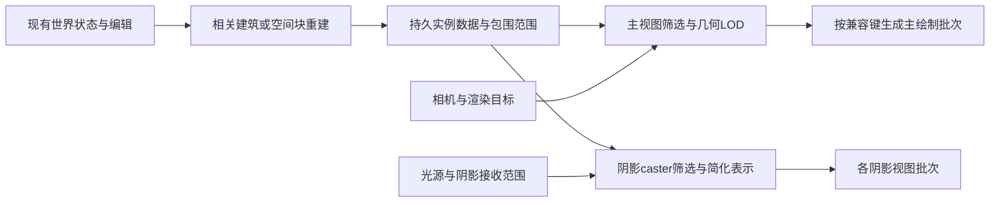

# 从 Tiny Glade 到综合 demo：实例批次、LOD 与阴影的具体取舍

本篇交付可用于独立实现的设计清单。原作事实分别见 [117：实例批处理](117-tiny-glade-instance-batching-and-submission-costs.md)、[118：LOD 与几何成本](118-tiny-glade-lod-selection-and-geometry-costs.md)、[119：阴影范围和预算](119-tiny-glade-shadow-cascades-and-work-budgets.md)，两轮可见性见 [115](115-tiny-glade-steady-culling-and-submission.md)。**以下分块大小、批次上限、像素阈值、阴影策略和演算参数均是独立设计建议，不是恢复的 Tiny Glade 配置，也没有适配用户工程。**

这轮没有读取 `3DSandboxTest` 的文件、日志或 Editor；没有运行参考游戏、Unity、GPU 或 Profiler。这里讨论“减少哪类工作”，不能保证任何 FPS，也不诊断用户报告的约10 FPS。

以下是本篇建议的职责关系，属于独立设计示意：



## 先保留产物，再组织可见批次

已有建筑、地形和损坏状态继续作为逻辑权威；表现层只维护可再生缓存。一次编辑令相关建筑/空间块失效，完成生成后更新其实例区间和包围盒。相机移动通常只改变可见集合和 LOD；它不应让未改变的墙、砖和屋瓦重新排布。光照或调色参数变化也不自动使几何失效。这里是接口职责建议，没有另建世界状态、存档格式或第二套时间系统。

重复砖瓦可复用基础网格和材质，每项保存变换、颜色/样式等实例数据，并用稳定逻辑ID关联其建筑所有者。交互、存档和损坏引用逻辑ID；GPU槽位与压紧后的数组下标只属于表现缓存。删除或重建释放相关 allocation，缓存版本不符的生成结果不提交。CPU数组和GPU buffer都按容量复用，增长时另记扩容事件，不在每个显示帧重新构造全部数据。

建议按**空间块＋兼容绘制键**组织批次。绘制键包括 mesh/submesh、material/shader pass、渲染层、LOD 与投影策略；颜色/seed走该shader明确支持的实例属性，避免给每片砖复制材质。空间块可先用一栋小建筑或局部区域，再以目标场景调整。块太大时包围盒松散，屏外实例更容易留在批次；块太碎则增加筛选、列表与提交。不要先把全地图同材质物体合成一个巨大bounds。

Unity 6.0 的 [RenderMeshInstanced 官方契约](https://docs.unity3d.com/6000.0/Documentation/ScriptReference/Graphics.RenderMeshInstanced.html)说明，批内实例作为一个整体做 bounds 裁剪/排序，单次可用数量受实例数据影响，文档给出的1023上限不能无条件当默认；默认双矩阵数据对应511。自定义结构额外字段也不会自动成为shader输入。因此 API 切批上限、颜色传递和批次bounds应作为后端契约固定。本篇没有核对用户实际Unity版本、管线或shader。

构造演算：12个可见空间块，每块2个非空绘制键，每键300个实例；假设后端允许且我们示例选用每批256项，则一个视图、一个pass的API提交为 `12×2×ceil(300/256)=48` 次，覆盖 `12×2×300=7,200` 项。几何实例数仍是7,200；阴影、深度/速度pass、其它材质及引擎内部拆分另算。48不是原作draw数，也不是48倍或150倍的时间收益。

首版可采用 CPU 管理的实例批次与空间筛选。需要GPU生成候选列表时，再引入间接提交。[RenderMeshIndirect 官方契约](https://docs.unity3d.com/6000.0/Documentation/ScriptReference/Graphics.RenderMeshIndirect.html)允许CPU或GPU生成命令参数、单次API处理多个命令，但bounds仍控制整体裁剪，参数布局应使用平台支持的 `IndirectDrawIndexedArgs`。不要把原作的20 B命令记录直接当跨平台Unity结构，也不要仅换成Indirect API就宣称已有逐实例GPU裁剪。

## LOD 必须减少几何或表示成本

[118](118-tiny-glade-lod-selection-and-geometry-costs.md)把实际资源计数接到屋瓦条件链：普通网格30三角形、LOD1为12；backface属于另一路36三角形资源。它给出一个明确方向：**远处仍保留实例时，可以通过更简单的网格降低每实例几何量。** 原作的距离门、raw标志、atlas编号和运行开关各有条件；不要把“coarse提交回调”、几何LOD和HZB采样mip混成同一种LOD。

自研首版建议准备两级表现：近处保留影响轮廓和接缝的几何，远处减少瓦片内部切分、背面和不可见的小体积；更远处若需要，改为连续屋面加自制纹理/法线细节。远景不能填死真实门窗、改变主要轮廓，碰撞和存档也不随显示LOD切换。纹理替代是否保住风格与轮廓，仍需未来画面验证。

阈值可按建筑/构件包围范围的投影像素估计，减少分辨率、FOV和对象尺寸变化带来的不一致。对透视相机、正向深度 `d>r` 且包围球相对距离较小的构造近似：

```text
pixelDiameter ≈ renderTargetHeight × radius / (depth × tan(verticalFov / 2))
上一状态为Fine：pixelDiameter < 24 时转Low
上一状态为Low：pixelDiameter > 32 时转Fine
其它情况保持上一状态
```

24/32只是可讨论的初值，取实际渲染目标高度而非Editor窗口尺寸；大范围、近裁剪面和非透视相机需各自的投影处理。采用滞回可避免边界反复切换；同一建筑或合理簇使用一致规则，避免逐片闪烁。渐隐可留待确实出现突变问题时引入，它也增加混合、片元或双份绘制成本。LOD判断只换缓存中的网格/列表，不重跑程序化排布。

构造演算：20,000项中2,000项近处用24三角形，18,000项远处用4三角形，源三角形引用量为 `2,000×24+18,000×4=120,000`，全用近模为480,000。四分之一只是这组构造参数的几何量比例，不含像素、阴影、材质、剔除或时间收益；它与原作30/12网格另算，不能混作原作节省75%。

## 阴影用独立资格、范围和简化表示

[115](115-tiny-glade-steady-culling-and-submission.md)及 [119](119-tiny-glade-shadow-cascades-and-work-budgets.md)显示阴影视图有独立候选与级联工作。自研应为墙体、屋面、小瓦、草叶和装饰分别声明投影策略。保留大形体投影；只在近处保留确实影响画面的砖瓦小细节；中远处可由简化屋面/建筑代理承担。阴影代理仍须尊重真实开口与主要轮廓，不能用封闭盒把门窗或桥下空间全部遮住。

caster选择不能只复用主镜头可见实例。屏外建筑仍可能把影子投到镜头内；应使用光源空间/接收区域所需范围，或依靠既有管线的caster裁剪。若使用额外代理，需让代理只进入阴影路径并关闭对应细节的重复投影，避免同一形体被额外绘制两份。主视图细节、阴影细节和物理网格是三个职责。

级联数、阴影距离、每级有效像素和过滤质量分别预算。[Unity 6.0 阴影级联性能说明](https://docs.unity3d.com/6000.0/Documentation/Manual/shadow-cascades-performance.html)明确指出更多级联会增加阴影pass中的draw calls；取舍需要兼顾画质。独立demo可先从一盏主方向光、较短阴影范围和较少级联开始，保留一档低成本质量设置。地图大不等于阴影必须覆盖全地图，灯笼和小灯也不自动获得实时投影；这些是美术/产品选择，未改用户当前默认设置。

构造上界：2,000个caster代理、每个12三角形、2级联，若全部同时进入两级则为 `2,000×12×2=48,000` 个源三角形引用；实际相交筛选可减少它。这个上界不代表每个实例必画两遍。另假设两层**各自完整**的1024×1024、每像素4 B目标，名义存储为8 MiB；改2048边长是32 MiB。它不是原作或Unity的真实分配，不能拿固定总atlas被切成多个tile的情况套这条公式，也没计mip、对齐、压缩、临时目标和过滤。

## 一个可实施的职责顺序

| 顺序 | 独立demo的具体产物                      | 缓存何时变化                                         | 后续实现时应能读出的计数                 |
| ---- | --------------------------------------- | ---------------------------------------------------- | ---------------------------------------- |
| 1    | 建筑/空间块拥有实例区间，共享网格与材质 | 编辑、增删、破坏、资源改变                           | 重建对象数、实例条数、上传字节、扩容次数 |
| 2    | 空间块筛选后生成兼容绘制批次            | 相机/对象bounds/可见性改变；无失效时复用相应数据     | 候选/可见实例、非空绘制键、每pass提交数  |
| 3    | 两级网格和显式切换/滞回                 | 当前视图越过阈值或质量配置变化                       | 各LOD实例数、切换数、源三角形量          |
| 4    | caster策略与简化阴影代理                | 建筑形状、灯光、接收范围或质量变化                   | 各阴影视图caster数、几何量、目标尺寸     |
| 5    | 规模确有需要时加入GPU筛选/间接列表      | 其输入和资源版本变化；按设计逐帧筛选的部分仍逐帧执行 | 列表容量/溢出、筛选耗时、主/阴影GPU时间  |

这些计数区分“编辑生成慢”“提交多”“几何多”“像素/阴影重”；它们是未来实现的可观测接口，不是本轮采集结果。共享材质、合理分块与明确LOD/投影规则已经足以形成首版方案；完整两轮HZB、私有稀疏分配器和原作recorder只有在真实规模需要时才值得增加。

本篇算术已在 `.cache/procedural-modeling/tiny-performance-batching-lod-shadows/demo-cost-examples.json` 做离线复核；该文件只存构造参数和结果。公共API来源固定为上述Unity 6.0页面，与Tiny Glade制品证据分开。运行时间、画面等价性、适配用户工程与性能收益均 **Not Run / Unknown**。
