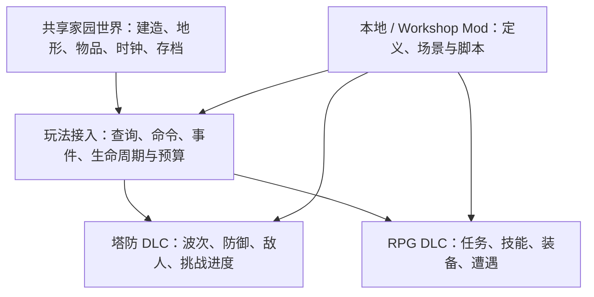

# 家园沙盒的玩法 DLC：塔防、RPG 与玩法 Mod

**当前产品目标是“共享家园世界 + 可选玩法模块 + 可扩展规则”，玩法包属于正式范围。** 本体提供沙盒建造、休闲钓鱼和家园生活；官方 DLC 可以把同一座家园接入塔防或 RPG 玩法；玩家 Mod 能新增内容、编排事件和扩展玩法逻辑。前一版只按外观包安排首阶段，范围过窄，本篇修正该取舍。

2026-10-21，Pacific Time。本篇是独立产品与工程建议，不是原游戏的恢复实现，没有检查 `3DSandboxTest`，没有运行或安装任何目标/框架。平台分发基础沿用 [123](123-steam-workshop-and-dlc-design-for-demo.md)，外部参考与脚本边界见 [125](125-gameplay-mod-runtime-lifecycle-and-references.md)。名称、字段和算例均为拟议契约，接项目时先对齐已有权威与真实代码。

## 三层职责

| 层             | 应当承担                                                                            | 不应因此产生的第二权威                                   |
| -------------- | ----------------------------------------------------------------------------------- | -------------------------------------------------------- |
| 共享世界与服务 | 对象身份、建筑/地形事实、空间查询、现有资源与物品账本、时钟、命令验证、保存与切世界 | 每个 DLC 另写一份房屋、库存、世界保存器或独立游戏时间    |
| 可选玩法模块   | 塔防波次/寻敌/胜负，RPG 任务/技能/战利品，模式 UI/输入上下文，以及模块自己的进度    | 模块直接改底层 mesh、物理对象、原始存档或绕开资源校验    |
| 创作者 Mod     | 模型/定义、地图/遭遇、规则变体、任务和受控脚本；可依赖本体或特定玩法包              | 订阅即授权、任意修改其他包的数据、各自创建每帧全世界扫描 |

塔防包可注册敌人、塔、波次与挑战规则；RPG 包可注册任务、交互、职业/技能与遭遇。战斗/寻路等共享能力只在出现两个真实消费者或存在明确现有服务时复用，不要求提前构建一个大而全的通用战斗引擎。首次塔防闭环可以带来最小攻击/受击接口，RPG 后续依赖它或明确提出新增能力。

图中连线表示服务或声明依赖，不表示所有模块同时运行，也不表示 Mod 可直接写另一模块的内部状态。

## DLC、玩法模式和代码载体分别设计

**DLC 是交付和使用资格，玩法模式决定世界怎么运行，Mod 是第三方扩展来源。** 一个付费塔防 DLC 可以包含编译好的模块、资源与规则；一个免费 Mod 也可以利用开放接口做出独立玩法。不要用 `isDlc` 同时代表可信代码、已购买、已安装、已启用和当前游戏模式。

| 包类型           | 能扩展到什么程度                                          | 对运行程序的要求                                                                      |
| ---------------- | --------------------------------------------------------- | ------------------------------------------------------------------------------------- |
| 数据玩法包       | 新塔/敌人/物品、数值、波次、任务图、已有行为组合          | 必须已有解释这些定义的能力；把 JSON 名称写成新行为并不会创造实现                      |
| 脚本玩法 Mod     | 新寻敌策略、事件链、特殊任务条件、技能/遭遇编排、规则组合 | 需要版本化脚本接口、有限查询与命令、调度/保存/失败处理                                |
| 官方代码玩法模块 | 新战斗系统、RPG 控制/相机、核心模拟等超出已有接口的能力   | 按实际平台编译交付；可随基础 Player 更新提供未激活的模块，再由 DLC 激活，资源另行交付 |
| 高权限代码 Mod   | 比脚本 API 更深的程序扩展                                 | 属于另一套兼容与执行契约；保留未来路线，不把任意 DLL 装载作为首个方案的隐含前提       |

Steam 允许 DLC 使用独立内容或随基础文件提供内容、由游戏检查资格；它没有限制 DLC 只能改外观。[Steamworks DLC](https://partner.steamgames.com/doc/store/application/dlc#Configuration)

若项目采用 IL2CPP，不能把“下载一个 C# DLL/AssetBundle”当作通用新逻辑加载方案。AssetBundle 主要承载资源；AOT 与反射/裁剪有自身约束。正式代码模块预编译、数据/脚本包后加载是可讨论的组合，不代表本项目已经采用了该后端或已有脚本运行器。[Unity AssetBundle](https://docs.unity3d.com/6000.0/Documentation/Manual/AssetBundlesIntro.html)、[Unity 6.3 IL2CPP 限制](https://docs.unity3d.com/6000.3/Documentation/Manual/scripting-restrictions.html)

## 玩法接入的最小接口

| 接口职责 | 塔防例子                         | RPG/Mod 例子                                  | 权威和成本边界                                                      |
| -------- | -------------------------------- | --------------------------------------------- | ------------------------------------------------------------------- |
| 查询     | 在有界区域找可攻击实体、申请路线 | 查询交互标签、任务目标、技能目标              | 返回带世界身份的句柄/只读结果；限制范围与结果量，长任务异步         |
| 命令     | 请求生成一批敌人、攻击或修理     | 使用技能、发起对话、提交任务奖励              | 既有世界/资源所有者复核目标、资格、数量和当前模式，模块得到明确结果 |
| 事件     | 建筑变更、路径失效、敌人死亡     | 鱼获、交互、任务状态变化                      | 只发布已提交事实；事件带实例/世代/去重身份，不由监听者猜操作成功    |
| 定时     | 下一波、攻击冷却                 | Buff 到期、限时目标                           | 使用现有模拟时钟和调度；暂停/读档/切世界不创建第二条时间线          |
| 表现     | 波次 HUD、攻击特效、防御编辑工具 | 对话/技能栏、任务指引、第三人称或其他控制方式 | 按模式注册输入与 UI 上下文，退出时解除；不永久覆盖本体工具          |
| 持久化   | 波次号、存活敌人状态、结算进度   | 任务阶段、技能/状态和模块进度                 | 模块只提交自己的数据块，随同一个保存事务写出，不自行覆盖主存档      |

不要把接口最初固定为“只能换参数”。应允许注册类型化的规则处理器和事件响应，数据包引用已登记行为，脚本 Mod 通过同一命令层组合它们。需要新增原生能力时升级接口版本，不通过脚本偷取 Unity 对象和内部私有字段补洞。

## 同一家园能切换玩法，玩法是否组合另有契约

安装包集合、世界启用集合和当前运行模式分别保存。建议首版一个家园同时只运行一个主玩法会话，建造/生活服务仍复用；以后是否允许“RPG 角色参加塔防”、钓鱼触发守家事件，需要声明兼容的规则组合，不能只按 Mod 加载顺序决定胜负逻辑。

关键争议点是资源发放、玩家死亡、建筑损坏、敌人派系、时间推进、暂停和输入。若两包都拥有互斥的控制规则，应拒绝组合并说明原因；若允许组合，由一个明示的组合模式拥有规则入口，继续调用同一套资源/世界服务。不能用“最后订阅的包胜出”化解行为冲突。

进入玩法前检查内容/API/依赖、当前世界能力、DLC 使用资格和保存迁移。注册成功只表明可选，玩家明确开始会话后才生成敌人或切换控制；退出要停调度、取消任务并释放监听/UI/输入，再保存可恢复的模块状态。

## 家园损坏与卸载后的保存保护

家园是否会永久受损尚未由用户决定。建议初版提供**可恢复的挑战模式**：以家园布置作为战场，工程上可通过正常世界/存档分支管理一个战斗副本；让玩家明确选择保留挑战分支或返回原家园。它是建议，不是本轮替用户冻结的产品政策；若要同一活动世界的永久损坏，必须另定该模式的写入/修复和失败规则。

不要战斗结束后把整座家园静默恢复到旧快照，否则可能抹掉战斗中合法建造。若采用副本，其每个活动世界仍只有一个正常世界权威，不额外造一套只供渲染/碰撞使用的假世界。奖励由明确的会话结算身份走现有资源提交，不能把战斗副本的所有库存直接复制回家园。

建议在现有保存根扩展以下逻辑记录；名称不是强制格式：

- 采用的包/接口版本、活动模式和玩法会话身份。
- 每包带独立 `stateSchemaVersion` 的状态数据；独立数据块不等于独立保存事务。
- 待恢复的事件/定时语义、必要实体引用和 RNG 状态；恢复事件订阅与状态迁移分开。
- 已提交的结算/进度身份，沿用现有幂等提交能力；若项目没有该能力，应明确实现与验证，不能只加一个内存布尔值。

缺塔防包时不能继续其战斗存档，但可保留数据并在满足本体依赖时打开独立家园。若塔/道具本身也是缺失定义，则按 [123](123-steam-workshop-and-dlc-design-for-demo.md) 的缺依赖策略处理，不能删除后直接保存。缺 RPG 包时同样保留任务/装备状态，不能把读不懂的数据当无效垃圾清掉。

## DLC 与社区 Mod 的依赖关系

允许两条创作路线：只依赖基础开放能力的独立玩法 Mod，以及依赖官方塔防/RPG 接口的扩展 Mod。后一种需要声明所需包、接口版本及 DLC；前一种不应因为“也是塔防题材”被错误绑定官方 DLC。题材相同不构成依赖，实际用到的定义/能力才构成依赖。

Workshop 条目的 DLC 依赖展示只是软依赖，游戏还要检查该包能否使用。[ISteamUGC AddAppDependency](https://partner.steamgames.com/doc/api/ISteamUGC#AddAppDependency)

例如社区 `creator.frost-defense` 依赖官方塔防包，新增冰冻塔和波次脚本；它上传自己的资产与规则，引用官方资源 ID，不把官方付费资源重新打包。多人如需支持，再明确谁需拥有哪个 DLC、谁运行权威脚本、客户端需要哪些定义/资源；不能由“Host 有 DLC”自动推出所有玩家都能加入。

## 一个可检验的塔防闭环

以下是构造例子，未运行，数字只是便于演算：

1. 玩家在自己的家园修筑两座塔；选择塔防挑战，验证包/API/资格，建立会话 `D17`，家园原档保持可恢复。
2. 官方波次定义要求生成 12 个敌人。调度器按有限批次提交生成命令，记录实际成功实体；未成功生成不能算作已击杀或已完成。
3. 冰冻 Mod 订阅已接受命中的事件，通过允许的状态命令给目标附减速；它不直接改 Transform 或物理对象。射程、目标是否还活着与会话身份由状态所有者复核。
4. 假定 12 次生成均成功，玩家在第 5 个敌人死亡后保存。候选存档包含剩余 7 个敌人、波次、减速到期语义及本次结算状态，全部成功后才提交；读档只恢复该状态，不重放最初 12 次生成。
5. 第 12 个敌人死亡后，结算提交奖励 30 单位到指定现有账本。重复收到波次完成回调仍只提交一次；崩溃后恢复也要由保存与资源事务证明，而非示例自行保证。
6. 如果 Mod 在结算前抛错，停止相关会话/处理器并报告故障，保留可诊断状态。此前已提交的合法变更不被假装回滚；不能无条件奖励、宣布胜利或清掉原档。

RPG 的最小对应例是：一次与家园 NPC 的交互触发任务 → 指定鱼获事实满足任务 → 提交一次奖励 → 保存/加载保持阶段 → 卸载任务 Mod 时保留该任务记录。它复用现有钓鱼/交互/物品事实，不把简单任务包扩成第二套库存。

## 性能与下一片范围

未启用的玩法包不注册活动 Tick、寻路、寻敌或敌人实例；本体建造/钓鱼不应持续支付全部 RPG/塔防模拟成本。启用后成本见 [125](125-gameplay-mod-runtime-lifecycle-and-references.md)，预算覆盖所有 Mod 合计、核心查询和完成提交，不能只限制脚本语句。

建议下一片是**一个脱离 Steam 的塔防玩法包 + 一个会改变行为的本地 Mod + 战斗中保存/恢复**，使用自己的测试资产，验证建造地图确实影响路径、防御和玩法结果。随后接 Workshop 分发与正式 DLC 资格；RPG 再用一条任务/技能闭环检验接口能否复用。这里只建议一条竖向样片，不要求先完成通用 RPG、所有组合或任意代码插件框架。

当前已明确的是正式产品方向、模块职责和关键失败边界；实际现有接口、脚本后端、永久损坏政策及联机权限仍待项目设计/验证。所有运行、安装、平台操作和用户项目检查均 **Not Run**。
