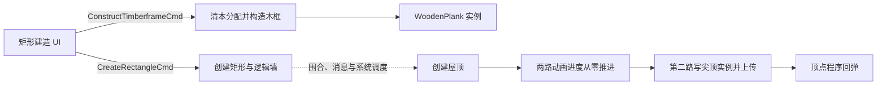

# Tiny Glade：木框到成品的状态链与动画交接

2026-10-21，Pacific Time。续接 [129：木框生成](129-tiny-glade-timberframe-placement-preview.md)和 [130：出现动画](130-tiny-glade-placement-animation-and-demo-priorities.md)。本篇只查本机发行制品；未启动游戏、附加进程、读取私人存档或检查用户 Unity 工程。独立 demo 的建议另见 [132](132-demo-building-feedback-state-and-update-budget.md)。

**新增接通了矩形 UI → 木框消息 → 木板实例，以及新屋顶 → 零进度 → 尖顶实例上传这两段。** 新建确认、已有建筑编辑结束、历史回放使用不同入口。完整链仍有明确缺口：输入枚举到所有确认/取消手势的对应、墙/屋顶生成调度到最终绘制的发布时机。不能把这份静态结果称为逐帧无缝交接已经通过。

## 链的结构与证据强度



实线表示下文核对的调用或带类型数据连接，不表示所有节点在同一帧同步完成；虚线是仍需结合既有墙/屋顶管线、调度屏障继续补齐的边界。木框、提示线、逻辑墙、屋顶动画和实例缓冲各自有所有者，不能画成一个模型换材质。

| 用户关心的操作 | 本轮已建立的静态连接                                                             | 仍未建立的保证                                                    |
| -------------- | -------------------------------------------------------------------------------- | ----------------------------------------------------------------- |
| 确认新建       | UI 写 `CreateRectangleCmd`；消费者建曲线、调用 `InnerWalls.new_wall`，并写历史   | 所有输入状态的命名；木框消失与成品首帧的精确交接                  |
| 取消候选       | 离开选定建造模式会把 Preview 判别写零；木框消费者每次进入先 clear 再读未消费消息 | Esc/右键/工具切换的全部入口；取消是否立即撤销本次已排入的木框消息 |
| 连续修改       | 有独立 Edit 消息、当前墙状态写端和 dirty 集；旋转路径实际调用增量插值            | 所有尺寸/朝向工具统一采用同一平滑曲线；快速改形状后的 GPU 发布帧  |
| 撤销/回放      | 历史处理器可把在途 ReplayBuffer 的选定动画字段置零；墙回放回到状态修改入口       | 每种撤销是否都触发立即完成；取消播放与普通撤销是否视觉相同        |

## 木框确实从建造 UI 产生，清理发生在消费端

`ui_create_rectangle` VA `0x140ADC7A0` 的匹配 PDB 包装器 `0x140AA8370` 在 `0x140AA9080` 实际调用该函数。其签名中，第 13 个参数是三个 writer 的 tuple，第一项是 `ConstructTimberframeCmd`，另两项为隐藏区域树木和木框声音。按该函数 Windows x64 栈布局，第 13 参数在 `0x140ADC7CC` 从 `[rsp+0x290]` 取到 `rbx`；至 `0x140ADCFF7–0x140ADD056` 的写端没有更换这个来源。

该写端以 `index*5*8` 寻址 40 B 消息项，写 raw 形状判别 `1`、24 B 矩形数据、一个选定状态字节及消息 ID，随后增加消息长度和总计数。位置分别为 `0x140ADD028 / 02C / 033–045 / 04A–056`。这里的状态字节含义未完整恢复，不把它擅自命名成“允许放置”或“退出动画”。

消费端的包装器 `0x140FE3860` 有真实 `MessageReader<ConstructTimberframeCmd>`、`TimberframeInstanceBuffer`、`AssetSsboLibrary`、梁计数和地形/基础参数缓存；`0x140FE3AF3` 实际调用矩形生成器 `0x141F4EFC0`。这补上了 [129](129-tiny-glade-timberframe-placement-preview.md) 尚缺的消息类型连接。

生成器先取得自己持有的稀疏实例分配，在 `0x141F4F284` 调用 `Writer.clear`，然后才在 `0x141F4F28A–0x141F4F310` 计算 reader 的两段未消费区间。每项 40 B；检查形状判别后才构造矩形梁柱，见 `0x141F4F370–0x141F4F3F3`。实际 `WoodenPlankSsbo.default/push` 和分段规则沿用 129。

**构造演算，非运行观察：** 若这个消费者本次被调度，且 reader 没有新的矩形消息，它已经执行本分配的 clear，随后不会由矩形分支补回梁柱。因此清理不必依赖每个候选都另发一个“删除木框实体”命令。但这不能证明系统每帧必运行，也不能排除本次清理后仍读到较早排队的候选；GPU 上传及同帧显示仍是后续边界。这里清的是本分配，不是所有建筑木板。

初始化 `add_timberframe` 内还有 `chain_ignore_deferred` 注册调用（`0x1406C44AE`）。其存在不能替代完整系统顺序证据，也不能推断此处强制刷新了 ECS deferred Commands。

## 确认新建与结束修改是两条路径

新建的选定分支在 `0x140ADD3FB` 调 `GladeBorder.is_shape_inside`。失败跳到 `0x140ADD5E6` 发反馈并回到预览路径；通过后组装创建参数，`0x140ADD67A` 调用带类型的 `MessageWriter.write<CreateRectangleCmd>`，目标 `0x141B75220`。该调用身份由 PDB 和实际 E8 目标共同确认，不靠相邻通用 helper 的别名猜类型。

`create_rectangle` `0x140A4BB50` 中，`0x140A4C193` 将矩形转为曲线，`0x140A4C240` 调 `InnerWalls.new_wall`；颜色取得、墙属性设置和历史写入在同一消费者内，选定历史调用包括 `0x140A4D670`、`0x140A4D723 / 817 / 8A2`。不能把 UI 消息入队当作已生成全部网格或已提交 GPU。

已有建筑的连续编辑则使用 `EditRectangleCmd`。`edit_rectangle` `0x140B761F0` 在 `0x140B762E4` 重算曲线，`0x140B762F2` 进入 `_try_update_state`，再在 `0x140B76333–0x140B76350` 把相同 WallId 加入 `InnerWalls+0x60` 的修改集合并更新矩形表示。它会修改正式的逻辑墙，不能把原作所有编辑都解释成只移动一份临时模型。

`finish_edit_rectangle` `0x140ADD6F0` 的匹配签名是：只读 InnerWalls、可写 WipRectangle/History/装饰存储与归档器，读 `FinishEditRectangleCmd`，写编辑完成与提示事件。选定变化分支构造 CompoundEdit 并在 `0x140ADDBDD` 调 `History.add`；相应收尾在 `0x140ADDD01` 将 Wip 判别写零。选定近似未变分支通过归档器恢复装饰存储（`0x140ADDCEC`）。这不是已经证明的通用“取消建筑并回滚一切”。

## 取消：候选失效、提示线退场和世界回滚需要分别看

`ui_create_rectangle` 前部检查 AppMode 的选定判别；不匹配时跳到 `0x140ADCDC7`，在 `0x140ADCDCA` 将 Preview 的判别写零后返回。这个分支不经过本函数尾部的 `CreateRectangleCmd` 写端。结合木框“先清、再按消息生成”，可以推导候选停止供给后存在释放显示的路径；还不能说所有取消手势都已经映射到这个分支。

提示线有自己的退场体系。`signifier_animation_t` 在 `0x140B725D0–0x140B72609` 根据选定 optional 状态改变时间步长的符号，按 duration 推进并夹到 `[0,1]`；`0x140B7274F` 调 easing，再写处理后的值。`despawn_marked` 的 `0x1409225F2–0x140922616` 检查可选动画记录的原始进度 `+0x14`，非零或 NaN 时不进入该删除分支；符合条件后 `0x140922642` 才调用 `EntityCommands.despawn`。标记系统另有两个浮点字段的比较，字段名称尚未恢复；不能把“被标记”与“立刻销毁”混用。

这些是 **signifier 提示实体** 的证据，不是木框梁都这样淡出。木框所选 shader 没有同名独立进度成员，沿用 130 的限制。

还有一个应避免的误认：`restore_in_progress_wall_appearance` 的两个已核直接 caller `0x140A51CE2 / 0x140A51E44` 均属于自由画墙 `draw_wall`。它确实恢复墙字段并发通知，却不能仅凭名字拿来证明矩形候选取消。未穷尽间接调用或内联写端。

## 连续修改：确认的是增量追赶，不是排队播放完整动作

旋转消费者 `do_ui_edit_rectangle_rotate` 的 `0x140B3F16E` 从 GameTime 所选 `+0x28` 取步长；本次调用把当前增量设为零，把期望角度差作为目标，在 `0x140B3F19C` 调 `ShapeVal.interpolate`。随后对结果做 sin/cos，计算新矩形并进行边界检查。不是每次拖动都创建一个从固定初始姿态播放到底的 AnimationClip。

`ShapeVal.interpolate` `0x1419BDC40` 同时支持标量和双分量。对**有限数、非负 dt、匹配的 variant**，所查公式可重组为逐分量：

```text
d = target - current
exponentialStep = abs(d) * (1 - exp(-20 * dt))
linearStep = min(abs(d), 2 * dt)
step = sign(d) * max(exponentialStep, linearStep)
next = current + step
```

依据 `0x1419BDC78–0x1419BDD19` 与 `0x1419BDD26–0x1419BDDCE`。**这里取步幅较大的一个；2 不是最大速度限制。** 小差值用线性项完成收敛，大差值主要由指数项追赶。类型不匹配另走 panic；NaN 的指令处理不被上面的有限数公式覆盖。原单位取决于消费者，不把“2”当所有建筑参数统一的米/秒。

算术例：dt=1/60，差值 1 的指数步约 0.283469、线性步约 0.033333，采用约 0.283469；差值 0.01 的两项约 0.002835 与 0.01，采用 0.01，局部直接到目标。本次旋转调用使用零当前增量；不能据此声称原作另有保存 previous tween 的统一动画对象。

## 成品出现：第二路屋顶进度已经接到尖顶记录

`create_roof` `0x14280DD10` 在 `0x14280E0B7` 调 `RoofAnimation.new`。后者 `0x140A007D0` 返回两路零浮点，创建器将其保留并写入待 spawn 的 bundle（`0x14280E1C8 / 1CD`），`0x14280E24C` 调 `Commands.spawn`。这里是新屋顶的初始状态；不能外推为已有屋顶每次重铺瓦都把进度归零。

动画包装器 `0x141F46190` 的 query 明确包含 Roof、可写 RoofAnimation 和可选 RoofMarkedForDeletion，并在 `0x141F46270` 调真实动画系统。系统根据删除标记的组件存在性选择回退/推进，在 `0x14280863C / 66C` 更新第一/第二 float，均夹到 `[0,1]`。正常推进第二路受**更新前**第一路大于约 0.99 的门控制。速率和 flat 分支见 130；这仍不是实测固定时长。

本轮进一步闭合尖顶消费：

| 环节         | 实际证据                                                                                                                                 |
| ------------ | ---------------------------------------------------------------------------------------------------------------------------------------- |
| 选中尖顶对象 | 包装器 `0x141F0FBE0` 的 query 为 `(Roof, RoofAnimation)` 且 `With<RoofSpire>`，真实 call `0x141F0FD41 → 0x142801B00`                     |
| 收集输出     | `place_roof_spires` 的 `0x142801D86 → 0x140FC8440` 收集 `RoofSpireSsbo`，中间 filter iterator 实际调用 `0x141F0FF80` 的形状回调          |
| 进度字段     | 回调 `0x141F0FF9C` 读 `RoofAnimation+4`，`0x141F10092` 写返回 Option 的 payload+16；成功 payload 共 32 B                                 |
| shader 对应  | `instanced_roof_spire.precomp` vertex 模块偏移 159，type 28 的 member 1 为 `roof_animation_t`，MemberDecorate Offset=16（文件偏移 1639） |
| 上传         | `0x142801DB1` 计算 `count<<5`，范围检查后 `0x142801DFA` 调 `update_buffer_bytes`                                                         |

因而 **RoofAnimation 第二路 → 32 B 尖顶记录+16 → shader 的 roof_animation_t → 130 的衰减回弹公式** 有字段级依据。回调还筛屋顶类型和屋脊比例；不是每种屋顶都生成尖顶。这里只接到了所选实例上传和 shader 读取，未重新恢复全部最终 draw binding 或实测 GPU 执行顺序。

## 撤销与打断：有结束在途动画的入口，不等于全部撤销瞬移

`history_process` `0x140B699E0` 根据 HistoryCmd 的一个 raw 字节分派。所选四项表在 `0x14305AE2C`；raw case 3 到 `0x140B69C70`，`0x140B69C80` 实际调用 `ReplayBuffer.make_animations_instant`，随后走消息通知及 PendingHistoryCommands 的清理分支。其他分支会保留/添加待处理历史命令。

该 helper `0x140B6AE40` 遍历现有 bucket、48 B 回放命令及某类嵌套 24 B 项，对分派选定的不同字段置零，如 `0x140B6AF40 / 5C / 65`、`0x140B6B040 / 70`。这证明它主动修改在途回放，不能由函数名直接宣布所有字段都代表时长、所有回放都已完成。

墙回放系统 `0x141C24750` 在 `0x141C24996` 调 `WallReplayEditCmd.process` `0x140C1C8B0`；后者所选分支按 elapsed/duration、clamp 和 cubic easing 得到插值，再进入实际墙状态操作。逻辑写端和历史单位详见 [62](62-tiny-glade-history-snapshots-and-regeneration.md)。`HistoryCmd.interrupt` 返回的原始紧凑值又与上述 case 3 不同，不能把“用户按撤销”“取消回放”“立即完成所有动画”当同一个已证状态。

**有界结论：** 原作有在途历史动画的专门处理能力；本轮没有证明撤销到达时会如何处理每个木框、每个屋顶和每个旧 GPU 结果，也没有取得取消后重新出现/快速撤销重做的画面证据。

## 身份、复核与剩余断点

目标仍为 `C:/Software/Steam/steamapps/common/Tiny Glade/tiny-glade.exe` 与相邻 PDB，PE x64、preferred base `0x140000000`；沿用 129 的 EXE/PDB 身份。本轮检查文件长度和所选指令，没有重新计算摘要。REA 的既有 Ghidra 超时仍适用；未重复启动相同全程序分析。新增证据来自现有 DbgHelp、dumpbin、PE 字节与既有 SPIR-V 解析记录，**是普通本地文件证据，没有新的成功 REA 深分析 Evidence ID**。

原始结果位于忽略目录 `.cache/procedural-modeling/tiny-placement-lifecycle/`：带查询覆盖的符号 JSON、有界函数反汇编、调用者解析、selected-anchors.json。正式复核入口为 [placement_lifecycle_probe.py](tiny-glade/tools/placement_lifecycle_probe.py)：17 个直接调用、15 个指令锚点、四项历史分派、插值常量及一个 shader 字段偏移；它只读文件，不执行目标。锚点匹配不证明整函数语义或适用于别的版本。

下一次若只补静态，优先两个断点：一是 ActionSet/UiState 的 raw variant 到确认、取消及模式切换生产者的精确对应；二是矩形候选停止供给、墙/屋顶 deferred spawn、实例上传与 draw 提交之间的先后条件。不要继续泛查所有动画名字。运行后再核对确认/取消是否闪空、连续改形状是否抖动、撤销是否出现旧结果；本轮均 **Not Run**。

## 2026-10-22 后续补证

[133](133-tiny-glade-confirm-cancel-input-mapping.md) 补上默认 Enter/Escape、A/B 与动作字段、点击和尺寸拖动的区别，以及 Escape 经默认模式请求到候选清理的接受分支；结束原始值 0/1 不能命名为取消/确认。[134](134-tiny-glade-preview-handoff-schedule-and-publication.md) 补上主程序配置的 45 项普通 chain、五条具体消费者注册和屋瓦 PrepareRendering flush。此前“完整输入对应与发布顺序未知”的范围由这两篇进一步缩小；右键/控制器到全部画布操作、历史门禁后的最终接受、最终 deferred 图与首帧呈现仍未证明。运行项继续 **Not Run**。
