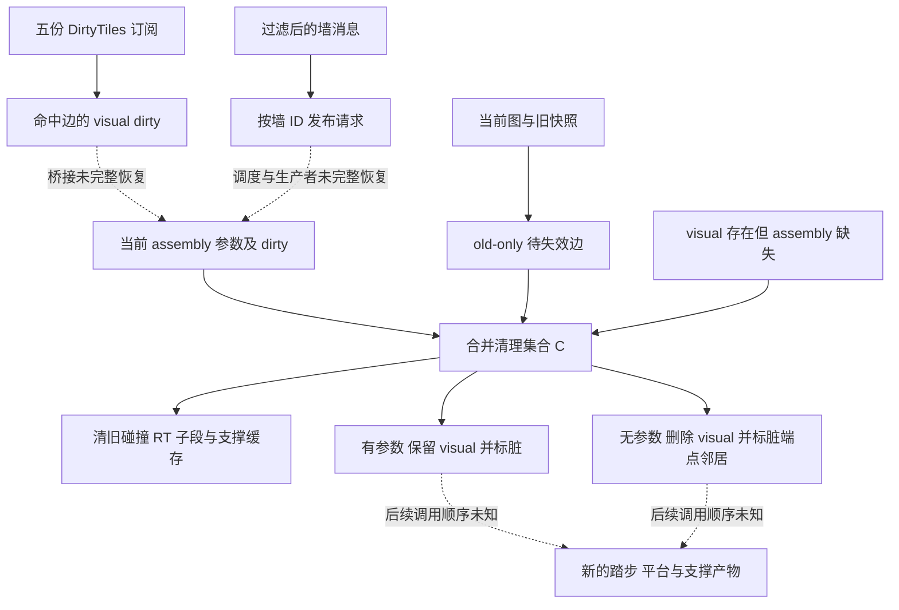

# Tiny Glade：建筑变化后的楼梯局部重建

发行版可以确认按地块订阅和楼梯边身份选择失效范围，并分别清理显示、碰撞、光追与派生缓存。仍存在组装参数的边保留显示记录并标脏；已经没有组装参数的边删除显示记录，并标脏两端相邻楼梯。这是局部产物生命周期的规则，不是已经恢复完整帧调度器。

本文区分两个 dirty：`PlayermadeStairsAssemblyParams` 的组装标志，以及 `StairsEdgeVisualState` 的显示标志。后者怎样触发新的组装参数计算，仍没有完整证据闭环。几何生产者见 [端点与路径](11-tiny-glade-stair-anchors-and-paths.md)、[踏步与平台](12-tiny-glade-stair-treads-and-platforms.md)、[支撑](13-tiny-glade-stair-supports.md)；身份与解码范围见 [证据账本](15-tiny-glade-stair-evidence-ledger.md)。

## 1. 三类状态必须分开

| 状态 | 已验证的用途 | 容易混淆的地方 |
| --- | --- | --- |
| `StairsState` 当前邻接索引与备份 | 提取边/孤立节点差异，维护待失效边集合 | 当前图并不是所有后续清理分支查询的集合 |
| 当前 assembly 参数列表 | 每条记录 `0x150` 字节，含边身份和组装 dirty | 清理中的“仍存在”查询使用该列表收集的边集合 |
| visual map | 边 → `StairsEdgeVisualState`，含 tile 订阅与显示产物 | 显示 dirty 与组装 dirty 有不同偏移与不同写入者 |

assembly 记录 `+0x128/+0x12C` 是两端 `u32`，转换为 identity：`(first<<32)|second`。assembly dirty byte 为 `+0x148`。`StairsState+0x148` 则是一个待失效集合，两者恰好偏移相同，不是同一对象。

visual 哈希桶每条 `0x140` 字节：前 8 字节是边键，后 `0x138` 字节是 value。写入“桶末尾减 7”相当于整个桶 `+0x139`，但 value 内偏移是 `+0x131`。本文统一以 value 偏移称呼显示 dirty，避免把键和值混成一个布局。

## 2. 从快照中取出消失的边和孤立节点

`StairsState::extract_diff_and_make_backup`（RVA `0xA60A40`）从旧备份和当前邻接索引各收集 token 集合。

实际遍历规则为：

- 对节点 `u` 的邻接 `v`，只发出 `u≤v` 的 `(u,v)`，避免同一无向边被两端各发出一次。
- 节点没有邻接边时发出 `(u,u)`，保留孤立端点身份。
- `reduce_diff` 在旧、新集合中成对取消公共键；得到 old-only 与 new-only。
- old-only 两端经 `min/max` 规范化后加入 `StairsState` 待失效集合。
- 克隆当前索引与附属状态，更新旧备份，并写状态标志。

证据：`0xA60A7A–0xA60C9D`、`0xA60CA8–0xA60D82`；公共键取消 `0xA5F0A5–0xA5F0EE`；规范化边与 stub 生产 `0x17CC0A0–0x17CC318`。备份成员并未全部命名，不在此推断完整存档格式。

### 构造演算：一条边消失后出现孤立节点

前置状态：旧图为 `10—20—30`，另有孤立 `40`；新图只保留 `10—20`，`30` 与 `40` 均孤立。

旧 token 为 `{(10,20),(20,30),(40,40)}`；新 token 为 `{(10,20),(30,30),(40,40)}`。取消公共键后，old-only 为 `{(20,30)}`，进入待失效集合；new-only 为 `{(30,30)}`，保留在差异结果的另一侧。当前图成为下一次比较的备份。

这是状态规则演算，没有运行游戏，也不证明单独修改某个建筑参数一定产生这种图变化。

## 3. 地块订阅限制显示更新范围

`stairs_subscribe_lazy`（`0x894A80`）构造五个 `Subscriber<DirtyTiles>`：三个来自 `RaycastWorld` 的 channel `0/1/9`，两个来自另外两份资源的 Publisher。`RaycastWorld::subscribe_to_changes`（`0x9EF480`）使用 `world+channel×0x390+0x170` 定位 Publisher。

本轮没有恢复通道 enum 和两个资源的原字段名，不能擅自把 `0/1/9` 命名为建筑、草或地形。

`playermade_stairs_assembly_propagate_dirty_flags`（`0x8970C0`）消费并合并发布的 dirty tile。辅助函数 `0x14E3AF0` 遍历 `0x200` 字节，也就是 64 个 `u64` bitword：

\[
\text{flat}=64w+b,\quad x=\text{flat}\ \&\ 63,\quad y=\text{flat}\gg6.
\]

通过最低位定位与清除逐一取出 tile，再编码为两字节 `(u8 x,u8 y)`。对每条现有可视边，只有它的 tile HashSet 非空、且包含当前 tile 时，才写 visual value `+0x131=1`。

证据：`0x8975C2–0x8976DC`；tile 解码 `0x14E3B30–0x14E3B99`；集合查找与写 dirty `0x14E3BFE–0x14E3CD0`。这是订阅集合相交，不是本函数内的包围盒或三角形相交。tile 对应的世界尺度，以及每条楼梯如何生产覆盖集合，仍未知。

### 构造演算：仅重做订阅到变化地块的边

前置状态：dirty tile 是 `{(3,2),(4,2)}`，对应 word 2 的 bits 3、4；楼梯 A 订阅 `{(1,2),(3,2)}`，B 订阅 `{(7,8)}`，C 订阅为空。

逐 tile 查集合后，只有 A 的 visual dirty 变为 1。B、C 在这段逻辑中不变。这个例子确认筛选规则，但没有证明 A 的组装 dirty 在同一个时刻也被写入。

## 4. 墙事件还有单独的过滤与发布入口

同一传播函数消费两个消息窗口。记录 stride 为 `0xB0`，只处理 `u32[event+0x80]==7` 的记录。已验证两条路径：

1. `DecoratorStorageAddr::try_as_wall` 转换成功，`PublicWalls::get` 找到墙，并且有限浮点字段 `wall+0x288≤3.0`。
2. event 首个 qword 标签 `≤2`、`event+0x10` 的 qword 为零，`event+0x18` 的 wall ID 能找到墙，且同一浮点字段满足条件。

符合条件时，写资源 change tick，并向发布缓冲追加 16 字节 `(sequence,wallID)`，递增长度和 sequence。证据为 `0x897410–0x8975B7`。

这里确认了“墙消息进入楼梯更新请求”的实际过滤，但标签 7、外层标签和墙浮点字段名仍未知。因此不能将这段简化为“只要墙高度变化就更新”，也不能把 3.0 当作全游戏统一墙高上限。

构造检查：标签 7、墙字段为 2.5 时可通过该有限值条件；3.1 不通过；标签 6 即使字段为 2.5 也不进入。NaN 不纳入上述有限值简写。

## 5. 旧子分段是缓存，不是重新求几何

在消费变化消息前，传播函数遍历现有 assembly records，将 `+0x130` 起的 `StairSubSegment` 列表复制到按边 identity 索引的 SmallVec 缓存。拷贝入口 `0x14E2400`、`0x14E3700` 的实际指令可见。

证据：`0x8972F6–0x89732F`、`0x14E2470–0x14E24D5`、`0x14E37D0–0x14E37EA`。这是保留旧分类结果的阶段；标签 6 的停止语义和完整消费者尚未贯通，不能由名称直接称为“重算已完成”。

## 6. 失效集合的精确构造

`invalidate_dirty_stair_artifacts`（`0xC429D0`）可按实际数据流整理为如下规则。伪代码是我们整理的规格，没有复制反编译源码。

令：

- `D`：从 `StairsState` take 出的待失效集合，原槽随即变为空集合。
- `P`：**当前 assembly 参数列表**收集出的 edge set。
- `V`：visual map 的键集合。
- `M=V\P`：有旧显示、没有当前组装参数的边。
- `A`：assembly 记录原 dirty 为 1，或其边已在 `D∪M` 的边。

遍历 assembly 时，符合条件的记录 dirty 写 1，其他记录写 0；收集 `A`。最终清理集合为：

\[
C=D\cup M\cup A.
\]

证据：take 与换空 `0xC42A27–0xC42B4E`；集合建立 `0xC42C02–0xC42E3B`；`V\P` 的查找跳过条件 `0xCA8464–0xCA84D0`；assembly 标记谓词 `0x19B1940–0x19B19D8`。

`P` 不是当前 `StairsState` 图的别名。即使两者通常相关，也不能在规格中替换它们。

## 7. 旧产物分别释放，范围并非都相同

| 产物 | 筛选范围与动作 | 证据 RVA |
| --- | --- | --- |
| edge → u32 映射 | 对 `C` 中每条边移除该键 | `0xC43014` |
| `ColliderMeshInstance` map | 键为 `(edge,subindex)`；只检查 edge 是否属于 `A∪M`，命中则清掉对应所有子键 | `0x17BCA54–0x17BCC2C` |
| 三份 `RaycastWorld` | 对 `C` 的每条边分别 `remove_collider`，并释放返回 Arc | `0xC43265–0xC43346` |
| visual，边仍在 `P` | 保留记录，只写 value `+0x131=1` | `0xC43480–0xC43602` |
| visual，边不在 `P` | `remove_edge`，随后标脏其两端点的现存邻接 visual | `0xC4334C–0xC43422`、`0xC43824–0xC43A8F` |
| RT mesh | 用 `(tag 2,(u<<32)\|v)` 为每条 `C` 边移除网格句柄；存在时释放 Arc 并标 RT 资源变化 | `0xC4361C–0xC43752` |
| 子分段与支撑类型缓存 | 按相同边 identity 移除 SmallVec 与 `StairArchWallSupportType` 条目 | `0xC4361C–0xC43752` 及 map helper |

三份 RaycastWorld 的原语义名没有恢复。`A∪M` 与 `C` 在两种碰撞产物中的使用不同，不应该将所有操作概括成一个“删除所有碰撞体”的统一过程。

### 显示删除怎样发生

`StairsVisualState::remove_edge`（`0xB15430`）只有找到边键时才搬出其 `0x138` 字节 value：drop 两个稀疏实例 allocation 槽，释放 tile 集合和若干 vector，标记 visual resource 变化，再从旧实体列表逐项排队 `EntityCommands::despawn`。

despawn 进入命令队列，不证明实体在这条指令后已经即时离开 world。allocation 的全部用途、vector 原字段名和命令 flush 位置仍未恢复。

### 邻接扩散只在删除边分支发生

只有 `e∉P` 的删除路径，才遍历两个端点当前邻接列表，规范化邻接边并标脏其 visual。保留边的路径直接跳往 RT/缓存清理，绕过邻接遍历。

邻接边不会在这个函数内递归加入 `C`。标脏邻居与当场清掉邻居全部缓存是不同动作，这个区别决定了独立实现能否真正保持局部更新。

### 构造演算：删除一边，只扩散到端点邻居

前置状态：

`P={(10,20),(20,40),(50,60)}`，`V=P∪{(20,30)}`，`D={(20,30)}`；只有 assembly 边 `(10,20)` 预先 dirty。当前节点 20 邻接 10 和 40。

1. `M={(20,30)}`，`A={(10,20)}`，`C={(10,20),(20,30)}`。
2. `(10,20)∈P`：保留 visual 并标脏，移除其受影响旧产物。
3. `(20,30)∉P`：删除 visual，排队旧实体 despawn，并移除该边碰撞、RT 和派生缓存。
4. 删除分支查端点邻居，令 `(20,40)` visual dirty 为 1；它没有在本次循环被递归加入 `C`，对应缓存也没有由这个 `C` 循环清理。
5. `(50,60)` 保持；state 的 `D` 槽已经换为空。

这是精确集合演算，不是游戏运行时性能或画面验证。

## 8. 重建管线与独立实现边界

可借鉴的原则是按边拥有产物、按订阅筛选环境变化、用显式快照差保留消失对象、按不同缓存契约清理，再将邻接扩散限定为确实需要它的分支。这些是可独立实现的行为规格；没有恢复开发者设计意图。

未做：没有启动游戏、捕获帧、读取私人存档，也没有复原 ECS scheduler、visual dirty 到 assembly dirty 的全部桥接、tile 覆盖生产者和命令 flush 顺序。尚未证明建筑的每一种拖拽变化具体进入哪条消息分支，或一帧内是否完成所有重建。

风险：资源字段名与事件 enum 不完整；不能由直接调用推断时序，不能由局部集合规则推断全场景性能。需要进一步追踪请求消费者和 dirty 读取者，才能将“局部失效已确认”提升为“建筑修改到新产物的完整时间链已确认”。
