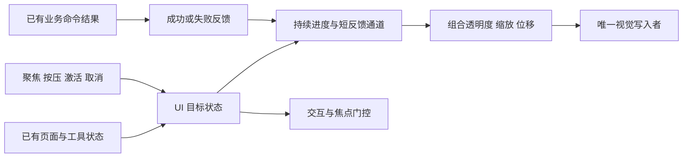

# 综合 demo：可打断的休闲建造 UI Motion 独立规格

2026-10-22，Pacific Time。依据 [144 的 Tiny Glade 静态研究](144-tiny-glade-ui-motion-static-chains.md) 提炼独立设计。本篇的界面层级、时长、位移、透明度、错峰和输入门槛都是**我们的建议**，不是原作已恢复参数。本轮不修改、检查或运行用户项目。

**建议做一套小型、可组合、可反向的动效规则。** 大界面负责进退，按钮负责聚焦和短反馈，按钮组负责展开顺序。视觉动画只消费已有 UI 状态和命令结果，不建立第二份建造、背包或游戏状态。

## 先分清六种不同的变化

| 类别           | 驱动原因                         | 建议表现                             | 关键规则                                              |
| -------------- | -------------------------------- | ------------------------------------ | ----------------------------------------------------- |
| 界面进退       | 打开/关闭页面、暂停菜单          | 小距离位移＋透明度，轻微整体缩放可选 | 退出完成后才释放视觉节点；开始退出就关闭旧页交互      |
| 上下文展开     | 选中建造类别，出现一排工具       | 整排显现＋轻微向外展开；可选短错峰   | 父项掌管显示目标，各子项有稳定 ID                     |
| 聚焦           | 鼠标指向、键盘/手柄导航          | 轻放大、颜色/底板变化                | 导航和鼠标共用聚焦语义，移走可反向                    |
| 按下/激活      | 按住、释放并成功激活             | 按住轻压缩，激活短回弹               | 按压反馈、发出请求和业务成功分别处理                  |
| 选中/禁用/失败 | 持久选中、当前不可用、请求被拒绝 | 选中标记常驻；失败短脉冲             | 失败不能播放业务成功效果，持久状态不由 tween 完成决定 |
| 布局变化       | 项目增删、排序、文字变长         | 仅必要项平滑移到新布局               | 避免每个悬停都触发整个 HUD 布局变化                   |

原作已经确认的可借鉴点是“状态和进度分离、倍率组合、消费后重置、父子显示传播”。进入/退出的淡入位移和逐项错峰是我们独立补全的表现规则。

## 第一版参数：少而一致

以下使用 UI 逻辑单位，不是世界米；随 UI 缩放统一换算。先让同类交互一致，再靠实际试玩调整。

| 对象          | 建议时间            | 建议幅度                          | 曲线/播放规则                             |
| ------------- | ------------------- | --------------------------------- | ----------------------------------------- |
| 页面进入      | 200–240 ms          | 从下方 12–20 单位到 0，透明度 0→1 | ease-out cubic                            |
| 页面退出      | 140–180 ms          | 轻移 8–12 单位，透明度 1→0        | 从当前值开始，单独调退出节奏              |
| 子工具排展开  | 180–220 ms          | 各项缩放 0.9→1，向下偏移 6–10→0   | 每项延后 15–25 ms；整组新增延迟封顶 80 ms |
| 子工具排收起  | 100–140 ms          | 同时淡出、轻回缩                  | 默认不逆序逐个拖慢                        |
| 聚焦进入/移出 | 100–140 / 80–120 ms | 1→1.06–1.10                       | 从当前值向新目标缓出                      |
| 按住          | 50–70 ms            | 1→0.96                            | 释放、移出或取消时恢复                    |
| 激活脉冲      | 140–180 ms          | 1→1.08→1                          | 有界关键帧或一条连续脉冲                  |
| 失败反馈      | 160–220 ms          | 小幅压缩/回弹＋明确状态提示       | 不依赖只变红，避免整屏震动                |

Tiny Glade 工具栏的选定目标包含 1.2/1.5，**不建议直接搬到有长文字、钓鱼状态或背包格子的 HUD**。这些控件的密度和命中需求不同，先用较小幅度。

**构造例：一排六个按钮。** 自行取每项 180 ms、错峰 20 ms、组延迟上限 80 ms。开始时间为 `0,20,40,60,80,80 ms`，全组在 260 ms 内完成；不是六段 180 ms 串行，也不会因为按钮数量增长而等待数秒。收起可统一用 120 ms。

## 实现结构：状态决定目标，动画负责到达



每个稳定控件 ID 保存当前出现进度、聚焦值、按压值和短反馈状态；不在每次更新中重新创建 tween 或重新从起点播放。控件重新布局或换文本时保留身份；实际从数据模型删除时才终止其拥有的动画和订阅。

视觉组合可以由我们独立写成：

```text
alpha = parentAlpha * revealAlpha * disabledAlpha
scale = baseScale * revealScale * focusScale * pressScale * pulseScale
offset = pageOffset + revealOffset + feedbackOffset
```

每次从基准值和当前通道值计算，最后由一个写入者更新显示对象；不要让多个动画各自覆盖同一个 scale，也不要把上帧最终 scale 当成本帧基准继续累乘。原作的 `TaffyNode` 消费后归一提供了相似职责线索，我们用自己的表现结构实现。

页面和控件允许有不同规则，但共享通道含义：例如页面不用按压通道，按钮不拥有整个页面的遮罩。状态持久化继续由现有 UI/游戏模型负责，动画完成不授予物品、不确认建筑、不写存档成功。

## 连续点击、反向和切换的规则

出现/退出保留一个 `[0,1]` 的进度，目标为显示或隐藏，按方向推进。三次缓出可参考原作的数学结构，但页面退出也可以独立配曲线。**保持当前显示值连续，不等于速度也连续**；首版可以接受速度变化，若实际有明显顿挫再引入保持速度的插值器。

短反馈重复触发采取有界合并：同一按钮的激活脉冲从当前显示值开始重定目标，最多一个活动脉冲；不积压数十个播放请求，也不每次乘大一次。成功提示按业务事件去重，不能因为重复播放视觉动画而重复执行命令。

| 场景                       | 应有行为                                           |
| -------------------------- | -------------------------------------------------- |
| 打开到一半立刻关闭         | 从当前透明度/位置返回；不跳到完全打开再退出        |
| 关闭中重新打开同一页       | 保留当前值转向；旧完成回调失效                     |
| A 页切到 B 页又马上切 C 页 | 最终只有 C 能取得输入；过期 A/B 回调不能隐藏 C     |
| 展开未完成就切另一个类别   | 旧组退出，新组按新目标播放；未开始的旧错峰项取消   |
| 指向按钮后立刻按下并移出   | 聚焦、按压通道分别恢复；按既有点击契约判断是否激活 |
| 控件播放中被移除/回收      | 所有者结束播放并解除监听；复用给新 ID 时清掉旧反馈 |

建议每次页面/组目标变更递增一个本地 transition generation。完成回调仅在“节点 ID 仍相同、generation 相同、当前仍要求隐藏”时才清理或归还视觉节点。这个 generation 只防旧 UI 回调，不替代世界版本、联机请求号或存档身份。

**构造例：快速切页。** A 正在关闭，B 已进入 40%；此时切到 C。立刻停止 A/B 的输入资格，将 C 设为当前页，B 从当前值退出。之后 A 的旧完成回调到达，因为 generation 已变而忽略，不能把整个菜单根隐藏。该行为是我们定义的验收规格，原作相应退出发布链仍 Unknown。

## 布局和视觉移动分别选择

Tiny Glade 的选定工具栏会把动画倍率写进布局尺寸，能做出“按钮长大，邻居让位”的效果。自己的项目只在少量主工具或有意需要让位的区域使用它。主 HUD、长列表和背包优先保留稳定的布局占位，用内部视觉层做缩放、位移和透明度。

推荐概念层级为 `布局占位 → 动效视觉 → 内容`：布局占位决定格子、间距和导航顺序，动效视觉负责短时变换，内容只负责图标/文字。这样可以选择让视觉扩大而不推开邻居。是否让命中区域随视觉变化，必须明确：第一版建议保留稳定命中框、关闭项立即停止命中，不能让看不见的零透明度按钮继续挡住场景操作。

若列表确实发生增删或排序，先求最终布局，再对旧位置到新位置做短平移；把需要移除的视觉临时保留到退出完成。这个方案通常归为 FLIP 类重排思路，是独立候选，不是本轮证实 Tiny Glade 使用的算法。滚动中的长列表还需避免与滚动位移重复叠加。

**构造例：悬停与重排。** 一个 80 单位宽的背包格子放大到 1.08，其视觉宽变为 86.4，但布局仍占 80，邻居不移动；建造工具排若有意采用尺寸参与布局，则邻居会让位。两者都是可控选择，不应由不同按钮脚本偶然决定。

## Unity 落地与性能边界

先读取用户项目现有 UI 技术和所有权，再选实际实现方式；本轮没有做这一步，不指定第二套 HUD 框架，也不安装 tween 包。UI Toolkit 或 uGUI 都可以表达上述状态、通道和视觉层职责，具体 API、资产写入和验证按项目自己的规范执行。这里不依赖某个包版本的特殊接口。

第一版只调度仍在变化的控件：结束后移出活动列表，目标不变不重复启动动画，避免每帧分配闭包/等待对象和重复注册监听。一次组展开统一安排时序；长列表只为当前需要呈现的项维持活动视觉。文字测量、布局写入、遮罩和透明叠绘的实际成本需要在项目里采样，不能由参考游戏静态结果估算 FPS 收益。

UI 动画建议消费明确的实时时钟，暂停世界时仍能关闭菜单；它只用于 UI 表现，不添加第二个游戏时间权威。支持减少动态效果：关掉大位移、错峰和回弹，保留短淡入及明确选中/聚焦。窗口失焦、输入模式切换、分辨率/UI 缩放变化后重算基准布局，保留当前目标状态。

首批只做三个能直观看到收益的对象：**主工具按钮、展开的子工具排、一个可切换页面**。不先给所有 HUD 元素逐个写动画，也不把 3D 木框到成品的世界动画混进 UI 管理器。

## 待实施的验收清单

以下全部为 **Pending / Not Run**，不能因为规格或公式通过而标成产品 Passed：

- 原子状态：业务命令只发一次；成功、失败、取消和动画结束不会混淆。
- 中断：覆盖打开→关闭→再打开、A→B→C、展开中换类别、退出中控件回收，旧回调不影响新页面。
- 输入：鼠标与导航聚焦一致；隐藏/退出项不截获场景输入；需要的遮罩按页面契约持续阻挡。
- 画面：无首帧闪现、尺寸累乘、文字模糊/裁切、不可见热区；不同帧率与 UI 缩放下检查连贯性。
- 性能：分别比较稳定空闲与集中展开时的 UI CPU、布局次数、分配、绘制和透明叠绘；未采样不声称提帧。

本文交付独立行为规格，不包含原作资源、恢复的生产代码或对用户工程的实现。当前足以进入一个有边界的 UI Motion 实现切片；若用户要求更接近原作，再补 144 中两个明确的静态入口。
