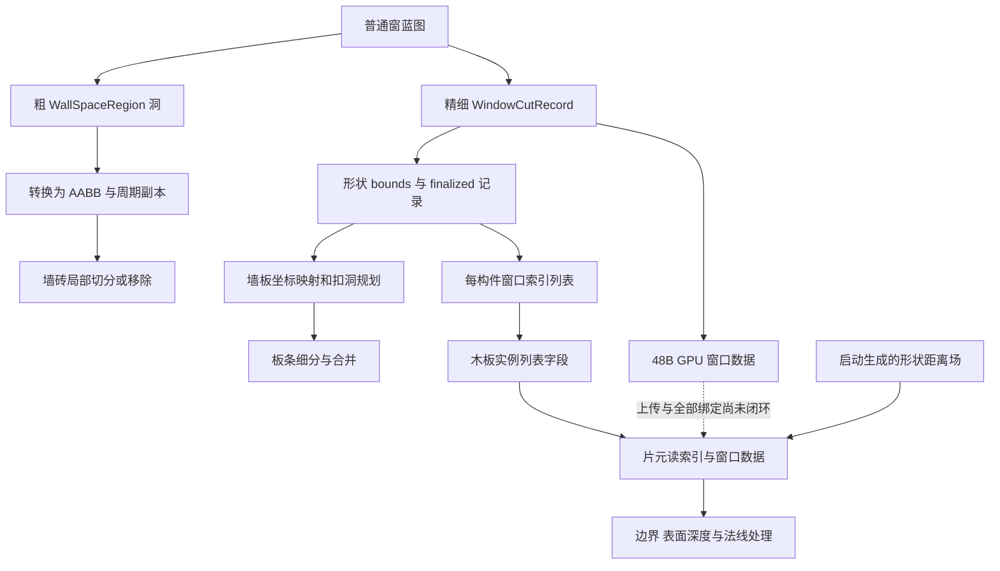

# Tiny Glade 普通窗户：砖、木板重建与精细洞形

普通窗户并不是仅在墙上放一个窗框模型。发行版可以确认两种洞描述：墙坐标中的粗矩形洞，和带形状编号、世界位置、水平法线的精细裁剪记录。砖块与木板有各自的 CPU 构造路径；部分木板实例还附带窗口索引列表，GPU 用窗口距离场处理可见边界、深度和法线。

前置放置与蓝图发布见 [16 窗户与墙洞生产](16-tiny-glade-window-placement-and-holes.md)，窗框见 [18](18-tiny-glade-window-frames.md)，窗边装饰见 [19](19-tiny-glade-window-autoclutter.md)。制品、地址规则和范围复核见 [20 证据账本](20-tiny-glade-window-evidence-ledger.md)。此前通用扣洞算法见 [04](04-tiny-glade-intersections.md)；本篇补普通窗户与消费者之间的具体连接。

所有数值使用游戏内部单位，没有证据直接等同于米。本文公式是对发行指令的重新组织，算例不执行原程序。

## 1. 三种记录不能混用

| 记录 | 本轮确认的表示 | 用途 |
| --- | --- | --- |
| 蓝图粗洞 | 20B：`WallSpaceRegion` 的中心、宽高四个 `f32`，以及洞类型 | 发布到 CPU 墙洞存储；finalize 后形成矩形范围 |
| 蓝图精细窗口裁剪 | 32B：墙坐标中心、水平法线、世界位置、形状字节和一个方向/侧别字节 | 发布到 `WindowCutRecords`，供精细候选列表及 GPU 数据构造 |
| 最终 CPU 精细记录 | 48B：16B AABB 加原 32B 记录 | 选择相关墙板/构件，处理周期边界 |
| GPU 窗口记录 | 48B，布局与上一个 48B **不同** | 木板片元读取世界位置、法线、形状层号与形状 bounds |

蓝图粗洞最初的四个浮点不是 `Aabb2` 的 min/max。`WallHoleStorage::finalize` 经 `Aabb2::from_center_dims` 将其转换。真正 `Aabb2` 的宽度 getter 为 `maxX−minX`，包含测试读取 `[minX,maxX]`、`[minY,maxY]`。两个 48B 记录也不能只凭大小相同直接 memcpy 对接。

## 2. 粗洞到实际砖块切分

已经确认的消费者是 `WallConstructor::from_curve<construct_walls::closure_env$3>`，RVA `0x1446690`。它在实际砖行处理过程中，`0x144888A` 调用 `split_brick_by_holes`（`0x815BE0`），不是仅有同名函数候选。

调用前生成局部砖记录，放进 `VecDeque<MyBrick>`；命中洞口后，该辅助函数调用 `resolve_hole_overlap`（`0x146C450`）处理局部砖集合。此链是专门的砖块操作，没有证明对整面墙进行任意三角形网格布尔。

### 2.1 先筛选，再按覆盖关系分支

`split_brick_by_holes` 对砖和洞范围做局部边界筛选。`resolve_hole_overlap` 检查洞宽高为正、待处理集合非空，再检测砖四角是否落在洞内；`Aabb2::contains` 包含边界。

四角命中数是分支入口：

- 四角全部被洞覆盖时移除砖。
- 部分角命中时进入对应切分/缩减路径。
- 零角命中仍有交叉覆盖路径，因为窗洞可以完全处在一块大砖内部。

角点测试位于 `0x146C75F–0x146C7BE`，跳表在 `0x330B288`。详细局部分支和此前验证边界见 04。本轮不把“存在角点分类”夸大为所有洞组合和退化情况已经解释。

### 构造演算：放窗后改变砖集合

前置状态：用墙坐标边界表达一块砖 `B=[0,4]×[0,3]`，粗窗洞 `H=[1,3]×[1,2]`。

1. 洞宽高为正，并与砖范围交叠。
2. 砖的四角均不在洞中，因此进入零角命中的交叉处理分支，不能直接保留整砖。
3. 若另取 `H=[−1,5]×[−1,4]`，四角都命中，进入整砖移除路径。

结果：砖集合会因窗洞而变化。第一种输入的最终分块数在这里没有完整恢复，不能套木板的四条矩形差集结果。

## 3. 粗板区域与精细窗口列表分别构造

本轮解码 `construct_wooden_wall_boards<construct_walls::closure_env$9,$10,$11>`（`0x144A4C0`）并确认如下调用：

| 调用位置 | 实际目标 | 含义 |
| --- | --- | --- |
| `0x144A98E` | `FinalizedWindowCutRecords::records`，`0xA6A370` | 取得 finalized 记录范围 |
| `0x144A9B7` 及四个其他位置 | `0x13E9710` 的 AABB 映射迭代器 | 初始化精细窗口候选列表；不能仅由它连接到粗板差集 |
| `0x144AB3E`、`0x144BDC3`、`0x144D7FD` | `plan_vertical_wall_boards`，`0x1485B80` | 竖向板规划 |
| `0x144EC2E` | `plan_horizontal_wall_boards`，`0x14877D0` | 横向板规划 |
| `0x144FD91` | `plan_circle_horizontal_wall_boards`，`0x14899D0` | 圆形墙的横板规划 |

这三个规划器分别在 `0x1485C39`、`0x1487864`、`0x1489B1F` 调用 `subtract_wall_cutouts`（`0x1484710`）。后续存在板块细分、过大板分割与窄板合并；例如横板/圆形横板直接调用 `merge_narrow_planks_horizontal`。因此“扣除后的数学区域”与“最终板条数量”是不同层次。

第十一轮进一步确认：粗规划器实际经 `1484310 remapped_wall_cutouts` 读取 `FinalizedWallHoles.holes_no_duplicates`，过滤raw类型并追加拱洞范围，再送矩形差集；`13E9710` 则构造每构件精细窗口列表。这里纠正此前将精细范围直接接到粗差集的解释。完整板布局和两条输入链见[43 木墙板](43-tiny-glade-wooden-wall-board-layout.md)。

### 3.1 有正面积才进行矩形差集

`subtract_wall_cutouts` 用 `Aabb2::intersects_non_inclusive`：仅接触边缘不算有效面积交叠。以区域 `B=[x0,x1]×[y0,y1]`，交集 `I=[l,r]×[b,t]` 为例，一条已恢复路径可重新表达为：

\[
\begin{aligned}
B_{bottom}&=[x0,x1]\times[y0,b],\\
B_{top}&=[x0,x1]\times[t,y1],\\
B_{left}&=[x0,l]\times[b,t],\\
B_{right}&=[r,x1]\times[b,t].
\end{aligned}
\]

实际还会过滤退化、过小区域，并按方向使用另一切分顺序。第十一轮核实 `0x10` 是最多16轮完整cutout扫描；每轮处理全部输入，没变化时提前返回。它不是16个窗户或16个cut项的限制。

### 构造演算：先扣区域，再排板

前置状态：同一墙坐标区域 `B=[0,4]×[0,3]`，窗洞 `I=[1,3]×[1,2]`，进入未退化、未尺寸过滤的上述路径。

得到上下条 `[0,4]×[0,1]`、`[0,4]×[2,3]`，左右条 `[0,1]×[1,2]`、`[3,4]×[1,2]`。面积总计 `4+4+1+1=10`，等于原面积 12 减窗洞面积 2。之后板条细分/合并另行决定具体实例数。

若窗洞只与墙区域边界相接，严格相交测试不进入这条扣除路径。这个例子验证区域规则，不能当作最终游戏里恰好生成四块木板的运行证据。

## 4. 精细记录 finalize：形状范围与周期副本

`WindowCutStorage::finalize`（`0xA69E90`）比较两对累积 `u64`（sum/xor）是否变化：相同则复用原 finalized 结果；变化时重新建立 48B 的 `(Aabb2,WindowCutRecord)` 列表。该局部比较不是逐记录精确比较，不在这里保证哈希绝无碰撞。

形状编号选择每项 20B 的 metadata。对编号 `≥15`，横向 bounds 还乘 `√2`；其他编号使用 1。随后将形状局部 bounds 平移到记录的墙坐标中心，再调用 `Aabb2::expanded(0.3,0.3)`。证据为 `0xA6A014–0xA6A06F`。这 `0.3` 是候选范围的扩张，不是窗框宽度或真正窗洞轮廓向外扩大 0.3。

开启周期处理时：

- 若扩张后的 `minX<0`，添加 `+L` 平移副本。
- 否则若 `maxX>L`，添加 `−L` 平移副本。
- 不越界就只保留原条目。

实际分支为 `0xA6A0DA–0xA6A13B`。这里添加的是用于候选筛选的范围副本，不是在墙另一侧再创建一个窗户实体。

### 构造演算：跨闭合墙起点

前置状态：periodic 开启、`L=10`、某个原始形状横向范围 `[−0.2,0.8]`，且使用非 `≥15` 的缩放分支。

1. 扩张后为 `[−0.5,1.1]`。
2. `minX<0`，再建立 `[9.5,11.1]` 的候选副本。
3. 这两份范围可被闭合墙起点两侧的构件查询到，但共用同一窗口几何记录。

若 periodic 关闭，只保留原范围。本例的形状范围是构造输入，没有宣称它对应游戏某个默认窗型。

## 5. 每块木件只携带与它相关的窗列表

`WindowCutLists::list_for_piece`（`0x24BD0E0`）遍历窗口 AABB。它先调用包含接触边界的 `Aabb2::intersects`，不命中时再检查横向平移一个周期长度的范围。命中的窗口序号追加到共享索引数组；当前构件得到一个起始偏移和计数。

该函数还按构件序号和命中数量混合一个 64 位累积值。不能仅凭这一 hash 宣称所有窗位置变化都已被检测；finalized 窗口数据的变化判定是另一层。

`pack_window_cut_list`（`0xA78260`，同址 alias 的数学相同）编码规则为：

\[
packed=\begin{cases}
0,& count=0\ \text{或}\ start\ge2^{24},\\
(\min(count,255)\ll24)\ |\ start,&\text{其他情况}.
\end{cases}
\]

这限制的是某一构件的编码列表，不是整面墙或整个游戏最多有 255 个窗。编码返回零时，调用者有回退共享索引长度的路径；不能把无效列表写成成功包含所有窗。

### CPU 到曲板实例，以及独立直木板显示契约

`emit_curved_horizontal_wall_board_piece`（`0x14530C0`）在 `0x1453295` 查询列表；第十一轮确认 `14532E2` 实际调用 `AAA870 CurvedHalfTimber.new_curved_xy`，再于 `0x1453332` 经setter写 `+0x48`，随后追加80B曲梁记录。共享setter/grow_one别名和同为80B，不能证明它采用直木板的仿射布局。曲梁CPU/GPU对应见[39](39-tiny-glade-wall-and-timber-rendering.md)。

独立的 `nani_wooden_plank` SPIR-V 契约声明：

| `WoodenPlank` 成员 | 字节偏移 |
| --- | ---: |
| transform | 0 |
| gate / piece seed | 48 / 52 |
| color_source / flags | 56 / 60 |
| window_cut_buffer_address | 64 |
| window_cut_list | 72 |
| pad | 76 |

直木板片元输入 `window_cut_list` 使用Flat decoration，实际用高8位作为计数、低24位作为起始索引，再按48B记录步长读窗口。曲梁也有同偏移的列表与对应消费，但前部几何格式不同；完整上传、descriptor建立和所有木件分支仍未恢复。本节表格解释直木板shader，不作为14530C0前部布局的证明。

### 构造演算：列表编码

前置状态：共享数组当前长度为 12，构件命中三个窗口索引 `[2,5,9]`。

列表起始为 12、计数为 3，编码 `0x0300000C`。片元解出 3 和 12，只访问这三条索引。若 count=300，编码计数为 255；若 start=`0x01000000`，返回 0。没有将后两种演算解释成游戏的常见场景或产品级限制。

## 6. GPU 窗记录怎样建立局部坐标

`WindowCutRecordGpu::new`（`0xA6A320`）从原始 32B 记录和形状 metadata 构造 48B GPU 数据：

| GPU 偏移 | 实际来源 |
| --- | --- |
| 0..11 | 原记录 `+0x10..+0x1B` 的三维世界位置 |
| 12 | `(metadata.layer<<8) | 原记录侧别字节` |
| 16..23 | 原记录 `+8..+0xF` 的水平法线 |
| 24..31 | metadata 的局部 min |
| 32..39 | metadata 的局部 max |
| 40..47 | padding；不赋予几何语义 |

木板维护函数 `0x81C060` 在 `0x81C8BF` 实际调用这个构造器。CPU 48B 的 `(Aabb2,record)` 不能直接充当上述 GPU 格式。

片元将 `(normal.x,0,normal.z)` 归一化，用与 up 的叉积建立水平侧轴。把片元相对窗口位置投到这个局部坐标后，形状平面坐标 `qxy` 转纹理 UV：

\[
uv=(q_{xy}-bounds_{min})/(bounds_{max}-bounds_{min}),
\quad layer=packedShape\gg8.
\]

证据：木板 blob1 原文件偏移 `0xD2DF–0xD50F` 的记录读取与基向量，`0x10677–0x1073B` 的 UV、层号与采样。原始 SPIR-V 偏移不是 CPU RVA。

## 7. 窗形距离场来自发行版启动构造

这部分不是凭 `sdf` 文件名猜出的算法。`bake_layer`（`0x19BA6D0`）实际读取 mesh JSON、取 mesh positions，并构造栅格输入。可见 `512×512` 的字节 mask 与其逐字节反集，两次调用 `distance_transform`（`0x19BC990`），见 `0x19BAB60–0x19BABE3`。原网格的全部光栅化边界和每种窗型层号映射仍未完整恢复。

`distance_transform` 两次调用 `lower_envelope`（`0x19BC400`），进行两个轴的处理。下包络函数可直接恢复的数学为：

\[
D(x)=\min_j\left(f(j)+\lambda(x-j)^2\right).
\]

候选抛物线 `p,q` 的交点为：

\[
s=\frac{f(q)+\lambda q^2-f(p)-\lambda p^2}{2\lambda(q-p)}.
\]

函数用交点数组维护有效候选，删除无效的前一候选，然后按区间计算输出；交点公式在 `0x19BC66D–0x19BC68B`，输出在 `0x19BC543–0x19BC55F`。`λ` 来自调用参数，不在没有单位证据时替换成“世界像素尺寸的平方”。

后续 `bake_layer` 有 `128×128` 的输出循环、编码/限幅和特殊形状修正；最终编码阶段可见 `clamp(...,−1,1)×127` 与取整。输入是两份距离变换结果，但所有重采样、边缘偏置与形状修正尚未还原成一个完整有符号距离公式。不能把标准 SDF 教科书公式直接填进这个缺口。

### 构造演算：下包络的平方距离

前置状态：只演算上述小函数的有限输入，`λ=1`，`f=[9,9,0,9,9]`。

逐点取所有候选最小值得 `D=[4,1,0,1,4]`。中心的零候选控制这五点；若再在索引 4 放一个零候选，结果变为 `[4,1,0,1,0]`。这个算例验证恢复公式，不代表原游戏某层 mask 的真实五个像素。

## 8. 最终显示不止“洞内丢弃”

木板 blob1 的第一次形状采样在 `0x1073B`。取 R 通道乘 `0.25`，再与 `0.008` 阈值比较：当 `0.25·sampleR−0.008≥0` 时跳往下一窗记录。未跳过时继续结合视线方向、局部深度、距离场采样迭代和相邻纹素差分，计算候选命中位置与法线。

在 `0x11BDB–0x11C17`，确认窗口路径需处理、但没有有效表面结果的分支执行 `OpDemoteToHelperInvocation`。有候选表面时则将新位置投影，取其深度与原深度的较小值，并更新后续法线/着色数据，见 `0x11C2B–0x11D23`。

这段证据说明精细窗洞会处理洞内的可见表面及洞边显示，而不只是从一张矩形墙面里硬删像素。完整迭代停止条件、所有方向分支、噪声扰动与最终轮廓仍未逐一恢复，本文不将它宣称为整面墙的通用 SDF 布尔引擎。

### 构造演算：局部形状采样门槛

前置状态：形状 bounds 为 `[−0.5,−1]..[0.5,1]`，局部点 `qxy=(0,0.25)`，metadata layer=5、侧别字节=1。

1. GPU packed shape 为 `0x501`；解得 layer=5。
2. UV 为 `(0.5,0.625)`。
3. 若 sampleR=0.04，缩放后 0.01 大于 0.008，跳过该窗的后续表面搜索。
4. 若 sampleR=0.02，缩放后 0.005，继续后续窗口表面处理，但不因此保证最终有命中或一定丢弃。

这些是构造参数，不是游戏默认窗型或真实纹理值。

## 9. 可独立实现的组织方式与边界

可以独立采用粗范围规划与精细显示分层、每构件局部索引、墙坐标周期副本、砖/木板各自重建的结构。这是行为规格，不是原游戏代码或资产的生产复用。

未做：没有运行放窗/移窗场景，没有恢复所有墙材质与窗型、所有砖切分组合、木板空间映射细节、全部 SDF 光栅化/编码分支和真实 GPU 调度。对石砖 shader 的本次选定模块没有发现窗口命名资源，只能说明该查询范围内的结果，不能证明全部石墙显示不使用其他裁剪方式。

风险：哈希比较可能与逐字段比较产生不同语义；字段大小相同不意味着布局相同；CPU 包围范围不是精细窗形；每构件列表计数不是游戏窗户总容量。关键调用和偏移已核对，剩余桥接与运行行为明确保留未知。

第十五轮补充：[65](65-tiny-glade-window-holes-and-lantern-components.md)已把精细shape层号追到原资源路径表。shape0使用cottage1x1主窗体与glass，shape3使用gothic1x1主框、glass与hat_full；这补足烘焙输入来源，仍未把全部光栅化/编码和最终边界宣称恢复。
