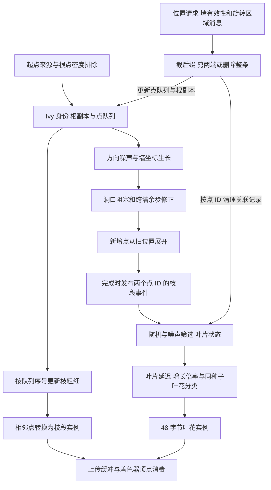

# Tiny Glade 常春藤证据账本

本轮范围：常春藤起点、生长与贴墙、跨墙转角、枝叶生成与显示、建筑变化及修剪。调查时间锚为 **2026-10-12 18:36:42 PDT，America/Los_Angeles**，来自时间工具 `2026-10-13 01:36:42 UTC`。该时间仅记录本轮取证，不推断游戏更新时间。

## 制品身份与方法

沿用前轮同一对 EXE/PDB：

| 制品 | 路径 | SHA-256 |
| --- | --- | --- |
| EXE | `E:/Steam/steamapps/common/Tiny Glade/tiny-glade.exe` | `4627ec9f9a8abe03dd30751f6a8e22868e0dfddf9f40029a1b848a3773495fe5` |
| PDB | `E:/Steam/steamapps/common/Tiny Glade/tiny_glade.pdb` | `ca8b5f18fcf5a79e282db9af9178b6ec8cecb776ea41f68435b543079d34dcf2` |

匹配 GUID `d8d61d04-9e31-5b47-4c4c-44205044422e`、age 1，PE 首选 image base `0x140000000`。正文 native 位置使用 RVA；shader 使用原文件偏移。文件偏移按所在 PE section 的测量边界转换，不用跨 section 固定减数。

REA MCP 未连接、本地 CLI 缺少编译运行文件的既有阻塞没有变化。本轮继续用系统 DbgHelp 查询本地匹配 PDB，用已有 Capstone 5.0.3 离线解码选定 EXE 范围，以及包内 SPIR-V 的格式解析。结果是普通本机静态证据，没有 REA Evidence ID、提供者会话或原生反编译结果。

完整线性解码表示所选范围的字节可被解码，不证明每字节可达、所有指令被执行，也不证明相关代码代表全部游戏行为。匹配函数名用于定位；正文结论另核实际读写、分支与调用。

## 本轮阅读路线

| 文档 | 问题与当前边界 |
| --- | --- |
| [21 起点与状态](21-tiny-glade-ivy-roots-and-state.md) | 起点来源、侧别、密度排除、候选预算、点身份；上游界面模式和完整随机初始化仍未知 |
| [22 生长与贴墙](22-tiny-glade-ivy-growth-and-wall-following.md) | 墙坐标、方向、洞口排除、转角、点展开；调度频率与全部退化行为仍需区分 |
| [23 枝叶与显示](23-tiny-glade-ivy-leaves-and-rendering.md) | 枝段事件、叶片筛选、朝向与动画、CPU/GPU 数据；完整帧时序仍未知 |
| [24 修剪与变化](24-tiny-glade-ivy-pruning-and-updates.md) | 头尾有效性、区域剪除、叶片关联清理、整对象删除与更新；不宣称完整全局 dirty 调度 |

## 关键入口

| 入口 | RVA | 初始选定范围字节数 |
| --- | --- | ---: |
| `ivy_spawner` | `BB4E60` | 4451 |
| `IvyStorage.spawn_ivy` | `BF3A80` | 862 |
| `Ivy.add_point` | `BF3FD0` | 140 |
| `ivy_grower` | `BB28C0` | 7723 |
| `IvyDirectionProposer.get_direction` | `A76040` | 1051 |
| `closest_segment_index` | `BB46F0` | 635 |
| `get_wall_double_sided_normal` | `BB4970` | 443 |
| `intersect_ivy_growth_w_wall_segment` | `BB4B30` | 805 |
| `WallCoord.into_world_space` | `C67380` | 659 |
| `ivy_leaf_spawner` | `A725F0` | 6803 |
| `ivy_pruner` | `A6F970` | 8453 |
| `ivy_pruner_cmd` | `A71A80` | 1412 |
| `is_point_still_valid` | `A72010` | 1307 |

这里列的是定位入口，不是全部取证范围；别名、内联和辅助函数分别记录。完整去重覆盖及检查记录在本篇末尾。

## 本机原始记录

全部位于既有本机产物目录：

`C:/Users/81553/.codex/visualizations/2026/10/12/01a12f36-6ef5-7a13-a524-0ffafe4443f7/`

| 子目录或文件 | 内容 |
| --- | --- |
| `tinyglade-ivy-spawn/` | 起点与状态 native 范围、callee 查询、claims 和算例 |
| `tinyglade-ivy-growth/` | 生长、墙坐标、跨墙、方向与 helper 范围及发现 |
| `tinyglade-ivy-leaves/` | 叶片 producer、动画、CPU/GPU mapping、两个 shader 的模块记录及发现 |
| `tinyglade-ivy-pruning/` | 修剪、有效性、消息读取、窗口剪除请求及发现 |
| `ivy-validation.json` | 根 agent 对制品、范围、shader、链接与构造演算的独立复核 |

这些本机证据跨机器需要另行迁移；正文包含关键行为、公式和位置，不以本机记录代替解释。研究交付不包含原游戏资产或恢复后用作生产的源码。

## 已串起的数据职责

下图表达已恢复的数据流和状态关系，不是实际一帧中的系统执行顺序。生成、动画、修剪和上传的完整 schedule 未恢复。

状态和身份已跨模块核对：Ivy 的 `+20` 为自身身份，`+60` 为关联墙身份；40 字节的枝点以 ID 关联 104 字节叶片，两套 48 字节 GPU 结构的意义各自说明。不能仅因字节数相同就共享类型解释。

## 独立复核结果

根 agent 的 `ivy-validation.json` 复核 **310 项通过，0 项失败**。覆盖：

| 范围组 | 记录数 | 记录字节合计 |
| --- | ---: | ---: |
| 起点与状态 | 12 | 10,682 |
| 生长与贴墙 | 16 | 14,064 |
| 枝叶与显示 | 17 | 29,502 |
| 修剪与变化 | 13 | 15,363 |

58 个记录中存在复用的辅助函数。按 RVA 去重后是 **55 个 native 范围、68,435 字节**；重复记录的范围大小和摘要相同。每个范围重新读取原 EXE，核 SHA-256、完整线性解码长度和对应 listing 的存在。

另复核 EXE/PDB 的完整摘要、两个 shader 原文件与八个内嵌模块摘要/长度，以及修剪专题 26 段更细指令范围的长度、原文件偏移和摘要。两个 shader 共八模块被格式解析，具体语义只对正文选定顶点消费作结论，没有把其余模块自动算作完全恢复。

算术与状态检查包括：投影、根密度严格边界、点预算与身份、噪声假设下的方向、直墙推进、洞扩张、转角剩余距离、展开完成、叶片随机门控与圆盘位置、延迟跨零、叶花互补、尺寸倍率、根尖粗细、网格横截面缩放、后缀截断、头尾保留及区域边界。检查采用独立构造模型，没有调用发行版函数。

正式目录 **27 份 Markdown、126 个相对链接**，通过 UTF-8、围栏、链接目标与四篇机制文档的算例存在性检查。前六轮的覆盖数字保留为各轮历史，不与本轮相加宣称全产品覆盖。

## 未做与风险

没有启动或附加游戏，没有读取私人存档，没有改动原 EXE/PDB/资产，没有测量帧耗时或实际画面，也没有构建 REA、安装新引擎或运行 REA 项目测试；本轮只新增研究文档。

构造算例验证我们对局部规则的演算，不是发行版重放。未恢复字段保留偏移和已见用途，不从名称推定物理含义。静态调用不能给出真实执行顺序、频率、完整随机种子或性能结论；所有“已确认”均受本轮选定范围限制。
