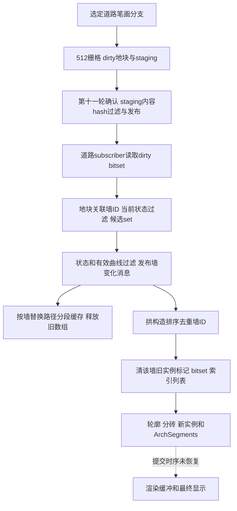

# Tiny Glade 道路变化与石拱局部重建

当前发行版证据支持按受影响墙更新：道路写入dirty地块，墙系统通过地块关联列表找到墙ID，分段缓存按墙替换，拱构造将候选墙排序去重，再清掉该墙旧砖实例并生成新产物。这里确认的粒度是墙；没有证据支持仅对洞边少量砖作差量重建。

本篇沿用同一EXE/PDB的静态范围。身份、原始记录、复核和剩余缺口见 [30 证据账本](30-tiny-glade-road-arches-evidence-ledger.md)。道路范围算法见 [26](26-tiny-glade-road-openings-and-merge.md)，石拱profile与布局见 [27](27-tiny-glade-stone-arch-profiles.md)、[28](28-tiny-glade-arch-bricks-and-rendering.md)。

## 道路编辑先改变栅格和dirty footprint

`draw_path`，RVA `BFAFE0`，其中 `BFB6FA` 实际调用 `C09650`。该绘制实例带 `PathRasterStagingSsbo` 和 `WorldRaster<512>` 类型，并实际进入：

```text
scratch → composite 相关处理
DirtyTiles.rasterize_world_space_stroke
composite → scratch 相关处理
rasterize_stroke
copy_to_staging
```

直接调用位置为 `C09BB0/C09D14/C0A693–C0A715`。dirty写入还保留旧覆盖：`C09CF7` 清临时512字节mask，`C09D14` 栅格化当前平滑笔画，之后把当前及上次footprint逐块OR到 `WorldRaster+98` 的512字节累计mask，再交换两份footprint缓存（`C09D19–C0A690`）。因此缩短或移动笔画时，旧覆盖也进入待更新区域。

这建立选定道路笔画分支的CPU栅格、dirty footprint和staging写入联系；其他材料/擦除/UI分支未全部纳入，不声称任何一笔必经同一分支，也不把staging复制称为当帧GPU绘制完成。

**构造例。** 给一个有效笔画输入并假设进入C09650分支：当前footprint={3,5}、上次={2,3}、既有dirty={9}，OR后得到dirty={2,3,5,9}，下一次保留的上次footprint={3,5}。结果是道路栅格修改及累积dirty记录，staging得到更新内容；通知发布时机未知。真实UI枚举、笔刷默认值和footprint全部边缘公式没有恢复，此例不计算实际游戏中某笔的地块数。

## 道路变化怎样关联到墙

初始化wrapper `1A2B230` 的精确类型签名包括 `PathRaster`、`TerrainHeightsData` 和Commands。`1A2B36F` 对PathRaster调用 `WorldRaster<512>.subscribe`，`1A2B387` 对TerrainHeightsData内部发布者调用subscribe，`1A2B39F` 把二者送入 `WallLazySubscriber` 资源插入命令。deferred apply保持资源+0为道路subscriber、+8为地形subscriber；不仅依据调用参数猜布局。

`publish_public_wall_state`，`B9F450`，内部 `gather_lazy_update_sources` 路径读取该资源：+0道路→`9C2B20→A82F70` closure0，+8地形→`9C2A50→A83260` closure1。已确认从512字节dirty bitset枚举置位索引，然后按索引访问48字节地块bucket，从bucket的+20指针/+28长度遍历u64墙ID列表。之后查当前墙状态并插入候选集合。

道路关联分支还有当前墙存在性和原始字段 `PublicWall+280<=.5` 的过滤，再向 `InnerWalls+60` set插入。该字段业务名尚未恢复，保留数值条件。地块→墙的表避免此路径遍历全场景；候选集合去重不等于每个墙一定立即重建。

候选set到墙消息也已核到：`BA0537/BA05F2` 读取 `InnerWalls+60` set及长度，`BA0675–BA06E4` 枚举keys。经inner/public与render-slot查找（`BA0704–BA08A0`），曲线节点数≥2且长度>0（`BA08A7–BA08D6`）后，`BA0925–BA094E` 写入16字节 `OnWallChanged` 消息：+0是递增消息ID，+8是选中WallID。writer类型由wrapper `5C2260` 的精确签名和实参位置交叉核对。

第八轮留下的flush桥已由第十一轮补通共享路径：WorldRaster.copy_to_staging按64B tile内容hash过滤dirty，随后调用Publisher.publish；详见[45 发布与重建](45-tiny-glade-shared-invalidation-and-rebuild.md)。完整scheduler和所有道路材质订阅仍未知，不能称完整即时调用链。

**构造例。** 假设dirty地块a关联[7,9]、b关联[9,12]；当前墙都存在且满足过滤，则set得到{7,9,12}，9只保留一个候选。若墙12不存在或不满足原始过滤条件，候选不包含12。实际a/b及关联表是构造状态，不来自私人存档。

## 路径分段缓存按墙替换

`calculate_path_wall_segmentation`，`802000`，消费16字节消息记录，以+8作为WallID查询PublicWalls。找到墙后 `802201` 调 `calc_path_wall_segmentation(801390)`，`802232` 更新统计，`802266` 以同一ID插入新描述。

返回旧值时，`80227C–802373` 逐项释放内部数组，再释放136字节步长的旧描述容器。这是缓存替换与资源所有权规则，不是把旧内容继续复用作当前产物。它不会在这一函数中遍历并替换所有墙。

**构造例。** 消息WallID=7，PublicWalls有7，缓存7的旧值A：计算得到B，以键7插入B，释放返回的A内部数组和旧容器。未见此路径替换其他墙键；队列重复消息可能在本阶段被分别消费，不能把拱构造的去重规则扩大到所有阶段。

## 拱构造去重后先清旧实例

`construct_arches(7F0120)` 收集墙ID；小列表分支在 `7F421F–7F42A8` 按无符号u64升序插入排序，`7F431E–7F43A5` 相邻去重。逐墙查到当前状态后，`7F09E3` 在进入新几何构造前，调用 `SparseInstanceBufferWriter.clear(13F7BD0)` 清该墙旧 `BrickTransform` 索引。

clear在 `13F7C30–13F7CAB` 对每个旧索引：

1. 对应byte标记置0。
2. 原子清对应bitset位。
3. 该墙索引列表长度置0。

这些是CPU sparse buffer的失效状态。未追完提交与渲染消费，不能直接称为GPU资源已经释放或画面已经更新。

随后按当前子段重做profile、ArchWalker和实例push；`7F39D4` 将新Vec按WallID插入 `ArchSegments`，若返回旧值，`7F39FA` 调drop `49D240`。该helper逐104字节record按capacity×4、×12、×4释放三类内部数组，再按capacity×104释放旧容器。此处类型由caller map建立，helper同址另有 `WallPathSegment` 别名，不能由最短显示名改写类型。

当前路径未见先比较新旧内容相等再跳过的门控；不把局部未见比较扩大为整个函数绝无缓存，也不声称拓扑改变后砖编号永久稳定。删除整个墙等其他生命周期和GPU提交仍未完整覆盖。

**构造例。** 输入墙ID=[9,7,9]；墙7旧索引[2,65]，墙9旧索引[4]。排序去重得到[7,9]，分别清标记2/65/4和相应bitset位，两个旧列表长度变0；两墙随后各进入构造一次。新实例是否复用同一slot、何时提交，在此演算之外。

若墙7的旧ArchSegments为A，生成新Vec B，则插入键7后取回A、释放其各record数组与容器，当前键7保留B；其他键不在此替换路径遍历。它与旧实例slot失效分别管理几何缓存和显示产物。

## 数据流程与运行时限制



箭头表示已恢复的数据职责和实际调用关系，虚线是未知桥；不是一帧schedule。道路和地形是两个subscriber来源，不能由这张图宣称水域、所有cobblestone或每种编辑操作均经同一订阅。

可供独立实现参考的机制是：让栅格编辑发布区域变化，维护区域到墙的关联，再按墙归属清旧产物、替换缓存并创建新产物；提交阶段明确拥有失效和新增slot。更细的差量更新是我们的另行设计，不能冒称发行版已有。

未做：没有运行道路绘制、取得真实消息序列或GPU时间线，未恢复完整scheduler、所有道路材料订阅、实例提交/上传和删除整个墙等其他生命周期路径。发布flush的后续证据见45，第八轮原检查计数保留历史范围。

风险：静态代码证明可用链路和局部条件，不能证明帧预算、更新延迟、所有输入覆盖或失效slot何时到达渲染端。墙级重建与像素级变化、少量砖差量重建分别是不同粒度。
