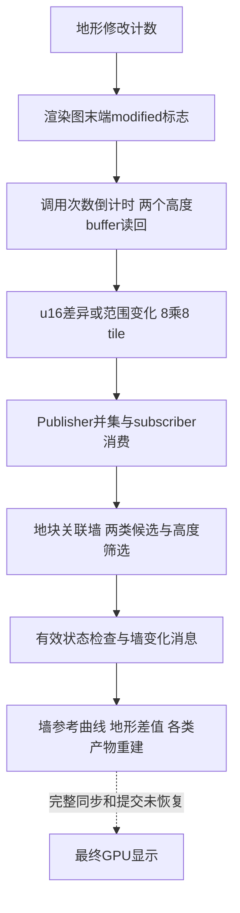

# Tiny Glade 地形读回、区域发布与局部重建

已确认的发行版链为：改动计数→渲染图末端标志→延迟读取两个高度buffer→量化数据差异标记8×8采样块→发布dirty并集→按地块关联与墙高度筛选→墙变化消息。完整GPU同步和scheduler没有恢复，不能把这条静态数据链说成固定两帧完成。

高度场生成见 [31](31-tiny-glade-terrain-strokes-and-heightfield.md)，建筑地面采样见 [32](32-tiny-glade-building-ground-sampling-and-heights.md)，石基产物清理见 [33](33-tiny-glade-foundation-surfaces-and-cutouts.md)，证据身份见 [35](35-tiny-glade-terrain-evidence-ledger.md)。

## 1. 改动计数与两次调用延迟

`ScheduledTerrainReadback.on_terrain_modified(A698F0)` 对首qword原子加1。`raster_visual_terrain_and_read_terrain_data(9AEDE0)` 末端按128bit type ID查同一资源：常量与唯一初始化实例 `18F4450` 相同，身份不仅靠字段形状猜测。

`9AFBD7–9AFBEA` 读旧计数，以cmpxchg尝试清0，没有重试循环；按此前非0把bool OR到资源+8。`delayed_terrain_changed_msg(A69900)` 每次先把已有u32倒计时项减1，第一个到0项才触发本次读回；同调用其他到0项不重复。之后取清+8，若为1新增倒计时2，再移除所有0项。

计数、待通知bool和延迟队列是不同状态。它们允许合并多次改动，但尚不能证明并发请求严格一对一，也不证明固定毫秒、两帧或GPU完成保证。

**构造例。** 队列[1,1,2]、modified=true：减到[0,0,1]，第一个0读回两缓冲、发一次地形事件，第二个0不重复；加入2并清0，结果[1,2]。新2还需后续两次该函数调用才到0。

## 2. 写入和读回确实是同一对缓冲

`9AF653/9AF662` 准备 `TerrainHeightSsbo` 与 `VisualTerrainHeightSsbo`，实际传管线字串 `country_core/terrain_editing/read_terrain_height:main`，`9AF735/9AF740`结束图内写入。写端与A69900读端使用相同buffer键，分别为RVA `331C8D8`、`331C9E0`。

读端调用BufferState动态接口，返回数据ptr/len送 `copy_from_gpu(19C0D50)`。精确wrapper签名与指令共同确认顺序：`A699FE` 更新Terrain CPU高度资源，`A69A25–A69A34` 写无payload `OnTerrainChange` 事件，再于 `A69A7B` 更新Visual CPU高度资源。消息写入时点不能解释为其他系统已执行；也不能由共享容器helper名改写事件类型。

图内buffer状态有开始/结束约束：write要求tag0，创建并保存图handle后置2；finish要求tag2，以access值0x23结束图内使用再置0；其他状态有panic。这个协议不能代替底层GPU fence或mapped数据新鲜度证明。

**构造例。** tag0→write保存handle/tag2→compute使用→finish/tag0。状态恢复0只表示图内使用协议结束，不表示实际GPU已经写完。

## 3. 量化位差决定dirty块

`19C0D50` 扫描512×512个u16，共524,288字节。每个16字节子行块比较两u64；完全相等就跳过，不等则复制整块并置dirty位，没有浮点epsilon门槛。

八个子行共享一个tile位，每tile覆盖8列×8行，dirty图为64×64、共512字节：

```text
tileX=floor(sampleX/8)
tileY=floor(sampleY/8)
bitIndex=tileY*64+tileX
```

资源+50/+54端点若不等于[-2.5,24]（NaN也不同），重置端点并把全部4096个tile标dirty，因为同一u16的世界高度解释已经变化。

**构造例。** 唯一样点(x=123,y=45)从u16值n变n+1：tile=(15,5)，bitIndex=335，发布这一tile。理想世界高度差约26.5/65535=.000404364，也会标dirty。若所有u16相同但旧端点为[-1,24]，仍会全图dirty。

## 4. 地形dirty直接发布并合并未消费变化

`19C12E8` 对高度资源+18调用 `Publisher.publish<DirtyTiles>(9C5460)`。这是地形的真实发布桥；道路WorldRaster不能用这个调用替代，其独立staging发布链已在第十一轮确认，见[45](45-tiny-glade-shared-invalidation-and-rebuild.md)。

publish增加epoch，对仍被subscriber持有的publication加锁，将原512字节mask逐块OR新dirty并更新epoch；仅publisher持有的publication可移除释放。已有pending或已消费到当前epoch的subscriber不重复创建publication。`take(9C6230)` 取走pending、置空，并记录其epoch。

**构造例。** subscriber未消费epoch1的{1,5}，随后发布epoch2的{7}；take得到{1,5,7}并记录epoch2，第一处变化不会被第二处覆盖。epoch和dirty并集分别表示版本与区域，不是独立地形物体身份。

## 5. 地块受影响不代表每个墙都重建

沿用前轮已确认的 `WallLazySubscriber+8` 地形来源，经 `9C2A50→A83260` 消费dirty；地块索引访问48字节空间bucket，遍历关联WallID。

地形closure与道路closure不同：Inner墙不存在则跳过；Public不存在，或有效Public的原始+280≤.5，直接加入待更新set。+280>.5且尚未在待更新set的墙先进入高度检查集合。无效曲线长度/节点数有诊断分支，+280完整字段意义未知。

高度检查逐当前墙Vec3点p取新地形h，f来自InnerWall+58。正常有限值下：

```text
p.y<=f：只有h>p.y标dirty
p.y>f：h!=p.y标dirty
```

任一点命中便按墙加入set，退出该墙点循环。这里也没有epsilon判定，但比较对象已经是CPU解码/插值高度，不是原u16位差。

**构造例。** 一个tile关联墙7/8/9，几何有效，+280为.3/.8/.8：7直接待更新，8/9进入高度检查。墙8有p.y=3、f=2、新h=2.8，因不等而更新；墙9所有p.y=1、f=2、新h=.5，没有高过p.y，因此不因这次候选加入。结果只更新7/8，不是bucket里所有墙一律重建。

## 6. 事件与几何产物分别更新

待更新set进入 `publish_public_wall_state(B9F450)` 共用处理，查inner/public/render slot并验证曲线节点≥2、长度>0，`BA0925–BA094E` 发16字节 `OnWallChanged={messageID,WallID}`。墙状态生产者重采样CPU地面，具体过程见32。

下游按墙重建石基表面：先排队despawn旧组、再生成面带；buffer owner进入延迟释放。道路分段和拱门也有按墙缓存替换、清旧实例的已证消费者，见 [29](29-tiny-glade-road-arch-local-rebuild.md)。这些是各自对象归属和重建规则，不是每砖差量算法，也不是GPU提交时间线。



未做：没有运行实际编辑、捕获GPU fence/消息序列或恢复完整scheduler；未覆盖空间bucket维护、所有编辑模式及下游全部生命周期。

风险：倒计时按函数调用计数，不能当固定帧延迟；量化块变化与墙最终变化有两级筛选；动态映射接口同步未解，不能由写/读键相同宣称数据总是即时新鲜。
