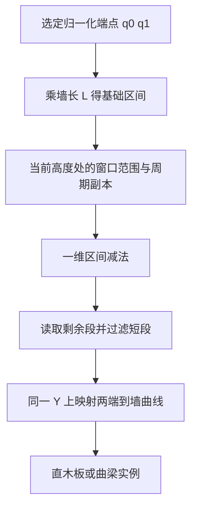

# Tiny Glade 木骨架：高度带、候选位置与窗洞避让

发行版有一套独立的木骨架规划器。它先形成高度带和沿墙候选，再依据窗口、屋顶和样式筛选；选定水平梁路径会用一维区间减掉窗口范围，窗下则可生成两条斜木板和一条水平木板。最终还分为直木板与曲梁两种输出类型。

本篇确认的是 `80A659→142E7B0 half_timbering` 中选定分支及其辅助函数。完整 32KB 决策树尚未恢复。发行版身份、覆盖与复核见[第十轮账本](40-tiny-glade-wall-layout-evidence-ledger.md)；精细 cut 与显示变形见[绘制篇](39-tiny-glade-wall-and-timber-rendering.md)。

## 1. 带状布局先于梁实例

`142EA43→C012E0` 的高度带辅助函数使用传入 H：

```text
H<5.9: 无额外带界线
否则: 先加入4.5
next=previous+3.5
仅当H>next+1.4继续加入next
```

界线与其他上下边界组合、排序，形成 `[0,y0,L,y1]` 的行 AABB（`142EC5B`、`13EAD00`）。这说明高墙可产生额外水平层次，但 H 的全部材质/屋顶来源和额外界线资格未贯通。

另有一条真实行边界生产链：主行 AABB 向量由 `142ED88→13EA900` 或 `142EDD7→13EAD00` 形成，再经 `14316CD→13EA550→13E46D0` 输出 16B 元组：

```text
(rowIndex, row.maxY, row.centerX)
若row.minY==wallBaseline，另输出
(rowIndex, row.minY-.02, row.centerX)
```

这些是行产生的元组，不能因后续处理窗口就误称窗对象。消费者还会限制或过滤所选 Y。

### 构造例：高墙的水平层次

H=10，辅助函数加入 4.5 和 8；若完整界线输入是 `[0,4.5,8,10]`、L=10，行范围为 `[0,0,10,4.5]`、`[0,4.5,10,8]`、`[0,8,10,10]`。第一行、baseline=0 时输出 `(0,4.5,5)` 和 `(0,-.02,5)`。是否全部形成可见梁仍需后续资格与窗口处理。

## 2. 沿墙候选怎样选位置

选定分支在 row.height>.75 时，以 raw flag 选择 s=2 或 2.5：

```text
N=ceil(abs(U1-U0)/s)
candidate_i=lerp(U0,U1,i/N), 0<=i<N
```

注意不包括 i=N 的右端点。后面还可合并近邻：选定链中两 u 的绝对差<.3 时，用算术平均替换（`142F49F–142F694`、`142FE45`）。还有额外候选、屋顶过滤和样式分支；不能把初始 N 当最终柱数或宣称所有立梁是统一规则网格。

### 构造例：初始立梁候选

row=[0,0,6,2]、s=2.5，N=3，初始 u=[0,2,4]。若后面出现邻近候选 2.2，可与2合成2.1。木梁最终角色、端点和实例数量不由这个小 helper 单独决定。

## 3. 窗口排除分成三种不同计算

### 3.1 候选点检测

主规划器 `142FCD7/14308C4` 调用 `1438080 check_for_overlap_with_all_windows`。它从符合资格的装饰记录取得窗口 AABB，测试 **候选点 (u,y)** 是否被包含；边界包含也算命中。

若窗口 maxX>L，另检测平移 −L 的副本；minX<0 时检测 +L 副本。首先命中的点返回 true。这不是对整根梁扫掠体积的碰撞检测。

构造例：L=10、窗=[9,1,11,3]，副本=[−1,1,1,3]；候选(.5,2)被排除，虽然它与原始窗的数值区间相隔很远。

### 3.2 当前行的重叠窗口列表

`1436680 overlapping_windows` 对窗口竖向范围先内缩：minY+.038、maxY−.038。raw subtype=9 且另一字节=1 时，再向上下各扩 `.14`。它与行 AABB 相交，并为跨接缝窗口添加 ±L 副本。

输出每记录20B：16B AABB加原始控制字节，其中包含周期副本标识。这个 AABB 是规划范围，不能当成 GPU 最终窗口形状。非常矮的窗口可能产生逆序区间，本 helper 未见统一 clamp 修复。

构造例：窗=[2,1,3,2]，普通调整为 Y=[1.038,1.962]，与 row=[0,1,5,2]重叠；特殊 raw 分支则变成 [.898,2.102]。

### 3.3 固定高度梁的一维范围减法

这条链实际贯通到实例生成：



`1431DE5/1431DF6` 从端点列表读 q0/q1，乘 L；一个屋顶高度分支还会收窄成中心区间。`1431EE5→24BCD90 new_range` 产生初始 12B 区间记录。

普通窗口路径先以 AABB.contains(centerX,testY) 选择窗口，然后 `14323D7→24BCA00 subtract` 减去 `[window.minX,window.maxX]`。跨首尾时还有 −L/+L 减法调用（`143249A/1432556`）。`14325D9` 另减额外12B范围，其全部生产含义仍未知。

`14325EF` 取剩余片段，`1432610/1432615` 读左右端点；长度<.1 的片段被跳过，等于.1不因这个比较被剔除。`143269F/14326DC` 把两端在相同 beamY 上映到墙曲线，随后输出 WoodenPlank 或 CurvedHalfTimber。

testY 与最终 beamY 来自不同局部值，可能不同；不能擅自简化为永远相同。raw subtype6/9 还有按 profile 求当前宽度的专门路径，本篇普通 AABB 例不覆盖这些轮廓。完整端点列表也混合了多个生产者。

### 构造例：水平梁绕开中央窗

L=10、q0=0、q1=1，基础范围[0,10]。testY=2、普通窗=[4,1,6,3]，减去[4,6]，剩余[0,4]、[6,10]。两段长度都通过.1门槛，再在所选 beamY 上映成三维端点。连续梁因此可成为两个构件，无需先创建完整梁后对实体网格做三维布尔。

## 4. 窗下两斜一平木板

`1430966→24BC2E0` 的特定分支：设 r=row.minY、w=window.minY、a/b为传入的沿墙候选区间两端、m=(a+b)/2。调用前确认当前窗口中心在这个区间中，但 a/b 不一定等于窗口左右边界。仅当

```text
.5 < max(w-r,0) < 2
rawPatternByte != 0x16
```

时生成候选。若 r 精确等于传入比较基准，k=−.16，否则k=0。该调用的比较基准来自 `14308E9→wall.max_y`，不能冒称墙底面。三对二维端点是：

| 段 | 起点 | 终点 |
| --- | --- | --- |
| 第一斜段 | `(a+.1,w+.13)` | `(m+.1,r+.2+k)` |
| 第二斜段 | `(m-.1,r+.2+k)` | `(b-.1,w+.13)` |
| 水平段 | `(a,w+.13)` | `(b,w+.13)` |

u 先除 L，再求墙曲线位置。选定检查分支中，真实曲线中点与端点弦中点距离>.078，会跳过构件，以免直木板不能贴合弯墙。接受段按中心出墙 `.3*normal` 放置，前两个矩阵轴尺度 .15，纵轴按段长缩放；`24BC9A1→13F6D90` 实际写入 WoodenPlankSSBO。

这不是所有窗口必有的三段装饰。raw 样式、法向符号及各曲线分支资格仍部分未知。

### 构造例：比较基准命中时的窗下撑

给这个辅助函数构造 r=0、w=1、a=0、b=2、比较基准=0，k=−.16：

```text
(.1,1.13) → (1.1,.04)
(.9,.04)  → (1.9,1.13)
(0,1.13)  → (2,1.13)
```

它们只是墙坐标候选；此例隔离辅助函数算术，不是完整建筑实例。若某一段曲线中点偏离弦中点 .09，将不通过>.078 的贴合检查；.05则通过这项检查。

## 5. 直木板与曲梁的真实输出

矩形/raw 形状的一条剩余区间路径构造 WoodenPlankSSBO，并在 `1432A1F` 调用对应 push。另一些形状通过 `1432E2E/1432EE2/14331C3` 调用 `new_curved_xz/new_curved_xy`。

曲梁的角度转换包含 `2π/L`。一个分支 radius 类参数扩 `.28+capture`、端角扩 `.08/inputRadius`。L=4π、u0=0、u1=2、角偏置0时，未扩张端角为0和1弧度；inputRadius=2 时角扩量=.04。这里只隔离已确认算术，不能当成完整圆建筑 fixture。

曲梁构造后经 with_seed，写入每元素80B的向量：索引i的字节位置 `80*i`，由五次16B写入与长度递增共同确认（`1432F36–1432F7C`）。WoodenPlank 同为80B也不代表格式相同，不能被共享 grow_one 的符号别名误导。

完整 seed 初始化和稳定生命周期尚未恢复。GPU 后续形变、列表裁洞与上传见[绘制篇](39-tiny-glade-wall-and-timber-rendering.md)。

## 6. 独立实现原则与边界

可以独立设计高度带、等参数候选、近邻合并和一维开口减法，并把直板贴合误差作为明确筛选项。闭合墙的周期副本应在候选点、行窗口列表和区间减法中保持一致。对于拱窗和异形窗，应自行定义高度处的宽度查询，避免用粗 AABB 代替全部精细开口。

未做：未恢复完整样式树、所有竖向端点规划和额外排除列表；未运行场景、恢复原始网格或验证帧调度。

风险：候选点排除、行列表、一维减法及 GPU 精细 cut 的边界各不同；把它们合并成同一碰撞规则会错误解释原游戏，也会让独立实现出现穿窗或过度删梁。
