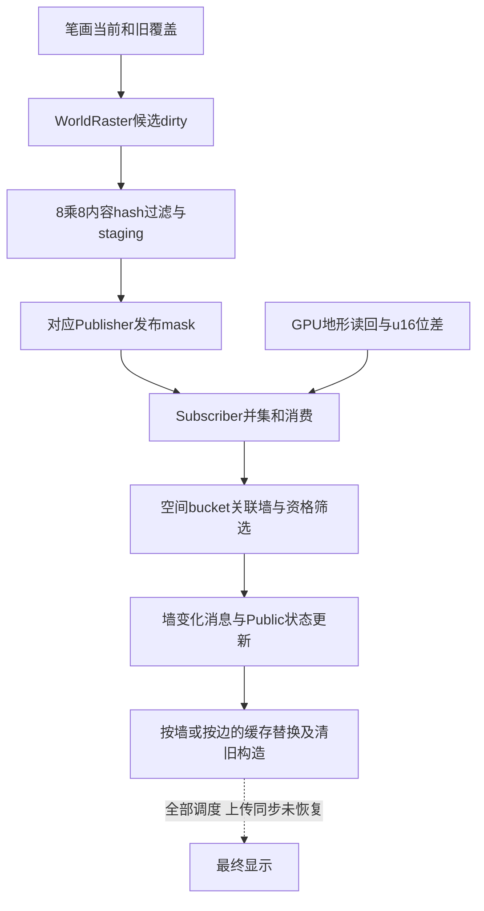

# Tiny Glade 变化发布、区域筛选与局部重建

现有发行版证据显示多种更新粒度：栅格以8×8采样块过滤并发布区域；墙系统从区域关联中筛选WallID；几何缓存按墙或楼梯边替换；显卡实例又有自己的清旧和上传状态。本轮补通了此前未确认的WorldRaster发布桥。完整调度图仍未恢复，不能宣称有一个统一dirty树控制所有模块。

随机稳定条件见[44](44-tiny-glade-stable-randomness.md)。屋瓦、木墙与植被的局部生成见[41](41-tiny-glade-roof-tile-layout-and-clipping.md)、[43](43-tiny-glade-wooden-wall-board-layout.md)、[46](46-tiny-glade-land-vegetation-and-exclusions.md)。身份与复核见[47](47-tiny-glade-four-systems-evidence-ledger.md)。

后续[50](50-tiny-glade-roof-edit-messages-and-regeneration.md)补屋顶编辑/墙消息到对象级重新铺瓦，[51](51-tiny-glade-vegetation-counts-and-active-list-rebuild.md)补植被计数及活跃前缀重建。跨系统scheduler和逐DirtyTiles补种仍保留缺口。

## 1. 原始笔刷覆盖先成为候选dirty区域

前轮道路调查确认 `C09650 draw_raster<Path...>`：当前笔画与上次footprint按位OR到WorldRaster的512B dirty图。移动、缩短笔画时，旧位置也成为候选，因为那些位置可能需要恢复。详细写入和范围见[道路重建](29-tiny-glade-road-arch-local-rebuild.md)。

这里的候选mask还不是最终实际内容变化。新增恢复的上传链会进一步过滤。

## 2. 新确认：staging前按实际tile内容哈希过滤

`A02200 upload_world_raster_buffers_to_staging` 的选定消息读取分支发现未消费消息后，`A02442→905940 AllWorldRasterWrite.upload_to_staging`。后者依次访问七个栅格槽位的buffer，并调用 `A78AE0 copy_to_staging<512>`。完整消息来源/全部调度资格仍未知，不能把这写成无条件每帧执行。

`A78AE0` 按参数选择当前数据源，并捕获临时tile缓冲、hash表和staging目标。`A78D34→A84210 DirtyTiles.retain` 遍历512B mask中的置位tile，对普通64B tile路径：

1. 用wordIndex和bit取得tile位置；一个tile对应8列×8行。
2. 从源图以512字节行步长抓8个u64，拼成64B临时tile（`A84339–A84418`）。
3. 对64B执行固定常数的整数混合，取最终hash低32位。
4. 与该tile保存的u32 hash比较（`A84507`）。相同则清dirty位（`A84310–A84328`）。
5. 不同则把64B复制到`staging+tileIndex*64`，更新保存的hash，保留dirty位（`A84517–A84565`）。

`C44B30 build_tile_hasher` 保存四个固定u64常数；所选retain路径内联了对应混合。因此它不是以本次哈希表随机key作为变化门槛。

这是**32位内容hash相等判断**，并没有在hash相同后再次逐字节确认相等。有限hash空间存在碰撞可能；静态调查没有测量实际发生率。不要把它改写成“所有字节完全相等才跳过”。

### 构造例：旧覆盖不会必然触发重建

前置候选dirty={2,3,5}。tile2的64B内容hash仍与缓存相同；tile3和5不同。retain后mask={3,5}，只将后两tile各64B写入staging。随后发布这一过滤后的mask。

tile5的staging位置是320字节；tileIndex335的位置是21,440字节。图中tile=(15,5)时，tileIndex=`5*64+15=335`，源起点字节=`5*8*512+15*8=20,600`，其后7行各加512。

这些是构造数据演算。若发生32位hash碰撞，实际分支会按相同hash跳过，即使原字节不同。

## 3. 过滤后立即调用发布者

`A78D3A–A78D61` 的独占publisher分支将过滤后的512B mask复制到调用输入，再调用 `9C5460 Publisher.publish<DirtyTiles>`；另一共享锁分支在 `A78DB0` 调同一发布函数。随后 `A78DD4` 写资源`+29A=1`，这属于后续状态标志，其所有消费尚未恢复。

`A78160 WorldRaster.subscribe<512>` 定位`+60`发布者，并在 `A781BA→9C5D10 Publisher.subscribe` 注册订阅。这将WorldRaster的写入、过滤、发布与订阅连起来；不同栅格仍各有发布对象，不能因为共用代码就合并为同一资源。

发布者的epoch、未消费mask并集和take语义已在[地形重建](34-tiny-glade-terrain-readback-and-local-updates.md)恢复：未消费的变化按OR合并，take取得pending并记录epoch。共用发布函数的语义可以复用，调用对象身份仍分别核对。

### 构造例：两次发布合并

订阅者未消费{3,5}时，再发布{7}，pending成为{3,5,7}，epoch前进；一次take取得该并集。不同发布者的{7}不会仅因索引相同自动合并，必须有消费者显式汇集它们。

## 4. 图形上传与CPU通知是不同阶段

所选 `905940` 调用先得到staging BufferState的动态接口，再送原始可写区域给copy_to_staging。缺失buffer或接口会走明确失败路径。独立的 `5E3B30 upload_raster_staging_to_texture<PathRaster>` 则负责图内纹理上传相关工作。

因此确认的是“staging处理过程中发布CPU区域变化”；这不等于GPU纹理写入已经完成，更不等于下游全部模型已经绘制。完整图提交、GPU fence、subscriber系统顺序和帧内时间线仍未知。

地形采用另一条路径：两个GPU高度buffer延迟读回，比较512×512 u16数据，将8×8块标dirty并发布；那里是按原u16位差筛选，不能用本轮32位tile hash替代。地形延迟计数按函数调用次数，不能概括成固定两帧。

植被样本还确认独立 `A85430 PlantSampleRaster.copy_to_staging`，在 `A858B0` 发布DirtyTiles；`9EB010`使用对应staging做图内上传。这个发布调用由植被专题保存，不能据此补成garden脏标志、全部候选及旧实例清理的完整时间链。

## 5. 区域变化转成墙候选，还会再筛一次

`B9F450 publish_public_wall_state` 汇集道路和地形订阅来源。按dirty索引访问空间bucket，遍历其中关联WallID，再插入候选集合。

地形路径还有墙高度检查：部分墙直接待更新；另一些逐墙曲线点比较新地面高度。有限正常输入下，点不高于参考底高时仅在新地面高过该点才更新；点高于参考底高时地面不同就更新。详细条件和未命名字段见[34](34-tiny-glade-terrain-readback-and-local-updates.md)。

候选通过曲线节点≥2、长度>0等检查后，`BA0925–BA094E` 写16B `OnWallChanged`记录，payload为WallID。**此写入位置在同一函数后续旧Public状态移除/重算之前**；它是消息入队位置，不证明消费者在当下已看到最终状态。系统执行/命令flush顺序仍需进一步证明。

### 构造例：区域粒度到对象粒度

dirty tile A关联[7,9]，B关联[9,12]；墙均满足当前分支资格，则集合为{7,9,12}，9只出现一次。若12已经不存在，不加入。若9需要地形高度检查且所有点都未命中，则最终墙候选可只剩7。

这个筛选粒度是墙。它不是自动找到每一块发生变化的砖。

## 6. 消费者分别拥有旧产物

| 产物 | 已确认的更新单位和清理 | 剩余桥 |
| --- | --- | --- |
| 道路墙分段 | `802000`按消息WallID算新描述，插入该键并释放返回旧值 | 所有编辑入口和调度顺序 |
| 石拱 | `7F0120`墙ID排序去重，清该墙旧sparse砖索引，生成新拱段并替换缓存 | 实例最终提交、删除整墙等其他路径 |
| 普通墙砖 | `808800`选定墙路径内实际调用clear并进入砖构造器 | 完整入口资格、所有材质与跨模块时序 |
| 屋瓦 | `1F46490`实际`1F46A65→1F4A6C0`清旧；之后才检查flat/墙资格并装配 | 变化消息的完整来源、上传和所有类型分支 |
| 石基面带 | 排队despawn旧组、构建新面带；buffer owner延迟释放 | 命令flush和GPU回收同步 |
| 楼梯 | 按边identity、订阅tile和参数dirty汇集清理，释放对应缓存/实例并标邻边 | visual dirty到assembly dirty的完整桥 |
| 木板/木骨架 | 对选定墙生成新板区域/构件；布局与精细cut各自处理 | 所有独立buffer生命周期与调度 |
| 陆地植被 | 可恢复候选生成、排除、输出及部分脏标志/读回 | 所有active-list更新、删除/补种顺序 |

这张表是已观察职责的汇总，不是一张已经恢复的统一调度图。各模块可能全量重建某个墙的产物，同时只更新少数墙；“对象级局部”与“构件级差量”要分别判断。

### 构造例：清旧后发现没有新产物

屋瓦路径先清旧，再检查资格。给一个先前有瓦片的对象，当前进入清旧调用，但之后符合不装配的flat/无有效墙分支：本次可以只清旧而不输出新瓦。不能把“未输出新实例”理解为保留旧实例。这是指令顺序推导，未执行真实编辑。

道路缓存则可以用键7的新值B替换旧A并释放A，其他墙键不在该替换路径中遍历。缓存对象替换、实例slot标记清零和实际GPU回收是不同所有者的操作。

## 7. 目前可以串通到哪一步

上图来自实际调用/既有已确认桥的组合；最末连接仍是待验证关系。墙ID、边identity、tile索引、messageID与publication epoch各有不同作用域，不能共用一个“版本号”解释。

## 8. 独立实现可以借鉴的边界

可以独立设计“旧新覆盖并集 → 内容变化过滤 → 区域通知 → 对象候选 → 各产物替换”的系统。每层应记录输入版本、作用域和拒绝原因；若用内容hash过滤，明确碰撞策略。旧结果和新结果的所有者应清楚，避免没生成新产物时遗留旧显示。

若需要异步构造，还应由自己的契约定义旧任务取消、结果版本检查和GPU资源退役；本轮没有确认原游戏采用哪一套完整异步版本机制。

未做：未恢复全ECS调度、所有资源注册/输入模式、植被active-list生命周期及GPU同步；未启动游戏或捕获真实事件时间线。

风险：32位hash过滤可能碰撞；消息写入与结果可见分离；不同对象粒度不能互相替代。已串通的静态发布链不代表所有编辑都立即完成全部重建。
