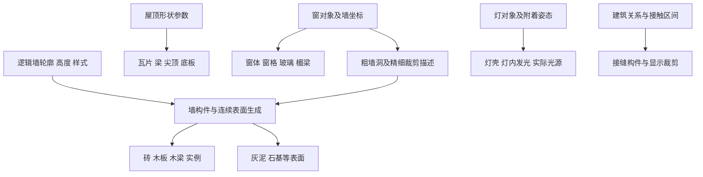

# Tiny Glade：一栋房子由哪些资产和生成器组成

本篇把此前的算法调查转成资产与拼装说明，回答“是否先建模整栋房子”“窗户是否独立”“房间怎样表示”。后续[65](65-tiny-glade-window-holes-and-lantern-components.md)解释墙洞与灯具，[66](66-tiny-glade-seams-and-independent-building-kit-spec.md)解释接缝及自研建模规格，[67](67-tiny-glade-building-assets-and-assembly-ledger.md)记录来源和核验。

核心结论：已确认的建筑路径结合**逻辑形状、可重复的小网格、独立装饰资源、程序生成的实例/连续表面及GPU显示处理**。并非把一个完整房屋模型整体拉伸。窗和灯具确实有独立资源；窗还向墙生成器提供开口。这里尚未恢复完整可进入室内、房间分隔或室内装修系统。

## 1. 这次实际读取了什么

发行目录已经包含`assets/meshes/*.json`，其中有属性名、属性类型、vertex buffer、index buffer及double_sided。无需从一个不透明大包猜网格。此次直接解析选定原文件，核对索引范围、顶点/三角形数量、属性和局部包络；没有修改游戏或把原资产作为自研生产资源。

静态查看图直接投影四份原JSON网格，按原始局部坐标叠合。颜色区分部件，玻璃作示意透明；没有执行游戏shader、纹理、光照或运行时变形：

下图保留为本机诊断产物，未随仓库提交原资源或PNG；其它机器可依照正文资源统计理解拆分，但不会自动获得这个绝对路径下的预览。


图中窗体是独立外框；另一个名为glass的网格包含窗格和玻璃。壁灯主体与inside也各是一个网格，inside位于灯体内部。**这张图是资产局部空间的诊断投影，不是重建完整游戏场景。** 实际组合和变换还须用CPU写端核对，详见65。

## 2. 建筑的逻辑单位先是形状和参数

已有发行指令确认墙状态保存曲线与高度/样式等状态，屋顶保存形状/剖面参数，装饰保存ID、类型、等级和附着位置。具体入口见[53墙线输入](53-tiny-glade-wall-footprint-input-and-curves.md)、[03屋顶](03-tiny-glade-roof-shapes.md)、[54装饰放置](54-tiny-glade-edit-picking-and-wall-placement.md)。

本轮另外解析了**游戏安装目录内自带的01-cottage起始场景**，没有读取玩家私人存档：

```text
assets/starting-builds/full/01-cottage/history.json
assets/starting-builds/full/01-cottage/snapshots/5476761123159047511.snapshot
```

snapshot前8B为`Snapshot`，随后u64给出4752B JSON元数据长度，从文件偏移16读取。只解析该有界JSON；剩余359142B没有被当成可读模型，也没有尝试恢复所有栅格内容。

这个包内样例明确保存3个Wall状态、3个Roof状态、4个Decorator状态：

| 墙ID | 轮廓 | style | height | elevation | 曲线点数 |
| --- | --- | --- | ---: | ---: | ---: |
| 6 | Rectangle | HalfTimbered | 5.771548 | 0 | 5 |
| 10 | Rectangle | StoneWithSkirts | 1.9 | 0 | 5 |
| 8 | Rectangle | HalfTimbered | 2.624550 | 3.152628 | 5 |

这三条记录是参数化的建筑墙轮廓，不是三个已确认的可行走室内房间。每条闭合曲线有首尾重复点；屋顶另存ridge方向、height/profile/eave等参数。

装饰组包含：ID8为rank1 CottageWindow、ID10为rank2 CottageWindow，目的地为Wall；ID12为rank1 CottageWindow，目的地为Roof UV；ID9为Roof目的地的Chimney。即使保存地址组是Wall6，内部destination仍需独立读取，不能把组内所有对象都说成贴墙窗。

**版本限定：** 包内主history的Version=18，snapshot JSON的Version=2，是发行包携带的历史样例schema，不等同于当前保存器全部输出。它直接支持“样例建筑由逻辑形状与独立装饰参数保存”，不用于把历史字段硬映射到当前所有native raw tag。

## 3. 模型资产分成几类

以下三角形数来自原indices按三项一组统计，不是实机draw call或最终可见三角形数：

| 资源 | 顶点/三角形 | 在当前证据中的职责 |
| --- | ---: | --- |
| `brick.json` | 600 / 300 | 砖类基础网格；局部包络三轴均为±0.5 |
| `wooden_plank.json` | 888 / 296 | 木板模板，有straight和LOD变体 |
| `roof_tile.json` | 20 / 30 | 瓦模板；还有LOD1与backface变体 |
| `roof_support_beam.json` | 90 / 30 | 梁类资源，局部Y范围0..1 |
| `roof_spire.json` | 828 / 414 | 尖顶资源，包含roof_profile_mult属性 |
| `decorators/window_cottage_1x1.json` | 96 / 32 | 独立窗体资源 |
| `decorators/window_cottage_1x1_glass.json` | 1056 / 352 | 独立窗格/玻璃资源，有is_glass属性 |
| `decorators/setdressing_window_lintel.json` | 228 / 76 | 上方楣梁资源，布局可以分段 |
| `decorators/setdressing_window_sill.json` | 36 / 12 | 选定窗台资源，不能据文件存在说所有窗必有 |
| `decorators/lantern_wall.json` | 1923 / 641 | 独立壁灯主体 |
| `decorators/lantern_wall_inside.json` | 72 / 24 | 独立灯内部分，CPU配发光shader |

“小件”指建模职责，不表示所有网格都极低面数。重复实例、LOD、可见性和分桶另有作用，不能按这张表推导实际帧性能。

同一种类型也不一定只建一个模型。发行资源存在cottage窗1x1/2x1/3x1、corner/dormer变体，以及不同gothic部件。前轮[59](59-tiny-glade-decoration-snapping-and-merging.md)确认等级合并后查询新等级资源尺寸；不是把任意宽高直接加起来，再强拉同一个窗模型。

## 4. 资产还包含供程序使用的辅助几何

以cottage1x1为实读例：

| 文件后缀 | 顶点/索引 | 本轮直接确认 |
| --- | ---: | --- |
| 主窗体 | 96 / 96 | 属性为position/normal/color/UV/tangent/bitangent |
| `_glass` | 1056 / 1056 | is_glass=1只有6个顶点，其余1050为0；不是整网格都是玻璃 |
| `_collision` | 8 / 36 | 仅position；包络深度约0.085 |
| `_interaction` | 8 / 36 | 仅position；包络深度约0.918 |
| `_flowerbed_locations` | 1 / 0 | position=(0,-0.7,0)，另带normal，没有三角面 |

因此建模资产不只有“显示mesh”。还有碰撞、交互区域、轮廓、标记点等输入。名称和统计只能给候选职责；实际consumer由65以及[18窗框贴合](18-tiny-glade-window-frames.md)核对。特别是`flowerbed_locations`的positions/normals确实被读成局部标记，再变换成窗边自动装饰候选；它不是一张隐藏的花箱实体模型。

## 5. 模型与材质/渲染子类分别组织

`assets/nani_meshes.ron`把资源分配到subset并指定属性增删。例如：

- 窗体与楣梁进入SolidVertexColorWindow；窗格/玻璃进入SolidVertexColorWindowGlass。
- gothic窗部分资源还出现在SolidVertexColorBricks，帽部件进入GothicWindowBricks。
- 灯inside同时列在Uber与LanternEmissive；CPU实际灯生成路径选择发光shader的写端见65。
- wooden_plank/LOD1/straight在WoodenPlank和WoodenGablePlank两组重复注册。
- roof_tile/LOD1/backface进入RoofTile。

这证明“一个源网格文件”和“一种渲染子类”不是一一对应。选定JSON本身只有一套indices/attributes，没有显式submesh/material slot；加载器或atlas阶段仍可能分拆。不能把RON的subset自动当成建模软件里的材质槽，更不能从重复注册推出每个场景都会同时画两次。

JSON提供几何与自定义属性，RON/CPU模型请求提供shader或subset，实例提供transform、颜色/种子及其它参数。原作者使用了哪款建模软件、哪种离线导出器、具体美术制作顺序，本轮未确认。

## 6. 房子怎样从这些输入变成画面

下图是按已有证据重组的数据职责；它不声称所有箭头都已恢复成同步调用栈：



墙改变后，各生成器读当前轮廓/开口重算相应产物；装饰按对象ID和附着坐标维持自己的身份。实例并不一定逐个成为传统场景树中的GameObject；实际缓冲、实体和所有权由各模块分别管理。前轮已核[55阶段和砖上传](55-tiny-glade-edit-rebuild-stages-and-upload.md)、[62恢复](62-tiny-glade-history-snapshots-and-regeneration.md)，尚未完整建立全部GPU完成时间线。

### 贯通例：一个“房子模板”应该保存什么

包内cottage例保存3个轮廓/屋顶和4个装饰，加载器恢复原逻辑ID后再由生成器构造表现。我们据此可以独立设计一个模板：保存建筑足迹、高度、样式、屋顶参数及窗/灯附着列表，加载时生成砖木与显示部件。**这是自研规格推导，不是复制该包内样例或恢复原作全场景。** 具体自研资产清单见66。

## 7. 未做与风险

未做：没有运行游戏、完整重放包内cottage、复原最终材质或导出整栋房屋；没有私人存档、原文件修改、工具安装和REA构建。本机静态预览未应用游戏shader。

风险：把历史样例当当前schema、把glassy名称当纯玻璃、把辅助mesh当显示mesh、把实例通道当唯一源网格、把外部墙轮廓当室内房间，都会产生错误的资产设计。已确认的模块拼装与尚未确认的室内系统分别保留。
