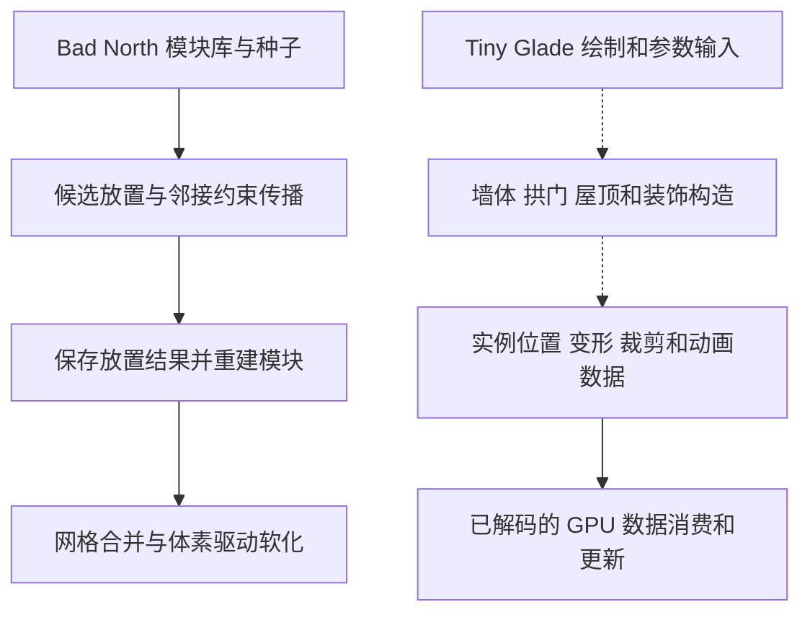

# 程序化建造与美术研究

最新续查见 [169：锁焦读回适用性与时效](169-tiny-glade-focus-readback-validity-and-latency.md)、[170：深度节点次序与录制](170-tiny-glade-depth-node-order-and-command-recording.md)、[171：树实例到材质和绘制回调](171-tiny-glade-tree-instance-to-draw-binding.md)。已接上 mapped 读回的 GPU/CPU 条件、登记到屏障/队列提交入口，以及树自身的 48 B 参数更新、同 buffer 绑定和计数式间接绘制录制。明确纠正 168：参数块首项是实例 storage buffer 引用。读回代次、实际 GPU 时效、特定树的排序输出与最终 descriptor backing 仍有边界；运行验证仍未进行。

前轮续查见 [166：焦点/树木 UI 写端](166-tiny-glade-focus-and-tree-fade-ui-writers.md)、[167：水／冰深度访问与版本边界](167-tiny-glade-water-ice-depth-access-and-epochs.md)、[168：树材质绑定生产者](168-tiny-glade-tree-material-descriptor-producers.md)。已接通三个拍照按钮、焦点拖动写点、两个非默认 profile 的逐项翻转，以及水／冰的可读写深度声明和树冠/树干七张纹理的绑定接口。未运行游戏或检查用户项目。

景深/渐隐参数基础见 [163：自动焦点参数生产者](163-tiny-glade-autofocus-parameter-producers.md)、[164：tree_see_thru 设置与圆锥来源](164-tiny-glade-tree-settings-and-cone-producers.md)、[165：场景深度到焦点/CoC](165-tiny-glade-scene-depth-to-focus-and-coc.md)。

近镜头反馈新调查见 [161：景深焦点与近远模糊](161-tiny-glade-dof-focus-and-near-far-blur.md)、[162：树木局部渐隐与景深关系](162-tiny-glade-tree-see-through-and-dof-composition.md)。重新解析自动焦点、CoC、树冠/树干及选定砖 shader，接通手放树动画到实例 half 打包、材质局部丢弃和编辑模式资格；不支持简单“树透明、建筑景深”的二选一模型。修正 69 的过渡项 min/下限误述；全部材料/模式、空间滞回及最终 GPU 同帧仍未知。本项仅先调研，未启动 Unity 制作或运行验证。

本轮界面/环境制作入口见 [155：菜单快照与悬停分类](155-tiny-glade-menu-snapshot-and-hover-visibility.md)、[156：太阳、雾与天气锁](156-tiny-glade-sun-fog-and-weather-panel.md)、[157：编辑边界、相机与远景](157-tiny-glade-edit-bounds-camera-and-distant-horizon.md)、[158：画质与 TGSR 比例](158-tiny-glade-video-settings-and-resolution-scales.md)。新接通开菜单事件到背景缓存、雾三字段/独立锁、普通相机选定约束、两套质量枚举与实际尺度；白线生产者、完整 GPU 截图回调、全预设矩阵仍未知。供现有 Supervisor/owner 实施，未运行游戏或检查 Unity 源码。

补充制作取舍见 [159：楼梯手柄、桥接与木框预览](159-tiny-glade-stair-handles-and-preview-adoption.md)、[160：统一水笔刷与分层橡皮](160-tiny-glade-water-brush-and-layered-eraser.md)。复用既有楼梯/预览/水域研究，新增七种 EraserLayer 及临时擦除查表；原作事实与用户新增的岸边、鱼、季节、保存范围分开。建筑/楼梯/桥/装饰用资源包；局部更新、撤销与旧异步结果失效按单一权威实施，未授予运行验证或项目写权。

地面制作优先阅读 [152：地面层次与资源包交接](152-tiny-glade-ground-layers-and-resource-pack-handoff.md)、[153：启动格网、背景地形与接缝](153-tiny-glade-ground-startup-grid-and-background-seams.md)、[154：地表颜色、湿岸和实例装饰](154-tiny-glade-ground-materials-and-pack-decoration.md)。新接通近处规则格网的真实高度位移、已有远景 terrain Mesh 到背景图、两圈边缘与高度梯度法线；区分起始作品/背景资产和玩家编辑，不冒称已恢复统一随机初始生成器。自研真实地形生成按最新用户要求推进，建筑/草木/石头/装饰必须使用已有资源包；未运行游戏或读取用户项目。

交互续查见 [150：旧捕获、释放点击与重叠仲裁](150-tiny-glade-ui-capture-release-and-overlap-arbitration.md)、[151：正式选中、聚焦宽限与声音事件](151-tiny-glade-selection-focus-grace-and-ui-sound-events.md)。接通未登记时保留捕获参数、释放点击身份检查、两组候选排序与追加、模式/类别的独立选中来源，以及约 0.3 秒的聚焦保留和声音事件入口。独立验收要求交给既有 NC11/相关 UI owner；未检查用户项目或运行验证。

相关续查见 [149：动效期间的命中门控与调查优先级](149-tiny-glade-ui-hit-gates-and-next-research.md)。补上工具栏显示/尺寸检查先于 widget 注册、布局命中框的额外扩张及聚焦重算；将旧捕获取消、重叠仲裁、正式选中/导航分离列为优先入口，完整菜单曲线和逐项错峰可延后。仍为静态研究，未检查或运行用户项目。

UI Motion 续查见 [146：菜单状态到渲染参数](146-tiny-glade-menu-state-to-render-motion-boundaries.md)、[147：点击触发/完成与按钮排时序](147-tiny-glade-click-completion-and-row-timing.md)。新增 MenuButtonContent 的 vtable 身份、实际菜单颜色标量消费者，以及开始交互插入/进度到 1 移除 UiPlaySelectAnimation 的 typed command 链；最终屏幕进退曲线、逐项延迟和完整屏障仍不冒称已恢复。[148：独立事项交接](148-ui-motion-dedicated-supervisor-handoff.md) 按用户新要求交给小屋 Supervisor，明确独立 owner/分支、首批真实 UI 范围与当前选中态修复边界；本会话未读用户工程、未运行验证。

Tiny Glade UI Motion 见 [144：出现、聚焦、点击脉冲与布局联动的静态链](144-tiny-glade-ui-motion-static-chains.md)、[145：综合 demo 的独立动效规格](145-independent-cozy-ui-motion-spec.md)。新增三次缓出、显示/聚焦进度、临时尺寸倍率消费后重置，以及父聚焦到子排显示的证据；菜单整屏进退和逐项错峰仍有缺口。自研规格单列进退、按压、选择、拒绝、错峰、可打断切换和性能边界；未运行目标或检查用户工程。

Shader 续查见 [140：受光公式、柔影与历史稳定](140-tiny-glade-lighting-brdf-and-soft-shadow-filter.md)、[141：风参数生产者与帧常量](141-tiny-glade-wind-producers-and-frame-constants.md)、[142：水面反射/折射及后备条件](142-tiny-glade-water-reflection-refraction-and-fallback-gates.md)。新增粗糙漫反射/GGX 结构、8+8 阴影搜索/过滤上界、Weather 到风字段 308 的写入，以及 Fresnel、屏幕历史门和实际 compute BVH 求交证据。[143：Unity/URP 独立实现方案](143-unity-urp-cozy-style-independent-rendering-plan.md) 单列光照、统一顶点风/运动向量与基础水面规格，适合综合 demo；未运行目标或检查用户工程。

Tiny Glade 的渲染问题见 [137：框架、Slang 与光影](137-tiny-glade-renderer-language-lighting-and-demo-route.md)、[138：植物顶点风](138-tiny-glade-vegetation-wind-shader.md)、[139：水面法线、涟漪与预算](139-tiny-glade-water-shader-and-demo-budget.md)。本机发行版走 Rust/rhapsody/Vulkan-SPIR-V，选定模块声明 Slang，不能当成 Unity URP；已新增树冠实际时间/风参数读取与多频率摆动的证据。附独立 URP 借鉴路线，未检查用户项目或运行目标。

取消与成品发布的续查见 [135：菜单/工具退出到木框清理](135-tiny-glade-menu-tool-exit-and-timber-cleanup.md)、[136：实体、实例与帧提交](136-tiny-glade-entity-upload-and-frame-publication.md)。补上工具按钮 raw8、模式管理 raw10、所属槽清理与木板池 PrepareRendering flush，以及具体单线程 executor 的末尾 deferred 开关、App.update 后进入 render/维护/图执行的路径；仍不把这些静态入口称为逐帧无缝交接。

Tiny Glade 的后续静态补证见 [133：确认、取消与输入映射](133-tiny-glade-confirm-cancel-input-mapping.md)、[134：木框退出、生成调度与发布条件](134-tiny-glade-preview-handoff-schedule-and-publication.md)。接通默认按键与动作状态、点击/拖动阈值、Escape 模式请求，以及主程序实际配置的 45 个有序阶段和五条消费者注册；仍不把消息、ECS 生效、GPU 上传和首帧显示混为同一个成功条件。右键/A/B 的全部画布桥、最终 deferred 图及逐帧交接仍有缺口，运行验证未做。

Tiny Glade 木框到成品的后续见[131：确认、取消、连续修改与历史动画交接](131-tiny-glade-placement-lifecycle-and-animation-handoff.md)，独立落地见[132：demo 建造反馈状态与更新预算](132-demo-building-feedback-state-and-update-budget.md)。新增建造 UI 到木框消息、候选清理、编辑历史、零进度屋顶到尖顶实例上传的字段连接；仍保留输入枚举和最终发布顺序的缺口。未运行游戏或用户项目。

Tiny Glade 的建造反馈见[129：木框预览与梁柱实例](129-tiny-glade-timberframe-placement-preview.md)、[130：出现动画与 demo 优先级](130-tiny-glade-placement-animation-and-demo-priorities.md)：新增矩形/圆形木框写端与尺寸分段、屋顶状态推进和尖顶回弹复核，区分瓦片运动与栅格平滑。木框退出到成品接管的完整链仍待查，未运行游戏或用户项目。

新增存档与联机要求见[127：DLC/Mod 状态与联机保存](127-dlc-mod-save-and-multiplayer-persistence.md)、[128：一人拥有 DLC、全房共享与 Mod 同步](128-party-shared-dlc-and-mod-synchronization.md)。用户已选择房间任意参与者拥有即可共玩，提供者不必是房主；统一保存、模块版本、缺包保护、内容准备与资格失效分别设计。公开机制与独立建议分开，实际平台/运行验证未做。

项目开工交接见[126：塔防玩法包与行为 Mod 首片](126-gameplay-packs-project-kickoff.md)：补核包依赖/扩展资格与迁移去重，整理到 3DSandboxTest 的独立 GUI/worktree 实施范围、共享窗口和验收边界。研究与实施分开；不会把新建对话当成功能完成。

玩法扩展目标见[124：家园沙盒的塔防/RPG DLC 与玩法 Mod](124-gameplay-dlc-and-moddable-homestead.md)，执行机制与性能依据见[125](125-gameplay-mod-runtime-lifecycle-and-references.md)。用户已明确本体是建造/钓鱼生活世界，DLC 可增加完整玩法，Mod 可扩展行为；[123](123-steam-workshop-and-dlc-design-for-demo.md) 已修正此前只先做外观包的过窄顺序。没有读取用户工程、运行游戏或安装框架。

Mod 与扩展内容见[四款游戏的 Mod / Workshop / DLC 对照](122-mod-workshop-dlc-comparison.md)及[综合 demo 的独立设计建议](123-steam-workshop-and-dlc-design-for-demo.md)：Tiny Glade 已有官方内容 Mod 流程；沙堡定位到地图 Workshop 方法候选；另两款的存档/打包能力与官方 Mod 支持分别说明。分开记录公开当前状态、本机静态证据、作品分享、素材包和 DLC；未读取用户项目或运行游戏。

项目性能线交接见[性能研究报告与Supervisor排期建议](121-performance-report-for-project-supervisor.md)：交给“采集静态运行性能分析”结合其项目采样规划，并转交项目Supervisor。参考游戏静态证据、接收对话运行进展转述、自研候选与授权边界分开记录。

Tiny Glade 性能专项见[综合demo具体取舍](120-tiny-glade-performance-patterns-for-composite-demo.md)，下分[实例批处理](117-tiny-glade-instance-batching-and-submission-costs.md)、[LOD几何成本](118-tiny-glade-lod-selection-and-geometry-costs.md)和[级联阴影预算](119-tiny-glade-shadow-cascades-and-work-budgets.md)。本轮新增coarse命令段到recorder、屋瓦30/12/36三角形资源计数及阴影视图生产链；自研方案和原作事实分开，未读取用户工程或运行验证。

性能续查见[四款游戏的稳态工作与准入条件](116-four-game-steady-performance-chains.md)。本轮优先新增 [Tiny Glade 两轮可见性到提交](115-tiny-glade-steady-culling-and-submission.md)，另补沙堡持续模拟、掘地求财空队列/LOD门、SUMMERHOUSE相机/配色频率；有新的静态制品证据，无运行测量，未读取用户工程。

性能专题见[四款游戏的性能机制与综合demo优先级](114-four-game-performance-mechanisms-and-demo-priorities.md)：对照局部生成、实例/缓冲复用、异步任务与提交、读回/碰撞节奏、低分辨率重绘的成本边界；用户报告的Editor Game视图约10 FPS尚无采样归因，另列专项诊断提案。

最新续查见[四款游戏：容量、启动改色、碰撞盒与反射纹理生产者](113-four-static-pool-startup-collision-and-reflection-producers.md)：外部池页数到绘制绑定、Awake到Setup改色、invoker盒来源与LOD资格更正、反射RT缓存及属性块。四份专题分别记录静态结论、条件和未决项，运行仍为Not Run。

最新续查见[四款游戏：配置、覆盖与预算的静态收口](111-four-static-config-overrides-and-budget-boundaries.md)：Tiny Glade 定位屋瓦编号、容量表与共同图视图；沙堡读出选择表初色及 Setup 竞争写端；掘地求财固定主关卡模式和可见块碰撞 LOD 上限；SUMMERHOUSE 区分反射相机与主相机矩阵。专题和自研规格边界均分开说明，运行仍未做。

最新续查见[四款游戏：颜色覆盖、碰撞归属、绘制预算与投影消费](109-four-static-color-collision-draw-and-projection-consumers.md)：全局颜色写端／Shader属性区别、过渡索引进入碰撞、距离分类到mesh索引／单次命令上限、矩阵生产到native提交与vertex消费。真实绑定／物理／帧数量和画面仍未运行验证。

最新续查见[四款游戏：湿沙薄水、LOD接缝、远处细节与像素轮廓](107-four-static-art-transitions-seams-and-pixel-grids.md)：沙堡补湿色／可见液层两道门，掘地求财补六方向过渡任务，Tiny Glade核实距离分类／分桶而保留真实预算缺口，SUMMERHOUSE读出真实缩放曲线与像素网格。运行未做。

最新续查见[四款游戏：原生等待、恢复刷新、调度屏障与订阅可达性](104-four-static-waits-restoration-schedules-and-subscriptions.md)：沙堡进入native请求／回调／等待层；掘地求财修正变化盒来源并接到mesh／碰撞；Tiny Glade区分消息与deferred；SUMMERHOUSE核对列表写端和真实启停条件。运行未做；[下一轮静态建议](105-next-static-study-recommendations.md)另列优先入口及四个美术／性能新方向。

最新续查见[四款游戏：生命周期、seed生产与监听实例](102-four-static-lifecycles-seed-producers-and-listeners.md)：沙堡加载重建与异步接收者、掘地求财失败位／LOD刷新、Tiny Glade重采样数组与快照创建候选，以及SUMMERHOUSE真实分类曲线／14件监听实例。退订实现另有明确修正，运行未做。

最新续查见[四款游戏：快照时效、加载保护、稳定重建与调色传播](100-four-static-state-consistency-and-palettes.md)：沙堡读回与碰撞分属两条调度链；掘地求财补出失败深度门及清旧提交点；Tiny Glade砖seed加数接到数组长度；SUMMERHOUSE三套真实配色接到共享材质与环境、粒子。运行未做。

最新续查见[四款游戏：可变别名、引用映射与默认配置](98-four-static-alias-interface-and-defaults.md)：Tiny Glade的Any表／TypeId已定位，raw handle改写者仍缺；沙堡接到真实引用映射接口，但class129接收者与末尾3生产者仍未知。另补掘地求财CDO构造门和SUMMERHOUSE管线纹理开关。运行未做；[下一轮建议与顺序](97-next-study-recommendations.md)单列。

最新续查见[四款游戏：BufferState写端、引用传递与目标生命周期](95-four-static-bufferstate-and-reference-transfer.md)：Tiny Glade同键图访问和完成未改指针，实际取句柄虚槽只返回原地址；沙堡+0x88本体接到资源引用回填。另补掘地求财生成类属性链接和SUMMERHOUSE的TAA分配／关闭门。槽23最终容量、四字段及尾值3构建来源仍未知，运行未做。

最新续查见[四款游戏：替换边界、构建端线索与效果开关](93-four-static-replacement-and-effect-gates.md)：Tiny Glade 同键插入和通用更新均不能解释扩容；沙堡补查发行资源和空虚槽，构建生产者仍缺失。另补掘地求财链接后一字节复制，以及 SUMMERHOUSE 完整相机追加配置。槽23最终容量和尾值3来源继续 Unknown，运行未做。

最新续查见[四款游戏：命令模板、读取分支与相机调度](91-four-static-other-writers-and-reader-selection.md)：Tiny Glade 找到同缓冲 23 条完整模板并确认实际初建 460 B；沙堡 class129 接到直接 reader，912/916 差额进入长度诊断。另补掘地求财模板/CDO 复制与 SUMMERHOUSE 相机条件排序。槽 23 最终容量、尾值 3 的构建来源及运行结果仍未知。

最新续查见[四款游戏：导入缓冲、对象长度门与顶点色写端](88-four-static-import-length-and-color-writers.md)：Tiny Glade导入tag3保留原buffer、沙堡通用reader返回长度核对、掘地求财Config属性门，以及SUMMERHOUSE实例alpha初始化。槽23四字段/最终容量与三值构建生产者仍未闭合，运行未做。

最新续查见[四款游戏：墙组入桶、加载边界与材质消费](86-four-static-bucket-loader-and-material-owners.md)：Tiny Glade墙初始组件到首桶/槽23的条件、沙堡class129注册到实际reader虚表、掘地求财原生CDO与renderer重采样，以及SUMMERHOUSE逐变体的遮罩采样/透明裁剪。命令四字段与扩容、沙堡尾部3的生产和外层处理仍保留明确未知；运行未做。

最新续查见[四款游戏：二进制读取、提交条件与过滤](84-four-static-readers-and-render-filters.md)：沙堡零槽到allowed的实际reader映射、Tiny Glade阶段3与只读转换节点、掘地求财chunk模式，以及SUMMERHOUSE相机层交集和遮罩灰度。Tiny Glade写入/扩容、沙堡三值的构建来源仍未闭合，运行未做。

前轮见[四款游戏：初始化、尾字段与相机目标](82-four-static-initialization-and-tail.md)：Tiny Glade 的 23 条初始零命令与槽 23 边界、沙堡尾值的两种映射、掘地求财材质到 section，以及 SUMMERHOUSE 遮罩/截图目标。前两项仍保留明确静态缺口，运行验证未做。

上一轮见[四款游戏：碰撞接受、命令槽与渲染目标](80-four-static-resource-acceptance.md)：旧碰撞结果的编号门、Tiny Glade 命令槽 16–22 与仍未闭合的 23、沙堡打包 Linear 配置，以及 SUMMERHOUSE 的 mip/附件链。前轮[提交与调度](78-four-static-submission-chains.md)、[指定断点结果](76-four-static-chain-answers.md)和[渲染连接账本](73-four-game-render-chain-closure.md)保留原有范围；[运行验证用例](74-runtime-validation-cases.md)本轮依要求未运行。

上一轮见[四款游戏：美术表现、局部更新与性能缺口](71-four-game-art-updates-and-performance.md)。按 SUMMERHOUSE、Tiny Glade、沙堡、掘地求财的顺序，各补两篇专题，区分实际资源/指令、条件成本推导与仍未运行验证的部分。

新增[《掘地求财》：挖掘、存档与性能](digging-a-hole/README.md)。本专题从 Unreal/Voxel Pro 的实际安装制品追踪体素编辑、局部网格与碰撞重建、稀疏保存和任务调度；分别标明游戏资源连接、插件能力及尚未运行验证的边界。

本次续查加入 **Sandcastle Demo（沙堡）** 与 **SUMMERHOUSE**。先读[本机路径、证据迁移与三款对照](68-local-targets-and-three-game-comparison.md)。沙堡重点看[水沙模拟、工具和表面模型](sandcastle/README.md)；SUMMERHOUSE 重点看[格点拼装、前后层次和组合变体](summerhouse/README.md)。下方 Bad North 与 Tiny Glade 各轮记录保留其原有证据范围；新调查不把历史未验证项自动升级为通过。

本case study的自研落地目标现统一为**Unity最小造房沙盒**。先读[Unity实施规格入口](unity-building-demo/README.md)，再按[研究到demo对应表](unity-building-demo/06-study-to-demo-map.md)选择原研究。规格已拆清AI/程序资产、墙/房屋/真实开口、挂灯、火水、永久破坏、局部重建与存档及验收；本轮先交付文档，尚未实现或运行Unity工程。历史研究保留原目标事实与未知，不被改写成我们的实现。

两款游戏解决不同的问题。Bad North 从已有三维模块中求出能拼接、能通行的岛屿，再合并和软化网格。Tiny Glade 的本机制品则显示出专门的墙体、拱门、屋顶、木结构和装饰构造模块，以及消费实例数据的 GPU 程序。Tiny Glade 的复杂度需要按几何规则、对象关系和显示更新分层理解。

第二轮重点从 Tiny Glade 本地发行版指令确认屋顶形状、建筑相交和接缝。已恢复幂剖面与逆剖面、尺度相关高度/屋脊、结构与显示截面的差异、墙洞局部扣除、接缝部件实例和 GPU 裁剪。完整屋顶拓扑、所有建筑交叠生产者及退化处理仍未恢复。

第三轮继续水体：已确认笔画平滑、512×512 栅格与 GPU 上传、实际多通道模糊、中央区域河床高度、泥土混合、水生植物筛选及水面法线/涟漪。第四轮把整幅水面、场景深度、地表顶点岸边修正、地图外缘及延迟反射覆盖串入绘制专题。真实 GPU 顺序、完整材质与物理河流机制仍有缺口。

第五轮研究楼梯与连接结构：从端点身份、宽度偏移、邻居对齐评分和路径采样，追到踏步/平台、木支撑、墙侧连接及局部产物失效。已恢复具体公式、构件输出和按边清理规则；固定步高、全部平台拓扑、dirty 桥接与实际帧调度仍未完全确认。

第六轮研究普通窗户：从已修改窗对象追到粗墙洞与精细裁剪、砖木消费者、窗框/楣梁贴墙和窗边自动装饰。已确认实际发布与部分重建比较、每构件窗口列表、木板距离场显示、窗台标记及窗周区域/候选生命周期；输入吸附、完整材质绑定与实际帧调度仍有缺口。

第七轮研究常春藤：从起点与根间密度排除，追到墙坐标生长、空间方向噪声、转角余步修正、洞口阻塞、枝点展开事件，再到叶片/花分流、粗细与尺寸动画及 GPU 实例；同时确认位置剪后缀、头尾有效性检查和整条删除。噪声配置、跨墙排序、退化几何和完整调度仍有缺口。

第八轮研究道路穿墙石拱：发行版指令确认四栅格墙侧采样、平滑与零边界、连续开口和周期首尾接续、评分/均匀细分、立方冠形与端部二次混合、三维折线分砖及实例轴；同时串起普通墙局部拱高裁剪、dirty地块关联墙、消息和按墙清旧重建。内部扩张区间未见通用并集，支柱细节、dirty发布flush和完整GPU提交仍有缺口。

第九轮研究地形与建筑落地：从实际画笔采点和坡面参数，追到GPU距离场、高度最大值选择、平滑及UNorm16；再串起CPU世界采样、公共墙参考曲线/地形差值、石基上下边界与两排顶点面带、窗洞显示和延迟回收。地形读回的dirty发布已确认，完整噪声、全部面类型和GPU同步仍有缺口。

第十轮研究普通砖墙与木骨架：确认随机行边界、墙顶连续区间、横分砖与独立seed、首末端点扰动、交替转角砖及占用区；木梁则按高度带和候选布局，分层排除窗口，并实际用一维减法生成剩余梁段。另串起四角变形、曲梁参数、GPU扰动及精细cut列表。固定半砖错缝、全样式树、原mesh和完整调度仍未确认。

第十一轮并查屋瓦、木墙板、稳定随机/重建与陆地植被：确认圆环排瓦与同屋顶边平面、粗板差集/方向/合并/弯墙采样、墙身份混seed和WorldRaster内容hash发布，以及灌木花朵资格/草位置序列。同步修正17的粗精细输入链及曲板类型。建筑间屋顶裁切、全样式、统一调度、补种清旧与树全景仍保留未知。

第十三轮查生成器上游与自然造型：确认自由绘墙采点/平滑/RDP/弧长存储、圆/矩形converter，普通装饰墙面投影与写端，45阶段名称及真实阶段图连边、砖实例回收/范围上传入口；树木则确认现成资源的展开/风摆/冠片扩展，岩层确认单元网格的mask位移与法线。完整吸附/厚度/自交、实际帧同步、资源处理器和最终renderer仍部分未知。

第十四轮继续装饰协调、墙厚、树资源加工与历史恢复：确认窗户等级合并/尺寸资源/中心调整与第三者排除、选定墙厚/转角实例规则、干冠筛选/属性加工和CPU实例staging，以及操作聚合、历史JSON、快照选择和逻辑ID恢复。任意轮廓自交修复、全局吸附、完整GPU提交及读档视觉等价性仍未知。

第十五轮直接检查建筑小件资源与实际拼装：解析选定JSON网格、RON子类和包内起始小屋的参数状态，补上窗体/玻璃/楣梁请求、SDF层到真实窗组件的路径表、灯壳/inside/实际光源，以及相交处砖梁实例。原网格静态叠合预览与独立建模规格见64–66；完整renderer绑定、室内内腔和全局封口仍有缺口。

| 阅读入口                                                                                    | 内容                                                                  | 证据范围                                |
| ------------------------------------------------------------------------------------------- | --------------------------------------------------------------------- | --------------------------------------- |
| [Unity最小造房demo规格](unity-building-demo/README.md)                                      | 最小资产库、墙/小屋/窗洞、灯、燃烧/灭火/破坏、保存与M0–M7实施验收     | 独立自研方案；尚无Unity运行结果         |
| [证据身份与范围](00-evidence-and-scope.md)                                                  | 安装路径、摘要、工具、版本对齐与未验证项                              | 本地静态调查                            |
| [Bad North 岛屿生成](01-bad-north.md)                                                       | 候选传播、房屋与通行约束、模块重建、顶点软化                          | 本地托管程序集 IL                       |
| [Tiny Glade 建筑生成](02-tiny-glade.md)                                                     | 曲线空间、路径开拱、结构模块、GPU 实例、屋瓦动画                      | 发行版符号和 SPIR-V，另列公开原型       |
| [Tiny Glade 屋顶形状](03-tiny-glade-roof-shapes.md)                                         | 20 点幂剖面、逆截面、高度上限、屋脊、檐口扩张                         | 发行版 CPU 指令                         |
| [Tiny Glade 建筑相交](04-tiny-glade-intersections.md)                                       | 墙坐标、洞口、石砖和木墙局部分割、接缝生成                            | 发行版 CPU 指令及直接调用               |
| [Tiny Glade 接缝显示](05-tiny-glade-seams.md)                                               | 瓦片平面、天窗洞形、底板共面分相、梁和尖顶                            | 发行版 SPIR-V 指令                      |
| [第二轮证据账本](06-tiny-glade-evidence-ledger.md)                                          | 地址规则、解码覆盖、关键入口、算术检查和缺口                          | 本地静态调查                            |
| [Tiny Glade 水域与河岸](07-tiny-glade-water-shape-and-banks.md)                             | 笔画、栅格、实际模糊通道、河床高度与泥土带                            | 发行版 CPU 与 SPIR-V                    |
| [Tiny Glade 水生植物及水面](08-tiny-glade-water-vegetation-and-surface.md)                  | 芦苇/睡莲簇状分布、花朵动画、噪声 LUT 与涟漪                          | 发行版 SPIR-V，另核 CPU 调度            |
| [水体证据账本](09-tiny-glade-water-evidence-ledger.md)                                      | 上传桥接、四次模糊实参、位置、复核与未知                              | 本地静态调查                            |
| [Tiny Glade 水面绘制与岸边过渡](10-tiny-glade-water-render-pipeline-and-bank-transition.md) | CPU 构图、地表顶点、暗岸带、世界外缘、深度与反射像素覆盖              | 发行版 CPU、SPIR-V 与网格结构           |
| [Tiny Glade 楼梯端点与路径](11-tiny-glade-stair-anchors-and-paths.md)                       | 墙锚、宽度偏移、邻居评分、样条、弧长、地形托高与子段分类              | 发行版 CPU 指令与实际生产者             |
| [Tiny Glade 踏步与平台](12-tiny-glade-stair-treads-and-platforms.md)                        | 玩家木/石踏步、连续楼面、平台等分布局、踢板与侧梁                     | 发行版 CPU，另列 GPU 契约缺口           |
| [Tiny Glade 楼梯支撑](13-tiny-glade-stair-supports.md)                                      | 承托站位、底端探测、斜撑、墙侧射线、结构图与漂浮砖                    | 发行版 CPU 条件公式及构件输出           |
| [Tiny Glade 楼梯局部重建](14-tiny-glade-stair-local-rebuild.md)                             | 快照差、地块订阅、失效集合、碰撞/RT/显示清理与邻接标脏                | 发行版 CPU 生命周期与集合规则           |
| [楼梯证据账本](15-tiny-glade-stair-evidence-ledger.md)                                      | 身份、关键入口、各模块确认程度、原始证据与验证边界                    | 本轮静态调查                            |
| [Tiny Glade 普通窗与墙洞生产](16-tiny-glade-window-placement-and-holes.md)                  | modified 窗对象、蓝图、粗洞/精细 cut 发布、周期副本与视觉比较         | 发行版 CPU 实际调用与数据转换           |
| [Tiny Glade 窗洞与砖木重建](17-tiny-glade-window-wall-reconstruction.md)                    | 砖切分、板区域扣洞、每构件窗口列表、形状距离场及深度/法线             | 发行版 CPU 与木板 SPIR-V                |
| [Tiny Glade 窗框贴合](18-tiny-glade-window-frames.md)                                       | 弦中点/yaw、出墙偏移、分段楣梁、gothic 局部参数与花槽标记             | 发行版 CPU 公式及模型请求               |
| [Tiny Glade 窗边自动装饰](19-tiny-glade-window-autoclutter.md)                              | 窗台候选、双侧区域、加权选择、采样、重叠排除及局部更新                | 发行版 CPU 与明确的 deferred 生命周期   |
| [窗户证据账本](20-tiny-glade-window-evidence-ledger.md)                                     | 已确认/未知、身份、105 个去重范围、模块与算例验证                     | 第六轮静态调查                          |
| [Tiny Glade 常春藤起点与状态](21-tiny-glade-ivy-roots-and-state.md)                         | 起点候选、墙侧、根点密度、预算、点与枝身份                            | 发行版 CPU 实际读写与调用               |
| [Tiny Glade 常春藤生长与贴墙](22-tiny-glade-ivy-growth-and-wall-following.md)               | 方向噪声、墙坐标、洞口阻塞、跨墙余步与展开事件                        | 发行版 CPU 公式和辅助函数               |
| [Tiny Glade 常春藤枝叶与显示](23-tiny-glade-ivy-leaves-and-rendering.md)                    | 叶片筛选、位置朝向、延迟、叶花分类、粗细及 GPU 实例                   | 发行版 CPU 与两个 SPIR-V 顶点模块       |
| [Tiny Glade 常春藤修剪与变化](24-tiny-glade-ivy-pruning-and-updates.md)                     | 位置请求、头尾截断、叶片清理、根更新和整条删除                        | 发行版 CPU 状态与消息消费者             |
| [常春藤证据账本](25-tiny-glade-ivy-evidence-ledger.md)                                      | 身份、关键入口、原始记录、验证与未知                                  | 第七轮静态调查                          |
| [Tiny Glade 道路洞口与合并](26-tiny-glade-road-openings-and-merge.md)                       | 四场采样、平滑/抬升、连续run、周期合并及精确分割坐标                  | 发行版CPU指令与道路SPIR-V               |
| [Tiny Glade 石拱形状](27-tiny-glade-stone-arch-profiles.md)                                 | 立方冠形、端部二次混合、H/B选择、高度映射和后续上限                   | 发行版CPU公式与实际调用                 |
| [Tiny Glade 拱砖与显示](28-tiny-glade-arch-bricks-and-rendering.md)                         | .56长度目标、折线采样、砖轴/编码、普通墙拱高与片元裁洞                | 发行版CPU与石砖SPIR-V                   |
| [Tiny Glade 道路拱门局部重建](29-tiny-glade-road-arch-local-rebuild.md)                     | 道路dirty、订阅与关联墙、事件、缓存替换及旧实例清理                   | 发行版CPU状态与消息                     |
| [道路石拱证据账本](30-tiny-glade-road-arches-evidence-ledger.md)                            | 身份、入口、已回答与未知、原始范围及独立复核                          | 第八轮静态调查                          |
| [Tiny Glade 地形笔刷与高度场](31-tiny-glade-terrain-strokes-and-heightfield.md)             | 末段改形、p/H编辑、GPU距离场/max、平滑及u16编码                       | 发行版CPU与SPIR-V实际绑定               |
| [Tiny Glade 建筑地面采样与高度](32-tiny-glade-building-ground-sampling-and-heights.md)      | 周边地面采样、参考曲线/差值、形状高度统计与石基标量                   | 发行版CPU调用和公式                     |
| [Tiny Glade 石基表面与窗洞](33-tiny-glade-foundation-surfaces-and-cutouts.md)               | 上下界、跳变面带、32quad分块、显示cutout及旧产物回收                  | 发行版CPU与石基SPIR-V                   |
| [Tiny Glade 地形读回与局部更新](34-tiny-glade-terrain-readback-and-local-updates.md)        | 两高度buf、调用次数延迟、8×8判差、dirty并集及墙级筛选                 | 发行版CPU身份和生命周期                 |
| [地形证据账本](35-tiny-glade-terrain-evidence-ledger.md)                                    | 身份、阶段区分、原始范围、独立复核和未知                              | 第九轮静态调查                          |
| [Tiny Glade 普通砖行](36-tiny-glade-brick-row-layout.md)                                    | 行高、顶高场裁段、横分与错缝、行端扰动及碎砖门槛                      | 发行版CPU公式和实际参数                 |
| [Tiny Glade 转角与扰动](37-tiny-glade-brick-corners-and-noise.md)                           | 近直角筛选、交替收口、占用区反馈、正弦哈希与四端值                    | 发行版CPU指令                           |
| [Tiny Glade 木骨架与窗洞](38-tiny-glade-timber-layout-and-window-avoidance.md)              | 高度带、候选点、周期窗口、一维减梁、窗下三段与构件类型                | 发行版CPU贯通生产链                     |
| [Tiny Glade 砖墙与木梁显示](39-tiny-glade-wall-and-timber-rendering.md)                     | 外层实际调用、砖GPU变形、曲梁80B参数/展开和精细cut上传                | 发行版CPU与SPIR-V                       |
| [砖墙木骨架证据账本](40-tiny-glade-wall-layout-evidence-ledger.md)                          | 输入身份、关键入口、确认/未知、原始记录及独立复核                     | 第十轮静态调查                          |
| [Tiny Glade 屋瓦铺排](41-tiny-glade-roof-tile-layout-and-clipping.md)                       | 64B瓦片、矩形输出、圆环计数/旋转/倾角、额外构件和清旧                 | 发行版CPU实际生产与GPU字段              |
| [Tiny Glade 屋瓦边平面](42-tiny-glade-roof-edge-planes-and-seams.md)                        | 本屋顶上下轮廓、plane余量/选择/压缩、GPU校正及相交缺口                | 发行版CPU与SPIR-V                       |
| [Tiny Glade 普通木墙板](43-tiny-glade-wooden-wall-board-layout.md)                          | 粗洞/精细列表、方向/均分/递归、窄板合并、扩展墙面与曲板               | 发行版CPU实际调用与公式                 |
| [Tiny Glade 稳定随机](44-tiny-glade-stable-randomness.md)                                   | 墙身份/行/区域seed、屋瓦零初态、实例counter及空间噪声                 | 发行版规则及条件推导                    |
| [Tiny Glade 共享失效与重建](45-tiny-glade-shared-invalidation-and-rebuild.md)               | 内容hash、staging发布、区域到墙、各产物所有权与调度限制               | 新发布桥与既有静态生命周期              |
| [Tiny Glade 陆地植被](46-tiny-glade-land-vegetation-and-exclusions.md)                      | garden/建筑bush与flower、值噪声、草序列/双通道mask、预置树            | 发行版CPU绑定与SPIR-V                   |
| [四系统证据账本](47-tiny-glade-four-systems-evidence-ledger.md)                             | 身份、四方向确认/未知、解释修正、原始记录与复核                       | 第十一轮静态调查                        |
| [Tiny Glade 屋顶表面与附着](48-tiny-glade-roof-trigger-mesh-and-attachments.md)             | triangle/UV/normal、4/9带与15格、数组替换、RT标记和装饰重心查询       | 发行版CPU实际读写与消费者               |
| [Tiny Glade 屋瓦可见性与屋面深度](49-tiny-glade-roof-gpu-visibility-and-depth.md)           | 11模块资源审计、视锥/visibility位、主HZB min与太阳max、局部FragDepth  | 发行版SPIR-V与明确pass缺口              |
| [Tiny Glade 编辑到重新铺瓦](50-tiny-glade-roof-edit-messages-and-regeneration.md)           | typed消息桥、reader游标、实体generation、索引回收、形状分派和注册边界 | 发行版CPU调用与状态                     |
| [Tiny Glade 植被计数与活跃列表](51-tiny-glade-vegetation-counts-and-active-list-rebuild.md) | draw模板reset、草计数clear、45056输入/逻辑ID、活动前缀与消费          | 发行版CPU、SPIR-V及ABI推导              |
| [屋顶与植被续查账本](52-tiny-glade-roof-and-vegetation-followup-ledger.md)                  | 身份、四方向确认/未知、原始记录、独立复核和运行缺口                   | 第十二轮静态调查                        |
| [Tiny Glade 墙线与轮廓输入](53-tiny-glade-wall-footprint-input-and-curves.md)               | 世界/屏幕采点、Curve弧长/失败、50轮平滑/RDP、圆矩形和状态owner        | 发行版CPU生产链与具体分支               |
| [Tiny Glade 编辑拾取与墙面放置](54-tiny-glade-edit-picking-and-wall-placement.md)           | ray、两种hit、最近段/墙坐标、周期资格、目的地与放置写端               | 发行版CPU，明确磁吸/尺寸缺口            |
| [Tiny Glade 编辑阶段与实例上传](55-tiny-glade-edit-rebuild-stages-and-upload.md)            | 状态/dirty键、45名称、阶段图连边、砖回收/64Bpush与范围写入口          | 发行版CPU静态配置与调用                 |
| [Tiny Glade 树木展开与树冠](56-tiny-glade-tree-resources-growth-and-canopy.md)              | 资源/处理器边界、干冠不同展开、风摆/弯曲、冠片及纹理门槛              | 包内配置/元数据与SPIR-V                 |
| [Tiny Glade 岩层位移](57-tiny-glade-rock-mesh-displacement-and-masks.md)                    | 单元网格/48B记录、ID扰动、组合mask、贴地/坡、法线与失活               | 发行版CPU绑定与SPIR-V                   |
| [输入编辑与树岩证据账本](58-tiny-glade-input-edit-and-natural-shapes-ledger.md)             | 身份、四方向回答程度、修正、范围及验证                                | 第十三轮静态调查                        |
| [Tiny Glade 窗户邻居协调](59-tiny-glade-decoration-snapping-and-merging.md)                 | 候选、等级/新尺寸、中心调整、第三者排除、评分与写回                   | 发行版CPU实际分支与存储                 |
| [Tiny Glade 墙厚与轮廓收口](60-tiny-glade-wall-thickness-and-contour-joints.md)             | 外轮廓、墙坐标/法线、普通砖深度、短片段和转角策略                     | 发行版CPU，明确全局offset缺口           |
| [Tiny Glade 树木网格加工](61-tiny-glade-tree-mesh-processing-and-publication.md)            | 干冠筛选、重映射、冠片中心/法线、默认属性与实例staging                | 发行版CPU与资源属性统计                 |
| [Tiny Glade 历史与恢复重建](62-tiny-glade-history-snapshots-and-regeneration.md)            | 操作聚合、未来裁剪、JSON、快照选择、回放写端与ID恢复                  | 发行版CPU，明确运行/持久化缺口          |
| [装饰轮廓树木历史账本](63-tiny-glade-coordination-contours-trees-and-history-ledger.md)     | 四方向确认/未知、身份、原始记录与核验                                 | 第十四轮静态调查                        |
| [Tiny Glade 建筑小件与拼装](64-tiny-glade-building-kit-and-asset-assembly.md)               | 原网格叠合预览、参数化小屋、砖板瓦窗灯和辅助几何                      | 发行资源JSON/RON、包内历史样例与CPU请求 |
| [Tiny Glade 窗洞与灯具部件](65-tiny-glade-window-holes-and-lantern-components.md)           | 组件请求、真实SDF输入、墙重建、挂灯变换及光源/发光                    | 发行版CPU、资源和灯具SPIR-V             |
| [Tiny Glade 接缝与自研建模规格](66-tiny-glade-seams-and-independent-building-kit-spec.md)   | 接缝砖梁类型、显示裁剪、独立小件库与产物所有权                        | 发行版写端及明确标注的自研建议          |
| [建筑资产与拼装账本](67-tiny-glade-building-assets-and-assembly-ledger.md)                  | 问题回答程度、身份、资源来源、修正和核验                              | 第十五轮静态调查                        |

建筑专题先读屋顶形状，再读建筑相交与接缝显示；水体专题按 07 → 08 → 10 阅读，09 用于证据核对。02 保留首轮墙体/拱门与作者原型研究；其中原型常数不替代发行版算法。Bad North 可以作为模块拼接与约束传播的对照。

楼梯专题按 11 → 12 → 13 → 14 阅读，15 用于证据核对。玩家绘制楼梯、平台边缘楼梯与地形阶梯的候选 GPU 管线分别说明；不把同名模块或局部公式合并成全游戏的统一算法。

普通窗专题按 16 → 17 → 18 → 19 阅读，20 用于证据核对。粗墙洞、CPU finalized cut、GPU cut 虽相关但布局不同；窗台标记装饰与窗周区域装饰也有各自的生成和筛选路径。

常春藤专题按 21 → 22 → 23 → 24 阅读，25 用于证据核对。枝条点、内嵌根副本、叶片记录和 GPU 实例分别保持身份与状态；空间散布参数不能当叶间距，粗细保存值也不能直接当最终半径。

道路石拱专题按 26 → 27 → 28 → 29 阅读，30 用于证据核对。02中的公开原型常数保留为历史；发行版实际规则以26–30为准。初始抬升、轮廓高度、拱圈实例和普通墙洞裁高分别保存语义，不把所有阶段归为一种网格布尔操作。

地形落地专题按31 → 32 → 33 → 34阅读，35用于证据核对。笔画参数、归一化高度、编码图与CPU世界高度分别解释；公共墙生产与另一路形状高度计算也不强行合并。木墙石基表面、地形dirty发布和道路dirty发布各有不同的覆盖边界。

普通墙布局专题按36 → 37 → 38 → 39阅读，40用于证据核对。普通砖行与转角band、窗下候选区间与窗边界、直木板与曲梁类型分别解释；“避窗”包含点排除、区间减法和GPU细裁，不能当成同一层计算。

第十一轮按41 → 42查屋瓦、43查木墙、44 → 45查稳定性与重建、46查植被，47核证据。同屋顶plane不等于建筑间裁切；候选随机、实例seed和物理slot不同；粗差集、精细cut与区域发布分别保持职责。

第十二轮按48 → 49查屋顶表面及可见性、50查编辑消息到重新铺瓦、51查植被计数和活动列表，52核证据。CPU表面cache、RT顶点、可见瓦、HZB与材质FragDepth分别保留来源；计数重置不等于payload擦除，全域候选扫描也不等于逐地块补种。

第十三轮按53 → 54 → 55读生成输入、编辑与重建，56 → 57读树岩造型，58核证据。平滑与RDP顺序、线段与无限直线投影、40B与64B hit、阶段图与实机时序、资源拓扑与实时变形分别保持契约。

第十四轮按59查装饰协调，60查墙厚/收口，56 → 61查树资源到实例，55 → 62查历史恢复，63核证据。等级资源与自由缩放、局部砖轴与全局轮廓、加工属性与实时分枝、逻辑ID与GPU槽位分别保持证据边界。

针对“我们做造房游戏该建哪些模型”，先读64的真实资产拆分，再读65的窗洞/灯具接入，66给独立资产契约与接缝所有权，67核证据。窗对象可包含多份视觉mesh；外部建筑轮廓不证明完整室内房间；共享实例格式不证明所有flags共用同一源mesh/material。

自研实施按Unity目录01 → 02 → 03 → 04 → 05阅读，06把00–67各组研究映射到最小版和后续扩展。窗洞与破坏洞采用我们的二维并集挤出，碰撞同源生成；火水是新增游戏规则，不能写成Tiny Glade已确认机制。当前实现阶段均未开始，先验证一间小屋的完整闭环。

## 两种生成职责

下面是研究内容的职责示意。Tiny Glade 的虚线表示按模块和数据职责推导的连接，尚未建立完整 CPU 调用链。

## 当前交付范围

已回答 Tiny Glade 的局部屋顶剖面/截面和渲染裁剪公式，部分回答建筑相交、部件开洞与接缝重建。03–05 每篇有前置状态、输入、步骤、结果的独立算例；06 说明每种证据能支持什么。没有把这些局部结果宣称为整款游戏的完整生成模型。

水体专题 07–10：中央水域的两次高度混合可直接从发行指令确认，植物分布与波纹有具体公式和构造算例。水域 G/B 是软遮罩，不能当作水深或速度。10 补上地形后处理、可见顶点和逐像素反射覆盖；反射/折射全部分支与实际 GPU 时间线仍未完整恢复。

楼梯专题 11–15：端点会按宽度和连接候选移动，默认高度受两侧地形托高；平台木布局按三维段长等分，再分别生成首末端、踢板和侧梁。木支撑站位、斜撑分支和结构图标量传播有具体演算。局部失效按当前 assembly 边集合决定保留或删除 visual，消失边才在该清理函数中扩散到端点邻居。每篇列出未知，未将结构图称为完整物理受力模拟。

普通窗专题 16–20：cottage 的单矩形、gothic 的三矩形粗洞经发布/finalize进入局部墙体重建；部分木件另带精细窗口列表。窗体整体贴合与楣梁分段分别布局，窗台标记生成稳定键候选；窗周装饰按区域采样与重叠筛选，再匹配或标记删除旧实体。没有将粗洞矩形、完整窗形、候选数量和实际实体数量混用。

常春藤专题 21–25：起点和生长点分别使用 0.34 与 0.315 的墙侧偏移，二维墙坐标每次推进 0.21；跨墙后通过双叉积消费剩余步长。末点展开完成才追加枝段事件；叶片生成再经过随机/噪声筛选、方向与尺寸构造，叶和花按同种子互补分类。修剪按端点身份清叶，常规阶段从两端缩短，特定消息可以移除整条。没有把端点检查说成全枝逐点验证，也没有从公共风字段名称补写摇摆算法。

道路石拱专题 26–30：覆盖经两侧取min、索引平滑和.05门槛变成有零边界的抬升；连续正值决定开口，周期首尾特殊合并，内部扩张候选仍可能分开。石拱冠形和节点高度另行改写；ArchWalker按三维折线和.56目标选择砖数，砖变换沿首尾弦。普通墙实例通过局部拱高裁片元；道路dirty按地块关联到墙，候选有效性通过后发布墙消息、替换缓存和清旧实例。没有宣称完整柱位、石券楔角或每砖差量更新。

地形落地专题31–35：笔画末段决定追加/覆盖，GPU用坡面距离及噪声生成候选并取max；最终高度经复合、平滑、u16量化和CPU双线性采样。公共墙保存参考Y与地形差，石基按资格/上下限/开口构建面带，显示另裁窗洞。地形读回以8×8样点块按位判差，发布并集后还有墙高度筛选；没有宣称所有墙随每次地形变化立即重建，或延迟2等于固定两帧。

未做：没有启动、附加或修改游戏，没有读取私人存档，没有构建 REA 或安装反编译引擎。REA MCP 未连接，本地 CLI 缺少编译运行文件；第二轮使用固定版本 Capstone 离线解码 EXE，以及包内 SPIR-V。没有运行游戏性能测试或 REA 项目测试；文档与算例检查不能建立运行等价性。

第十二轮补上屋顶triangle/UV cache与装饰消费者、带类型编辑/墙消息到per-roof清旧，以及灌木/花全局计数模板和草活动列表机制。11个屋顶模块的资源审计及局部depth输出进一步限定了相交解释；完整建筑间保留侧、renderer pass状态、植被跨系统调度与逐地块补种仍未知，见[52](52-tiny-glade-roof-and-vegetation-followup-ledger.md)。

风险：公开原型与本地发行版不同，不能把原型常数移植成发行版事实；符号名不能独立证明调用和行为；静态证据不能证明所有场景必经某个分支。研究交付解释和独立规格，不包含游戏资产或恢复的生产代码。

首轮检查记录：当时 4 份文档 UTF-8 可读、5 个相对链接目标存在、代码围栏配对；Tiny Glade EXE、PDB 与 17 个选定着色器共 19 个制品摘要一致。第二轮的新增检查单独记入证据账本，避免把首轮覆盖冒充当前完整覆盖。

第三轮检查：目录内 11 份 Markdown、39 个相对链接通过检查；水体所选 EXE/PDB、12 个 shader、23 个内嵌模块及 34 个 native 范围摘要重新核对，构造算例算术通过。详细覆盖和局限见水体证据账本。

第四轮检查：12 份 Markdown、49 个相对链接，以及本专题所选 EXE/PDB、9 个 shader、20 个模块、水面网格和 40 个不同 RVA 的 native 范围复核通过。新旧轮次有复用输入，覆盖数分别记录；详细文档新增 10，复核与动态状态缺口见 09。

第五轮检查：17 份 Markdown、74 个相对链接；本轮 EXE/PDB、4 个 shader、10 个内嵌模块，以及 98 个不同 RVA、352,050 字节的 native 范围摘要与线性解码记录复核通过。端点、踏步、支撑、局部失效均有构造演算；这些检查不建立发行版运行等价性。新增 11–15，原始记录和剩余缺口见 15。

第六轮检查：22 份 Markdown、100 个相对链接；本轮 EXE/PDB、4 个 shader、16 个内嵌模块，以及 105 个不同 RVA、225,565 字节的 native 范围复核通过。另核对 41 段装饰子范围摘要与文件偏移，以及墙洞、板区域、编码、贴合和自动装饰构造演算。新增 16–20；各组有共享函数，去重方式及未运行项见 20。

第七轮检查：27 份 Markdown、126 个相对链接；本轮 EXE/PDB、2 个 shader、8 个内嵌模块，以及 55 个不同 RVA、68,435 字节的 native 范围复核通过。另核对 26 段修剪子范围的摘要、长度与文件偏移；投影、方向、转角、枝叶动画、分类与修剪算例通过。新增 21–25，310 项独立检查通过；覆盖与运行缺口见 25。

第八轮检查：32份Markdown、152个相对链接；本轮EXE/PDB、2个shader、5个内嵌模块，以及63个不同RVA、124,497字节的native范围复核通过。另核对七组轮廓/砖轴常数字节和35段重建子范围；洞口、合并/分割、冠形、分砖、砖轴、显示裁剪与墙级重建构造算例通过。新增26–30，368项独立检查通过；覆盖和运行缺口见30。

第九轮检查：37份Markdown、178个相对链接；本轮EXE/PDB、7个shader、14个内嵌模块，以及54个不同RVA、83,243字节的native范围重新解码/摘要复核通过。另核对57段细指令范围与18组常数/身份原字节；笔刷、坡面、量化、建筑高度、石基面带/窗洞及地形dirty/墙筛选算例通过。新增31–35，440项独立检查通过；运行同步和覆盖缺口见35。

第十轮检查：42份Markdown、208个相对链接；本轮EXE/PDB、2个shader、8个内嵌模块，以及53个不同RVA、114,869字节的native范围重新解码/摘要复核通过。另核36段细指令范围、4组单列常数字节；砖行、墙顶裁段、错缝/行端、转角/正弦、木梁减窗/窗下三段、曲梁展开及列表算例通过。新增36–40，452项独立检查通过；全样式、种子生命周期、原mesh及调度缺口见40。

第十一轮检查：49份Markdown、265个相对链接；本轮EXE/PDB、10个shader、21个内嵌模块，以及93个不同RVA、198,840字节的native范围摘要/新解码复核通过。另核20段native及23段shader细证据、31个木墙原字节块；六篇专题都有构造例和未知，612项独立检查通过。新增41–47，修正17/20并补03/29/34的后续关系；旧轮统计保留历史范围，完整相交/调度/补种缺口见47。

第十二轮检查：54份Markdown、306个相对链接；本轮EXE/PDB、12个shader、23个内嵌模块，以及36个不同RVA、69,840字节的native范围摘要/新解码复核通过。另核28段native细范围、88个指令定位、38段shader细范围和939个资源声明/访问位置；四篇专题都有构造例和未知，2,283项独立检查通过。新增48–52并补41/42/45/46的后续指引；原字节/结构检查不建立运行等价性。

第十三轮检查：60份Markdown、351个相对链接；本轮EXE/PDB、3个shader、9个内嵌模块，以及70个不同RVA、154,199字节的native范围摘要/新解码复核通过。另核58段native细范围、111个轮廓指令位置、45个阶段名、6组UI常数、17段shader细范围及11份资源摘要；五篇专题都有构造例/未知，838项独立检查通过。新增53–58并更新48/50/46后续指引、修正49矩阵名称；未建立实机交互、帧时序或GPU等价性。

第十四轮检查：65份Markdown、385个相对链接；本轮EXE/PDB和100个不同RVA、306,934字节的native范围摘要/新解码复核通过（含选定caller与外层复用）。另核89段native细范围、5组装饰常数、28个读key/调用位置和3份树资源身份/筛选/分组统计；四篇专题均有构造例/未知，782项独立检查通过。新增59–63并补53/54/55/56/44的续查指引；未建立实机编辑、持久化或画面等价性。

第十五轮检查：69份Markdown、421个相对链接；本轮EXE/PDB和38个不同RVA、138405B的native范围摘要/新解码通过，另核38段native细范围、10个实际call、67个绑定原字节范围与18层SDF路径表。43份去重模型JSON、所选RON子类、4个灯shader模块/37788B/1838条结构指令、6个shader细范围、包内历史小屋元数据和原网格诊断图均复核，3434项通过/0失败。新增64–67并补04/17/18；检查项含逐指令/字段核验，不等于同数量算法或实机画面等价。
