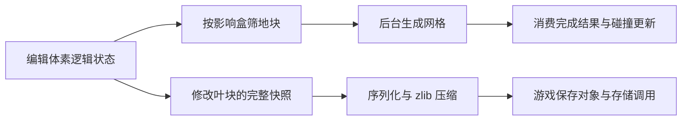

# 掘地求财：挖掘、存档与性能

本机《A Game About Digging A Hole》走的是 **Unreal + Voxel Pro 的三维体素路径**。目前已从匹配的 EXE/PDB 和解码后的游戏资源确认技术栈，逐项追到值场编辑、受影响区域筛选、网格与碰撞任务，以及保存快照和队列。游戏的实际资源调用与插件本身的能力在各页分别标明；未运行游戏或测量 FPS。

最新续查见[09：碰撞结果接受门](09-collision-result-acceptance.md)：旧 cook 即使已入队，仍须通过当前 cooker 编号相等等检查，再进入 BodySetup 交换与物理状态重建。[08 的 Mixed 分派](08-mixed-handler-submission-chain.md)和[07 的初始配置条件](07-material-slots-and-handler-selection.md)继续适用；实际加载、覆盖与物理时序未运行验证。

| 要回答的问题                     | 阅读入口                                                              | 已有证据与边界                                                             |
| -------------------------------- | --------------------------------------------------------------------- | -------------------------------------------------------------------------- |
| 铲子怎样改变地形，洞怎样变成模型 | [挖掘与局部重建](01-excavation-and-local-rebuild.md)                  | 体素编辑公式、脏区、mesh 与碰撞链；游戏具体工具分支另列                    |
| 挖了之后怎样存下来、怎样恢复     | [保存与一致性](02-save-load-and-consistency.md)                       | 修改叶块快照、zlib、加载重建、游戏保存请求队列；持久化保证不由异步名称推断 |
| 为什么能持续挖，哪里可能变慢     | [性能与独立设计](03-performance-and-independent-design.md)            | 局部更新、距离优先级、后台任务和提交预算；实际耗时与长时间挖掘为 Not Run   |
| 矿物外观与地形是什么关系         | [矿物网格、摆放与移除](04-mesh-materials-and-ore-presentation.md)     | 实际蓝图布点、组件、网格选择与煤网格包身份；材质槽和露出判定未知           |
| 连续挖掘如何处理任务与增长       | [任务生命周期与性能增长](05-task-lifetimes-growth-and-performance.md) | 续查任务替换、失效和数据保留边界；与实际游戏配置及计时分开                 |
| 换电脑后如何重新核对             | [证据身份与复核](00-evidence-and-reproduction.md)                     | Steam build、摘要、PDB 匹配、容器范围和自写读取工具                        |

最值得借鉴的是**保存逻辑地形、重建派生网格**。插件保存的是被修改的体素叶块及附加对象，单叶块值/材质各有 4096 个元素；未编辑部分继续依赖生成器。它每次整理当前全部已修改状态，属于稀疏快照，不是每次铲击追加一条日志，也不能据此认定磁盘增量写入。快照期有全域数据锁，随后序列化和压缩；异步入口不会让这个锁消失。

实际游戏连接已恢复：`Dig` 在一个条件分支中进入表面候选筛选、强度与衰减处理，再异步编辑体素；两种爆炸蓝图调用球形挖除。主存档采用 `VoxelComplexController_SaveExample`，其 `Save` **同步**抓取并压缩体素，再经矿物管理对象回调补入物件位置、种子和玩家状态，之后走异步 slot 写入。因此本作“异步写盘”和“异步体素快照”需要分开理解。具体分支、参数来源及一致性边界见 01、02。

局部重建则把“改变地形”和“显示新洞”分成不同阶段：编辑值场后，以影响盒找重叠 chunk，后台计算 mesh，再消费结果和更新组件碰撞。原生实现还有 invoker 距离优先级和提交截止时间；具体游戏参数、长尾成本与最坏帧耗需运行证据。

图中上游编辑、重建与快照是原生路径概要；游戏资源如何接入及存储调用的具体分支以 01、02 为准，不表示所有阶段同步或每次挖掘都保存。

与前面三款的区别可按“状态是什么”理解：

| 游戏                                    | 本轮相关研究中的状态                       | 适合借鉴的模块                         |
| --------------------------------------- | ------------------------------------------ | -------------------------------------- |
| [Tiny Glade](../README.md)              | 连续建筑轮廓、构件关系、地形高度与派生几何 | 墙屋顶、开洞、接缝与局部构件重建       |
| [Sandcastle](../sandcastle/README.md)   | 规则网格单元的沙水状态与高度表面           | 流动、侵蚀沉积、铲挖与堆积、水面显示   |
| [SUMMERHOUSE](../summerhouse/README.md) | 预制建筑块、格点、前后层次和组合规则       | 小件拼装、邻接替换、解锁与调色         |
| 掘地求财                                | 三维体素密度/材质、修改叶块和派生网格      | 地下空洞、局部重建、保存恢复与性能调度 |

对自研 Unity 沙盒，建议把地形数据所有者、网格/碰撞任务和保存队列分开：连续编辑合并脏块，任务提交前校验版本，保存记录请求版本与完成版本，并保留可恢复的旧快照。这是独立设计建议；原作是否具有所有这些保障，仍以已恢复证据为限。
