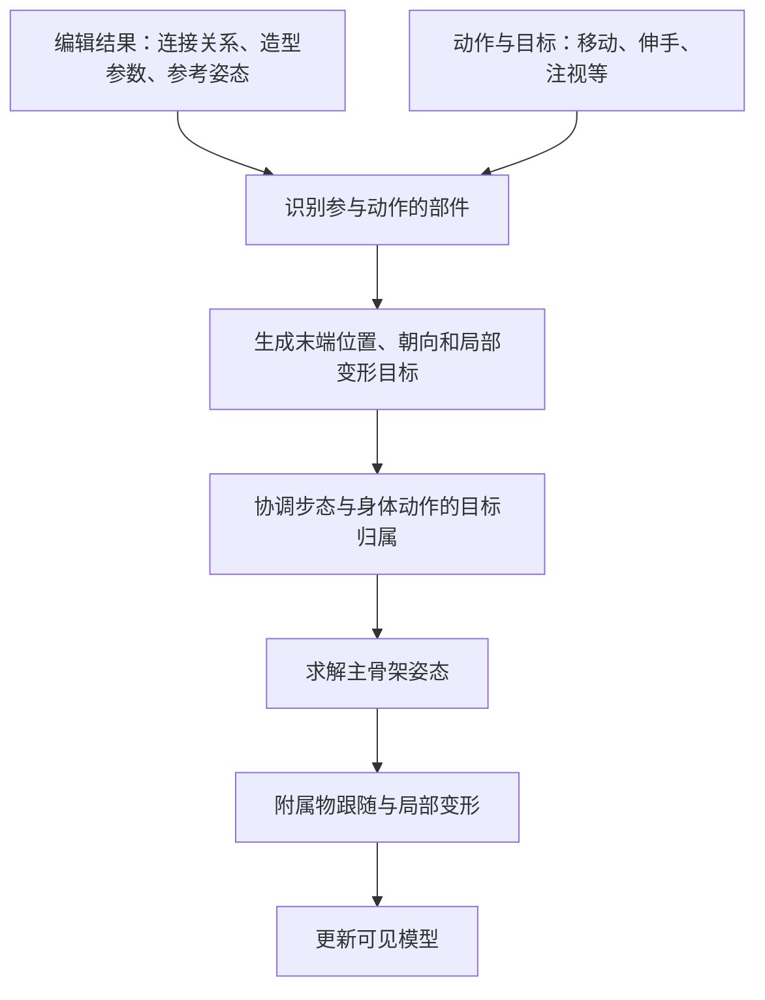

# Spore 陆地生物：其他身体部件与姿态

范围延续[研究目录](README.md)：登陆后的生物编辑与动作适配，限定在部落阶段之前。这里补充躯干、手臂、头嘴、眼耳、尾巴、翅膀与装饰；不研究部落持物或整款游戏重建。详细算法续见 [03 核心结构](03-core-structures-and-frame-pipeline.md)与 [05 姿态求解](05-particle-ik-and-rest-pose.md)。

时间锚点：2026-10-11 17:50:35 PDT（America/Los_Angeles），对应 2026-10-12 00:50:35 UTC。本轮采用公开设计资料、本机只读字节检查及明确标注的独立教学演算，没有原游戏运行观察。

## 先把“形状”和“姿态”分开

后续[30](30-part-shape-rest-pose-and-local-animation.md)细化这一分层：取得烘焙后局部动画适配说明与一条本机嘴部标量通道，补齐拉长嘴、加粗肢体、参考弯曲后的独立算法。下文原始覆盖和当时未知保留。

拉长嘴、加粗手臂是造型；转头、伸手、弯腰是骨架姿态；张嘴、握手、闭眼是部件内部变形。它们需要不同的数据入口，不能用一个“播放动画”的解释全部覆盖。

Rigblocks 公开资料描述的是预制部件与参数化编辑手柄：手柄在单位区间内选择变形，多个造型变化以增量组合，完成的形状可以烘焙。烘焙造型不能被解释成取消角色全部运行时动画。[开发团队 Rigblocks 资料](https://www.cs.cmu.edu/~ajw/s2007/0248-Rigblocks.pdf)

**独立造型演算：**假定自己的嘴部有“长短”和“宽窄”两个参数，长度基准 10 cm、增量 8 cm，宽度基准 4 cm、增量 2 cm。选 `u=0.25`、`v=0.75`，得到长 12 cm、宽 5.5 cm。再让运行时张嘴程度从 0 变到 1，改变开口而保留上述造型。这只是我们选择的简单线性规则；原游戏的参数曲线及两层变形组合顺序未恢复。

躯干和肢体表皮还有另一条生成路线。开发者介绍了 metaballs 隐式表面，并指出相近肢体可能连成蹼膜，骨骼权重也与生成表皮的 metaballs 来源有关。视觉上连成一片，不等于骨架父子关系合并。[Chris Hecker 开发笔记](https://chrishecker.com/My_Liner_Notes_for_Spore)

**独立表皮例子：**两条骨链保持各自父子关系，但生成它们外皮的影响区域相交，表面可以相连。把两条链拉开，外皮连接可能消失。借鉴时应分别验证“表面连续”与“关节连接”，不要凭外观反推拓扑。

## 公开动画设计支持到哪一步

公开论文描述：部件带语义标签和标准化变形；玩家编辑姿态是参考姿态；动作可相对自身、其他部件或外部目标适配。求解先脊柱后肢体，嘴的目标可委托脊柱；不参与目标求解的子树可接受被动次级运动。它还明确没有处理体内自碰撞。[开发团队动画论文 §1.2、§3、§4.3–4.4、§5](https://www.chrishecker.com/images/c/cb/Sporeanim-siggraph08.pdf)

这说明要区分三种姿态，而不是把编辑器里的形状直接当作每帧动画：

| 姿态 | 用来回答什么 | 本报告的独立例子 |
| --- | --- | --- |
| 参考姿态 | 这个生物平时怎样站、各部件从哪里出发 | 手臂自然下垂，肘部预先略弯 |
| 目标姿态 | 当前动作希望部件到哪里、朝哪里 | 手希望到达嘴旁，头希望朝向目标 |
| 求解姿态 | 骨架怎样在可达范围与约束下接近目标 | 肩、肘、脊柱共同调整，保留可辨认的弯曲 |

### 躯干和脊柱：提供整体姿态

**独立教学场景：**生物有六个脊柱节点，嘴挂在前端，参考姿态略向前弯。我们让嘴的目标降低 20 cm，同时保持身体基准位置。可以设计为前端多个节点逐渐弯曲，而不是让嘴在一个安装点上转动。20 cm 是构造输入；各节点最终弯多少需要求解，不能直接平均分配并宣称是 Spore 的结果。

把“颈部”理解为承担头嘴动作的一段连接链，对分析比先假设固定人形颈骨更有用。需要记录部件挂在哪个节点，以及目标是否会影响祖先链。本机准确的节点数量、权重、根节点选择结果和弯曲限值仍未知。

**独立姿态建议：**为了自己的实现稳定，可以把参考姿态留在有弯曲余量的状态，显式处理目标不可达；不要要求极度折叠或完全伸直的链始终得到同样自然的结果。这是设计建议，不是原游戏编辑器的强制校验规则。

### 手臂和手：末端目标与手形分开

**独立教学场景：**A 的手离嘴近，B 的手离嘴远；共同动作要求“手到嘴旁”。我们根据每个生物自己的嘴位置生成目标，再解各自肩肘姿态，而不是复制 A 的肘角给 B。可以同时给手设置握合程度；末端位置与手指形状是两个输出。

参考姿态还可以成为挥手动作的起点。独立定义手的位移 `Δp(t)` 后，选择 `p_goal(t)=p_rest+Δp(t)`。这是最简单的自研位置示意；需要另外选择坐标系、缩放、末端朝向和约束，不能当作论文全部动作模式或本机公式。

多个手意味着必须明确选择规则。**独立构造例子：**四只手、两个嘴，如果只允许“一只手对应一个嘴”，共有 `4×2=8` 种配对；“四只手同时动”则是另一种规则。本机各动作到底选择一只、左右一对还是全部，以及没有手时怎么分支，均未追到配置。不能把配对数量当作游戏实际变体数量。

### 头和嘴：朝向、到达与张嘴是三件事

**独立教学场景：**目标在左侧且高于嘴，先计算希望朝向的方向，再给头嘴连接链设置姿态目标，并让嘴的开合参数随动作变化。我们还可以叠加小幅点头。不要让张嘴参数顺便承担转头，也不要只转嘴的网格却期待身体自动弯腰。

**独立多头例子：**两个头分别朝前与朝后，目标位于前方。自己的系统可以根据当前朝向与目标夹角，降低背向头的跟随权重，避免两个头都硬转到同一方向。本文未恢复原游戏针对某个双头生物的选择阈值或最终动作。

### 眼睛和耳朵：局部变形，不必牵动整条链

**独立教学场景：**角色注视一个目标时，头部保持朝向，闭眼程度从 0 到 1 再回到 0；这样可以表达眨眼而不改变头部位置。耳朵下垂也可以采用局部变形参数。这里的 0/1 编码是我们自己选的，不代表本机通道数值。

尚未确认本机有没有独立眼球视线、眼睑骨骼、眨眼间隔，或不同眼型采用怎样的局部实现。`eye` 名称不能证明上述结构；头部朝向也不能自动证明眼球跟随。

### 尾巴、触角与装饰：先判定角色，再选择动作

不能把所有尾巴归为被动弹簧：尾巴可能属于脊柱延伸，也可能属于动作主动控制的链；硬角、甲片与柔软触角也应区分。

**独立教学场景：**转身后，一个未参与主要动作的柔软附属物可以延迟跟随并逐渐稳定；刚性角则只随安装点运动。若另一动作主动要求该附属物击打目标，自己的系统可以暂时切换到主动控制。何时切换、如何消除跳变，以及具体部件是否柔软，都需要自己的明确规则。本机对应分类与参数未解出。

本机字符串中关于 secondary 依赖环和 smoothing 的诊断，只能证明存在相关诊断词汇，不能直接拿来证明尾巴的弹簧方程。

### 翅膀：造型、主动动作与被动运动分别核对

**独立教学场景：**自己的翅膀可以有三种控制状态：收拢、展开、周期拍动。展开程度可以是一个部件参数，拍动可以是骨链姿态，翅尖再有被动跟随；三者可以组合，但必须先明确通道归属。

本机有 `wing` 与 `glide` 名称，尚未恢复翼骨链、展翼通道、拍动时序或陆地生物滑翔动作。前述“肢体表皮形成蹼膜”也不能证明翼部采用相同动画。这里不提供臆测的 Spore 拍翼公式。

## 给自研系统的一条数据流

下图是独立设计建议，按上述问题组织职责，不是本机已恢复的函数调用图。



**独立组合例子：**一个生物向前走，同时伸手到嘴旁。脚有落脚目标，手有到嘴旁的目标，身体允许一定摆动，嘴有开合目标。需要解决的核心问题是这些控制器谁拥有哪个输出、怎样过渡和怎样处理冲突。不能把整套行走姿态与整套伸手姿态简单各取一半，就保证脚仍贴地、手仍到嘴。

如果开始自己的实现，最低需要保存：部件身份及父节点、参考位置与旋转、左右对应、功能角色、造型参数与运行时变形通道。社区 SDK 的 `CreatureBlock` 声明确实列出了 parentIndex、symmetricIndex、position、orientation、capabilities、deforms 等字段，可作研究入口；它是社区声明，不是原开发者源码，也没有在此 EXE 上验证内存布局。[社区 CreatureBlock 声明](https://modapi-docs.sporecommunity.com/struct_anim_1_1_creature_block.html)

## 本机补充证据

目标仍是 `E:\Steam\steamapps\common\Spore\SporeBin\SporeApp.exe`，20,626,168 bytes，PE32 i386，版本资源 `1.3.0.29`，SHA256：

```text
f9716458cdc232a507686dcb490e75680c514e31a5b1f33601b0dfcd05baf75d
```

以下均为 EXE 原始文件偏移，只代表字符串位置。没有函数交叉引用，不能证明这些通道在选定阶段实际执行。

| 字符串或名称组 | 文件偏移 | 调查价值与限制 |
| --- | --- | --- |
| `wing` | `0xfeb520` | 翼部角色词汇；不能确定拍翼算法 |
| `mouth`、`eye`、`ear`、`grasper` | `0xfeb5e8`、`0xfeb5f0`、`0xfeb5f4`、`0xfeb5f8` | 嘴、眼、耳、抓握部件词汇 |
| `nostretch`、`limb`、`spine` | `0xfeb600`、`0xfeb60c`、`0xfeb614` | 不伸长、肢体、脊柱相关名称；约束效果未确认 |
| `DeformBoneEndJoint`、`DeformBoneMiddle` | `0xfeb8f0`、`0xfeb904` | 变形骨骼名称线索 |
| `symmetricIndex`、`parentIndex` | `0x1046708`、`0x1046764` | 对称与父节点字段线索 |
| `orientation`、`jointPosition`、`deformChannel` | `0x1046770`、`0x10467a4`、`0x10467b4` | 姿态与变形字段线索 |
| `swayPhase`、`swayAmplitude` | `0x1046ee4`、`0x1046ef0` | 摆动参数名称，单位未知 |
| `maxyawangle`、`maxrollangle`、`maxpitchangle` | `0x1046fdc`、`0x1047010`、`0x1047020` | 旋转幅度名称，坐标约定与应用位置未知 |
| `deformSpec`、`deform`、`aggregate` | `0x1047afc`、`0x1047b08`、`0x1047b10` | 通用变形描述入口 |
| `Anim/partscaps/deformdesc`、`Anim/deformdesc` | `0x1047c0c`、`0x1047c78` | 部件能力与变形描述路径线索 |
| `blendInTime`、`allowLocomotion` | `0x1047d84`、`0x1047da0` | 混入时间、允许移动名称；实际优先级未确认 |

局部完整 NUL 终止 ASCII 簇覆盖 `[0xfeb4a0,0xfeb640)` 与 `[0x1047a80,0x1047cd0)`。眼和耳是三字符字符串，不能采用最小四字符筛选后断言不存在。

全文件 ASCII 关键词检查未得到 `eyelid`、`openmouth`、`closemouth`、`wingflap`、`jiggles` 或 `wiggles` 命中。`blink` 的子串命中来自 `cJobLink`，`jaw` 的有意义名称来自 `cell_jaw` / `cell_jawhead`，不属于陆地眨眼或张嘴实现证据。未命中字符串不能排除功能。

特别排除误归属：相机/星系邻域的 `mLookAtVelocity` 不作生物注视证据；部落邻域的 grasper 名称不作第二阶段持物证据；涂色粒子邻域的 `alongspine` 不作脊柱姿态证据。

## 覆盖、验证与后续入口

已回答：造型与运动的区别、参考/目标/求解姿态的职责、不同部件应分别追踪哪些输出。部分回答：公开系统如何组织脊柱、肢体与附属物；本机仅有对应名称和结构线索。未回答：本机具体部件通道表、精确翼部算法、姿态参数值与选定生物的动作结果。

实际验证：复核本机 EXE 摘要；重新解析 PE 节表并修正前篇节起点；检查有界字符串簇及上述假命中；核对文档链接、UTF-8 和构造例子的算术。没有创建或改动游戏文件。

未做/原因：没有原生函数反编译、资源通道解码或游戏运行观察。沿用前篇已记录的 REA runtime/provider 缺口；没有重新安装、构建或修改配置。没有执行仓库软件测试，因为本轮只增加研究文档。

风险：公开设计与当前 EXE 未逐项对齐，字符串不能证明算法，独立演算不能当作实际游戏参数或保证极端姿态可用。公开论文的自碰撞限制不证明这个 Steam 版本每个边界行为；本机仍需验证。

后续最小静态入口：从 `deformSpec` / `Anim/partscaps/deformdesc` 找解析和调用者，确认部件角色怎样映射到运行时通道；再查 `parentIndex` / `jointPosition` 如何进入姿态求解。需要运行验证时，可选择同体型不同参考弯曲、双头、柔软/刚性附属物、翅膀四组对照，记录局部变形、安装点姿态与最终可见结果。没有执行这些场景。
