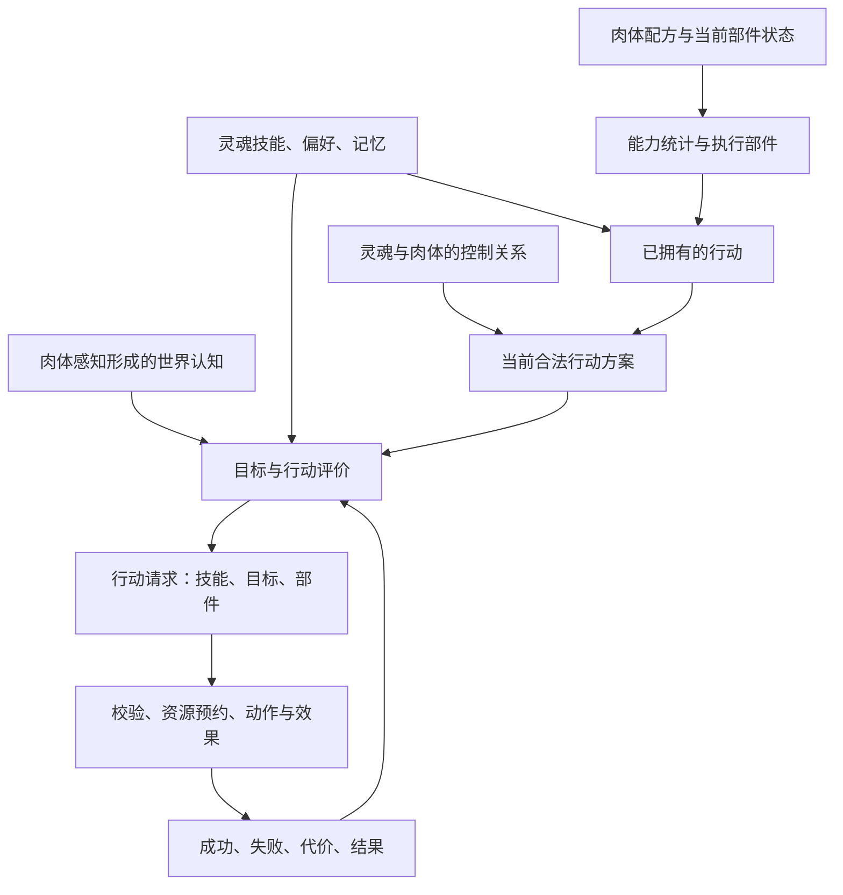

# 13 借鉴设计：灵魂、肉体、技能与控制关系

[目录](README.md)。这是针对用户肢体拼装游戏的**独立设计建议**，不是 Spore 的灵魂系统研究；没有证据显示 Spore 有这里定义的灵魂机制。用户已确认：灵魂既影响行为策略，也会提供自己的技能。本轮锚点 2026-10-11 21:37:02 PDT，对应 2026-10-12 05:37:02 UTC。

## 核心分层

肉体描述可执行的动作条件、感知条件与身体能力；灵魂描述目标、偏好、知识和灵魂技能；占有关系将某个灵魂接到某具肉体；行动执行器负责检查条件、选部件、预约资源、驱动动作和结算。这里的“占有”只是关系命名，不擅自决定游戏必须有夺舍玩法。



这是建议的职责图。单个灵魂控制单具肉体是当前演算的简化前提；多灵魂共体、离体施法、分布式控制需要另定义仲裁规则，不在这里默认为已定玩法。

## 结构与所有权

```text
BodyInstance {
    bodyId, recipeId, anatomyRevision
    parts: { partId, parentId, health, functionState, activeCapabilities }[]
    bodyResources, bodyCooldownLedger, perceptionConfiguration
    anatomyGraph, locomotionState, referencePose
}
SoulInstance {
    soulId, learnedAbilityIds, soulResources, soulCooldownLedger
    policyProfile, knownFacts, longTermGoals, observedOutcomes
}
ControlLink {
    controllerId, soulId, bodyId, generation
    permissions, compatibilityResults
}
ActionDescriptor {
    abilityId, origin: Body | Soul
    sourceId, executionModes[], effectDefinition
    cooldownScope, costOwners[], cancellationPolicy
}
ActionPlan {
    descriptorId, targetId, executionMode
    providerPartIds[], channelClaims[], costReservations[]
    anatomyRevision, controlGeneration, evaluationSnapshotId
}
```

身体受伤和疲劳属于肉体；灵魂能量、知识和人格属于灵魂；正在执行的动作属于控制关系上的行动实例。替换控制者不应默认修复伤口、清空肉体冷却，或重置灵魂自身的消耗。具体资源名称和跨身体继承政策仍需按你的玩法配置。

稳定 partId 指一枚具体部件实例。资产类型 ID、身体数组下标、左右标签都不能替代它；两只同款爪子是两个实例。Spore 的相关声明见 12，其持久部件身份尚未验证。

## 技能集合不是单一交集

```text
OwnedActions = DeriveBodyActionDescriptors(body)
             ∪ SoulLearnedActionDescriptors(soul)

AvailablePlans = MaterializeAndValidateExecutionModes(
    OwnedActions, body, soul, controlLink, currentWorld)
```

并集只说明技能来源；合法行动还取决于执行模式。必须区分：未学会、缺部件、部件损坏、资源不足、冷却中、目标不合法、距离不符、控制权限不足。返回具体原因，不能把这些情况统一当作“没有技能”。

独立技能例子：

| 技能与来源 | 执行条件 | 肉体变化后的结果 |
| --- | --- | --- |
| 爪击，肉体 | 至少一个健康且可达的爪部 | 断爪后可改选另一爪；没有爪则不可执行 |
| 灵魂弹，灵魂 | 模式 A 为纯意识；消耗灵魂能量，要求有效控制关系与发射位置 | 无手仍可按模式 A 施放 |
| 印记火球，灵魂 | 模式 B 要求具备符印手势的手；也可单独配置吟唱模式 | 手损坏后技能知识保留，手势模式不可用 |
| 吐息，肉体 | 功能正常的喷吐器官、供能/弹药、口部通道 | 不能仅因嘴模型存在就默认可用 |

这些技能和条件是构造例子，不是已经替你决定的实际技能表。灵魂技能也可能与肉体器官共同形成混合技能；其来源可以有多项，但知识、执行部件和消耗仍应保留各自归属。

## 肉体影响策略，不只影响技能按钮

AI 使用肉体感知形成的认知快照：眼、听觉、嗅觉决定能观察什么，灵魂记忆保存过去见过什么。默认不把真实世界全部敌人直接塞进灵魂认知。全知视角、魔法感知、猜测敌人意图应是明确能力或难度规则。

同一个灵魂换到重甲短腿肉体，会发现接近目标耗时更长、撤退成功率更低；换到长腿远程肉体，可评估拉开距离后的攻击。灵魂的目标可以保持“保护主人”，实现方法则随肉体变化。

熟练度不必直接增加身体伤害。它可以影响目标预测、施放时机、部件协调和经验置信度。若灵魂也增加伤害，必须把该倍率写入数值合成契约，避免一个“灵魂强度”同时隐含修改命中、冷却、动画速度和伤害。

## 控制关系改变时怎样避免旧动作继续生效

```text
ChangeControl(soul, newBody):
    validate permissions and compatibility
    stop accepting new actions on previous link
    ApplyConfiguredCancellationToRunningActions(previousLink)
    release uncommitted resource/channel reservations
    detach old link; create new link with new generation
    invalidate plans and provider bindings for old link
    derive plans from new body's anatomy and soul's learned abilities
    return result with unavailable modes and reasons
```

取消不是自动退款：资源是否已支付、效果是否已提交、投射物是否已生成必须分开。一个已经发射的投射物可以按政策独立存在，使用发射时的施法者身份；不能在控制关系变化后把它改归新身体或结算第二次。

断肢更改 anatomyRevision，不必更改 soulId。旧方案在施法准备或效果提交前必须重新校验其**具体依赖部件**。无关装饰变化不应无条件打断所有动作；依赖不再有效时，按技能配置取消、降级或重新规划，不能静默换手继续。

## 灵魂如何改变动作风格

战略偏好决定选什么；表达风格决定姿态幅度、等待时间、视线和手部表达。风格进入动画/姿态层时仍必须满足可达性和脚部接地。若风格改变前摇、攻击窗口、范围等战斗属性，它就属于玩法参数，需要同时更新 AI 预测和伤害判定，不能只加快显示动画。

不要把“好战”固化成只能近战。远程肉体上的好战灵魂可以更积极地压制；谨慎灵魂也可以在可靠击杀窗口使用爪击。策略应该评价行动效果，而不只按技能名称硬编码人格。

## 建议先实现的最小契约

先支持一具肉体、两个健康爪部、一个可选喷吐器官；两种灵魂各有一项独立法术；共用技能执行器，能演示换灵魂改变选择、换肉体改变合法方案、断肢使旧方案失效。再讨论共体仲裁或自由组合施法器官。

未做：没有提供用户游戏仓库，因此没有匹配现有代码、保存格式或实现任何游戏系统。风险：控制关系、兼容性与跨身体冷却属于产品规则，本文是可评审建议；不能未经确认整套落入生产。
