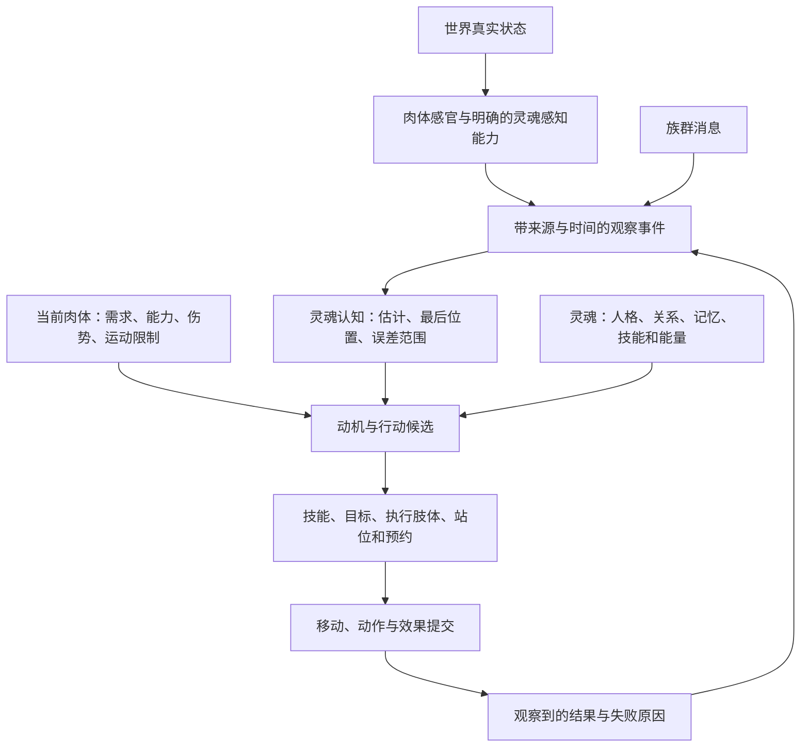

# 27 感知、目标记忆与动机：灵魂知道什么，肉体能做什么

[目录](README.md) · [肉体评估](16-soul-ai-body-assessment.md) · [群体配合](21-pack-coordination-and-shared-intents.md) · [移动与停止](26-land-approach-stopping-avoidance-and-gait.md)。范围仍为登陆后、部落前的Creature Stage。调查锚点：**2026-10-12 14:21:42 PDT，America/Los_Angeles**。

本轮取得本机感知、声量、脱离目标和逃跑调参，以及公开动机枚举、目标更新与NPC更新入口。**没有恢复原作的视觉遮挡、目标记忆布局、动机阈值或行为优先级。** 第1–3节列证据；第4节以后是用户肢体拼装／灵魂游戏的独立规格。Spore没有被证明存在这里的灵魂、断肢或换体机制。

## 1 原作：本机参数确实存在，但不是完整AI公式

用[专项读取器](checks/read_selected_perception_properties.py)只读取两个已选DBPF包里名为`CreatureGameTuning`的PROP资源，保留四组键、两包共8条记录，不展开其他资源或导出游戏资产。[参数观察](evidence/local-selected-perception-properties.json)保留包摘要、资源键、存储位置、解码摘要、原类型和值。

下表取`type=0x00b1b104 / group=0xad56080c / instance=0x7c340397`，该记录有249项属性。两个包里**下列选定字段**一致；不因此决定运行加载顺序或所有属性完全相同。

| 字段 | 原始值 | 能说明什么／仍未知什么 |
| --- | ---: | --- |
| `creatureMaxPerceptionRadius` | 50 | 有感知半径上限调参；不能说眼睛看50米，也未知作用对象与单位 |
| `creatureLoudnessNormalSpeedMultiplier` | 1.5 | 常速声量倍率；未知何时使用 |
| `creatureLoudnessSprintingSpeedMultiplier` | 2 | 冲刺声量倍率；未知是否与其他倍率相乘 |
| `creatureLoudnessInCombatMultiplier` | 3 | 战斗声量倍率；未知听觉检测公式 |
| `creatureCallMaxLoudness` | 500 | 呼叫声量上限词汇；不是已知传播距离 |
| `creatureUntargetDistance` | 17.5 | 脱离目标距离词汇；未知中心距、条件与计时关系 |
| `creatureChaseDistance` | 5 | 追逐距离词汇；不能当普遍追逐半径或攻击站距 |
| `creatureHelpAllyInRadius` | 10 | 支援盟友范围入口；未知报警与任务分配规则 |
| `creatureFleeDistance` / `creatureFleeTime` | 25 / 5 | 逃跑距离与时间调参；单位及状态转移未知 |
| `creatureFleeRememberTime` | 90 | 有逃跑相关记忆时间参数；不证明所有目标的记忆TTL都是90秒 |
| `creatureFleeWatchTime` / `creatureFleeStealthTime` | 10 / 10 | 警戒与潜行相关时长词汇；未恢复执行条件 |
| `creatureFleeTimeToTired` / `creatureFleeTiredTime` | 3 / 3 | 疲劳相关调参；未知是否与体力条同源 |
| `creatureFleeDirectionBiasHerd` / `...AwayFromThreat` | 1 / 1 | 指向族群／远离威胁的方向偏置词汇；没有证明采用向量加权 |
| `creatureFleeDirectionBiasNest` | 0.5 | 巢穴方向偏置词汇；不是必定回巢 |
| `creatureHitPointsTurnAndFightPercentage` | 0.75 | 有回身战斗相关健康比例参数；比较方向、参照血量及生效分支未知 |

`group=0xf71fa311`的28项记录显式引用上述父键，并写有感知半径30、战斗声量倍率5、四项Sight/Hearing与LookAt警觉倍率1.25、WatchTime=5。另两组`0`和`0x02ae0c7e`也引用父键，分别写FleeDistance=35/45、WatchTime=5。**没有确认这些组分别属于玩家、普通NPC、成长阶段或其他角色**，不拿组名猜生效条件。

本轮选择字段的[名称登记表](evidence/public-perception-motive-registry.json)固定到SporeModder-FX提交`a482c51d8d37fc8cf416acecc3c00a5b0723f2e5`。显式注册ID优先；无显式ID名称按小写FNV1匹配，不用FNV1a。登记表也包含冒险等其他范围，读取器排除Scenario字段。[固定登记表](https://raw.githubusercontent.com/Spore-Community/SporeModder-FX/a482c51d8d37fc8cf416acecc3c00a5b0723f2e5/reg_property.txt)

`creatureSightAngle`、`creatureSightRadius`、`creatureBasePerception`、`creatureBaseLoudness`、`creatureHungerDrain`和初始健康／饥饿调参虽能在登记表定位，**没有直接写在本轮所选的这些记录里**。不等于运行没有视觉、听觉或饥饿衰减；它们可能有其他资源、默认或调用路径。这里没有取得有效配置合并结果，也没有解码另一个非PROP的`CreatureTuning`来补数值。

## 2 原作：动机状态、目标与行为决策应分别调查

固定ModAPI提交`2d71289adc71aa5c58f4516c6c835c99f5f9ca19`的`CreatureMotive`枚举是：

| 枚举 | 值 | 证据边界 |
| --- | ---: | --- |
| None / Default | 0 / 1 | 未解释进入条件 |
| LowHunger | 2 | 名称描述饥饿状态，不等同于觅食动作 |
| CriticalHealthAndHunger | 3 | 健康和饥饿的复合状态，优先级未知 |
| LowHealth / CriticalHealth | 4 / 5 | 不证明低血量必逃跑 |

社区注释称低／危急阈值来自`MotiveTuning`；没有给出阈值值或本机读取者。[枚举声明，660–668行](https://raw.githubusercontent.com/Spore-Community/Spore-ModAPI/2d71289adc71aa5c58f4516c6c835c99f5f9ca19/Spore%20ModAPI/Spore/Simulator/SimulatorEnums.h)

其他入口：

- `cCreatureBase`声明`SetCreatureTarget(target, bool, intention)`、`UpdateHunger(deltaTimeSeconds)`、`UpdateMotiveState()`及`mLastMotiveState`。饥饿更新、动机分类、目标意图是可分别追踪的入口；不证明按某个顺序调用。[生物声明](https://raw.githubusercontent.com/Spore-Community/Spore-ModAPI/2d71289adc71aa5c58f4516c6c835c99f5f9ca19/Spore%20ModAPI/Spore/Simulator/cCreatureBase.h)
- `cCreatureAnimal`有`NPCTickAI`、`mUntargetDistanceTime`；`field_1624`只是整数，注释标为`cAIMemory`，未公开其布局。[动物声明](https://raw.githubusercontent.com/Spore-Community/Spore-ModAPI/2d71289adc71aa5c58f4516c6c835c99f5f9ca19/Spore%20ModAPI/Spore/Simulator/cCreatureAnimal.h)
- `cSpeciesProfile.mSight`是整数，社区注释为Sense。不能解释成米数、视角或眼睛数量加成。[物种声明](https://raw.githubusercontent.com/Spore-Community/Spore-ModAPI/2d71289adc71aa5c58f4516c6c835c99f5f9ca19/Spore%20ModAPI/Spore/Simulator/cSpeciesProfile.h)
- 决策数据有回调、子节点决策策略和根决策入口；`cAgentOrder.mOriginalTargetPos`是命令字段，不能冒充“最后看见目标的位置”。行为对象有交互历史和交互栈，也不等同于感知记忆。[决策数据](https://raw.githubusercontent.com/Spore-Community/Spore-ModAPI/2d71289adc71aa5c58f4516c6c835c99f5f9ca19/Spore%20ModAPI/Spore/Simulator/AI/cBehaviorTreeData.h)、[行为对象](https://raw.githubusercontent.com/Spore-Community/Spore-ModAPI/2d71289adc71aa5c58f4516c6c835c99f5f9ca19/Spore%20ModAPI/Spore/Simulator/cBehaviorAgent.h)
- 22已有物种关系表；没有找到它到`UpdateMotiveState`的公开调用链。不能将敌对关系直接推为“总是攻击”，也不能用模糊人格字段还原原作评分。

[7份公开声明记录](evidence/public-perception-motive-contracts.json)保留实际读取的字节数、SHA256、路径与行号。共享Simulator声明不是当前本机Creature Stage调用证据。

## 3 原作：本机可追踪入口与不成立的推断

重新核对EXE摘要仍为00记录的`f9716458…af75d`；只查`.rdata/.data`内完整、NUL结尾的4–160字节ASCII串。[本机记录](evidence/local-perception-motive-entry-observations.json)保留34个词法候选的查询范围和18个选定完整字面量。

| 完整字面量 | 文件偏移 | 当前用途 |
| --- | --- | --- |
| `Simulator/cAIMemory` | `0x10695f0` | 后续定位记忆类型的读取者 |
| `mUntargetDistanceTime` | `0x1069654` | 追脱离目标计时入口 |
| `mPlayerAlertState` | `0x10696bc` | 查警觉状态读写 |
| `mIntentionTowardsTarget` | `0x1069bd4` | 查目标意图与行为分支 |
| `mHungerDelayTimer` / `mHungerDelta` / `mHunger` | `0x1069c88` / `0x1069c9c` / `0x1069cac` | 查饥饿更新时间、增减与状态分类 |
| `mCurrentLoudness` / `mbStealthed` | `0x1069d3c` / `0x1069d50` | 查声量与潜行如何进入感知 |
| `mLastMotiveState` | `0x1069d7c` | 查动机状态更新后的消费者 |

这些均为数据字面量地址，不是函数入口、社区对象成员偏移或当前进程指针。邻域还有共享动物与Scenario字段；同处一段内存不证明陆地专属类成员关系。

本机另有`fleeTime/fleeSpeed/flee_target`候选，但邻域含cell、electricDischarge和poisonRecharge，未用于陆地结论；`Flee: normal end`邻域含车辆、城市和交易，也排除。**同名“逃跑”不代表同一阶段算法。** 这次ASCII范围没有视觉／听觉相关完整名称命中，不用于否定它们：PROP属性可以只存ID。

| 原作问题 | 本轮结果 |
| --- | --- |
| 感知、声量、逃跑是否有独立调参 | 部分回答：选定本机值已读取 |
| 是否有健康／饥饿分类与NPC更新入口 | 部分回答：公开声明与本机名称互相提供调查入口 |
| 是否存最后见到位置、如何忘记／重新发现 | 未回答：有记忆名称，不知内部内容与更新规则 |
| 是否做视线遮挡、视角、听觉衰减 | 未回答：不能从登记名补公式 |
| 饥饿、受伤、关系如何选择具体行为 | 未回答：分类、阈值、策略与执行链仍缺 |

## 4 自研结构：感知事实、目标记忆、身体需求、灵魂策略

以下参数都由我们选择，单位为秒与米；不沿用上面的游戏配置。职责建议如下：



世界状态只能由感知／物理／效果的权威主人查询；灵魂决策接口只接收已知信息与自己身体的状态。全局知道敌人绕到石头后，不代表NPC也知道。若某类灵魂有透视，明确做成具有范围、过滤规则、代价和冷却的能力。

```text
SensorProfile { sensorRevision, bodyVersion, controllerEpoch,
                organs[partId, modality, localPose, range, aperture,
                       noiseFloor, enabled], soulSensors[] }
Observation   { eventId, observerLease, entityId?, entityGeneration?,
                source, observedAt, receivedAt, region, errorRadius,
                confidence, facts, sensorStamp, originObservationId }
Belief        { entityKey?, anonymousTrackId?, sourceObservations[],
                lastConfirmedPosition?, estimatedRegion,
                observedHealthInterval?, observedEquipment?,
                relationEvidence?, lifecycleEvidence?, expiresAt }
BodyNeeds     { hungerNeed, healthFraction, pain, stamina, mobility }
SoulPolicy    { riskTolerance, aggression, empathy, curiosity,
                foodPreference, relationshipRules, skillKnowledge }
Decision      { beliefRevision, bodyVersion, controllerEpoch,
                motive, targetBelief, candidatePlan, score, reasons }
```

实体键包含代次，防止死亡后复用ID继承旧仇恨或攻击。只有声源方向／区域时保留匿名轨迹，不用世界对象ID帮助AI自动识别敌人。敌人健康和技能记录是估计，可过期；自己肉体的能力快照由16提供，是精确信息。

灵魂拥有长期知识与人格；饥饿、伤口和体力归肉体；灵魂法术能量、身体技能成本归各自账本。换肉体会更换身体需求，不会将旧肉体的饥饿复制给新身体；是否让灵魂有独立需求需另立规则。

## 5 自研感知：器官、姿态、遮挡与声源

眼睛放在不同部件上时，视锥来自当前世界姿态，不固定在身体中心。眼睛所在骨链转动或断裂，要改变对应传感器；多个眼睛形成多个覆盖域，不能简单按数量乘视距。身体变宽会改变眼睛和耳朵位置，进入感知几何，但不必自动提高数值范围。

### 视觉

```text
ObserveVision(sensor, frame):
    validate sensor belongs to active body/control/sensor revision
    origin, forward = current solved transform(sensor.partId)
    candidates = broadphase.Query(sensor.range)       # 感知主人内部
    for target in candidates:
        samples = allowed visible samples of target
        for p in samples:
            if |p-origin| > range: continue
            if dot(normalize(p-origin), forward) < cos(aperture/2): continue
            if sensor's declared occlusion test blocks p: continue
            emit limited Observation of actually distinguishable facts
```

重合点需特殊处理，不对零向量归一化。多眼睛重复看见同一实体可合并覆盖和证据，但相关采样不能当独立概率反复提高到100%。低频感知可做预算分批；结果仍携带观察时刻，不用接收时刻冒充新鲜。

### 听觉

自己定义示例：`heardStrength = emittedStrength * activityMultiplier * attenuation(distance, barriers)`，达到传感器阈值才发事件。声音由发生动作的世界事件生成，战斗、奔跑、潜行可分别改变声量。距离衰减、墙体阻隔和背景声都是自研规则，未恢复Spore公式。

听见墙后战斗首先输出方向和误差区域；是否能认出某个个体，取决声音身份特征和已学知识。听见不等于看见，也不自动获得准确生命值或攻击点。群体呼叫可使用同一声音传播，但结构化族群消息仍是另一类来源。

嗅觉不是已证实的原作机制。用户若需要，可做随时间扩散的气味痕迹，输出轨迹证据；不必为了“感知完整”立即实现。

### 灵魂技能

本候选灵魂有`SoulReveal`：付能量、进入冷却后，按声明范围和遮挡政策发观察事件。盲眼身体是否能借它准确锁定，必须由技能的事实精度与后续攻击资格明确决定。视觉缺失不能默默由全局扫描补齐。

## 6 自研记忆：失去视线后仍知道，但不持续定位

教学规则：观察置信度`c(t)=c0*exp(-(t-observedAt)/4)`；满8秒失效；估计误差半径`r(t)=r0+vBound*(t-observedAt)`。本例`vBound=2 m/s`是保守运动预算，不是从隐蔽敌人的真实速度读取。多个来源保留各自时间和误差；此模型不声称是最优概率滤波。

```text
AcceptObservation(event, now):
    reject invalid timestamp, stale direct-sensor lease/revision,
           invalid entity generation or malformed estimate with reason
    deduplicate by original observation identity and reporting provenance
    store observedAt independently from receivedAt
    append source evidence; update compatible belief estimates
    do not replace newer precise evidence with stale imprecise report

EstimateBelief(now):
    derive confidence and expanding region from each original observation
    select/fuse compatible estimates under explicit sensor policies
    never ask world for an unobserved target's current position or health
    when no unexpired evidence: expire actionable track, keep optional history
```

例：最后看见敌人在`(20,0)`，两秒后它实际上走到`(30,0)`。AI仍以`(20,0)`为旧确认点，置信度约0.607，初始0.1米误差扩成4.1米，不自动追到`(30,0)`。行动是去最后位置附近搜索，或按合法预测估计区域；不是精准跟踪。搜索点需要26的当前身体通行能力。

族群消息在`t=7`收到，但源成员`t=2`看见目标，则年龄是5秒；消息重传、转发和重复回调都不能将它刷新为`t=7`新见。转发保留原观察ID和来源链并限制跳数／寿命；消息只刷新通信记录。敌人位置机密不由消息渠道自动解锁。

“视线消失”“解除当前目标”“忘记目标”“敌人死亡”是不同事件：

| 状态 | 自研处理 |
| --- | --- |
| 被岩石遮挡 | 当前直接感知过期；保留旧位置和误差区域 |
| 选别的敌人／转为觅食 | 改行动焦点，不删除旧敌人记忆 |
| 脱离追逐预算 | 结束追逐；是否保留关系历史由灵魂规则决定 |
| 观察到目标死亡 | 更新生命周期证据、取消该目标的活体攻击方案 |
| 世界中死亡但未被观察 | AI不自动收到死亡知识；旧轨迹按规则衰减 |
| 回到旧位置没看见 | 只降低有效搜索覆盖区内的存在概率，不证明整个区域无人 |

负面证据也必须有覆盖条件：盲眼身体不能通过“没看见”清空区域；队友报告没有目标不能当自己全视野确认。有限记忆容量可先按“正在执行／直接威胁／新鲜度／关系价值”淘汰可行动轨迹；审计历史与去重账本使用独立期限，避免无限增长。

## 7 自研动机：先合法性与求生约束，再人格评分

Spore的`CreatureMotive`是健康／饥饿分类入口。我们另设行为候选Fight、Investigate、Flee、Eat和Follow；不是将其枚举直接翻译成上述行为。

本例`H`是饥饿需求：0吃饱，1极饿；`I=1-healthFraction`；`D`是当前已知危险0–1；`P`是基于16能力评估与敌人已知能力区间得到的胜率估计；`C`是相关观察置信度；`E`是逃跑成本。本例普通谨慎灵魂取：

```text
U_Fight       = 80*P*C - 50*I - 20*H
U_Investigate = 45*C   - 25*D - 10*I
U_Flee        = 80*D   + 40*I - 20*E
U_Eat         = 60*H   - 70*D
```

分数只用于演示流程，不是平衡数据，更不是Spore值。人格改变这些权重和约束；不改变客观射程或凭空产生肢体。关系影响攻击收益／禁忌、可请求谁支援和可能意图；敌对仅是证据之一，距离、饥饿、能力和风险仍参与。

候选合法性先于分数：

- 精确目标攻击需技能允许的感知来源、新鲜度和误差范围。本例要求直接视觉或已授权精确SoulReveal、观察年龄≤0.2秒、误差≤0.25米，并在效果时点再查25的规则。区域攻击可明确允许对记忆区域施放，AI预测收益需包含误差，不借机锁定隐藏对象。
- Investigate用于尚未确认的相关轨迹；完全失效则无搜索目标。规划仍需可达路线和搜索预算。
- Eat需合格食物和安全的接近／食用方案。食物也需观察；旧水果记忆可以产生寻找食物方案，不能在远处或未确认时直接消耗。
- Flee需当前肉体能完成的逃跑方案。有风险不代表必有出口；返回NoSafeEscape后可改最后防御、求援或掩护，不每帧发不可执行的逃跑指令。
- 本例健康≤0.35且危险≥0.5进入求生约束；有安全退路时优先选择求生方案。退出需健康≥0.5、危险≤0.25且最短保持期2秒已过。此硬约束及滞回均是自研选择；被逼死角时允许明确的最后防御分支。

一般合法候选切换需比分数高8分，并满足最短保持期；旧计划失效或求生约束生效时立即重选，不等待保持期。不能因为滞回而继续挥一只已断的手。

```text
TickDecision(actor, now):
    events = DrainValidatedSensoryAndReportEvents(actor)
    beliefs = UpdateBeliefs(events, now)
    caps, needs = AssessCurrentBodyAndSoul(actor)
    # 危险与敌人强度只基于beliefs和自己已受伤等可知事件。
    motiveFeatures = EvaluateNeedsThreatAndRelationships(needs, beliefs, caps)
    goals = GenerateLegalGoals(motiveFeatures, soul.policy)
    plans = BuildPlans(goals, caps, beliefs, navigationProfile)
    reject missing limbs, stale sensing, blocked routes, insufficient energy,
           unavailable cooldowns and incompatible action channels
    apply survival constraints and invalid-incumbent handling
    score complete (skill, target belief, providers, stance, route) plans
    choose using policy, bounded search, hold time and score margin
    atomically reserve selected resources/channels; revalidate versions
    if reservation races: emit reason and recompute from fresh snapshot
```

上面的Fight分数是便于说明的目标层示例；实装要对完整方案评分并纳入16的资源、耗时、风险和效果估计。相同敌人可生成“右长手近战”“左手喷射”“灵魂冲击”等不同方案；先选敌人后硬塞默认手会错过更好的组合。

## 8 自研完整遭遇：发现、追逐、丢失、受伤、恢复、换体后重见

前置：灵魂拥有Firebolt（需右手发射器）和独立SoulReveal；身体有两眼、两臂、六足。Firebolt射程6米；目标最初20米外可见，需先移动。感知视觉范围30米；`E=0.2`；初始`H=0.7`、健康0.9。数值、时间和身体都是自研构造，不是运行Spore的记录。

| 时刻 | AI实际知道什么 | 合法候选分数与选择 | 执行与具体部件 |
| --- | --- | --- | --- |
| t=0 | 看见敌人，C=1、D=0.2、P=0.85 | Fight=49；Flee=16；已知安全食物方案Eat=28。选Fight | 选择右手Firebolt方案，按26接近到合法站位；“选了攻击方案”不意味着已经施放 |
| t=1–2 | 保持观察并接近；t=2最后确认敌人在岩石旁 | 等待到位、支撑与感知提交检查 | 六足根据实际速度走；右手预备姿态有独立通道预约 |
| t=4 | 岩石遮挡，最后观察年龄2秒，C≈0.607；目标真实位置未知 | 精确Fight不合法；Investigate≈21.29；Flee=16。改搜索 | 取消未提交Firebolt、释放原预约；走向旧确认点附近的可达搜索位。原Eat路线已不安全，本次不合法 |
| t=5 | 遭伏击，自己健康降到0.35；右手断裂；听见区域声源，D=0.8 | 进入求生约束；旧视觉C≈0.472，Investigate≈−5.24；Flee=86。选逃跑 | Firebolt提供者失效；六足仍可逃跑，走安全退路。听见声音不允许精确穿岩施法；旧右手回调不能产生效果 |
| t=10 | 到安全掩体，健康经本例恢复机制至0.55；看见新食物；H=0.8、D=0.15；旧视觉满8秒失效 | 满足退出求生条件且已过保持期；Eat=37.5，Flee=26。转进食 | 不知道敌人是否死了或离开；危险下降来自已评估掩体和当前证据，仍保留未知。食用需实际接近和合法嘴部动作 |
| t=11 | 灵魂换到无眼无手、有角与嘴的肉体；新身体需求重新读取 | 原传感器与旧身体计划失效；灵魂知识保留但不能实时看见 | 使用新的控制代次；不将旧食用、右手技能或视觉回调移到新身体 |
| t=12 | 付出SoulReveal成本，得到本规则允许的精确新观察；新身体健康0.8、H=0.3，D=0.45；重评估P=0.35 | 新Fight方案=12；Flee=40；Eat=−13.5。仍选撤离 | 无手Firebolt不合法；角／嘴近战方案需另接近。重见敌人不等于必须攻击；新的身体改变胜率与选位 |

在t=5同一事件既更新自我伤势，也使右手能力失效；没有获得墙后敌人的精确坐标。t=10恢复和食物出现是场景明确输入，不从未知世界状态自动制造。t=11换体是玩法事件，能否在交战时允许换体由产品契约决定；本例假设合法。

如果t=12只收到队友旧报告而没有SoulReveal，不能生成精确锁定方案；可以求援、搜索或撤退。若灵魂更激进，可能选角攻击，但必须生成可达站位、成本和支撑合法的具体动作。策略差异发生在相同已知信息和身体约束上。

## 9 自研变化处理：断肢、失去感官、换体与群体任务

```text
OnBodyChanged(change):
    increment affected body/sensor/navigation revisions
    rebuild active sensor providers and current capability snapshot
    invalidate active direct observations made under affected old sensor stamp
    keep old facts only as time-stamped memory, not current visibility
    cancel only plans dependent on detached providers or changed constraints
    preserve committed world effects and soul-owned knowledge by their owners
    publish updated role feasibility to pack coordinator
    request fresh decision, including route and goal reassessment

OnControlTransferred(oldLease, newLease):
    perform 16's authoritative lease transition
    reject late old-body sensor callbacks and uncommitted action callbacks
    retain soul history with original source/time; no freshness reset
    assess new body's needs, sensors, skills, mobility and target feasibility
    make new current observations before using a new precision target lock
```

断一只眼不等于灵魂立刻失忆；另一只眼是否仍覆盖目标需要重新感知。断耳使听觉提供者失效，不删除已经听见的事实。无眼身体仍可凭声音搜索；没有对应灵魂技能时不能精准选隐藏敌人。把肢体数组下标当传感器身份会在重排后误绑定，使用稳定partId与代次。

21的族群共享任务可以要求某成员搜索某区域，不给它隐藏敌人的真实坐标。任务发布者保留情报出处；接收成员以自己的视野、肉体速度、技能与风险接受／拒绝。斥候失去感官或前排失去手臂时发布能力变化，再重分配任务；不能将共享目标当作所有成员的当前视觉。

群体关系和灵魂个体关系也分开：敌对物种可能让攻击收益更高；某个个体的救命记忆可以约束攻击。新肉体外形影响他人如何识别自己，但自己的灵魂知识不因此清空；被识破、冒认等是可选产品机制，不是本轮Spore结论。

## 10 实际检查、未做与下一步证据

[读取器检查](checks/verify_perception_reader.py)核对显式ID／FNV1、Scenario排除、冲突诊断、8条变体分离、父键、局部缺省和所选字段跨包一致。[独立算例检查](checks/verify_perception_motive_examples.py)核对最后位置冻结、误差增长、过期、消息延迟／重复、听觉不能精确锁定、断肢／控制变化、灵魂感知、时间拒绝、完整遭遇分数、切换滞回和无逃跑方案分支。它们是研究工具与教学模型检查，不是原作AI测试或用户游戏上线测试。

[本轮验证记录](evidence/perception-motive-verification.json)记录实测结果、文档链接与来源覆盖。未修改生产代码，没有跑仓库生产构建；没有启动或附加游戏、读取私人存档、安装工具、解码其他阶段或恢复原生调用链。REA MCP/provider仍不可用，复用既有阻塞，未重复修改配置。

还需原生／运行证据的问题及最小场景：

| 要确认什么 | 最小场景，尚未执行 | 记录与控制 |
| --- | --- | --- |
| 感知与视线遮挡 | 同NPC、关系、距离，目标进出遮挡 | 目标确认时刻、警觉变化、移动请求；排除声音与同伴消息 |
| 感知部件是否有玩法作用 | 保持能力与形态近似，只改变眼睛配置 | 需要先控制相关作品属性；不能将部件改动全部归为视觉 |
| 丢失目标与记忆 | 发现后离开、遮挡、过时再返回 | 区分当前目标、最后位置、搜索和重新发现；不知道内部状态时保留混杂 |
| 健康／饥饿分支 | 相同敌人和情境，分别改变已确认的需求状态 | 更新函数、阈值、策略决策；避免作弊命令路径替代正常路径 |
| 逃跑记忆90的真正用途 | 确定所属角色与读取函数后观察逃跑恢复 | 查单位与计时起止，不先把90设成通用TTL |

风险：社区ABI与本机未对齐；配置用途、单位、继承和生效角色仍未知。自研模型的置信度、风险、胜率、感知精度和最短保持时间需要实际项目校准；简单指数衰减不是对原作或真实认知的还原。最大的实现风险是从世界查询或群体消息泄漏隐藏信息，以及身体变化后保留过期锁定；本节契约和算例覆盖这两类边界。
