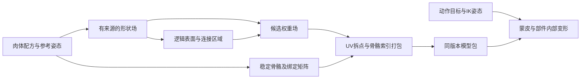

# 29 陆地生物的网格生成、肢体接合与自动蒙皮

[目录](README.md) · [身体图](03-core-structures-and-frame-pipeline.md) · [编辑重建](06-editor-input-and-rebuild.md) · [花纹](07-skin-texturing-and-patterns.md) · [并行动作](28-parallel-actions-channel-ownership-and-conflicts.md)。只研究登陆后、部落前的生物及其编辑器。

这次取得了比“有蒙皮字段”更直接的证据：开发者说明了隐式表面和权重来源，同时记录了宽躯干与相邻肢体的缺陷。**原作机制部分已回答，精确权重公式与本机调用链仍未恢复。** 后半篇是针对你的拼装游戏独立设计的完整算法，不能当成Spore源码。

## 原作证据：确认到哪一步

| 问题 | 开发者公开说明 | 还不能确认 |
| --- | --- | --- |
| 躯干、肢体怎样形成皮肤 | 球形metaball沿躯干、肢体布置，构成隐式表面 | 球间距与编辑更新公式 |
| 怎样生成三角形 | 提到ear clipping与Moore/Warren mesh displacement | 本机实现、采样密度 |
| 自动权重来自哪里 | 依据生成metaball的身体部位 | 分配、平滑、截断公式 |
| 相邻肢体会不会融合 | 未实现分组，可能连成蹼 | 本版全部边界行为 |
| 宽身体能否完美变形 | 宽脊柱段可能权重不平滑、发生剪切 | 后续版本修复情况 |
| 嘴、眼等细节 | 使用预制、可变形Rigblocks | 每类部件的实际接缝结构 |

来源：[Chris Hecker，Creature Skin Mesh](https://chrishecker.com/My_Liner_Notes_for_Spore#Creature_Skin_Mesh)。这是开发历史说明，不是本机函数追踪。它也没有说明原作逐帧重建皮肤，不能由“运动时有蹼”推出实时重网格。

开发者给出的单球场函数可写为`f_i(p)=s_i*(|p-c_i|²/R_i²-1)^4`，半径R以外为0。该公式解释形状贡献；它**不是已公布的骨骼权重公式**。原作球间距、等值阈值、贡献如何转成各骨骼份额仍不能由此补全。

这里要分开三件事：**编辑器生成皮肤的形状场、动画系统的身体节点、绘制时的骨骼和顶点权重。** 球与身体部位的来源关系可帮助连接它们，仍不证明一个球必然对应一根骨骼。

动画论文§1.2说明身体节点具有父子关系、位置和旋转，并有独立的标量deform控制嘴、手、眼等内部动作；玩家创建时的姿态是rest pose。[Hecker等，SIGGRAPH 2008，第2页](https://www.chrishecker.com/images/c/cb/Sporeanim-siggraph08.pdf)

Rigblock手柄驱动参数化造型曲线，多曲线积累平移、缩放和旋转增量；完成造型后可以烘焙掉这组编辑变形数据。不能把它理解为删除游戏里的走路、张嘴等全部动画。[Rigblocks，§2–3](https://www.cs.cmu.edu/~ajw/s2007/0248-Rigblocks.pdf)

贴图论文明确区分主体网格与附着细节部件，所以“皮肤融合”不等于所有眼球、牙齿、甲片都焊为同一网格。[Player-Driven Procedural Texturing，§2](https://www.cs.cmu.edu/~ajw/s2007/0311-PaintingModels.pdf) 开发者另外说明baking包含网格简化、自动UV、压缩贴图与AO；该说明不是权重生成公式。[Shalin Shodhan项目记录](https://www.shalinshodhan.com/projects.htm)

来源摘要和读取章节见[开发机制记录](evidence/public-mesh-generation-design.json)、[相关论文记录](evidence/public-mesh-related-papers.json)。没有保存或复用原作网格、纹理或生成源码。

## 本机与社区证据：表示格式不等于生成算法

本机EXE摘要仍与00一致；在.rdata内复核34条完整ASCII字面量。代表性入口如下，位置都是**文件偏移**：

| 名称 | 偏移 | 研究用途 |
| --- | --- | --- |
| `weights / invbindpose / jointnames` | `0xFEC5CC / 0xFEC5D4 / 0xFEC5E0` | 权重、绑定参考与关节名称的候选表示 |
| `joint_rigblock_%d` | `0xFF098C` | 部件关节命名候选 |
| `Skinner/MeshAORender` | `0xFF1084` | 网格/AO验证入口候选 |
| `boneMatrix / blendWeight / blendIndex` | `0x100C7B8 / 0x100C824 / 0x100C830` | 顶点和骨骼数据候选；不是动作通道混合权重 |
| `submeshIndex / parentIndex / jointPosition` | `0x1046718 / 0x1046764 / 0x10467A4` | 子网格、层级与位置候选 |

详细范围、排除项见[本机记录](evidence/local-mesh-skinning-entry-observations.json)。`baker`帮助同时涉及建筑、载具、生物；Havok的`numBonesPerVertex`不能证明生物采用某个影响数。字符串存在不确认LBS、DQS、接缝算法、实际调用或字段ABI。

固定提交的社区头文件和RW4读取器补充了蒙皮表示、矩阵与编辑连接入口，见[公开格式记录](evidence/public-mesh-skinning-contracts.json)。这些声明说明怎样表示或读取结果，不能反推编辑器怎样生成每个权重；本轮没有读取一份具体生物的顶点权重。

已核对的社区关系是`RWVertexBuffer→顶点布局/原始数据`，以及`RWSkinsInK→RWSkeleton/RWAnimationSkin/RWSkinMatrixBuffer`；顶点布局声明blendIndices/blendWeights，矩阵缓冲读写3×4数组。**顶点blendIndices到矩阵槽位的映射仍缺失**。RWSkinsInK里的整数是RenderWare对象引用，骨架父索引是另一种编号，不能把这三种索引合并解释。`FromRigblocks`和`TessellateSkin`也只是声明的构建/细分入口。

## 自研选择：连续肉体与独立器官分开建

下面所有类型、公式、阈值和策略都是我们自己的规格。

建议连续肉体采用**参考姿态中的形状场→共享表面网格→按形状来源生成权重**。眼、牙、甲片等采用独立部件，其连接方式显式声明。灵魂负责行为、技能与动作风格；肉体配方负责几何与连接；28的动作协调最终提供骨骼姿态，两者不各自改写蒙皮绑定。



```text
BoneId = (stablePartId, persistentJointId)  // 不用会随插入变化的数组序号
BindSkeleton {
    parents: Map<BoneId, BoneId?>
    localBind, globalBind, inverseGlobalBind
    controllerNodeToBones                 // 显式映射，不要求一对一
}
SkinPrimitive {
    primitiveId, skinGroup, center, supportRadius, strength
    owners: SparseMap<BoneId, weight>      // 非负，和为1
    sourcePartId, authorizedJoinIds[]
}
LogicalVertex { id, bindPosition, skinGroup, weights, sourceRegion }
RenderCorner { logicalVertexId, uv, normal, tangent, material }
Attachment { mode, hostRegion, anchors[], localFrame, internalRig }
ModelBundle {
    revisionKey, recipeDigest, mesh, skeleton, weights, bonePalette,
    attachmentBindings, material, diagnostics
}
```

`LogicalVertex`是几何身份；为UV或硬边复制出来的`RenderCorner`仍引用它。两个靠得很近但属于不同腿的顶点不因此变成一个身份。生成骨骼时校验父节点存在、无环、矩阵有限且可逆；缺少部件、零长骨链或退化尺度必须返回带部件ID的诊断。

## 自研算法一：任意骨架由配方生成，不从网格猜

造型轨道怎样烘焙、局部动画怎样适配新的内部骨架，以及内部蒙皮/全身蒙皮如何二选一，进一步见[30](30-part-shape-rest-pose-and-local-animation.md)。

配方已有脊柱控制、肢体连接和关节，因此先建骨架，再生成围绕它的表面。无需先生成怪物网格，再让通用自动绑骨工具猜哪个是手脚。

```text
BuildReferenceSkeleton(recipe):
    ValidateRecipeGraphAndPartContracts(recipe)
    for control in recipe.spine in stable order:
        CreateOwnSpineBone(control.id, control.referenceTransform)
    for limb in parentBeforeChild(recipe.limbs):
        frame = EvaluateHostSurfaceMount(limb.mount, recipe.shape)
        for joint in limb.persistentJointControls:
            CreateOwnBone(joint.id, parent, frame * joint.referenceLocal)
    for organ in recipe.detailParts:
        MapAuthoredInternalBonesToInstanceIds(organ.partId)
        BindOrganRootToDeclaredAttachment(organ)
    ComputeGlobalBindParentBeforeChild()
    InvertAllBindMatricesOrReturnDiagnostic()
    return skeleton
```

造型曲线的输出先进入参考网格与参考骨架；动态张嘴等动作仍保留独立内部骨骼/形变通道。不可把编辑时烘焙后的顶点再无条件应用同一造型增量，否则拉长或加粗会重复一次。

## 自研算法二：形状场、接合与三角形

一个易解释的自研紧支撑核如下。它是我们选定的三次核，**不是原作公式**：

```text
q_i(p) = |p-center_i|² / supportRadius_i²
f_i(p) = strength_i * max(0, 1-q_i(p))³
F_group(p) = sum(f_i(p) for i in this skinGroup)
surface: F_group(p) = ownIsoLevel
inside:  F_group(p) > ownIsoLevel
```

支撑半径不等于最终可见半径，多个核会互相扩大连接区；要用实际等值面标定用户的“粗细”。沿脊柱和肢体采样球，球的来源保留到网格和权重生成结束。每个肢体段的球拥有两端骨骼的平滑份额，例如沿段参数u时为`{proximal:1-u, distal:u}`；躯干同样在相邻脊柱骨之间分配，避免把一整块宽身体硬分给一根骨。

根部需要同组核有充分交叠。自研例：半径1、强度1、等值0.25，两球距离0.8时，中点总场值约1.185；距离1.9时只约0.00185。后者中点在外部，不能因“两球属于同一条腿”就保证皮肤连通。对连接区域采样并检验路径/网格连通；失败时调整采样或支撑参数，超出预算则返回`DisconnectedSkinJoin`。

我们选择普通规则网格上的一致四面体剖分用于初始实现；这是自研取舍，不是认定Spore使用marching tetrahedra。保持相邻格面的剖分一致；交点用全局采样边键共享。仅逐块各自生成浮点近似交点，会在块边界制造裂缝。

```text
BuildOwnSkinSurface(primitives, quality):
    grid = CoverSupportBoundsWithBoundedUniformGrid(quality.cellSize)
    EnforceMemoryAndTriangleBudgets(grid)
    samples = EvaluateFieldWithSpatialIndex(grid, primitives)
    for tetra in ConsistentTetrahedralization(grid):
        crossings = []
        for edge in tetra.edges where endpointInsideDiffers:
            key = OrderedGlobalEndpointIds(edge)
            crossing = edgeCache.GetOrCreate(key,
                BracketedRootOnEdge(F-ownIsoLevel, edge, ownTolerance))
            crossings.append(crossing)
        EmitOrientedTrianglesForTetraCase(crossings)
    RemoveDiagnosedDegenerateTriangles()
    ValidateAdjacencyWindingAndDeclaredClosedRegions()
    ValidateAuthorizedJoinConnectivity()
    return logicalMesh
```

阈值恰好命中采样点时须有全局一致的分类与端点去重规则；根搜索不能跨到未经检查的另一个分支。紧核的梯度给出外法线方向`-normalize(∇F)`，零梯度返回诊断并使用已声明的邻面近似。梯度法线改善光滑外观，**不会修复两张分离的皮肤**。

同组全局相加容易让两条靠近的腿意外融合。我们的最小可维护方案是：声明允许的接合边；不相关器官分组；对未授权交叠和新的拓扑连接报错或给编辑预览明确提示，必要时要求移开肢体。不能声称一个简单分组或“只保留最近骨骼”就彻底解决同组邻腿融合。若产品必须允许任意交穿且始终分离，需要另外设计局部接合域与独立表面边界，属于更大算法范围。

## 自研算法三：来源权重、平滑和GPU索引

在表面顶点p，对每个贡献球查它的骨骼份额`λ_ij`：

```text
a_j(p) = sum_i f_i(p) * λ_ij
w0_j(p) = a_j(p) / sum_k a_k(p)
```

贡献必须属于这个顶点的皮肤组及允许接合域；不能在场值合并了另一条腿之后，仅删掉它的权重来宣称几何融合已经修好。候选来源和几何授权不一致时返回`UnauthorizedSkinJoin`。

例如躯干贡献2、上臂段贡献1，上臂段份额是上臂0.75/下臂0.25，那么初始权重是脊柱`2/3`、上臂`1/4`、下臂`1/12`。这样权重跟随造型来源；跨空间相近却不连接的另一只手，不自动成为候选骨骼。

宽躯干还需要平滑过渡。可在**逻辑网格邻接图**上迭代正权重扩散，并保留来源先验和锚点：

```text
w_next(v) = ProjectToAllowedWeightSimplex(
    (1-alpha) * w0(v) + alpha * WeightedNeighborMean(w(v)))
```

`0≤alpha<1`由我们配置；锚点固定，邻接只跨已授权的皮肤连接，禁止通过空间最近点跳到别的腿。保存残差和迭代预算，未收敛不得标为完成。该方法保证非负、归一化等约束，不能保证所有极端姿态都保持体积。

```text
BuildOwnWeights(logicalMesh, primitives, skeleton, policy):
    for v in logicalMesh.vertices:
        candidates = EvaluateAuthorizedPrimitiveContributions(v)
        raw = AccumulateOwnerShares(candidates)
        RequireFiniteNonnegativeKnownBones(raw)
        if sum(raw) <= ownWeightEpsilon:
            return UnboundVertex(v.id, v.sourceRegion)
        w0[v] = Normalize(raw)
    weights = SmoothOnAuthorizedLogicalAdjacency(w0, policy)
    for v in logicalMesh.vertices:
        selected = StableTopK(weights[v], policy.gpuInfluenceLimit)
        discardedMass = 1 - sum(selected)
        ReportOrRejectExcessiveWeightDiscard(v, discardedMass)
        finalWeights[v] = Normalize(selected)
    palette = BuildBoneIdToSlotMap(skeleton)
    for renderCorner in SplitUVAndHardNormalCorners(logicalMesh):
        CopyPositionAndFinalWeightsFromLogicalVertex(renderCorner)
        PackIndicesUsingCurrentPalette(renderCorner, palette)
    return {finalWeights, palette, diagnostics}
```

自研初始GPU上限可选4，**不是原作上限**；截断后必须归一化、报告丢失份额，且同一逻辑点只截断一次。量化权重时同样让所有复制点复用一份打包结果。骨骼数组重排或断肢后，要按稳定BoneId重建palette，不能继续使用旧数组下标。

## 自研算法四：绑定矩阵怎样使皮肤随姿态运动

选择LBS作为独立基础模型。令`B_j`是骨骼j在参考姿态中的模型空间全局矩阵，`G_j(t)`是当前姿态同空间矩阵：

```text
p(t) = sum_j w_j * G_j(t) * inverse(B_j) * p_bind
p_world(t) = creatureWorld * p(t)
```

参考姿态`G=B`时，每一项都是单位变换，权重和为1就应得到原顶点。角色世界位置只应用一次；不能把世界矩阵既放进G又在末尾重复乘。

局部部件可拥有自己的参考坐标，但进入统一蒙皮前须明确转换及绑定矩阵空间。法线/切线需要独立的正确变换与正交化；存在非均匀缩放时不能照搬位置变换，也不能靠插值法线掩盖翻面。生产实现需对所选蒙皮映射制定法线策略并测量关节处误差。

## 身体加宽：换参考形体，不能混用旧绑定

采用06圆截面例，半宽从0.4改成0.7。左右肩的模型位置分别外移0.3；实际融合表面须重新查询连接框架，圆截面只是演算。

```text
ApplyWidthEdit(recipe, newWidth):
    edited = CommitOwnShapeRevision(recipe, newWidth)
    skeleton = BuildReferenceSkeleton(edited)
    primitives = BuildOwnFieldWithProvenance(edited, skeleton)
    mesh = BuildOwnSkinSurface(primitives)
    binding = BuildOwnWeights(mesh, primitives, skeleton)
    attachments = RebuildOwnAttachmentAnchors(edited, mesh, binding)
    bundle = ValidateCoherentBundle(mesh, skeleton, binding, attachments)
    PublishOnlyIfRevisionStillCurrent(bundle)
    RebindAnimationTargetsAndSolveFromCurrentIntent()
```

二维例：新肩绑定平移0.7、新参考顶点横坐标0.7，正确参考蒙皮仍为0.7。若顶点已改成0.7，却使用旧绑定平移0.4和新姿态平移0.7，会得到`0.7+(0.7-0.4)=1.0`，产生重复外移。

动作可从旧姿态平滑过渡到重新求解的姿态；“参考形体重绑定”和“当前动画姿态”仍是两份数据。快速预览可以低分辨率，但网格、权重、inverseBind和palette必须同版本成包交换。旧任务完成时保留`BakeSuperseded`诊断并释放其所有资源；不能只换新网格配旧矩阵。

## 肢体弯曲：开裂、塌陷、互穿分别处理

| 现象 | 自研原因检查 | 对应处理 |
| --- | --- | --- |
| UV边缘几何开口 | 复制顶点的位置、权重、骨索引或矩阵不同 | 共享逻辑点及最终打包权重 |
| 两张肉体网格根部脱开 | 只有参考姿态交叠，动态变形不一致 | 生成连续桥接皮肤，或显式锚定连接边 |
| 弯肘处变瘪 | LBS及稀疏采样的体积损失 | 增加关节采样、独立姿态修正并测试 |
| 扭转挤成细绳 | 旋转混合造成局部塌陷 | 评估其他蒙皮方法/修正，不能只调法线 |
| 腿、躯干互相穿透 | 没有自碰撞与姿态限制 | 05/28的约束及独立碰撞处理 |
| 花纹有线、但几何闭合 | UV边缘采样、法线或贴图不连续 | 07的跨面绘制和图集padding |

**接缝不裂的一个可证明条件**：两渲染顶点的参考位置、全部权重与对应骨骼变换相同，则上式得到的当前位置相同。只让初始位置一样，条件并不成立。

完整二维算例：接缝点`p=(1,0.2)`，近端保持不动，远端绕`(1,0)`转90°，远端贡献点变成`(0.8,0)`。

| 两侧权重（近端/远端） | 蒙皮后位置 | 两侧距离 |
| --- | --- | ---: |
| 两侧都为0.5/0.5 | 两侧都为(0.9,0.1) | 0 |
| 一侧0.8/0.2，另一侧0.2/0.8 | (0.96,0.16)与(0.84,0.04) | 约0.169706 |

这个例子证明复制点必须共享权重。它没有证明体积守恒：LBS混合的180°扭转仍可能塌陷；换成别的蒙皮也不自动解决非均匀缩放、独立网格接合或自碰撞。

姿态修正可以独立定义为参考空间的关节形变，再进入统一蒙皮：`p_bind_corrected = p_bind + OwnCorrective(jointAngles, localRadius)`。对接缝复制点采用同一修正；对根部需要跨接合域一致。修正方向和幅度由我们资产/算法决定，限制顶点位移并检测翻面，不能无限“鼓起来”来隐藏失败。

## 独立器官怎样接合

选择连接契约，而不是强迫所有器官共用皮肤：

| 部件方式 | 自研执行 | 限制 |
| --- | --- | --- |
| 连续软组织 | 同一形状场生成过渡皮肤，使用共同权重 | 需检查连通、融合与关节采样 |
| 柔性连接裙边 | 根部边界点绑定到宿主三角形的重心锚点，过渡到器官自己的骨骼 | 需约束边界一致并处理内部形变 |
| 刚性眼球/甲片 | 以宿主锚点组求局部框架，放置独立网格；用声明的覆盖边缘 | 刚体不能精确随任意软皮肤变形，需测覆盖余量 |

宿主重心锚点不是“找最近位置”：保存`hostRegion + triangleBinding + barycentrics + localOffset`。运行时先蒙皮宿主，再用相同三点重心坐标重建锚点；重网格后按形态区域重投影并校验距离/方向/宿主身份，旧triangleIndex失效。三个锚点退化或翻转要报告`DegenerateAttachmentFrame`；不能悄悄把嘴附到旁边的手。

柔性边界可以将器官根部直接钉到这些锚点；内层形变必须在边界处为零或经过明确投影。刚性部件只能近似覆盖，不能承诺任何弯曲都无缝。身体加宽后同时更新锚点、绑定和内部部件根框架。

## 对灵魂、断肢与换肉体的连接

灵魂切换姿态风格时只改变目标/关节姿态，不重建参考权重。新增肉体、重接肢体或永久造型变化才失效模型包。断肢需要独立定义切口封盖、剩余骨骼/权重、受影响部件的连接和能力失效，之后触发16的肉体评估。**这不是Spore已证实的断肢机制。**

旧手删除后，仍指向它的权重不是“归一化一下就好”：先确定对应区域应删除、封盖或重新生成；若需要保留区域才重新生成权重。错误BoneId保留可诊断原因，不能静默绑到根骨继续绘制。

## 检查与尚未回答的问题

[独立算例检查](checks/verify_mesh_skinning_examples.py)覆盖20项：参考姿态恒等、非法矩阵/权重、截断份额、接缝复制点、90°弯曲开裂、加宽重复变换、来源份额、邻腿拒绝、核支撑/连接反例、索引重排以及旧任务/混版模型拒绝。二维矩阵仅用于验证这些关系，不能替代完整三维渲染与表面测试。

执行结果和本机复核见[验证记录](evidence/mesh-skinning-verification.json)。后续生产实现还需要实际四手六足网格：连通/闭合、极端粗细、邻腿接近、关节90°/180°、非均匀缩放、细节器官、UV拆点、LOD和连续编辑的测量。没有实现完整提取器或跑渲染测试，不能宣称可生成所有任意拼装身体。

原作仍未知：实际球间距、权重核/平滑/影响上限、最终蒙皮形式、rigblock根部接合、宽躯干修复、本机增量重建、缓存及LOD策略。未做：原生反编译、启动/附加游戏、私人存档读取、提取生物资产、生产实现和性能测试；REA/provider限制沿用00，未重复安装或改配置。

风险：历史设计与本机版本未完全对齐；自研算法有非法融合、细网格成本、LBS塌陷和附件覆盖限制，均需在自己的资产与允许姿态范围内验证。
