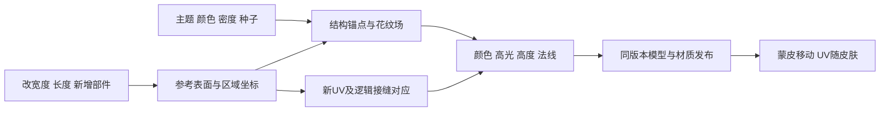

# 35 陆地生物皮肤：变形、条纹、斑点与接缝

[目录](README.md) · [基础皮肤管线](07-skin-texturing-and-patterns.md) · [网格与蒙皮](29-creature-mesh-joins-and-automatic-skinning.md) · [造型与动作](30-part-shape-rest-pose-and-local-animation.md) · [编辑成本](34-editor-validity-complexity-and-runtime-cost.md)。只研究登陆后、部落前的生物及其编辑器，不研究其他阶段的绘制系统。

关键区别是：**花纹按什么身体坐标生成、绘制结果存在哪张UV图集、身体改变后如何重建**。只把旧贴图放大，无法解释新增肢体，也无法保证关节条纹连续。本篇原作证据在前；后面的坐标、密度、接缝和更新算法均是我们独立设计。

## 原作：已答、部分回答与未知

后续[36](36-selected-skinpaint-recipe-and-material-controls.md)实际读取选定主题/条纹PROP及效果目录，补上主题三槽和区域分布到Particle索引的静态链。它没有恢复Particle绘制、间距单位或编辑重绘；本页的形态/接缝独立算法及23项检查保持原范围。

| 问题 | 有来源的答案 | 尚未回答 |
| --- | --- | --- |
| 条纹怎样跟随肢体 | 表面粒子笔刷具有脊柱/肢体相关方向与形态信息 | 精确方向场、条纹相位、数量、间距与笔刷尺度 |
| 加宽后是否重新展开 | 开发者说编辑网格后需快速生成图集以进入Play/Paint Mode | 每次滚轮的触发时机、延迟/缓存、重绘或重投影的具体选择 |
| 拉长后条纹变多还是变宽 | 资料说明形态适配和定向笔触 | 不同脚本是否固定数量、物理密度或混合规则 |
| 新部件如何接上花纹 | 论文区分主体网格与附着细节；格式可表达parts区域 | 各类Rigblock是否共用图集、根部纹理如何衔接 |
| UV边缘怎样消缝 | 开发者最终发行说明保留纹理dilation | 本机精确扩张范围、压缩/mip政策与逐帧调用 |
| 皮肤是否修复拼接裂口 | 无此证据，29另有几何与权重问题 | 不能拿纹理扩张证明两块网格焊接或动画无裂缝 |

### 开发者一手资料

[Maxis贴图论文§2](https://www.cs.cmu.edu/~ajw/s2007/0311-PaintingModels.pdf)完整一页已读：生物的主体UV采用cubemap分区；表面粒子笔刷生成颜色、高光和凹凸；玩家组合base、coat、detail及颜色。沿脊柱、肢体的定向笔触说明花纹与形态有联系，并非固定人形UV。其§3的建筑/载具投影不能拿来证明生物运行时使用三平面贴图。

[配套演讲](https://www.cs.cmu.edu/~ajw/s2007/0311-PaintingModels-slides.pdf)完整相关页中，第15–16页将生物skinpaint与另一类材质方案区分，并说明笔刷在网格点写入UV、表面粒子受框架与骨架影响。第23、26页的图集/后台烘焙是共享管线背景，不据此断言每个陆地生物使用相同算法或编辑触发规则。

[Hecker，Creature Texturing及脚注7](https://chrishecker.com/My_Liner_Notes_for_Spore#Creature_Texturing)补充了历史变化：

1. 图集从未展开三角形出发，扩展相邻且朝向近似同一主轴的面，再投影并打包。UV图块只需机器可绘制，不要求美术手工识别。
2. 早期绘制原型收集笔刷覆盖三角形，以UV作为绘制目标、三维坐标作为笔刷采样坐标；原型表面粒子使用重心坐标。
3. 最初Swarm接线后来被可感知形态、提供肢体相对坐标的定制系统替换，绘制被移入游戏引擎后台。
4. 原型曾生成图块裙边多边形；脚注7明确说发行前为了性能禁用裙边，仅保留纹理扩张。作者描述绘制过程中可见的缝在完成后消失。

最后一项修正很重要：**原型裙边、最终纹理扩张、几何接合是三个不同概念。** 不能把早期鼠标/画板工具当成玩家编辑方式，也不能由“表面上绘制”推出玩家改体型时粒子身份一直保留。

来源的bytes、SHA256、完整页/章节范围及未知见[公开设计记录](evidence/public-skin-pattern-design.json)。论文摘要与29一致；本次Hecker响应摘要独立保留，不覆盖早先响应，也不因摘要不同推断算法变化。没有下载或复用原作纹理/网格作为自研资产。

### 本机词汇与社区格式连接

本机EXE摘要再次与00一致，`.rdata/.data`限定区域复核104条完整NUL ASCII，见[本机记录](evidence/local-skin-pattern-entry-observations.json)。`alongbone`、`aroundbone`、`alongspine`、`aroundspine`等是入口；`4SkinPaint`和`4spSkinPaintSettings`必须保留完整前缀，不能把其中的后缀当成另一个已定位字面量。名称存在不建立调用者或当前皮肤脚本。

社区SporeModder-FX固定提交 `a482c51d8d37fc8cf416acecc3c00a5b0723f2e5`，读取四份源文件的相关声明、解析与引用序列化，见[格式记录](evidence/public-skin-pattern-format-entries.json)：

```text
SkinpaintDistribute：torso / limbs / parts / back / belly / joints等区域
        └─ EffectDirectory引用 → SkinpaintParticle
Particle：方向/形态变量 → 命名材质通道；brush → file IDs
        └─ 可引用另一Particle
Flood：单独的效果类型，具有区域/形态及混合表示
Settings：材质初始化/设置表示，含部件相关设置
```

Distribute的spacing/limit、Particle的diffuse/bump/specular名字说明**格式能表示这些输入与引用**。它们不恢复游戏的粒子积分、纹理栅格化、实际层序或编辑清除时机。Back/Belly脚本参数t在社区parser中转换为`cos(t*pi/2)`或其相反数；不能把t误称为米制身体距离。这里的particle selection也不是战斗技能选手。

## 自研：状态、坐标与所有权

以下规则、阈值和数字全部由我们自行定义。

```text
SkinStyle {
  styleId, seed, layers[Base, Coat, Detail], paletteLinear
  patternKind, densityPolicy: Relative | Physical
  stripeCount, spacingMeters, spotRadiusPolicy, materialChannelRules
}
SkinSurface {
  shapeStamp, logicalMesh, connectivity, atlasDigest, regionField
  carriers: persistentPartId → centerlineAndTransportFrames
  joins: authorizedRegionPairsAndBoundaryCorrespondences
}
PatternAnchor {
  persistentPartId, segmentId, normalizedArc, angle, stableCellId
  styleSeed, featureKind, reconstructionStatus
}
SkinBakeKey {
  shapeDigest, paintRevision, atlasDigest, partAssetDigests
  styleSeed, generatorVersion, textureProfile, quality
}
SkinBundle { meshUVStamp, color, specular, height, normal, diagnostics }
```

肉体配方拥有造型和附着；皮肤配方拥有主题/颜色/种子；身体表面拥有形态坐标；编译任务拥有不可变输入和产物。灵魂切换策略不重置身体花纹；若产品要“换魂变色”，只通过显式外观参数改变，不能暗中改几何、碰撞或技能资格。

几何生成后，为每个稳定部件建立沿中心线的弧长坐标a（米）与归一化u=a/L。横向角θ使用沿骨链平行运输的参考框架，避免接近直线时Frenet框架翻转；弯曲和参考姿态改变时重算框架并保留基准方向。不存在唯一圆截面时用自有表面参数/距离场，不能假装所有关节都可按圆柱精确展开。

绘制使用**编辑完成的参考身体**，动画时UV与皮肤随蒙皮移动。不能每帧用世界坐标重新取条纹，否则肉体会穿过固定花纹。通常走路不需要重绘整张皮肤；实时湿润/伤口是明确的独立层。张嘴等大幅局部形变的拉伸由30参考造型与动态变形政策共同处理。

同一顶点可能混合多个身体来源，见29；骨权重不自动等于皮肤区域权重。我们定义单独的`regionField`，保留部件/组织来源、禁止连接与接合区域。眼球、牙齿、甲片的材质有独立掩码，不能无条件把躯干条纹画满所有器官。

## 自研算法A：条纹的尺度政策

沿肢体画环纹可用周期相位：

```text
Relative: φ = N*u + φ0
Physical: φ = a/spacingMeters + φ0
stripeDistance = abs(fract(φ + .5) - .5)
mask = 1 - smoothstep(halfWidth-softness, halfWidth+softness, stripeDistance)
```

N是周期数，宽度为周期比例；物理间距单位米。环纹和沿肢体的纵纹是不同方向：纵纹用绕轴θ的周期。接缝不是简单重复材质的问题，还要处理角度的周期闭合。

| 构造编辑 | Relative | Physical |
| --- | --- | --- |
| 腿长0.4→0.8m，原4周期 | 保持4周期，间距0.1→0.2m | 保持0.1m间距，周期4→8 |
| 躯干半径0.2→0.4m，绕周8条 | 保持8条，周向间距约0.1571→0.3142m | 若期望间距0.2m，闭合数量6→13，实际间距约0.2094→0.1933m |

周向Physical不能直接用`R*θ/spacing`而假装θ=0与2π无缝：周长不一定是间距的整数倍。这里选择整数`M=max(1,floor(2*pi*R/spacing+.5))`，用`φ=M*θ/(2*pi)+φ0`闭合，以微调间距换取闭合；数量切换可增加明确的迟滞/编辑过渡，不称为原作规则。不规则截面用截面弧长/周长替代Rθ。

如果产品必须严格固定间距，就要允许一处间距补偿区或明确的图案断点。严格间距、任意周长、完全闭合无法无条件同时成立。

## 自研算法B：斑点的身份、大小与密度

先把斑点中心保存为稳定部件的结构锚点，而非旧三角形编号或atlas像素。同一部件的候选随机数由`Hash(styleSeed, persistentPartId, stableCellId)`产生；新增另一条腿不会因为数组顺序变化重排旧腿候选。但稳定种子只保证相同输入的确定性，不保证变形、接合与排斥之后像素全部不变。

```text
buildSpotCandidates(region):
  Relative:
    enumerate fixed normalized cells; jitter each from its stable key
  Physical:
    targetCount = round(surfaceAreaMetersSquared * densityPerSquareMeter)
    enumerate metric-sized cells in stable order; jitter from stable key
  reconstruct each anchor on current authorized surface
  reject ambiguous/disallowed/outside anchors with a reason
  accept candidates whose surface-distance to accepted centers >= spacing
  stop at target or bounded candidate budget; report achievedCount and failures
```

排斥距离与笔刷覆盖用连通表面上的距离，不能仅看欧氏距离：两腿在空间中靠近，不代表皮肤笔刷应跳过去。网格边图Dijkstra可作为自己的近似；边长太大时对小笔刷误差明显，应细分或采用更准确表面距离，超预算给出`InsufficientSurfaceResolution`。只沿授权连续接合跨部件；独立器官不自动连通。

斑点大小也要单独选政策。圆柱近似下，局部距离为 `ds=L*Δu`、`dc=R*wrapped(Δθ)`：

- Relative使用固定归一化半径，例如Δu半径0.025、Δθ半径0.2；腿变长会拉长斑点，变粗会扩大周向尺寸，仅拉长时可能变椭圆。
- Physical使用`d=sqrt(ds²+dc²)`和米制半径0.01；腿长增加后归一化覆盖缩小，斑点物理大小保持。该局部度量只适用小范围近圆柱，关节采用真实表面度量。

例如面积0.12→0.24m²，密度100个/m²，目标数量12→24；排斥、掩码和有限候选可能令实际数较少，必须输出实际数及原因。默认不能用无限重试强行塞满。

锚点重新落表面时，从原part/segment的结构坐标找到当前参考位置，再在授权skinGroup与来源区域内投影；检查最大偏移、法线夹角、区域身份。禁止直接找全身体最近三角形：旧腿上的伤疤可能跳到新增、靠得更近的手臂。部件删除的伤口/花纹锚点返回失效；是否保留灵魂印记是另一条显式产品规则。

## 自研算法C：新增部件与关节条纹

新增部件声明皮肤接合政策：`InheritHost`、`OwnMaterial`或`TransitionCollar`。普通连续肉体可继承颜色/主题；异种甲片、眼球等保留自己的材质；接合圈可作颜色与花纹过渡。这是可讨论的自研默认，不证明Spore的部件都连续同纹。

条纹相位不能直接平均实数：0.99与0.01其实很接近，平均成0.5会跳半个周期。相位通过 `z=(cos(2πφ),sin(2πφ))`融合，再取atan2得到周期相位；向量和接近0表示相位冲突，返回`JointPhaseConflict`。骨架分叉/闭环没有通用“自然连续”的保证。

```text
solveJointPattern(collarMesh, hostField, childField):
  set boundary values from both surfaces in complex phase space
  for bounded iterations:
    each interior z_i = weightedMean(z_neighbors) // nonnegative geometric weights
  if residual too large or magnitude near zero:
    return JointPhaseConflict(boundaryIds, residual)
  derive phase from atan2; validate seam color/height residual
  keep original fields outside collar
```

这个局部平滑是我们的近似，并非最优相位场求解。复杂接合可能出现条纹收缩、分叉或消失；失败时采用已声明的过渡圈，把图案对比度平滑降到0，再接另一侧图案。颜色可在线性空间平滑连接，高度/高光分别按自己的材质规则处理。不能声称简单色彩插值就让条纹线条一一衔接。

新增眼睛不重新随机全身；连续新肢体只初始化自己的锚点与接合域。但新的网格可能改变UV打包、整体面积、区域场与AO。只有证明依赖范围时才局部重烘焙；初版可全身重绘而保留结构锚点/种子，不能用“只添一只手”保证其他区域绝无变化。

## 自研算法D：三类接缝分别处理

| 接缝 | 主要修复 | 不能解决 |
| --- | --- | --- |
| 同一逻辑表面的UV图块缝 | 同一表面场写入两侧、接缝对应、各图块gutter与mip | 骨权重不同造成的实际分离 |
| 主体与独立部件根部 | 连接几何/权重契约、安装遮罩/过渡圈、材质政策 | 仅扩大贴图颜色不能焊接 |
| 颜色连续但光照有缝 | 顶点法线、切线手性、同物理方向的法线图编码 | 不同法线基中的RGB直接平均 |

同一个三维笔触覆盖UV缝两侧的三角形，分别用它们自己的UV栅格化。每个像素按重心坐标还原参考表面位置，再采样同一皮肤场；UV图块的打包位置不能参与花纹相位。

```text
rasterizeOwnSkin(surface, atlas, style):
  for each triangle and covered texel:
    bary = inverseUVTriangle(texel)
    p, regionCoordinates = interpolateReferenceSurface(bary)
    pigment, height, specular = evaluatePatternAndMaterial(style, p, regionCoordinates)
    write each channel with its declared rule
  fillChartGuttersUsingLogicalSeamCorrespondences()
  fallbackToOwnEdgeDilationAtTrueSurfaceBoundaries()
  deriveNormalsWithSurfaceMetricAndCorrectTangentHandedness()
  buildAndValidatePerChartMipsWithinReservedPadding()
```

接缝对应保存同一逻辑边两侧的角点与方向，不靠atlas里相邻像素猜三维相邻。向图块外扩展采样时可从几何对应的邻面取值；没有邻面的真边界才夹持本图块边缘。所有填充限制在本图块预留区，不能侵入另一块眼球/牙齿纹理。生成mip时按图块隔离降采样与重新填充，LOD超过保证范围需扩大图集间距、限制采样或换资源布局。

构造预算例：只保证到mip3，基础bilinear采样半径0.5texel、预留压缩防护4texel，则本例最低gutter为`ceil(.5*2³+4)=8`基础texel；这是指定过滤假设下的估计，尚未验证目标GPU/块压缩。更高mip、各向异性和多tap过滤需更大覆盖，不能把8当通用原作常量。

镜像UV的切线方向可能相反。同一世界法线在两侧可有不同的法线图RGB，但经各自TBN转换后应一致。把RGB强行复制到镜像图块可能出现亮暗缝；先在共同物理框架处理方向，再编码到各图块的切线基。凹凸高度梯度也必须包含UV到表面的尺度，不直接拿不同密度的UV差分当米制梯度。

## 自研编辑与动画更新管线



这是自研职责图，不是原作调用图。

```text
onShapeOrPaintEdit(request):
  validate immutable recipe and explicit density/material policies
  compile new reference mesh, semantic carriers and authorized connectivity
  generate atlas + seam correspondence for exactly this surface
  rebuild persistent anchors; report missing/ambiguous ones
  evaluate regions, joint fields and brush coverage
  rasterize all dependent maps; pad/mip/normal validation
  complete SkinBundle with exact SkinBakeKey
  if key != actor.currentRequestedKey:
    releaseOwnedResult(); record SkinBakeSuperseded
  else if mesh/UV/maps do not share the expected key:
    retain prior complete model; report MixedSkinBundle
  else publish complete model+material at the same boundary
```

颜色变化通常不重建骨架；体型变化可能重建几何、图集及花纹；纯走路不改变参考图集；改变纹理质量会重建纹理但不改经济或技能。沿用06/33/34版本协议，不让旧宽度的烘焙完成后覆盖新腿。

## 完整构造例：加宽、拉腿、新手，再弯腿

1. **初始。** 四手六足、躯干截面半径0.2m、legA长0.4m。Relative环纹4周期，躯干绕周8条；legA三个斑点锚点u=.25/.5/.75，其他参数固定。初版拥有shape7、paint2、atlasA。
2. **加宽。** 躯干半径变0.4m，shape8。8条纵纹数量不变，周向间距加倍；半径相关的斑点横向尺寸按其独立政策更新。表面/UV重建为atlasB，不能继续用atlasA的像素坐标。若改成Physical约0.2m的周向间距，则用13条闭合，不强行保留8条。
3. **拉长legA。** 长度变0.8m、shape9。Relative环纹仍4周期，间距0.2m；三个斑点中心从轴向.1/.2/.3m变.2/.4/.6m。采用Physical时则环纹8周期、0.01m斑点半径不变；面积目标增大时新增候选数量，但不宣称所有旧像素保留。
4. **新增handE。** shape10，给新手稳定ID与新候选种子。InheritHost复用主题，但关节相位另解；不可解时生成声明的过渡圈，眼/牙掩码仍保持。其他部件的种子不变；接合邻域及新atlasC的所有纹理依赖仍须更新。
5. **异步完成。** shape8的旧任务到达，记录Superseded并释放；shape10的新颜色图若混入shape9的UV则拒绝。只有完整shape10/paint2/atlasC包发布。这个防护不能靠颜色看起来相同而省略。
6. **弯腿行走。** 使用shape10参考绑定蒙皮，UV与花纹一起移动，不在世界空间重新排列斑点；UV重复角点共享几何/权重。若腿弯曲后根部裂开，交给29检查几何与绑定；如果只有过滤/亮暗缝，按本篇接缝流程查。两类错误不能互相掩盖。

这是一套独立数值演算，不是原游戏样本或像素对照。Relative与Physical是两种产品政策，文档保留选择位置，不冒称原作统一规则。

## 验证与后续原作验证入口

[23项独立检查](checks/verify_skin_pattern_examples.py)验证长度/宽度的两种周期政策、角度闭合、斑点物理/相对半径与目标数量、稳定种子、锚点不跳部件、表面距离、UV缝采样、图块隔离、镜像法线基及过期/混版本发布。它们仅验证构造数学和状态关系，没有实现完整表面粒子/图集打包/三维皮肤生成器。实际覆盖见[本轮验证](evidence/skin-pattern-verification.json)。

如要进一步确认原作，最小场景是同一陆地生物、同一主题和颜色，分别只改宽度、只拉一条腿、只添一部件，记录编辑中与稳定后的图案数量/间距、接缝、纹理刷新时点；再比较静态与弯腿动画。没有该运行数据，不能将图案变化归因给重绘、重投影或某种固定密度。

未做：游戏运行/附加、私人生物存档、具体皮肤脚本和brush资源解码、原生执行调用恢复、GPU渲染/压缩/mip视觉对照及性能测量；原因是本轮静态研究和现有provider缺口。没有实施用户游戏的材质系统或运行仓库生产测试。

风险：历史资料与本机版本未完全对齐；社区格式不建立执行时序；分叉坐标/相位没有通用无缝保证；局部圆柱和网格距离只是近似；padding预算需目标过滤器验证。原作编辑后重绘/重投影、具体花纹密度和跨Rigblock接缝仍未知。
