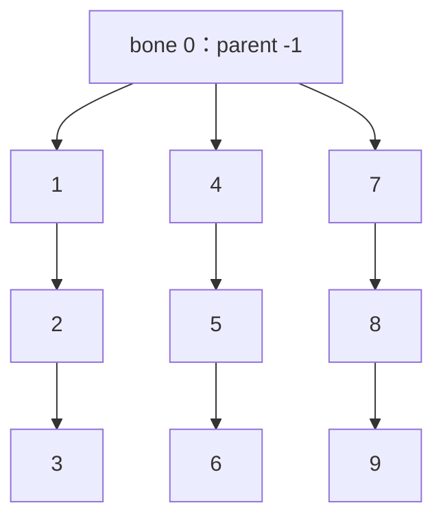

# 37 一个部件怎样定义可编辑、可运动和可执行技能

[目录](README.md) · [造型与局部动作](30-part-shape-rest-pose-and-local-animation.md) · [能力聚合](10-capability-aggregation-and-ability-eligibility.md) · [附着交互](06-editor-input-and-rebuild.md)。范围仍是登陆后、部落前的Creature及其编辑器。研究起点为2026-10-12 18:45:05 PDT（America/Los_Angeles）。

问题不是“给一张网格挂动画”这么简单。**部件定义需要同时描述玩家可以改什么、造型后的参考是什么、怎样接到宿主、动作能写哪些输出，以及它贡献哪些玩法能力。** 这些表示彼此连接，但不应共享一组含义不明的参数。

下文先列开发者历史设计、固定社区格式和本机配置；“自研”部分才是给用户拼装与灵魂游戏的建议。没有用原作代码或资产实现用户游戏。

后续[38：轴控制与能力绑定](38-axis-controls-capability-role-and-local-deform-binding.md)实际查询这些控制键，未在七包索引中找到实体；另读一份PCTP，取得手类型ID到grsp及嘴deform到ANIM的静态对应。本篇的历史覆盖与35项检查保持原范围，运行关联仍未确认。

## 原作证据：部件的五类信息

| 问题 | 已有证据 | 还不能推出 |
| --- | --- | --- |
| 控制点/把手 | Rigblock把手控制参数化造型轨道；RW格式保存起终点、默认时间及动画对象引用 | 所有把手都线性缩放；控制点必然是骨骼 |
| 参考骨架 | 编辑骨架与简化运行骨架在历史烘焙流程中有区别；格式保存骨架、父子关系和绑定数据 | 骨骼自动简化公式；声明数量等于已读模型中的数量 |
| 连接位置 | 编辑实例声明父子、位置/法线/朝向；另外声明连接器及若干骨骼索引 | 把手端点就是安装点；某个未知偏移就是肢体半径 |
| 动画曲线 | 编辑把手引用RW局部轨道；全身ANIM有身体选择与局部deform参数 | 两类动画ID可直接互换；默认时间单位及最终插值已知 |
| 能力标签 | 部件PROP有玩法能力数值；动画系统另有能力标记、等级表示及映射格式 | 名叫mouth就一定能咬；部件等级决定此次执行者 |

## 开发者历史设计：把手是在选形状，不是在播放战斗

Rigblock包含几何和造型轨道。玩家移动把手时，在单位区间中选取轨道位置；同一轨道的不同子区间可以产生不同样式，因此不必是“拖动距离乘一个尺寸系数”。作者在Maya里制作多条轨道并查看共同效果，导出把手位置、范围和对应动画。[Rigblocks论文，§1–2](https://www.cs.cmu.edu/~ajw/s2007/0248-Rigblocks.pdf)

多造型轨道按参考增量合成，不能用普通交叉淡入淡出，让第二个造型削弱第一个。历史资料还区分编辑烘焙与保留、适配的运行时动作；嘴部运动可以基于新的参考骨架继续执行。[论文§3](https://www.cs.cmu.edu/~ajw/s2007/0248-Rigblocks.pdf)、[演讲第20–24页](https://www.cs.cmu.edu/~ajw/s2007/0248-Rigblocks-slides.pdf)

这是共享技术的历史设计，不能直接视为本机每一种陆地部件的执行顺序。本轮完整复核一页论文，摘要与30一致；未视觉核验图片。[本轮来源记录](evidence/public-part-authoring-design.json)

## 固定社区格式：控制点、骨骼和连接器不是同一个对象

来源固定到SDK `2d71289adc71aa5c58f4516c6c835c99f5f9ca19` 和FX `a482c51d8d37fc8cf416acecc3c00a5b0723f2e5`。它们是社区声明和工具读取规则，没有在当前EXE上验证ABI。字段与完整读取位置见[部件契约记录](evidence/public-part-definition-contracts.json)。

**把手。** `RWMorphHandle`记录handleID、一个未知整数、起终点、defaultTime，以及到`RWKeyframeAnim`的对象引用。已知布局为64字节：两个LE int32、两组三分量LE float64、一个LE float32、一个LE int32引用。三维把手的路径数据不能当成网格控制顶点、碰撞点或关节位置。

`EditorRigblock`另声明MorphHandles、MorphHandleWeights、MorphHandleChannels列表，以及部分变形骨骼索引。它们说明编辑需要记录把手及关联状态；**仅凭并列列表不能恢复索引配对、归一化或采样公式**。社区查看器能够编辑上述RW字段，但没有恢复原游戏鼠标拖拽算法。社区UI对defaultTime的时间单位解释，也不能替代原程序的参数转换证据。

**参考骨架。** SDK中出现DeformBoneEnd/Base/MiddleIndex，RW中存在Skeleton及动画/蒙皮关联对象。这些骨骼索引、RW对象索引、资产骨骼名称、实例父部件索引是不同编号空间。历史编辑骨架与运行骨架可能不同；不能将其中任意一组编号直接用于顶点权重或身体节点。

**连接。** 编辑实例有parent/children、BallConnectorHandle、SocketConnectorModel及偏移字段；还分别保存effects与csnap变换和骨骼索引，以及吸附/对齐/交互资源键。这里的“handle”可能指操作器对象，并不等于`RWMorphHandle`。csnap是接合研究入口，不能当成造型控制点；实际坐标空间、表面投影和重算公式未知。

## 动画曲线与能力：有桥接，但不是同一字段

RW局部轨道表示LocRot、LocRotScale或BlendFactor等关键帧；全身ANIM的局部RigblockComponent则记录标量value、weight和插值器。一个嘴的四个deform ID仍未解释为“张嘴/宽度”等具体语义。30实际读到的mouthMorphs曲线不能直接成为某个已选手/嘴的把手曲线。[30的实际曲线与限制](30-part-shape-rest-pose-and-local-animation.md)

更具体地，`CreatureBlock`声明capFlags、capLvlFlags、32个能力指针槽和32个int8等级槽，**没有直接内嵌一串四字符角色名**。社区PCTP读取器另描述名称/哈希到四字符标记和索引的映射，以及标记到deform描述的关联。PROP的`modelCapabilityBite/Strike`等int32数值与这些动画标记不是同一字段；PCTP提供关联入口，不能反过来说二者毫无联系。[固定格式来源与位置](evidence/public-part-definition-contracts.json)

`modelCapabilityToPropFileMap`、`modelCapabilityAnimKeys`及默认动画值/权重也在社区属性字典中声明。尚未读取实际PCTP映射，不能声称本机Bite直接对应某个tag/槽位。该读取器还有版本3读写条件不一致及明确标为“并非实际范围”的字段，不能把名称像range的两项浮点当作参数限制。

## 本机：沿一份手部件逐层读取定义

本轮从本机两包索引中的Creature手/嘴候选，选定`ce_grasper_default_01`手部件。它不是空模型：Patch PROP键为`00b1b104:40626000:0df11468`，偏移31262393，存储351字节，解压后924字节，含22个属性。名称与字段标签按固定社区注册表核对；不是从玩家存档取得。[实际部件记录](evidence/local-part-definition-observations.json)

| 实际字段 | 原值/引用 | 可以确认的范围 |
| --- | --- | --- |
| modelMeshLOD0 | `2f4e681b:40606000:0df11468` | 指向一份具体RW4模型 |
| modelRunTimeBoneCount | 4 | 配置中的数量声明；不是实际生成骨架观察 |
| modelMinScale / modelMaxScale | 0.5 / 2 | 配置范围；没有恢复滚轮到尺度的映射 |
| modelScale | 约1.3 | 与上述限制及造型把手分别存储 |
| modelCapabilityGrasper / Social / Cuteness | 1 / 3 / 2 | 三项玩法属性原值；不直接解释成三个技能实例 |
| modelLeftFile / modelRightFile | 本体`0df11468` / 镜像`e53af88e` | 部件文件对应；具体镜像变换未知 |
| modelRotation / modelEditorInitialRotation | `[0,7,-4]` / `[0,-30,0]` | 两组独立原始向量，未确定单位/旋转顺序 |
| modelPrice / modelComplexityScore | 20 / 0 | 这份文件的配置，不推导全局成本公式 |

父引用链局部追到`CreatureGrasperTemplate → creatureRigblockTemplate → GlobalRigblockTemplate`，另读取镜像PROP。共五份Patch PROP成功解析，分别含6/22/18/24/16个属性；null候选遇到未支持类型0x39的诊断，未改造读取器猜测该结构。不同包、父文件和镜像文件分别保存，没有自动合成运行时有效配置。

Grasper模板声明`modelActsLikeGrasper=true`、`modelHasBallConnector=true`；`modelHandleKeys`引用三个名为DeformAxisLeft/Forward/Up的控制键，`modelHandlePlacementTypesTemplate`引用三组PreserveOrientation模板。`modelRigBlockType`引用注册表中的creature/grasper类型。**这些是编辑控制/分类/放置引用，不是已证明的动画grsp标记。** 模板父文件的球连接字段为false，更能说明需要实际继承规则，而不能把某个父字段直接当成最终生效值。

原引用有type=0的键。父PROP追查按当前研究选择PROP类型，分别记录原键与解析尝试；类型0的实际运行解析策略未知。放置模板只匹配注册名称，没有读取其内容。所选PROP中没有直接找到PCTP引用，不据此否定其他文件或程序代码中的映射。

### 本机：同一手模型中的骨架和局部曲线

沿准确模型键在七个Data包的索引中检索，只在`Spore_Graphics.package`命中：偏移152564158，存储33479字节，解压声明55388字节。父链记录保存各包索引身份；本轮进一步读取这一个资源，并完整散列Graphics包，SHA256为`e01bb86d8ddf02c56d52394b4e1db7181c1e1ebe1878bf6fb72c4ee523fcedd1`。两份证据的读取范围不同，不能把前者的“未读模型”当成后者的范围。[模型元数据与局部曲线](evidence/local-selected-rigblock-metadata.json)

选定RW4中有21个section。两个Skeleton头分别声明1和10个骨骼，两个KeyframeAnim各有10条通道，并引用与10骨Skeleton相同的`skeletonID=0xa5f9dff5`。**PROP的4、资产的1/10，以及动画的10条通道都保持原义**；没有因此断言配置错误或已恢复骨架简化。

进一步读取骨架的名称哈希、原始flags和父索引，以及RWSkinsInK的20字节引用。section8明确连接矩阵缓冲section7、10骨Skeleton section16和AnimationSkin section6；没有解析这些绑定矩阵。10骨父关系实际形成以下三条链：



两份动画的十个channelID与此骨架十个名称哈希逐项相同。这里有具体对象引用和ID对应，强于仅有同名字段；但没有据此命名三个手指、说明蒙皮索引或恢复编辑参考姿态。另一份单骨架的用途也仍未知。

这个目录中没有类型`0x00ff0000`的RWMorphHandle记录。三轴控制模板存在，不代表每个具体模型都必须另有这类记录；也不证明把手不存在。其控制来自哪里、怎样进入动画，目前没有贯通。

读取器通过下一条通道的起点确定前两条LocRot通道的有界范围，不使用最后通道的“读到时间下降”循环。两个动画共局部读取10个关键帧；下面是动画section0、channel1、ID`0xd0be09e9`的三个样本：

| 原始time | rotation四分量原值（约） | location第一分量（约） |
| ---: | --- | ---: |
| 0 | `[-0.699406,-0.680368,0.161970,-0.147298]` | 0.010772957 |
| 0.625 | `[-0.784494,-0.620136,0,0]` | 0.010295334 |
| 1.25 | `[-0.761302,-0.627715,-0.047783,0.155274]` | 0.010295334 |

这些样本说明该局部轨道具有实际变化，不说明它就是握拳、拉长或哪个手指。未把time解释成秒、location解释成米，也未执行插值。另一动画的该通道在所选两帧保持相同值；相反符号的四元数组件也不能直接当成相反运动。此处RW曲线与30的ANIM嘴部标量曲线属于不同表示，没有建立两者的本机映射。

## 自研：一份部件资产的最小契约

以下字段、单位、校验及算法全部是我们的独立设计。它们用于自有或适当授权资产，不是Spore恢复出的文件格式。

| 内容 | 自研定义 | 由谁使用 |
| --- | --- | --- |
| 不可变身份 | assetId、版本、内容摘要、资源引用 | 配方保存与加载 |
| 编辑控件 | parameterId、默认值/合法范围、控件框架、把手路径、造型轨道 | 编辑输入与参考编译 |
| 参考结构 | 造型骨架、运行骨架模板、稳定boneId、父关系、特征定位规则、蒙皮来源 | 编译器 |
| 连接 | 自身rootConnector框架、可接宿主类型、连接方式、宿主锚点/插口规则 | 拼装与身体图 |
| 局部动作 | semantic、默认中性值、采样曲线、输出boneId/通道、参考适配规则 | 动作绑定与局部动画 |
| 玩法贡献 | capabilityId、数值/单位、有效连接条件、所需动作语义 | 能力评估与技能执行 |
| 约束与诊断 | 尺寸/关节限制、输出所有权、合法姿态域、资产校验结果 | 编辑反馈、动作协调 |

```text
PartDefinition {
    assetId, schemaVersion, assetRevision,
    editControls[], authoredShapeTracks[],
    authorRig, runtimeRigTemplate, boneMapping,
    featureRules[], rootConnector, allowedHostAttachments[],
    motionTags[], localProfiles[], capabilityContributions[],
    validationRules, outputCompositionOrder
}
PartRecipe {
    stablePartId, assetId, assetRevision,
    shapeValuesByParameterId, restJointEdits,
    parentPartId, hostAnchor, userMountRotation
}
CompiledPart {
    stablePartId, bodyRevision, definitionRevision,
    referenceGeometry, localBind, inverseBind, weights,
    editedFeatureFrames, editedRootConnector,
    boundLocalProfiles, effectiveContributions
}
```

定义中的boneId是稳定语义身份，运行数组索引仅用于当前编译结果。配方保存参数和连接；CompiledPart是可再生成数据，不把活对象指针、当前握拳结果或某次动画的播放进度写进永久造型。

一个角色标签说明“动作可以查询哪类部位”；能力贡献说明“游戏规则允许做什么”；局部profile说明“该部件怎样实现动作”。自研装饰嘴可有mouth标签和Open动作，却不提供bite；有bite等级却缺少必需动作映射的资产，应报告`SemanticMappingMissing`，不能只凭图标解锁技能。

## 自研算法一：把鼠标转成编辑参数

点击先得到具体partId、controlId。拖动期间冻结控件使用的坐标框架，避免新造型推动控件端点后，再用移动后的端点解释同一鼠标位置，产生跳动。冻结的是输入映射；预览图标可以另随特征移动。

以下选用直线滑杆，是我们的交互方案。世界空间端点A、B长度L，单位方向e；鼠标射线O+t·r，r为单位方向，t≥0。令w=O−A、c=e·r，最近点的滑杆距离为：

```text
s = (dot(e,w) - c * dot(r,w)) / (1 - c*c)
t = c*s - dot(r,w)
if t < 0: s = dot(e,w)       // 最近射线点退到射线起点
q = clamp(s / L, 0, 1)
```

世界端点从声明的输入框架变换，不把屏幕像素直接当米。L为零、射线无效或近乎平行时返回诊断；可以选择资产声明的备用拖动平面，但不能用巨大的无穷值继续更新。UI越界拖动可夹紧，加载或脚本输入非法参数则显式报错，二者不混用。

```text
DragOwnControl(session, pointerRay):
    require current part/control identity and compatible editor revision
    q = ClosestRayToFrozenControlSegment(session, pointerRay)
    if mapping failed: publish diagnostic; preserve last valid preview
    else:
        nextRecipe = copy(session.pendingRecipe)
        nextRecipe.shapeValues[control.parameterId] = q
        PreviewCompile(nextRecipe, expectedRevision)
    on release: commit one valid edit transaction
    on cancel: restore transaction baseline
```

这里的q为0–1；它只选择造型轨道，不等于秒、肌肉力度、技能等级或身体整体缩放。

## 自研算法二：生成造型、骨架和连接框架

曲线在资产中显式声明输入域、输出单位与插值方式。我们的示例采用分段线性采样：在`(qa,va)`和`(qb,vb)`间，`v=va+(vb−va)*(q−qa)/(qb−qa)`；不同轨道可以输出长度、正缩放、局部旋转或特征位置。多轨道的增量合成沿30的自研规则，不能用混合权重平均不同造型。

```text
CompileOwnPart(definition, recipe, revision):
    validate asset version, unique IDs, parameter domains and finite curves
    validate bone hierarchy has no missing parent or cycle
    validate feature rules and authored→runtime bone mapping exist
    shape = evaluate own edit tracks from immutable asset, not old preview
    features = evaluate declared landmarks and rest edits on shape
    bind = place own runtime rig template from these features
    connector = evaluate own root-connector rule(features)
    profiles = bind own semantic curves to stable runtime bone IDs
    validate neutral profile preserves edited reference
    contributions = evaluate declared contributions and connection requirements
    return immutable same-revision part bundle, or structured diagnostics
```

模板不是“自动从任意网格猜骨骼”。例如自研嘴资产声明下颌铰链随嘴长定位，编译器照规则放置；手资产声明手指根和握合输出。映射缺失不能默默删骨；一个动作写多个输出时，必须经过28的通道所有权政策。

连接公式也要保留部件自身插口，而不是只移动网格原点。选用列向量、刚性安装框架：

```text
partToHost = hostSocket * userMountRotation * inverse(editedRootConnector)
```

自身连接点经该变换后与宿主安装框架对齐。身体变宽引起hostSocket更新；部件拉长可能引起editedRootConnector更新。两者各有所有者，不能把形状缩放同时写入网格、bind和安装矩阵三次。表面附着与连续肉体接合进一步按06/29处理。

## 自研算法三：动作语义绑定到具体实例

```text
BindOwnAction(skill, target, partId, currentBody):
    part = lookup stable partId in currentBody
    reject detached/disabled or stale-version part
    require this part's contribution satisfies skill's execution requirement
    for semantic in skill.requiredLocalSemantics:
        require an authored profile maps semantic to valid outputs
    require reach/target conditions and resource/channel reservations
    return action binding(partId, revision, profileIds, ownershipToken)

EvaluateOwnPartMotion(binding, semanticValues):
    require current reference revision and channel ownership
    pose = fresh edited neutral reference
    for profile in declared composition order:
        value = sample its own curve in its declared input domain
        apply once to owned outputs relative to edited reference
    validate joint limits and return pose with diagnostics
```

灵魂选择技能、目标及动作风格，身体负责可用部件与映射。灵魂不直接改编辑参数；灵魂自带技能可以声明无需肉体部件，或明确要求某种施法器官。两张嘴用同一个assetId，也仍是两个partId；一张嘴张开，不会因定义共享而同时改另一张嘴。

技能动作的时间曲线可输出Open；部件的Open profile再输出下颌运动。“技能时间→动作语义→部件局部姿态”与“鼠标→造型参数→参考重建”是两条管线。技能结束时回到部件自己的中性语义值，保持玩家造型。

## 自研完整演算：拉长一张嘴，再执行咬击

构造资产：Length参数q∈[0,1]，曲线节点`(0,0.08m)、(0.5,0.10m)、(1,0.16m)`；默认q=0.5。下颌铰链在`0.15·L`，尖端在L，自身连接点在局部`(0.01,0)`m。独立Open曲线为`(0,0°)、(0.5,12°)、(1,32°)`，中性值为0。这些常数全部是自研。

1. 把手A=(0,0.04,0)、B=(0.08,0.04,0)m。射线O=(0.06,0.04,1)m、r=(0,0,−1)，得到s=0.06m，q=0.75。
2. 长度落在后半段，`L=0.10+(0.16−0.10)*(0.75−0.5)/0.5=0.13m`。不是从0开始直接乘16cm。参考铰链变为(0.0195,0)m，尖端为(0.13,0)m。
3. 资产贡献自研bite等级2；实例M1已连接且健康，并具备Open映射，因此可作为咬击执行者。另一装饰嘴M2只有mouth标签与Open映射，没有bite贡献，不能执行该技能；两者身份分开。
4. 技能某时点请求M1的Open=0.75；分段曲线得到22°，不是`0.75*32°=24°`。下颌尖端围绕新铰链转动，局部点变为`(0.121953816,0.041394029)m`，离铰链仍为0.1105m，造型长度没有重置。
5. 宿主安装点=(0.4,0.6)m、朝向20°。先减自身连接点，再安装：世界尖端为`(0.491044583,0.677188123)m`。连接点本身精确落在宿主安装点；总尖端运动不是直接绕网格原点旋转42°。
6. Open回到0，恢复已编辑的局部尖端(0.13,0)m，世界点为`(0.512763114,0.641042417)m`。M2没有受到M1请求影响。
7. 若造型从revision7变为8，revision7动作绑定被拒绝并重新建立；若M1断开，则其执行资格和贡献失效，灵魂按16重新选行动。断肢机制是用户游戏设计，不能视为Spore事实。

示例是二维关系核对，没有验证三维关节体积、网格质量、可达性、攻击命中或真实画面。射线输入是三维几何，但不构成完整原游戏UI复现。

## 自研资产制作与变化边界

美术制作一份部件时，至少交付：中性几何、造型控件和轨道、特征点/连接框架、骨架与蒙皮、局部动作语义及范围、能力贡献与校验规则。美术命名可以不同，但运行语义必须能绑定；游戏不能仅凭模型名称猜“这是一只可攻击手”。

| 变化 | 自研需更新 |
| --- | --- |
| 拉长/加粗 | 参考几何、受影响特征/骨架/连接/权重、动作适配与几何能力；等级是否变更由玩法规则明确决定 |
| 宿主变宽 | 宿主安装框架、部件模型空间位置及可达/通行评价；不自动重写该部件长度 |
| 只播放Open/Grip | 当前姿态及占用；不改配方或永久能力 |
| 断开/禁用 | 贡献和执行资格重评估，旧请求失效；原资产定义保留 |
| 换魂 | 策略、灵魂技能和意图更新；无形体改变时不重新编译部件 |
| 资产版本升级 | 明确参数/骨骼/语义迁移；缺映射时拒绝加载并保留原因 |

有限采样检查只能验证所选造型和姿态点，不能保证全部参数组合都合法。极端组合仍需自有三维资产、约束和可视化验证。

## 验证、未做与剩余问题

[独立契约算例](checks/verify_part_definition_examples.py)19项通过，覆盖拖拽求值及退化诊断、非线性参数、中性参考、连接点对齐、两个实例、能力与动作映射分离、断开及版本失效。[RW元数据读取检查](checks/verify_selected_rigblock_metadata.py)16项通过，覆盖签名/范围、相对buffer指针、引用空间、错误类型、骨架/蒙皮对象关系、通道目录、局部帧边界及实际捕获记录。五份PROP复用已有有界读取器；没有因未支持类型0x39而静默丢弃错误。

读取覆盖、当前检查结果与限制单独保存在[本轮验证记录](evidence/part-definition-verification.json)，不沿用30或36的检查数。合计35项检查不等于原游戏编辑、动画或三维行为验证。

原作部分回答：五类信息的历史职责、社区表示、选定手部件的配置/父引用及模型骨架/通道元数据与局部帧。仍未知：真实鼠标映射、三轴模板执行及把手曲线关联、参考骨架简化、各连接框架的更新公式、实际PCTP映射与某个技能的执行者选择。最小下一步是实际读取三个轴控制/PreserveOrientation模板及所选手的能力映射消费者，不能仅增加同名字符串来解决。

未做：启动/附加游戏、原生反编译、私人存档读取、模型/纹理资产导出、用户产品实施、三维渲染及原游戏运行对照。REA/provider缺口沿用00，未安装、构建或改配置；研究脚本和自研算例不需要仓库生产构建。

风险：社区格式/ABI与当前发行版未逐项对齐；父引用和名称不建立实际加载顺序；教学契约不保证所有极端资产和姿态合法。原作证据与自研参数不可混用。
