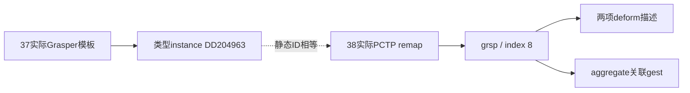

# 38 三轴控制、能力角色与局部变形怎样关联

[目录](README.md) · [37：部件定义](37-part-definition-edit-controls-rigs-and-capabilities.md) · [30：造型与局部动作](30-part-shape-rest-pose-and-local-animation.md) · [11：具体执行者](11-action-plans-and-execution.md)。范围仍是陆地Creature及其编辑器；共享格式仅作为技术表示，不扩查其他阶段玩法。研究起点：2026-10-12 19:12:26 PDT，America/Los_Angeles。

本轮沿37留下的两条线继续：**三轴编辑/放置键是否能找到实体；部件类型怎样关联到动画角色和局部变形。** 第一条取得明确但有界的阴性结果；第二条取得实际PCTP映射和与已有手部件/ANIM的ID对应。没有恢复鼠标拖拽或原作绑定执行函数。

后续[39：同类肢体、变体与默认混合](39-same-role-effectors-variant-binding-and-default-mixing.md)补到开发团队的集合查询/动作变体/游戏选择机制，并重读既定ANIM的实际筛选字段。它没有补齐本机默认值消费者；本篇PCTP原值与28项检查范围保持当时交付。

## 本机结果一：六个控制/放置键没有找到资源实体

37的Grasper模板引用三个轴ID：

| 标签 | instance原值 | 使用位置 |
| --- | --- | --- |
| DeformAxisLeft | `0x7cc96c02` | modelHandleKeys；放置模板group |
| DeformAxisForward | `0x2e6521f4` | 同上 |
| DeformAxisUp | `0xd02751de` | 同上 |
| PreserveOrientation | `0x95f07f3d` | 三个放置模板instance |

原始控制键是`type0:group0:axisID`；三个放置键是`type0:axisID:95f07f3d`。本轮在七个Data包索引中检查原始键、只替换type为PROP的候选、PROP同instance跨group候选，以及四个ID在所有资源类型的group/instance精确相等查询，均无命中。没有可继续解压的实体，payload读取数为0。[控制键查询范围与身份](evidence/local-axis-control-template-observations.json)

这纠正了后续研究的入口选择：**不能继续称它们为已经找到的三份PROP模板。** 它们可能参与程序内策略、注册表或其他间接解析，但这些只是解释候选。阴性查询不证明把手或PreserveOrientation功能不存在，也不恢复哪个坐标框架被保留。

37已读的手模型中也没有独立RWMorphHandle记录；其内部动画仍存在。两项结果不能拼成“手没有编辑动画”，更不能从三轴名称编造具体变形公式。

## 本机结果二：一份实际能力映射文件

固定社区格式将`type=0x7c19aa7a`识别为PCTP（Part Capabilities File）。本轮两包中分别找到一个键，资源键彼此不同，不能当作覆盖前后同一资源：[本机PCTP记录](evidence/local-selected-capability-mappings.json)。

| 文件 | 完整键（type:group:instance） | 原始版本 | 本轮读取 |
| --- | --- | ---: | --- |
| Spore_Game | `7c19aa7a:00006f14:f8ccfe08` | 3 | 解压3475字节，仅头部身份/版本记录 |
| PatchData | `7c19aa7a:000082d0:142d3338` | 4 | 解压4961字节，完整遍历四类表并验证结尾；导出mout/grsp相关字段 |

两包完整摘要与37一致；EXE和Graphics身份沿用37，没有重读模型。其余五包只有索引查询，没有读取PCTP内容。固定文件名注册表未匹配这两个实例和group名称，当前不知道原游戏何时加载它们，不能据包名认定Patch必定用于此次Creature动画。

版本4实际包括88项长名称、168项remap、8项aggregate、20组deform描述，priority原值为2.0。priority不解释为帧率、排序保证或出现概率。名字和角色表可能跨编辑器共享；正文只使用与既有嘴/手表示相符的两组，不把全部表项当成陆地玩法。

版本3的`+8`处原始整数为60，按公开条件是nameCount候选，不是priority浮点。社区读取器与写入器对v3的第二个deform浮点条件不一致，本轮不盲套v4解析或自动修正。未读取v3有效映射，保留明确不支持状态。

## 实际关联：手部件类型 → grsp → deform列表

Patch v4中实际读取到：

| 长名称 | 按固定规则计算并与remap核对的哈希 | 四字节角色 | remap index原值 |
| --- | --- | --- | ---: |
| grasper | `0xdd204963` | grsp | 8 |
| mouth | `0x3c2a2452` | mout | 11 |

37的手模板`modelRigBlockType`原引用为`type0:group9ea3031a:instanceDD204963`。其instance与这份实际PCTP的grasper remap哈希相同，形成**跨配置的静态ID对应**。角色grsp的aggregate还列出gest；这里确认关联记录，不解释其运行时继承/筛选方向。



图中虚线不是原作调用；没有证明某个编辑事件执行了PCTP查找。**index8也不是第8根骨骼或当前name表第8项。** 社区写入器会排序name表，但不随之重排mapping.index；它用这个index恢复编译顺序。名字哈希、PROP字段ID、骨骼索引、动画角色、deformID仍是不同编号空间。[固定格式及生产/读取位置](evidence/public-capability-binding-format-contracts.json)

## 实际反例：同一个deform ID，两个角色不同默认值

| 角色 | deform ID | 原始浮点0 | 原始浮点1 | flags |
| --- | --- | ---: | ---: | --- |
| grsp | `89e06a31` | 0.5 | 1 | 0 |
| grsp | `75d4c8cd` | 0 | 0 | 0 |
| mout | `89e06a31` | 0 | 1 | 0 |
| mout | `5d8d0055` | 0.5 | 0 | 0 |
| mout | `892788c6` | 0 | 0 | 0 |
| mout | `dd0dcef4` | 0 | 0 | 0 |

社区格式工具将两个浮点解释为default_value/default_weight，并明确注释它们不是实际range；flags还有rendered/helper及wrap的社区解释。原作采样、混合、中性参考与默认值使用公式没有恢复，因此正文同时保留原值，不把0.5变成开口角、缩放比例或蒙皮权重。

同一`89e06a31`出现在手与嘴下面，首浮点不同。这直接反对“只按deformID全局查到唯一Open语义”的做法。mouth的四个ID还与30所选Patch ANIM的mouthMorphs列表相同；这补到**角色描述与动作组件的ID对应**，仍不是该生物嘴部的完整实际执行链。

## 社区中间结构：角色、等级与动画值分列存储

固定SDK的`cCreatureDataResource`声明：RigblockData记录mCapabilityIndex、mMorphsIndex、mNumCapabilities；资源另存mCapabilityIDs、mCapabilityLevels、mAnimationIDs、mAnimationValues、mAnimationWeights。CapabilityTag为四字符表示，注释关联PCTP角色。[来源身份与行位置](evidence/public-capability-binding-format-contracts.json)

这为“部件配置编译成身体动画数据”提供具体表示入口。它没有公开生成这些列表的函数体，不能用相同数组下标直接推导各列表配对；mMorphsIndex也不能自行解释成骨骼起点。动画值/权重、能力等级与造型参数应分别跟踪。

属性字典另声明以下四项，精确ID由注册表核对，不以普通名称FNV替代：

| PROP字段 | 字段ID | 公开类型 |
| --- | --- | --- |
| modelCapabilityToPropFileMap | `047be907` | keys |
| modelCapabilityAnimKeys | `047be908` | keys |
| modelCapabilityDefaultAnimValues | `047be96f` | floats |
| modelCapabilityDefaultAnimWeights | `0684d16c` | floats |

ToPropFileMap的文档写作`<capability id>!<propfile id>`，对应资源键的group/instance表示。当前未取得实际Map条目，不能猜统一能力PROP目录或把类型0自动解释成某种资源。公开的实际执行体仅追到社区转换器“读取→格式化/写回”，没有取得原作控制或绑定函数体。

## 自研：显式编译三条绑定，不用名称或全局整数猜

以下是独立设计，不照搬PCTP默认值、flags或index。

| 绑定 | 完整身份 | 输入和输出 |
| --- | --- | --- |
| 编辑控制 | definitionId + version + controlId + shapeParameterId | UI操作 → 永久造型参数 |
| 动作角色 | definitionId + version + role + localChannelId | 动作语义值 → 部件局部输出 |
| 具体执行者 | bodyRevision + stablePartId + boundProfile | 技能请求 → 当前身体中的部件/骨骼 |

能力贡献也独立保存：角色说明动作适用部位，等级/条件说明技能资格，profile说明部件怎样运动。角色存在不保证有攻击能力；技能资格成立不保证具备所需动画实现。

```text
BoundPart {
    stablePartId, definitionId, definitionRevision, bodyRevision,
    shapeBindings: controlId → typedShapeParameter,
    motionBindings: (definitionId, definitionRevision, role, channelId) → profile,
    boneBindings: stableBoneId → currentArrayIndex,
    capabilities[], diagnostics[]
}
MotionCommand { space: Motion, partId, revision, role, channelId, value }
ShapeCommand  { space: Shape, partId, editorRevision, parameterId, value }
```

shape.width与motion.grip就算碰巧编号相同，也不能共用一个槽。两个资产都使用localChannelId=1，也必须带定义身份、版本与角色上下文；两个相同资产实例则还须区分partId。算例用own-hand-v3等字符串合并表示定义身份与版本，正式契约将它们分列。别名表出现重复/歧义时拒绝编译并保留诊断，不采用最后写入覆盖。

## 自研编译与求值伪代码

```text
CompileOwnBindings(definition, recipe, bodyRevision):
    require known definition/version and unique part/control/semantic identities
    for control in definition.controls:
        require its Shape parameter exists and input/output units are declared
        bind its explicit placement-frame policy and edit track
    reference = compile own edited geometry/rig/features (37/30)
    for localProfile in definition.profiles:
        require role/channel has no ambiguous definition
        require stable target bone or scalar output exists in reference
        require curve domain/default/neutral and composition ownership are valid
        record full scoped key → current output mapping
    validate skill-required profiles and contribution conditions
    return immutable body-revision binding or diagnostic result

ResolveOwnMotion(command, boundPart):
    reject wrong parameter space, partId or bodyRevision
    reject detached/disabled part
    key = (boundPart.definitionId, boundPart.definitionRevision,
           command.role, command.channelId)
    reject missing required profile with RequiredProfileMissing
    validate command value in that profile's domain
    delta = sample declared profile relative to its edited neutral reference
    output = fresh current reference; apply delta once to reserved output
    return output and diagnostics; never write back Shape parameters
```

骨骼数组从index0重排到index7时，重新建立stableBoneId映射；旧请求用revision检查失效，不能沿用index0控制另一个关节。删除肢体更新有效贡献与执行资格，灵魂据16重新选行动。单独换魂不改部件永久造型。

自研候选筛选应返回可用部件与拒绝原因，例如CapabilityInsufficient、RequiredProfileMissing和PartUnavailable；不只得到一个空列表，让AI无法区分缺技能、缺动作和断肢。

## 自研控制框架：轴向、变形输出和安装姿态分开

对自己的直线滑杆，显式声明轴在部件中性空间、宿主空间还是世界空间。鼠标投影沿37的独立公式。控制框架用于解释输入，造型轨道决定哪些几何/骨骼改变；“沿X拖”不必意味着只缩放全网格X轴。

自研选择PreserveUserLocal策略：造型后更新连接位置和特征位置，保留用户相对宿主的安装旋转。宿主旋转仍会改变部件世界朝向；这不是保持世界旋转不变。它只是我们明确选定的策略，不能当成原作PreserveOrientation的含义。

## 自研完整演算：加宽手，再抓握，最后断开

自研H1定义own-hand-v3，role=hand、localChannel=1，Grip输出finger骨。宽度参数u∈[0,1]，`W=0.03+0.02u`m；默认u=0.5。Grip中性值n=0.2，上侧最大弯曲40°，下侧最大张开10°。这些参数不来自上面的PCTP。

1. 玩家把width的u从0.5改到0.75，宽度从4cm变成4.5cm。两侧特征点各外移2.5mm；用户局部安装角20°保持。这是永久参考更新，没有提高抓握等级。
2. H1连接正常、grasp等级1且具有Grip映射；装饰手H2等级0，被拒绝并返回CapabilityInsufficient。另一个模拟缺映射的H3返回RequiredProfileMissing。灵魂可以据此区别“无资格”和“无法执行”。
3. 灵魂选择H1执行Grip，请求Motion值0.6。正侧归一化`r=(0.6−0.2)/(1−0.2)=0.5`，局部弯曲20°。在这个二维同轴演算中，安装20°加局部20°得到40°；宽度仍为4.5cm。
4. own-mouth-v2也有localChannel=1，但role=mouth、neutral=0.3、正侧最大30°。同样0.6求得约12.857143°；它不会使用手的20°profile。将mouth请求误发给H1则明确拒绝。
5. 动作结束请求自身中性0.2，局部增量回到0°，保持编辑宽度和安装20°。如果错误地一律归零，本例会得到−10°张开；“中性”与“数值零”不是天然相同。
6. 身体重编译使finger数组位置从0变为7，以stableBoneId重新绑定。revision12动作交给revision13身体时拒绝旧请求，不误控新数组的第0骨。
7. H1断开，候选返回PartUnavailable，未执行的Grip停止。灵魂改选其他可用肉体行动或自带技能；不会把断肢的profile继续当成当前身体的执行者。

这里规定的是我们自己的标量映射及失效处理，不是Spore的默认值混合公式，也不证明三维手指、接触或战斗命中。具体通道预约与效果提交沿11/28，造型/蒙皮沿29/30。

## 实际验证、未做和剩余风险

[PCTP读取检查](checks/verify_capability_mapping_reader.py)13项通过，覆盖有界计数、版本、大小、逆序tag、NUL身份、有限值、默认字段和本机记录；[独立绑定算例](checks/verify_part_binding_examples.py)15项通过，覆盖参数空间、作用域、中性值、实例、骨骼重排、资格/缺映射诊断、断开与版本。实际结果、摘要和文档检查见[本轮验证](evidence/part-binding-verification.json)，不并入37的35项。

已回答：所选文件中的名称/角色/deform实际关系及默认字段；六个控制/放置键的有界索引查询结果。部分回答：手部件类型到角色、角色到ANIM组件ID的静态对应；编译中间结构。未回答：轴策略的原作处理函数、PCTP加载选择、真实Map条目、默认值/权重合成、参考骨架生成及最终技能执行者选择。

未做：原生反编译、启动/附加游戏、私人存档读取、模型/纹理导出或重读、用户产品实施和三维运行对照；REA/provider缺口沿用00，没有安装/构建/改配置。研究脚本与规格验证不需要运行REA生产测试。

风险：共享映射文件的Creature运行适用性尚未确认；静态ID对应不能替代调用证据；社区注释不是本机执行公式。下一处需要的是实际能力Map条目或轴键消费者，而不是再假定这些名称必定对应可解压资源。
