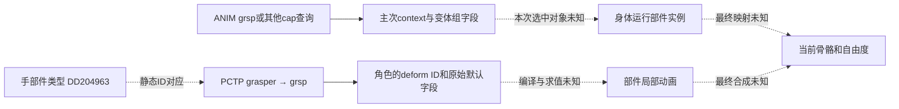

# 39 多只同类肢体：选执行者、绑定局部动作与混合默认参数

[目录](README.md) · [38角色映射](38-axis-controls-capability-role-and-local-deform-binding.md) · [28通道协调](28-parallel-actions-channel-ownership-and-conflicts.md) · [30造型与局部动画](30-part-shape-rest-pose-and-local-animation.md) · [11行动执行](11-action-plans-and-execution.md)。范围仍为登陆后、部落前的Creature及其编辑器。调查起点：2026-10-12 20:41:48 PDT，America/Los_Angeles。

这一轮补到的重要机制是：**身体查询可以选中多只手；动作可为不同手产生变体；游戏再选择当前使用的变体，相关肩部随同变化。** 开发团队明确描述了这条链。本机所选ANIM也有左右/位置筛选字段，但没有恢复此次技能的游戏选择条件、最终骨骼实例绑定或PCTP默认值混合函数。以下先列来源，再给用户游戏的独立规格。

后续[40](40-action-events-emitters-hit-windows-and-stale-callbacks.md)追事件/发射/窗口，[41](41-mirroring-mount-frames-and-action-coordinates.md)追镜像框架，[42](42-branched-limbs-shared-joints-and-goal-conflicts.md)追分叉共享，[43](43-unusual-bodies-locomotion-modes-and-transitions.md)追特殊运动，[44](44-editor-rebuild-undo-and-animation-cache-consistency.md)追重建缓存。它们没有把本篇PCTP默认混合缺口填成已确认公式。

## 原作：选四只手与决定哪只手攻击，是不同步骤

本轮重新读取开发团队动画论文PDF第3–6页，摘要与身份见[公开机制和固定格式记录](evidence/public-same-role-binding-contracts.json)。以下是历史系统设计，未与本机执行调用对齐。

| 环节 | 公开机制 | 对多肢体的意义 |
| --- | --- | --- |
| 身体查询 | capability查询可以选中四只手；多个约束取交集 | 同一个通道可作用于多个相符部位 |
| 位置约束 | 使用character bounds或capability-set bounds；extent查询返回零或一个，极值并列时任选其一 | “同类”“某一侧”和“极值部位”是不同筛选维度 |
| 动作变体 | 可为选中的手生成各自变体，由游戏条件决定使用哪个 | 选择可以考虑当前情境；论文的最近/未占用只是例子，不是所有技能的固定规则 |
| 关联部位 | 同一variant group可令对应肩部随手一起变化 | 主手与辅助部位需要一致，不能各自随意选一个 |
| 混合归属 | 按animated degree of freedom取得归属，同blend group可分享再混合 | 骨骼位置、旋转等可以分别处理；不能用整根骨的一个开关概括 |

来源：[Hecker等，§3.1、§3.2.3和§4.1.2，PDF第3、5、6页](https://www.chrishecker.com/images/c/cb/Sporeanim-siggraph08.pdf)。该论文的position/rotation混合说明不能直接当成PCTP局部deform标量的公式。

据上述公开行为重新组织的说明性流程如下；这是概念规格，不是恢复的原生函数：

```text
roleMatches = body query for channel capability
eligibleBodies = intersect roleMatches with declared spatial constraints
if channel requests extent: keep zero or one extreme result
variants = possible body choices for authored variant groups
chosenVariant = game selects using its current conditions  // local policy unknown
associate covarying channels with this same variant
specialize channel goals to the selected bodies
resolve ownership per animated degree of freedom, then compose pose goals
```

四只手全匹配时，结果数4本身不代表四次攻击。variant选择、动画通道覆盖和玩法效果提交仍各有职责；辅助脚或肩部出现在攻击动画中，也不代表它们都是伤害执行者。

论文也描述多组变体的组合与约束，不能把组数、选中的身体数与TLSA choice条数互换。实际枚举次序和本机游戏评分仍未知。

## 本机：实际左右/位置筛选与主次context

本轮沿28已有46份ANIM、612条通道检查主次context，不从名称另选动画或扩查其他阶段。[所选查询原值、位置及覆盖](evidence/local-same-role-selector-observations.json)。社区格式固定到FX提交`a482c51d8d37fc8cf416acecc3c00a5b0723f2e5`，解释标签保留社区性质。

| 所选查询 | 观察到的primary flags原值 | 固定社区工具的解释 | 仍不能得出的结论 |
| --- | --- | --- | --- |
| grsp | `0x00000004` / `0x00000008` | left / right筛选 | 通道名R hand不是身体中的固定第几只手 |
| foot | `0x00020000` / `0x00020004` | localLeft / localRight筛选 | 不是已确认的偶数/奇数腿交替算法 |
| strk | Y位段含`0x00000020` | back筛选 | 不证明技能优先选后手或最高攻击等级肢体 |
| 另一些查询 | 含`0x00200000` | 社区工具以未命名selectFlags保留 | 不自行命名为随机/全部/最近 |

全部1224个context中，两项未命名字段field_8/field_C原值均为0。611条通道secondary为flags2和空tag；另一条为mout/flags0，位于补丁所选com_strike_tl_lvl05的L hand通道。后一条movementFlags原值0x20，不含社区定义的SECONDARY启用位0x1，**只能说次查询字段存在，不能说它在播放中启用了嘴部参考。** 它们没有显示稳定部件ID或已选骨骼下标，不把零填成默认肢体编号。flags控制四字节payload按capability或数字表示解释，不能把字符串视图强套到数字查询。

固定格式另有X/Y/Z以及leftMost/rightMost/frontMost/backMost/topMost/bottomMost的extent标签。**所选1224个context的extent位段均为0**；格式支持某标签不等于此次技能采用它。基础版本21和补丁版本25的原位段继续保留，未执行社区旧版兼容改写。两包46份既定资源的存储和解压内容实际重读，其摘要及全部通道元数据均与28一致；没有导出完整动画。

bindFlags的16–23位和24–31位分别保存社区解释的blendGroup与variantGroup。按无符号方式取位段，避免高字节被有符号右移显示为负数。**同一组号需要结合动画实例及绑定结果；不是全身体全技能通用的组身份。** SDK的播放参数pChoice对应TLSA choice，没有证明它就是论文的“第几只手”variant选择接口。

左右筛选也与镜像设置分开：bindFlags另有mirroring位段0x32，社区格式命名default/left/right/reverseDefault/never；实际镜像变换未恢复。公开工具数字secondary的解析/输出分支还存在类型值不一致，本文保留原值和诊断，不自动把两个值统一叫外部目标。

## 原作：角色、局部deform与实际骨骼还缺哪一段

目前能够拼出的证据链如下：



手类型→grsp的实际ID关系见38。选定Strike通道还使用skrs/strk等查询，不把所有打击通道统一替换成grsp。部件有抓握角色也不自动具有打击技能；技能等级与动作角色继续分别跟踪。

社区cCreatureDataResource把部件的capability/morph起点与全局角色、等级、animation ID/value/weight数组分开；CreatureBlock、anim_csd、anim_cid给出编译描述与运行实例的连接入口。这些声明未公开选择、编译或混合执行体。37手模型的骨骼名字哈希、内部KeyframeAnim通道和38的PCTP deform ID也不能直接当成同一个编号空间。**component.index、remap.index、部件序号和骨骼数组下标均需独立核对。**

因此，动作角色→选中部件→局部变形→骨骼的中间表示已有入口，完整本机运行绑定仍未恢复。没有把“第一个匹配手”“最强手”或“随机手”填入这个缺口。

## 原作默认参数：已知是两套数值，未知是合成消费者

下表复用30/38已读记录，不宣称本轮重新解码这些曲线或PCTP：

| 对照 | PCTP原始浮点0/1 | 所选ANIM局部曲线value/weight | 能确认什么 |
| --- | --- | --- | --- |
| mout的89e06a31 | 0 / 1 | time0约0.302573 / 0.844668 | 描述默认字段与动态曲线字段分开存在 |
| grsp的89e06a31 | 0.5 / 1 | 本轮未取对应手曲线 | 同ID在不同角色有不同描述默认值 |
| mout的5d8d0055 | 0.5 / 0 | 所选五帧为1 / 约0.742647 | 默认weight原值0与非零曲线weight并存于所选记录 |

[PCTP实际记录](evidence/local-selected-capability-mappings.json)与[局部曲线记录](evidence/local-selected-part-deform-keys.json)来自不同资源；PCTP的Creature加载适用性尚未确认。不能据这个对照认定它们一定在一次游戏播放中一起使用。

固定社区工具把PCTP两个浮点注释为default_value/default_weight，并说明不是range；ANIM RigblockComponent则每个关键帧另存value/weight及插值器。属性字典还声明DefaultAnimValues/Weights。现有表示**不确定**默认字段如何继承、何时缺省、是否参加归一化、如何与动画实例权重/通道权重相乘，或是否先变换再混合。

特别不能把default_weight=0解释为部件功能永远关闭，不能把value×weight当成最终关节角度，也不能把动画weight当蒙皮顶点weight。当前未取得这些字段的原作消费者；后面的公式是明确选定的自研政策。

## 自研：先选择具体执行者，再绑定整组相关输出

以下全部是用户拼装/灵魂游戏的独立设计。灵魂提出技能与目标偏好，肉体提供当前可执行实例及约束；灵魂自带技能也声明是否需要手、脚、嘴、瞄准框架或纯意识资源。

```text
EffectorRef = (stablePartId, definitionId, definitionVersion, bodyRevision)
RoleProfile = (definitionId, version, semanticRole, localChannelId,
               neutralValue, defaultValue, defaultWeight, curveDomain,
               localOutputBones, helperRelations, blendContract)
OutputKey = (partInstanceId, stableBoneId, degreeOfFreedom)
BoundVariant = (actionId, controlGeneration, bodyRevision, targetId,
                executorRef, helperRefs, stableOutputKeys, currentBoneIndices)
```

四只同资产的手共享RoleProfile定义，各有实例身份和状态。手H2的fingerA与H4的fingerA是不同输出。局部通道整数1也要带定义版本与语义；Shape.width不能进入Motion.grip槽。

辅助肩通过配方关系`hand→parentArm→shoulder`取得；脚通过`foot→parentLeg→hip`取得。缺关系、缺目标骨或定义有歧义，返回RequiredHelperMissing/StableBoneMappingMissing，避免临时搜一个最近肩膀。骨数组重排后重新映射稳定身份，不沿用旧下标。

## 自研：技能、目标、肢体的联合筛选与提交

```text
BuildPlans(skill, perceivedTargets, immutableBodySnapshot):
    for target in targets permitted by skill:
        for part in body.instances providing required semantic role:
            reject detached/disabled, insufficient local capability, cooldown
            reject required profile/helper/output missing or already reserved
            specialize own profile into this part's edited reference and limits
            reject target outside current reach or blocked essential trajectory
            for foot attack: construct and validate contact transfer plan
            score feasible (skill, target, part, executionMode) tuples
            record score terms, required outputs/resources and rejection reasons
    sort by descending score, then stable tuple identity
    return ranked plans and diagnostics

CommitPlan(plan, actor):
    recheck body revision, control generation, target validity and local cooldown
    recheck every required output and gameplay resource reservation
    recheck support transition when required; future support is not current support
    if any check fails: return explicit reason without partial reservation
    atomically reserve all requirements within this actor's serialized update
    freeze this action's executor/helper bindings and start its own timeline

OnDependencyLost(action):
    cancel uncommitted effect windows; release only this action's reservations
    notify soul/body assessment of changed capability and rejected plan
    build a new action if another part is selected; do not move old hit window
```

简单的“候选按距离排序”不够：占用、实际可达、辅助骨链和支撑需要先检验。已启动动作默认固定执行者，避免敌人移动时每帧跳换左右手。提交时再查预约，处理评分之后另一动作先占用的情况。共享躯干兼容/预算沿28，不因两只手不同就自动通过。

此处的原子性只覆盖单个actor的串行更新；网络、持久化和并发事务需产品自己的契约。伤害是否提交仍按11/25/33检查真实窗口与当前有效性，视觉贡献存在不代表能扣血。

## 自研：默认值、默认影响、中性参考分别定义

为同一已绑定标量输出明确规定三件事：n是中性参考；d是无动作时的默认目标；w0是默认目标参加混合的影响。d可以与n不同，例如默认轻握。它们的范围、单位和作用域由自己的资产契约定义，不直接导入PCTP原值。

自研先排除零影响贡献，再按优先级和兼容契约选择动作贡献集合A。必需输出冲突已在提交时拒绝；表现贡献若被抑制则保留诊断。只有同一实例/输出、参数域、参考和合成语义相符的贡献才允许混合。不同握合与张开意图若未声明兼容，不自动平均。

```text
MixOwnScalar(profile, compatibleContributions):
    validate finite default/value/weights; reject negative weights
    active = contributions with effectiveWeight > 0
    choose compatible winning priority/contract; record suppressed contributors
    T = profile.defaultWeight + sum(active weights in winning contract)
    if T == 0: return profile.neutralValue with NeutralFallback diagnostic
    q = (profile.defaultWeight * profile.defaultValue
         + sum(weight * value for winning contributors)) / T
    return q

EvaluateOwnLocalPose(boundVariant, q):
    profile = exact instance/definition/version/role/output binding
    delta = sample own scalar-to-local-pose profile relative to edited neutral
    localPose = fresh edited reference with this delta applied once
    resolve whole-body goals/constraints; emit one authorized skinning path
```

本政策选择“默认目标始终按w0参与”，如果某技能需要完全控制，可以在动作定义中声明抑制默认影响并纳入预约；不能临时靠曲线恰好weight=1推导完全独占。动作结束后没有动态贡献，回到d；d=n才回到中性。T=0明确回n。零权重高优先级通道不取得混合归属。

动作有效权重可在自己的契约里定义为时间包络×局部曲线影响×动作强度，所有因素独立记录；这不是原作已证乘法链。本文数值表直接使用effectiveWeight。旋转与位置另用28的合成契约，不把标量平均推广成矩阵/四元数分量平均。固定造型数据不参与帧间回写。

## 自研完整例子：四手选择、握合混合、断手改选

身体revision42有H1–H4四只手、六条腿。目标T已经感知且允许攻击；灵魂选择单手打击，同时H3正在维持护盾。下面所有距离、分数、角度、默认值均为构造参数，不是Spore常数。

| 手 | 可达半径 / 到T距离（m） | 命中概率 / 前摇s / 疲劳 / 根转角rad | 硬条件结果 |
| --- | --- | --- | --- |
| H1 | 0.9 / 1.1 | 0.9 / 0.25 / 0.1 / 0.1 | Unreachable |
| H2 | 1.25 / 1.0 | 0.85 / 0.35 / 0.1 / 0.15 | 可执行 |
| H3 | 1.2 / 0.8 | 0.9 / 0.25 / 0.3 / 0.35 | EssentialOutputOccupied |
| H4 | 1.1 / 0.95 | 0.7 / 0.4 / 0.2 / 0.2 | 可执行 |

等级与profile在本例均足够，H3的必要手输出已经占用。采用教学评分`S=pHit×damage/(windup+0.2)−2×fatigue−3×abs(rootYaw)`，伤害12点；前两项和转角成本用自研系数换到同一评分尺度。命中概率是自研预测输入，不宣称用距离即可推出。

H2得到`0.85×12/0.55−0.2−0.45=17.895455`；H4得到`0.7×12/0.6−0.4−0.6=13`。先选H2。更近的H3已经被资格过滤，不用高分覆盖护盾占用。相同分数按稳定partId打破平局，复现时不受数组重排影响。

1. A0提交前复查revision42、目标和预约，绑定H2的fingerA/fingerB以及Arm2肩部；当前骨索引7/8/4。一次提交预约所有必需输出和资源。H1/H3/H4不会因共享资产或同名fingerA一起握合。
2. H2造型宽度仍4.5cm、用户安装角20°，沿38保留。自己的Grip定义n=0.2、d=0.35、w0=0.25，正侧40°，负侧张开10°；本例动作贡献v=0.8、effectiveWeight=0.75。
3. `q=(0.25×0.35+0.75×0.8)/1=0.6875`。自研正侧映射`delta=40×(q−0.2)/0.8=24.375°`；fingerB使用定义中0.6倍增量，即14.625°。二维同轴演算中安装加fingerA增量为44.375°，宽度不变。每帧从新参考算一次，不累加上一帧44.375°。
4. 若另有同优先级、同握合兼容契约的表现贡献v=0.6、w=0.25，则`q=(0.0875+0.6+0.15)/1.25=0.67`，fingerA增量23.5°。这只解释局部姿态合成，不增加一次攻击效果。不同契约或低优先级贡献被抑制并报告原因。
5. A0结束后，仅默认影响存在，q=d=0.35，增量7.5°，保留轻握。若w0也为0则q=n=0.2，增量0°。不以“动作结束归零”代替资产自己的中性值。
6. 如果H2在效果提交前断开，身体更新为revision43：A0依赖失效、未提交窗口取消、预约释放。灵魂重新筛选，H4成为可执行最高分，建立A1；旧A0不会把尚未命中的一次攻击自动移到H4。
7. 新骨数组重排后稳定输出映射重新建立。revision42的旧请求被拒绝；旧释放令牌只释放A0持有的资源，不影响A1。已提交的世界效果按11的效果主人继续管理，不靠删除动画回滚。

## 自研同一身体：哪条腿能踢，要把支撑转换纳入资格

六脚平面接地点（m）为F1=(-0.4,0.6)、F2=(0.4,0.6)、F3=(-0.5,0)、F4=(0.5,0)、F5=(-0.4,-0.6)、F6=(0.4,-0.6)。质心投影(0,0)。只用平地准静态模型，要求剩余支撑凸包非退化且投影距每条边至少0.1m；不是动力学稳定保证。

初始只有F1/F4/F5接地。踢击候选的状态为：F1和F4移出支撑会退化成两点，SupportUnsafe；F2冷却未就绪；F3技能等级0；F5到目标1m超过0.6m可达；F6缺必要profile。每个拒绝带原因，因此当前无合法腿，灵魂可以改技能或提出“停稳后踢”计划。

本例完成减速、落脚和实际接触确认后六脚接地，使用新快照再筛选。F1输入p=0.8、damage10、windup0.3、fatigue0.1、rootYaw0.1，分数15.5；F4为p=0.6、damage10、windup0.4、fatigue0.2、rootYaw0.2，分数9；其他拒绝仍存在。选择F1，但提交前还需检查其具体支撑余量。

移出F1后五点凸包的最小有符号边距为`0.3/sqrt(1.17)≈0.27735m`，满足0.1m约束。现在才释放F1世界接地锚点，绑定F1的ankle/toe与Leg1的hip，交给踢击；其余脚维持支撑。动作结束后规划新落点、确认接触，再把F1交回步态，不能同时让攻击和锁脚控制它。

腿的“候选有动作角色”与“当前能抬起来”分别验证。少于三点、三点共线、质心在外或边距不足均保留诊断；不以剩余脚数量足够就认定稳定。六足奔跑、腾空、斜坡和受击需更强的物理契约，此算例没有验证这些情境。

## 检查、未做与风险

[独立算例检查](checks/verify_same_role_selection_examples.py)27项通过，核对四手/六脚筛选和评分、稳定平局、缺角色/映射诊断、相关辅助骨、骨骼重排、全量预约、旧令牌、默认/动态混合、零权重、无贡献与支撑凸包。[证据一致性检查](checks/verify_same_role_evidence.py)8项通过，核对既有身份、46份资源摘要/元数据、全部查询统计、代表原字节/偏移/位段及固定公开来源范围。共35项，文档检查另见[本轮验证记录](evidence/same-role-binding-verification.json)，不与38的28项合并。研究算例不验证原作选择器执行、曲线求值或游戏战斗。

已回答：开发团队描述的集合查询→变体→游戏选择→关联部位流程；所选ANIM查询位及主次context原值。部分回答：角色/deform/编译身体/骨骼表示的静态连接；默认字段与动态曲线的区分。未回答：本机每个技能的variant选择政策、实际绑定函数、默认继承/混合公式和最终命中执行者。

未做：启动/附加游戏、原生调用追踪、私人存档读取、完整模型/纹理/动画导出、用户游戏实现和三维对照。REA/provider缺口沿用00，没有安装、构建或改配置；文档与独立算例不需要仓库生产构建。本轮本机实际读取与复用范围以证据记录为准。

风险：历史设计与社区格式不能代替本机运行证明；所选PCTP加载上下文仍未知。独立混合政策、单actor预约与平地支撑模型需要结合产品验证。下一处原作证据应是游戏选择variant的调用者或局部deform默认字段消费者，继续读字段名不能补齐这两个缺口。
