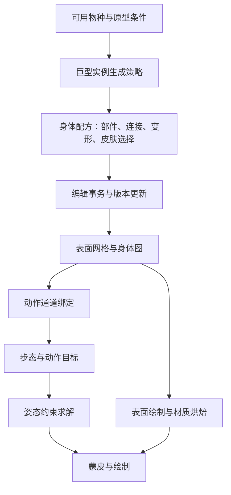

# Spore 陆地生物编辑器与程序化生物研究

范围是登陆后、部落前的 **Creature Stage（生物阶段）**：任意身体怎样获得动作、姿态、皮肤，以及局内 Epic Creature 怎样成为巨型实例。“自动动画”指按身体结构适配动作，不是用机器学习分析视频。

文档采用与[紫色晶石研究目录](../stoneshard/README.md)相同的模块阅读方式。已有续篇保持原路径；首次报告保存在[历史多足研究](notes/initial-multi-leg-study.md)。基础拆分锚点为 2026-10-11 20:55:16 PDT；灵魂与肉体续篇锚点为 **2026-10-11 21:37:02 PDT，America/Los_Angeles**。没有启动游戏；当前静态研究不需要保持游戏打开。

## 模块目录

| 文档 | 回答什么 | 交付 |
| --- | --- | --- |
| [00 证据与范围](00-evidence-and-scope.md) | 原游戏事实和我们设计的边界 | 文件身份、证据等级、来源 |
| [01 身体部件与姿态](01-body-parts-and-poses.md) | 嘴、眼、手、尾、翅膀与姿态 | 已有部件研究和本机词汇 |
| [02 技能与附着](02-skill-selection-and-editor-attachments.md) | 哪只手攻击；加宽如何带动肢体 | 已有绑定、双骨链与附着推导 |
| [03 核心结构与逐帧流程](03-core-structures-and-frame-pipeline.md) | 任意肢体怎样表示、绑定、混合 | 数据结构、通道绑定和帧管线 |
| [04 步态与足部目标](04-gait-synthesis-and-foot-targets.md) | 多足错开、落地、转弯、停步 | 相位与状态机、足部轨迹 |
| [05 姿态与约束求解](05-particle-ik-and-rest-pose.md) | 骨链怎样弯、分叉怎样协调 | 约束投影、参考姿态、不可达诊断 |
| [06 编辑交互与重建](06-editor-input-and-rebuild.md) | 拖动、滚轮、镜像后更新什么 | 输入事务、附着与版本失效 |
| [07 材质与花纹](07-skin-texturing-and-patterns.md) | 花纹怎样适配不同身体 | UV、表面粒子、笔刷与烘焙 |
| [08 巨型生物生成](08-epic-creature-generation.md) | Epic 物种与巨大化怎样分层 | 官方筛选条件、实例参数与未知 |
| [09 后续研究与验证](09-related-systems-and-verification.md) | 还有什么值得研究、如何证伪 | 研究排序、验证矩阵、实际检查 |
| [10 能力聚合与资格](10-capability-aggregation-and-ability-eligibility.md) | 多个部件怎样形成能力与技能门槛 | 新增官方/社区证据、独立统计与贡献来源 |
| [11 行动方案与执行](11-action-plans-and-execution.md) | 灵魂提出技能后哪只手执行、何时产生效果 | 选部件、占用、资源预约、中断与事件去重 |
| [12 配方与运行重建](12-body-recipes-and-runtime-reconstruction.md) | 设计、伤口、实例和缓存怎样分开 | 配方/模型证据、稳定身份与加载规格 |
| [13 灵魂与肉体](13-soul-body-contracts.md) | 灵魂如何提供技能、控制和策略 | 面向用户游戏的独立关系与所有权设计 |
| [14 AI 策略评价](14-ai-strategy-and-action-scoring.md) | 同一肉体如何因灵魂不同改变行为 | 效用评分、人格权重、认知与反馈演算 |
| [15 场景与落地验证](15-soul-body-scenarios-and-validation.md) | 换魂、断肢、资源不足怎样验证 | 端到端场景、建议顺序与实际检查 |
| [16 肉体评估与联合决策](16-soul-ai-body-assessment.md) | 怎样评估肉体并绑定技能、目标与具体部件 | 三层评估、完整方案、评分与失效伪代码 |
| [17 完整战斗算例](17-soul-ai-complete-battle.md) | 断手、换体后怎样继续战斗 | 逐次分数、资源/冷却、控制身份与最终结果 |
| [18 敌人生物来源与生成](18-enemy-creature-sources-and-generation.md) | 非本人设计的NPC来自预设还是随机 | 官方作品筛选证据、未知与自研约束生成 |
| [19 陆地模型/贴图/动画续查](19-land-creature-graphics-research-priorities.md) | 哪些图形与动画环节最值得深入 | 网格/蒙皮、动作叠加、局部变形、接触、皮肤与边界场景 |
| [20 物种、族群与数量](20-species-herds-and-population.md) | 巢穴周围的数量、补充、灭绝怎样分层 | 本机词汇、公开结构、独立人口预算与事件结算 |
| [21 群体配合与共享意图](21-pack-coordination-and-shared-intents.md) | 为什么一起跟随、响应攻击、分配任务 | AI结构入口、局部通信、角色预约与断肢重评估 |
| [22 社交会话与关系](22-social-sessions-and-relationships.md) | 唱歌跳舞怎样影响个体、物种与同伴 | 官方规则、会话/关系分离、独立多人结算算例 |
| [23 需求与流程蒸馏](23-requirements-and-workflow-distillation.md) | 本轮需求、踩坑怎样进入通用技能 | 需求适用范围、可复用规则与验证边界 |
| [24 下一轮陆地机制](24-next-land-mechanism-investigations.md) | 还有哪些机制最值得追 | 命中与体型、导航、动机、遭遇编排、编辑反馈的入口与验证方案 |
| [25 距离、肢体可达与命中](25-body-reach-attack-ranges-and-hit-resolution.md) | 长手怎样参与攻击；实际配置与动画接触如何区分 | 本机技能模板/等级局部解码、几何与事件职责、断肢后策略算例 |
| [26 接近、停止、避让与步态](26-land-approach-stopping-avoidance-and-gait.md) | 变宽怎么通行、攻击前停在哪、速度怎么接多足 | 本机移动/GAIT配置、停止入口、独立通行/制动/避让与实际速度反馈 |
| [27 感知、记忆与动机](27-perception-target-memory-and-motive-selection.md) | 如何发现、丢失和重见目标；需求如何变成行动 | 本机感知/逃跑调参、公开动机状态、独立认知与断肢/换体完整遭遇 |
| [28 多动作并行与通道冲突](28-parallel-actions-channel-ownership-and-conflicts.md) | 边走边攻击、多肢体放技能、共享骨骼如何协调 | 本机TLSA/ANIM局部配置、自由度归属、独立预约/混合/抢占与支撑转换 |
| [29 网格接合与自动蒙皮](29-creature-mesh-joins-and-automatic-skinning.md) | 拼装怎样生成皮肤、骨架与权重；加宽和弯曲怎样处理接缝 | 开发者隐式表面/权重来源证据、独立网格/绑定/接合算法及20项算例检查 |
| [30 造型与局部动画叠加](30-part-shape-rest-pose-and-local-animation.md) | 拉长嘴、加粗肢体、弯曲参考后，张嘴/握合/摆腿怎样保留造型 | 原作烘焙适配说明、嘴部标量曲线、自研参考增量/唯一变形路径与30项检查 |
| [31 地形、锁脚与支撑](31-terrain-contact-foot-locking-and-support.md) | 长短腿怎样上台阶、转弯、停步；加厚肚子怎样影响落脚 | 原作地面/步态入口、独立落点/抬脚/高度区间与支撑失效 |
| [32 身体体积与接触](32-body-volume-contacts-and-self-collision.md) | 胖身体挡手、长嘴穿胸、握物怎样处理 | 原作体积限制、独立胶囊/接触许可/联合约束与完整算例 |
| [33 变形后的命中与AI同步](33-shape-revisions-collision-hit-and-ai-sync.md) | 身体变形、断肢、换体后，碰撞、攻击和灵魂策略怎样一起更新 | 社区模型/范围入口、独立快照提交、扫掠命中及行动失效 |
| [34 编辑限制与运行成本](34-editor-validity-complexity-and-runtime-cost.md) | 拼装合法性、DNA/复杂度、预览烘焙与LOD怎样分开 | 原作入口与证据边界、独立预算/事务/降级算法 |
| [35 皮肤、变形与接缝](35-skin-pattern-shape-edits-and-seams.md) | 加宽、拉长、新增部件后条纹/斑点怎样变化；UV和部件缝怎么处理 | 开发者最终消缝修正、格式引用链、独立密度/锚点/相位/同版本烘焙与23项检查 |
| [36 实际皮肤配方与材质通道](36-selected-skinpaint-recipe-and-material-controls.md) | 一份主题怎样引用三层绘制；条纹怎样选择身体区域 | 本机六份PROP、五条效果引用路径与局部分布配置；独立通道合成及26项检查 |
| [37 部件定义、编辑控制与动作能力](37-part-definition-edit-controls-rigs-and-capabilities.md) | 一个部件怎样定义把手、参考骨架、连接、曲线及能力 | 实际手部件父链、模型骨架/局部曲线；独立资产契约、输入映射与完整咬击算例 |
| [38 轴控制与能力角色绑定](38-axis-controls-capability-role-and-local-deform-binding.md) | 三轴键是否对应资源；部件类型怎样接动画角色与局部变形 | 七包有界阴性查询、实际PCTP映射与共享ID反例；独立作用域绑定和完整抓握算例 |
| [39 同类肢体选择与默认混合](39-same-role-effectors-variant-binding-and-default-mixing.md) | 多只手/腿怎样选执行者、相关骨骼怎样一起绑定、默认参数怎样参与 | 开发团队查询/变体机制、46份ANIM重读与主次context；独立四手/六脚选择和默认混合演算 |
| [40 事件、发射点与伤害窗口](40-action-events-emitters-hit-windows-and-stale-callbacks.md) | 选定手/嘴后怎样触发效果，多部位与旧回调怎样结算 | 八份ANIM的60事件/770INFO；独立slot、socket、窗口扫掠、去重与生命周期 |
| [41 镜像、安装与动作坐标](41-mirroring-mount-frames-and-action-coordinates.md) | 左右、倒置和不同安装怎样适配方向 | 实际左右配置/查询字段、历史变体镜像；独立框架、反射与一次变换 |
| [42 分叉与共享关节](42-branched-limbs-shared-joints-and-goal-conflicts.md) | 两手共用肩肘时怎样联合求解 | 历史分叉/cross-constraint和部件内部树；独立目标协调、残差及失败回退 |
| [43 特殊身体运动](43-unusual-bodies-locomotion-modes-and-transitions.md) | 无足、短腿、侧足、急停和转身怎样切换 | 历史浮/爬/pseudo-feet机制；独立资格、高度包络、停步与模式发布 |
| [44 重建、撤销与缓存](44-editor-rebuild-undo-and-animation-cache-consistency.md) | 连续编辑怎样保持模型、能力、骨骼和动作同版本 | 社区编辑历史/动画实例/bake入口；独立generation、内容缓存、旧结果拒绝与清理 |
| [45 动画条件与绑定回退](45-animation-predicates-conditional-binding-and-fallbacks.md) | 缺脚/缺手、必需通道失败时怎样选动作 | 实际46动画/818事件条件与15require通道；独立预检、有限备选和旧计划失效 |
| [46 能力贡献与执行资格](46-capability-contributions-body-statistics-and-executor-qualification.md) | 最高值、总量、数量、档位和具体手怎样区分 | 四份手/嘴贡献及固定统计/范围表示；独立归约、局部资格、容量与灵魂来源 |
| [47 受击与AI恢复](47-hit-reactions-action-interruption-and-ai-recovery.md) | HP/表现/硬直/取消/逃跑怎样协调 | 战斗/能力/动机入口与有界配置阴性；独立反应账本、提交边界和恢复重规划 |
| [48 次级运动与主动接管](48-secondary-motion-passive-appendages-and-active-takeover.md) | 尾耳等怎样拖曳、何时由技能接管 | 历史hasIK/Jiggles边界与公开属性入口；独立阻尼、姿态连续性与控制权交接 |
| [49 吸附、安装与连接校验](49-editor-surface-snapping-attachment-and-connection-validation.md) | 鼠标命中怎样成为合法父关系与镜像安装 | 拾取/csnap/朝向/伙伴声明；独立表面锚、框架对齐、滞回、双侧校验与事务 |
| [50 完整配方与运行映射](50-complete-creature-recipe-runtime-bones-and-bindings.md) | 一具完整身体怎样对应骨、权重、能力与动作 | 两个CRT版本/两个编译候选的有界诊断；独立31部件/57骨编译与断肢映射 |
| [51 动作与步态时间](51-ability-animation-clocks-and-gait-synchronization.md) | 技能时间、动画事件、循环与多足相位怎样同步 | 实际时钟字段复用与历史腿组频率；独立暂停/倍速/跨步事件/急停演算 |
| [52 注视与多器官注意力](52-gaze-head-orientation-and-multi-organ-attention.md) | 多头怎样看不同目标，与攻击/导航怎样协调 | 编辑look声明与9个实际手部LOOKAT通道；独立双头/共享脊柱/限速与授权 |
| [53 特效与音效资源链](53-action-effects-audio-resources-and-presentation-ownership.md) | 动作事件怎样找到效果/声音，跟随与缩放怎样分开 | 六FX目录、10导出/20叶、四audioProp；独立表现账本、双嘴/六足与声音预算 |
| [54 多生物运行降级](54-creature-population-animation-and-simulation-lod.md) | 网格、动画和AI如何分层降成本 | 八PROP中的SimulationLOD100/75与不同表示；独立100NPC分散调度与事件连续 |
| [55 造型与关节可行域](55-joint-limits-shape-edits-and-motion-feasibility.md) | 拉长、加粗、参考弯法怎样影响可执行动作 | 实际手部4行绑定/10个局部样本；独立3D摆锥/扭转及前摇/接触拒绝 |
| [56 默认姿态与灵魂风格](56-neutral-posture-body-form-and-soul-action-style.md) | 身体neutral、动作pose与灵魂style如何分开 | 三个普通idle组的六ANIM/51通道；独立六足高度/支撑和连续换魂 |
| [57 编辑预览与功能验收](57-editor-animation-preview-and-functional-validation.md) | 当前配方怎样试走/试动作并留下有效结果 | 官方Test Drive/本机编辑动作配置；独立隔离副本、版本与测量验收 |
| [58 整链复制、替换与重挂](58-limb-subtree-copy-replacement-and-reparenting.md) | 上臂换件、手指保留、整链移动如何维护身份 | 公开编辑入口与复制支持未知；独立子树事务、接头迁移、成本与旧AI失效 |
| [59 灵魂校准与经验迁移](59-soul-body-calibration-feedback-and-experience-transfer.md) | 改造或换体后怎样学习可靠用法 | 纯自研反馈归因、依赖/情境、弱先验、有限探针及R→Soul→R算例 |

建议动画路线：**00 → 03 → 04 → 05 → 06**。技能选肢体结合 02 与 03；皮肤读 06 → 07；巨型生物读 08。

皮肤续查路线：**07 → 35 → 29 → 34**。35补开发者“原型裙边在发行前移除、最终保留纹理扩张”的说明，固定格式中区域→粒子→笔刷/通道引用，并独立演算加宽、拉腿、新部件、弯腿与UV更新。区分固定数量/物理密度、图案接合/UV过滤/几何裂缝；原作编辑重绘或重投影、斑点尺度和跨Rigblock连续性仍未知。验证见[本轮记录](evidence/skin-pattern-verification.json)，不合并到此前46项检查。

实际配方续查：**35 → 36 → 06**。36在两包局部读取长颈鹿主题、条纹ML和melt基础层PROP，匹配五个effect导出，再追Visual→Sequence→区域Distribute→Particle索引。两份效果目录中的引用与分布段已读，Particle/Settings内容仍未读，spacing单位和重绘时机仍未知。核对与独立材质算例见[验证记录](evidence/selected-skin-recipe-verification.json)。

接触与成本续查路线：**26 → 31 → 32 → 33 → 34**。31补地形查询候选及独立锁脚/支撑；32指出历史求解器明确忽略体内碰撞，补自己的体积约束；33将肉体版本、广相/狭相、实际技能窗口与灵魂评估贯通；34区分编辑合法性、资源价格、复杂度与运行预算。共同构造场景为长短六足、加厚身体、长嘴、握物和断肢。原作精确落脚、体积修补、命中同步及成本公式仍未知；检查记录见[本轮验证](evidence/contact-and-cost-verification.json)。

网格与蒙皮路线：**06 → 29 → 07 → 28**。29确认历史设计采用metaball皮肤及按身体来源生成权重，记录宽躯干剪切、邻肢融合的限制；独立规格贯通“配方→骨架→共享表面→权重→UV拆点→同版本绑定→姿态”。原作精确权重公式、最终蒙皮形式和本机重建调用链仍未知。

部件造型路线：**01 → 30 → 29 → 05 → 28**。30补充Rigblock编辑轨道烘焙为新基础网格、局部动画适配新参考骨架的历史说明，并局部读取一个已选Patch ANIM的mouthMorphs五帧、四参数。独立规格贯通参考重建、局部增量、全身求解与一次蒙皮；原作参数语义、插值、最终合成次序仍未知。

部件资产续查路线：**37 → 30 → 06 → 10 → 11**。37沿一份实际手部件读取五份PROP及父引用，核对三轴编辑/放置模板引用，并读取所选RW4的骨架层级/蒙皮对象关系、两个动画目录和10个局部帧。PROP的运行骨数4与资产骨数1/10分别保留；动画角色映射与玩法等级不混用。后半为自研部件定义、鼠标参数、参考编译、连接框架和具体实例绑定，35项检查见[本轮记录](evidence/part-definition-verification.json)。原作轴模板执行、骨架转换、PCTP实际映射及曲线语义仍未知。

绑定续查路线：**37 → 38 → 30 → 11**。38在七包索引中未找到六个控制/放置键对应实体，保留查询范围；局部读取一份v4 PCTP，取得grasper→grsp、mouth→mout及deform原值。手部件类型与grasper哈希对上，嘴的四个deform ID与30所选ANIM对应；同ID跨角色默认值不同，不按全局整数猜动作。28项研究读取/独立绑定检查见[本轮记录](evidence/part-binding-verification.json)，原作加载选择、轴消费者、实际能力Map与运行合成仍未知。

同类肢体续查路线：**38 → 39 → 28 → 11 → 16**。39重新读取开发团队的集合查询/动作变体/每自由度混合说明，重读既定46份ANIM的612通道，取得左右、局部左右及次查询字段原值；所选extent位段全0，唯一非空次查询缺社区启用位。自研例子贯通四手资格/评分→绑定对应肩与局部骨→默认/动态标量混合→断肢改选，以及六脚先停稳再踢击。35项证据一致性/独立算例检查见[验证记录](evidence/same-role-binding-verification.json)；本机技能选择条件、PCTP默认合成消费者和最终骨骼绑定仍未知。

五项完整续查路线：**39 → 40 → 41 → 42 → 43 → 44**。40在所选喷吐动画找到同一time、不同通道/表项的同名hit，区分事件来源筛选、逻辑效果槽与真实命中；41分离左右资产、查询、镜像和安装；42演算两个单独可达目标共同占用分叉点时无解；43补原作无足机制及自己的支撑/转换；44演算加宽→替换→Undo/Redo，并拒绝同内容键的旧任务发布。原作证据、自研规格和未恢复消费者分别列明；研究/算例及整目录核对见[本轮总验证](evidence/land-five-topics-verification.json)。断肢与灵魂是用户产品需求，不宣称Spore已有相应机制。

行为与交互五项续查路线：**45 → 46 → 47 → 48 → 49**。45检查整段/通道/事件三层条件；46把部件贡献、身体摘要与本地执行资格分开；47区分已确认伤害、受击表现、硬直与新AI规划；48限制被动子树并平滑交接主动控制；49从鼠标命中到稳定锚、连接框架和全量合法配方提交。实际读取、独立算例与文件检查见[本轮总验证](evidence/land-behavior-five-topics-verification.json)，不叠加此前111项。原作消费者未知的地方逐篇保留；断肢、供能与灵魂仍是自研需求。

完整运行映射五项路线：**50 → 51 → 52 → 53 → 54**。50明确原作同一完整生物端到端尚未建立，提供独立四手六足双头编译映射；51保留原始时间单位未知并独立统一事件时钟；52不把手部LOOKAT当眼睛凝视证据；53沿实际事件ID找到FX和audioProp，分离表现/伤害；54用原作未定单位100/75和自有调度阈值分别论证。独立结构、伪代码、贯通例子和实际检查见[本轮总记录](evidence/land-runtime-five-topics-verification.json)，不累加先前117项；没有启动游戏或实施用户产品。

编辑器与灵魂衔接路线：**55 → 56 → 57 → 58 → 59**。55把造型、参考偏好、硬限位和接触分开；56只把灵魂风格当受约束的提案；57将预览效果与真实世界隔离，验收确切版本；58保留孩子身份但重新编译新宿主接头/动作依赖；59把反馈归到具体身体、学习者、技法和情境。原作硬限角、neutral计算与整链复制/替换消费者仍有缺口，灵魂校准是独立扩展。检查与覆盖见[本轮总记录](evidence/editor-body-ai-five-topics-verification.json)，不叠加上一轮139项。

用户正在做肢体拼装与灵魂机制，且确认灵魂既改变策略也提供独立技能。对应阅读路线：**10 → 11 → 12 → 13 → 14 → 15**。10–12 分别列出 Spore 证据与自研规格，13–15 是面向用户游戏的独立建议；不声称 Spore 有灵魂系统。未提供用户游戏仓库，因此没有实施或替换任何现有游戏架构。

深入AI路线：**13 → 16 → 17**；16–17也是自研规格。17完整演算“先打远处威胁→断手改意识技能→换无手肉体→改用角和嘴”。普通敌人来源读18，再结合08看Epic；不能把随机选作品、随机拼身体与随机放置混成一个算法。此次续篇锚点为2026-10-12 00:04:31 PDT。

战斗几何续查路线：**11 → 25 → 16**。25取得两包各25个技能记录的实际配置，并以独立算例说明长手/短手选择、前摇后落空、多手事件去重与断肢改选灵魂法术。配置范围与身体可达性之间的原作公式仍未知；本轮检查与限制见25，不用解码记录数宣称整条战斗链已恢复。

移动续查路线：**25 → 26 → 04 → 21**。26取得CreatureGameTuning与gait0–6的局部配置，分别解释占地、攻击站位、局部避让、实际速度与步态；自研例子贯通“变宽改道→窄道等待→减速停靠→攻击重查”。原作宽度参与导航的公式、避让算法和速度转换入口仍未知。GAIT速度/相位原值与04的教学参数明确区分。

感知与策略续查路线：**27 → 16 → 21 → 26**。27取得8条感知/逃跑调参记录，区分当前感知、目标记忆、肉体需求与灵魂行动；独立遭遇贯通“发现→追逐→失去视线→受伤撤退→进食→换体重见”。原作目标记忆布局、需求阈值、遮挡和行为优先级仍未知。专项检查结果见27及其验证记录。

并行动作路线：**28 → 03 → 11 → 26**。28沿四类技能动画ID取得两条TLSA的26个选定组及46条ANIM的612条通道元数据。所选打击、咬击和冲撞配置允许locomotion，喷吐配置不允许；不据此保证局内行为。独立例子贯通四手六足并行、共享躯干、资源不足、受击抢占、效果保留与脚部支撑转移；原作技能并发和实际通道仲裁仍未知。

群体与社交路线：**20 → 21 → 22**，结合16看每个成员怎样评估当前肉体。续查时间锚点为 **2026-10-12 00:41:48 PDT**；官方手册已读取相关完整页面，社区声明固定到提交并保存摘要，本机EXE摘要再次一致。具体围攻策略、补充参数单位和社交公式尚未恢复；三篇中的算法与参数明确标为自研规格。

族群/社交续查当时的检查：新增[群体/社交算例](checks/verify_group_social_examples.py)的7项检查通过；核对25份Markdown、103个相对链接、16个本机完整字面量及8份公开来源记录。核对范围见[检查记录](evidence/group-social-verification.json)；这些检查不等于原游戏运行或自研AI上线验证。后续技能蒸馏的检查单独记录在23。

## 系统关系

这是**研究职责图与自研分层**，不是本机调用图；Epic 箭头表示复用物种内容，不证明生成时重新运行编辑器。

## 证据边界

| 问题 | 当前状态 |
| --- | --- |
| 任意身体的动作适配 | 开发团队公开设计；本机有相关词汇，未对齐函数 |
| 一次技能具体选哪只手 | 开发团队集合查询/变体/游戏选择机制及本机筛选位已取得；本机逐技能策略未知 |
| 技能距离与实际命中 | 四类攻击配置已局部解码；体型修正、命中几何及提交时点未知 |
| 移动、停靠与步态连接 | 移动调参与GAIT局部参数已读取；通行宽度、停点、避让与速度传递链未知 |
| 感知、记忆与动机选择 | 感知/声量/逃跑实值及公开动机枚举已取得；记忆布局、阈值与行为选择链未知 |
| 多动作并行与骨骼冲突 | 历史自由度混合机制及本机播放组/通道元数据已取得；技能并发、实际绑定与事件抑制未知 |
| 动作事件、发射来源与伤害窗口 | 八份所选ANIM的事件/INFO连接和事件来源已读取；同名hit并不证明重复伤害，消费者未知 |
| 镜像、分叉、特殊身体与编辑重建 | 历史镜像/分叉/无足机制及社区编辑/bake入口已取得；本机公式、模式条件、缓存与取消保证未知 |
| 动画条件与必需绑定失败 | 所选46动画、818事件条件和15条require通道已核对；原作评估、失败回退与选择顺序未知 |
| 部件能力与具体执行资格 | 四个手/嘴定义及身体统计声明已取得；原作贡献归约、技能档位和执行者资格消费者未知 |
| 受击、恢复与次级运动接管 | 战斗/反应/AI入口及历史IK子树、Jiggles边界已取得；原作取消链、参数和控制权交接未知 |
| 编辑拾取、吸附与合法连接 | 拾取、csnap、朝向、父子和对称声明已取得；原作命中选择、矩阵顺序、吸附与校验算法未知 |
| 完整配方到运行身体 | 有界XML模板/编译候选与格式诊断已取得；原作同一完整样本的骨/权重/能力/动作映射仍未建立 |
| 动作时钟、循环与注视 | 时间字段、步态表示、编辑look声明及手部LOOKAT位已核对；原作秒数换算、目标分配与暂停消费者未知 |
| 特效、声音与运行降级 | 10FX导出/四audioProp与SimulationLOD100/75已读取；实际播放/继承、调度/单位与成本未知 |
| 造型、关节限位与neutral | 手部局部矩阵/曲线与普通idle引用已读取；角跨度不是硬限位，原作默认站姿计算仍未知 |
| 预览测试与整链编辑 | 官方测试场和编辑动作配置已核对；原生验收/资源隔离、整链复制与换件保留规则仍未知 |
| 灵魂校准与经验迁移 | 已有独立归因/计数/迁移规格，未取得Spore对应学习机制证据 |
| 网格接合与自动蒙皮 | 历史隐式表面/部位来源权重及本机表示候选已取得；精确权重、最终蒙皮和附件接缝仍未知 |
| 部件造型与局部动画 | 历史烘焙/适配链及一条本机嘴部标量通道已取得；动态ID语义、插值与最终合成规则未知 |
| 地形接触与支撑 | 历史步态及社区地面查询入口已取得；真实锁脚、平衡与地形调用链未知 |
| 身体体积与局部接触 | 历史系统明确忽略体内碰撞；本机修补与表面接触链未知 |
| 变形后的碰撞/命中/AI | 社区模型边界与技能接口已取得；原作同步顺序、伤害几何未知 |
| 编辑合法性与运行预算 | 原作编辑/烘焙入口见34；独立预算不能代替原作成本公式 |
| 加宽后附着点外移 | 用户观察与社区字段提供入口；公式是独立模型 |
| 花纹适配身体 | 开发团队公开表面绘制设计；本机有 SkinPaint 词汇 |
| Epic 候选物种 | 官方 CRG 筛选条件可查 |
| Epic 概率、地点、倍率 | 未恢复；冒险模式同名字段不能代替 |

**伪代码是可讨论、可独立实现的规格，不是反编译源码。** 模块分别说明输入、状态、输出、步骤和失败条件。需要精确区分公开事实、本机线索、自研选择与未知。

未做：原生反编译、游戏运行和逐帧测量。DBPF只对各篇明确选择的资源作有界读取，完整新增/复用范围见[00证据与范围](00-evidence-and-scope.md)及每轮验证记录；未恢复包内脚本或完整动画执行。当前缺少可用 REA MCP/provider，既有启动器缺少编译运行文件；未安装引擎、构建工具或改配置。没有修改生产代码，因此没有跑仓库构建和生产软件测试；研究读取器与独立算例做了专项检查。

30另沿28的已选键局部读取一个Patch ANIM中mouthMorphs的标量关键帧；这个新增覆盖不扩大28原记录的元数据范围，也不构成运行时曲线求值或具体部件绑定。

风险：历史公开设计与本机发行版未逐项对齐；名称存在不证明执行。伪代码不能复制游戏参数、像素或生成分布。实际检查见 09，历史报告中的验证只属于当时交付。

## 仓库发布与文件摘要

仓库按 `.gitattributes` 统一使用 LF 换行。提交整理会更新指向本研究文件的摘要与字节数，并在相关 JSON 的 `repository_publication` 保留原文件身份及每项旧值；原游戏制品、资源载荷与公开来源的摘要保持原值。详见[发布摘要记录](evidence/publication-line-ending-verification.json)。历史检查的次数、日志、时间与运行边界仍按各轮原记录解释。
