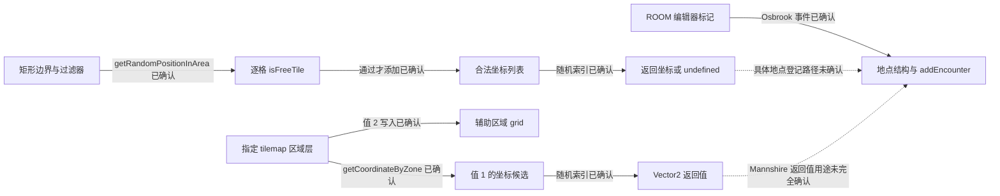

# 世界地图：预设地点、区域掩码与随机落点

[总目录](README.md) · [证据范围](00-evidence-and-scope.md) · [地牢生成](02-dungeon-generation.md)

本模块研究世界地图怎样表达作者预设、筛选随机落点，以及怎样核对随机输出。已经确认两种候选收集算法和一个十项随机序列核对算法，尚未恢复完整世界生成器。本文自包含地列出证据、演算与限制；本机调查文件仅作为可选复核材料，不是阅读本文的前置条件。

## 1. 问题与完成程度

| 问题 | 本轮能回答到什么程度 |
|---|---|
| 世界地图是完全随机的吗？ | 发货资源含城市、河流等编辑器标记，且有区域随机落点逻辑；属于预设与随机共同参与的结构 |
| 给定矩形区域怎样找落点？ | 扫描格子，调用合法性检查，收集候选，再取随机索引；候选为空返回 undefined |
| 作者能限定某地点出现在哪个区域吗？ | 一段实际函数读 tilemap 掩码：值 1 定义候选点，值 2 定义辅助区域 grid；具体层名尚未恢复 |
| 每个城市是否每次都在同一个最终格子？ | 未确认；编辑器坐标与最终地图登记结果必须分开 |
| 能否还原所有 POI 的生成概率、距离规则？ | 未确认，已有入口和部分过滤器调用证据，缺少完整实参与运行分布 |
| 随机种子能否重现世界？ | 已确认十项随机输出核对，底层 PRNG、种子重设和完整重现流程仍未知 |

安装输入为 GameMaker YYC x64，`data.win` 大小 109,736,736 字节，SHA-256 为 `84034525fcdef3c6fd9803628b8de6c43fea479c930e168a95906de37a2ae19c`。本文十六进制地址是本次 EXE 的静态虚拟地址 VA；十进制资源偏移是 `data.win` 文件内字节位置，两者不可互换。范围与版本解释见[证据范围](00-evidence-and-scope.md)。

## 2. 数据模型：预设坐标、区域约束、候选点

理解这一模块至少需要区分五种数据：

| 数据 | 已观察的表示 | 含义与边界 |
|---|---|---|
| 编辑器标记 | ROOM 中对象实例及 X/Y | 作者保存的空间数据，不等于最终开档坐标 |
| 地点描述 | Osbrook 嵌套结构的 type、class、location、_room、owner、roadConnector 等字段 | 地点登记所用描述；每个字段的所有业务规则未恢复 |
| 区域过滤 | `createFilter` 与 `isFreeTile` 调用 | 将地图坐标变成合格或不合格；具体布尔/undefined 语义仍待核验 |
| 落点候选 | 临时 ds_list，内容为 Vector2 或 [x,y] | 在约束之内选择的位置集合 |
| 辅助区域 | worldWidth×worldHeight 的 grid | 区域函数另行生成，并交给 AddZoneGrid 方法 |

下图只表示已观察的局部关系，不表示所有世界生成阶段的时序。标有“未确认”的连接不能作为恢复的调用链。



`scr_globalmapCreate`（`0x141da09a0`）直接调用 guiCreateContainer 和 globalmapStateUpdate，更像 UI 初始化入口。不能因名字包含 Create 就把它当作世界生成器。实际世界 controller 的 Other_12 位于 `0x144a44940`，存在地点查询、区域过滤与道路相关调用；这些支持生成职责定位，但没有证明完整地形算法。[本机第一轮报告](../../../_reference/stoneshard-study/dungeon-findings.md)

## 3. 真实例子：城市标记与坐标转换

`r_GlobalMap` ROOM 记录偏移为 **15,485,920**，名称 UTF-8 字节起点为 **40,622,656**，编辑器尺寸为 **6188×4108**，实例总数为 **2352**。这些尺寸是资源尺寸，本文不将它直接等同于 worldWidth/worldHeight 的运行时格子数。

| 真实对象实例 | data.win 实例偏移 | 编辑器位置 X,Y |
|---|---:|---:|
| `o_globalmap_editor_osbrook` | 15,496,156 | 5668,1664 |
| `o_globalmap_editor_mannshire` | 15,496,204 | 5356,2340 |
| `o_globalmap_editor_brynn` | 15,578,524 | 5356,2860 |
| `o_globalmap_editor_Denbrie` | 15,608,332 | 4732,3068 |
| `o_globalmap_editor_river`，其中一项 | 15,578,764 | 4628,1456 |

Osbrook Other_10 事件在 `0x142e36efa / 0x142e36f1f` 读取自身 X/Y，在 `0x142e370a8` 调用 `scr_glmap_addEncounter`，前两个实参来自这两个读取值。嵌套结构起点 `0x142e36800` 中可识别地点属性。由此能确认“保存标记→形成地点描述→调用地图登记”的局部路径；addEncounter 内部对坐标的所有归一化与额外处理未完整恢复。

Mannshire 事件 `0x142be4650` 有一段可确认算术：对 X/Y 有符号整除 52，编译器指令采用乘数 `0x4ec4ec4ec4ec4ec5`、高位乘积、右移 4 和符号修正，地址为 `0x142be4820–4857`、`0x142be48ac–48d9`。因此真实标记 **5356÷52=103，2340÷52=45**。这是代码所做的坐标转换演算，不能自动把 (103,45) 称为最终城镇落点。

这个事件还在 `0x142be4998` 调用 `getCoordinateByZone`，传入常量 RValue `0x1498b5358` 与 undefined。该常量的初始化字符串、区域层名称和返回值全部用途尚未恢复。尤其不能将“编辑器里有 Mannshire 标记”“代码做了除 52”“代码调用了随机区域函数”拼成一个没有数据流证据的最终坐标结论。

开发者在历史日志中说明重要地理元素预设、部分地点和内容随机；2024 年又说明调整 Osbrook 所在区域及 Mannshire 附近 Herbalist’s Hut 的放置规则。这支持混合设计的解释，但不替代当前安装版本的跨种子实测。[2021 年官方世界地图日志](https://store.steampowered.com/news/posts/?appids=625960&enddate=1636384970&feed=steam_community_announcements)、[2024 年官方地图调整日志](https://store.steampowered.com/news/posts/?appids=625960&enddate=1718042193&feed=steam_community_announcements)

本段可选证据：[模板摘录](../../../_reference/stoneshard-study/second-world-template-evidence.json)、[Osbrook 事件](../../../_reference/stoneshard-study/native-disassembly/second_gml_Object_o_globalmap_editor_osbrook_Other_10.txt)、[Mannshire 事件](../../../_reference/stoneshard-study/native-disassembly/second_gml_Object_o_globalmap_editor_mannshire_Other_10.txt)。

## 4. 算法 A：矩形区域内收集合格格子

函数 `scr_glmap_getRandomPositionInArea` 起点 **0x1404c06d0**，EXE 文件偏移 **4,979,408**，范围大小 **4769 字节**。下面的描述来自分支与实参数据流，不仅来自函数名。

### 输入、输出与状态

| 项目 | 已确认契约 |
|---|---|
| 参数 0、1 | X、Y 的扫描起点 |
| 参数 2、3 | X、Y 的扫描上界；已分析整数路径对应右端排除 |
| 参数 4 | 传给合法性检查的过滤器；缺省时会构造过滤器 |
| 地图状态 | 合法性函数读取 terrainGrid 等地图信息，具有边界与其他检查分支 |
| 临时状态 | X/Y 游标、候选列表、随机索引、选中点副本 |
| 正常输出 | 从候选列表选中并 Clone 的坐标对象 |
| 空候选输出 | undefined；返回前销毁列表 |
| 未确认边界 | 非整数、异常参数、上层重试次数与替代区域策略 |

算法的局部状态依次是“初始化列表→扫描→空/非空判断→选择与清理→返回”。这是函数内控制流；没有证明整个世界 controller 只调用它一次。

### 逐步规则

1. 缺少过滤器时调用 `createFilter`，调用点 `0x1404c0ce3`。
2. 创建 ds_list，调用点 `0x1404c0d70`。
3. 先取 X 起点，每个 X 下重置 Y 起点。X/Y 每次加 1，循环比较地址为 `0x1404c0e2d / 0x1404c0f35`。比较运行库带有 1e-5 容差，因此这里仅解释正常整数格子输入。
4. 调用 `isFreeTile(x,y,filter)`，调用点 `0x1404c0fd7`；其结果转换布尔，为假则跳过当前格（`0x1404c0fe4–0fe6`）。
5. 通过时构造 Vector2，再添加到列表，dispatcher 调用点 `0x1404c10d6 / 0x1404c1123`。
6. 扫描结束读取长度。长度为零跳到 `0x1404c18ab`，销毁列表（`0x1404c191c`），返回 undefined（`0x1404c193a`）。
7. 非空时计算 n−1（`0x1404c136f`），调用整数随机 wrapper（`0x1404c1432`），按结果取列表项（`0x1404c1492`）；Clone 选中点后清理列表并返回。

### 局部行为伪代码

下面仅表达已核对的普通整数格子路径；`filter_is_missing` 概括原入口的缺省参数处理，不重新定义 GameMaker 的动态类型规则。

```text
choose_position_in_area(xmin, ymin, xmax, ymax, filter):
    if filter_is_missing(filter):
        filter = create_default_filter()
    candidates = create_list()
    for x in [xmin, xmax), step 1:
        for y in [ymin, ymax), step 1:
            if boolean(isFreeTile(x, y, filter)):
                candidates.add(Vector2(x, y))

    if candidates.size == 0:
        destroy(candidates)
        return undefined

    index = random_integer_closed(0, candidates.size - 1)
    selected = clone(candidates[index])
    destroy(candidates)
    return selected
```

Clone 后销毁列表的步骤说明返回值不只是需要调用者继续保留临时列表的索引。这段不说明 Vector2 的全部内存实现，也没有替调用者添加区域扩大、重试或失败兜底。

### 四格演算

下面是构造输入，用于说明已确认运算，不是新开档地图观察。取矩形 **[10,12)×[20,22)**，过滤器的测试结果由例子指定：

| 扫描序号 | 坐标 | 假定合法性结果 | 列表变化 |
|---:|---|---|---|
| 1 | (10,20) | true | [(10,20)] |
| 2 | (10,21) | true | [(10,20),(10,21)] |
| 3 | (11,20) | false | 不变 |
| 4 | (11,21) | true | [(10,20),(10,21),(11,21)] |

n=3，随机索引范围为 0..2。假定本次随机包装后的有效非负整数为 5，则 **5 mod 3=2**，选中 (11,21)。若只有第一格合法，n=1，索引必为 0；若四格都不合法，函数返回 undefined。随机选择只发生在合法集合中，无法把非法点“抽成合法”。

由遍历可推导时间代价随扫描格子数增加，另加每格合法性检查代价；候选列表内存随合法格数增加。原函数没有经过性能基准，不能由此给出实际耗时或整个游戏的硬件要求。

`zoneDistribution` 在 `0x14058354c` 直接调用这个函数，同时存在 `createChunkArray`（`0x1405805fa`）和两次 `filterChunkList`（`0x1405806f9 / 0x140580df3`）调用。这确认了区域/块筛选与落点选择的关联，不能仅由指令位置声称它是所有 POI 共用的唯一生成流程。

可选证据：[区域算法指令](../../../_reference/stoneshard-study/native-disassembly/second_scr_glmap_getRandomPositionInArea.txt)、[14 项世界函数调用摘要](../../../_reference/stoneshard-study/second-world-native-evidence.json)。

### 合法性检查还有哪些限制

`isFreeTile` 起点 **0x1420692a0**，直接调用 `isInsideMapCoord`（`0x142069b59`），以及 GetBiomeFilter、GetWaterSavezone 和多个 SimpleCheck 分支。它把 hasEncounter、hasRoad、hascollision、hasDecor 作为检查函数输入，加载点分别为 `0x14206b390 / 0x14206b5ba / 0x14206b778 / 0x14206bae7`。

这证明检查关注这些地图信息，但尚未恢复 SimpleCheck 的完整逻辑和各调用者的过滤器实参。某字段可能表示必须存在、必须不存在或 undefined 表示忽略；不能统一写成“自动避开道路和已有地点”。[可选合法性指令](../../../_reference/stoneshard-study/native-disassembly/second_gml_Script_scr_glmap_isFreeTile.txt)

## 5. 算法 B：指定区域层的掩码扫描

`scr_glmap_getCoordinateByZone` 起点 **0x140683b00**，函数范围 **5637 字节**。它的输入是区域层标识和可选过滤器；缺省过滤器构造有直接调用（`0x14068411b`）。已确认的候选收集阶段依据原始 tilemap 值，但不把完整过滤器作用扩展到没有跟踪的数据流。

| 状态/输出 | 已确认内容 |
|---|---|
| 区域层 | 参数 0→layer_get_id→layer_tilemap_get_id |
| 扫描范围 | worldWidth×worldHeight，X/Y 从 0 起，每次加 1 |
| 候选列表 | 原始 tilemap 值等于 1 时添加 [x,y] |
| 辅助 grid | 原始 tilemap 值等于 2 时，对应位置写 1 |
| 坐标输出 | 随机候选构造的 Vector2 |
| 副作用 | 函数后段把辅助 grid 交给 AddZoneGrid 方法 |
| 空候选处理 | 本段未发现算法 A 那样的显式 undefined 分支，具体结果未知 |

实际步骤：layer_get_id dispatcher `0x140684214`，layer_tilemap_get_id dispatcher `0x14068425b`；创建列表和 grid 为 `0x1406842d2 / 0x140684379`。循环中第一次 tilemap_get（`0x1406845ab`）与常量 1 比较（`0x1406845dc`），相等才添加候选（`0x14068470c`）。第二次读取（`0x140684777`）与常量 2 比较（`0x1406847b1`），相等写辅助 grid（`0x14068489d`）。扫描结束按 n−1 调用双参随机范围 wrapper（`0x140684a01`），取列表项（`0x140684ad5`），构造 Vector2（`0x140684c68`）。

### 非空候选路径的行为伪代码

```text
layer = resolve_layer(input_zone_identifier)
tilemap = resolve_layer_tilemap(layer)
candidates = create_list()
zoneGrid = create_grid(worldWidth, worldHeight)

for x in [0, worldWidth), step 1:
    for y in [0, worldHeight), step 1:
        if tilemap_get(tilemap, x, y) == 1:
            candidates.add([x, y])
        if tilemap_get(tilemap, x, y) == 2:
            zoneGrid[x, y] = 1

# 以下只解释 candidates 非空的正常选择路径。
index = random_integer_closed(0, candidates.size - 1)
selected = Vector2(candidates[index])
# 函数后段还有 AddZoneGrid、清理和返回；完整顺序不由此重写。
```

原入口确实有两次 tilemap 读取，因此伪代码保留两次。这里没有新增空列表返回分支，也没有指定辅助 grid 的全部初始值。算法 A 的空列表行为不能套用到此函数。

### 六格演算

假设 worldWidth=3、worldHeight=2，区域层的原始值如下。表格是构造数据，值 1/2 的实际编辑器贴图映射尚未取得。

| Y\X | 0 | 1 | 2 |
|---:|---:|---:|---:|
| 0 | 1 | 2 | 0 |
| 1 | 0 | 1 | 2 |

X 在外层、Y 在内层：读 (0,0)=1 时加入候选；(0,1)=0 不加入；(1,0)=2 只写辅助 grid；(1,1)=1 加候选；(2,0)=0 不加入；(2,1)=2 只写辅助 grid。候选结果为 **[(0,0),(1,1)]**，辅助 grid 的 **(1,0)、(2,1)** 为 1。双参随机索引范围为 0..1，选择后构造坐标返回。

这个机制让“可出现在哪些点”和“属于哪个区域”由作者编辑的数据分别表达。它与算法 A 的差异是：A 根据逐格合法性函数收集合格点；B 的已确认候选条件是指定区域层原始值为 1。本文没有证明所有调用者都把 A、B 连续执行。

可选证据：[掩码算法指令](../../../_reference/stoneshard-study/native-disassembly/second_gml_Script_scr_glmap_getCoordinateByZone.txt)。

## 6. 随机范围与十项序列核对

### 随机 wrapper 的已确认运算

| wrapper | 本轮确认的正常整数路径 | 在世界算法中怎样使用 |
|---|---|---|
| `0x1451de240(N)` | 非负 N 先加 1，再以生成的非负值取模 N+1 | 算法 A 传 n−1，结果 0..n−1 |
| `0x1451de280(a,b)` | 计算 abs(a−b)+1，取模后加 min(a,b) | 算法 B 传 0,n−1，非空时结果 0..n−1 |
| `0x1451df0e0` | 两次调用底层 32 位输出，拼成 64 位、清除符号位，再作余数运算 | 两种 wrapper 共用的下层计算 |

区间包含两端已经由指令确认，但不能声称严格均匀：取模会受底层输出分布与余数偏差影响。这里还没有确认底层 PRNG 类别、状态布局、种子如何设置，也不能把它标成某种标准随机算法。双参 wrapper 分析只使用起点至 `ret 0x1451de2c7`，下层只使用起点至 `ret 0x1451df144`，避免混入相邻函数。

可选证据：[单参 wrapper](../../../_reference/stoneshard-study/second-perception-disassembly/runtime-0x1451de240.txt)、[范围 wrapper](../../../_reference/stoneshard-study/second-perception-disassembly/runtime-context-0x1451de280.txt)、[下层余数运算](../../../_reference/stoneshard-study/second-perception-disassembly/runtime-context-0x1451df0e0.txt)。

### 十项序列不是已确认的完整世界复现算法

初始化函数 **0x1408a2200** 清空 globalmapRandomSequenceList（`0x1408a2320`），设置循环计数 10（`0x1408a2325`），调用随机 wrapper(1000000)（`0x1408a238b`），添加到列表（`0x1408a23db`）。它保存十个 **0..1000000** 的整数输出。

核对函数 **0x140453580** 先设置结果 true（`0x1404536f7–370d`）。只有列表长度等于 10 才进入核对（`0x140453750 / 0x14045376f`）；逐项重新生成相同范围输出（`0x140453890`）、读存储项（`0x1404538be`）并比较（`0x1404538e0`）。不一致就把结果改 false（`0x140453910–391f`），继续剩余循环。长度不是 10 时，这个函数自己跳过比较并保持 true。

构造演算：设保存序列 S 有十项，重新生成序列 T 前三项相等、第 4 项 S[3]=42 而 T[3]=43。核对结果从 true 变 false，随后即便剩余六项都相等，仍返回 false。如果 S 只有九项，该函数自己保持 true；这不代表整个调用者接受九项数据，因为上层规则未分析完。

这段可以解释成随机输出一致性核对，但尚不能具体标为存档校验、防篡改、跨版本兼容或世界复现保证。若核对前没回到同一随机状态，结果可能不同；是否存在种子重置以及核对对随机状态的影响需跟踪调用者。[初始化指令](../../../_reference/stoneshard-study/native-disassembly/second_scr_glmap_randomSequenceInit.txt)、[核对指令](../../../_reference/stoneshard-study/native-disassembly/second_scr_glmap_randomSequenceVerify.txt)

下面是正常整数序列的局部核对规格，其中初始返回 true 和长度门控来自原指令：

```text
verify_sequence(saved):
    result = true
    if saved.length == 10:
        repeat for i = 0 to 9:
            generated = random_integer_closed(0, 1000000)
            if generated differs from saved[i]:
                result = false
    return result
```

不一致后仍继续循环，因此它仍消费后续随机输出；不能在解释原行为时改成第一个不一致就提前 return。非整数或异常存储值的比较语义没有由这段简化规格定义。

## 7. 对独立游戏设计的启发与区别

以下是我们可以自行设计的方案，不是对 Stoneshard 未恢复部分的补写。

| 可借鉴的原理 | 我们可独立采用的设计 | 与本次目标证据的区别 |
|---|---|---|
| 作者约束与随机内容共同参与 | 为主城/主线编写区域规则，再放置自创 POI | 不沿用目标地图、标记坐标或资源 |
| 先合法性后随机 | 显式表达生物群系、距离、占用和通行约束，再选候选 | 目标过滤器的每个字段语义尚未完全恢复 |
| 空候选是可诊断结果 | 返回失败原因与被拒绝统计，由上层决定重试或失败 | 已观察 A 返回 undefined，未确认目标上层重试策略 |
| 候选与区域边界分离 | 为区域建立独立的数据类型，避免魔法数字 | 目标掩码原始值 1/2 已确认，编辑器映射未知 |
| 可重复生成需要状态管理 | 为自己选定的 PRNG 保存 seed、版本和随机流状态 | 没有确认目标 PRNG 或完整 seed 流程 |
| 对结果做一致性检查 | 用版本化数据摘要和完整输入记录核验复现 | 十项核对不是已证明的完整地图摘要；不能直接移植作为保证 |

若我们的地图规模较大，可自行选择流式抽样或预计算合格集合；这是工程选型建议。它们可能改变随机调用次数、顺序与分布，不能说与目标结果等价。

## 8. 核心证据表与后续可确认问题

| 关键声明 | 原始地址/偏移 | 可选本机证据 |
|---|---|---|
| 真实城市/河流编辑器标记 | ROOM 15,485,920；实例 15,496,156 等 | [模板摘录](../../../_reference/stoneshard-study/second-world-template-evidence.json) |
| Mannshire 坐标整除 52 | 0x142be4820、0x142be48ac | [事件解码](../../../_reference/stoneshard-study/native-disassembly/second_gml_Object_o_globalmap_editor_mannshire_Other_10.txt) |
| 区域内逐格检查、候选与空返回 | 0x1404c0fd7、0x1404c1123、0x1404c193a | [矩形区域解码](../../../_reference/stoneshard-study/native-disassembly/second_scr_glmap_getRandomPositionInArea.txt) |
| 区域 tilemap 值 1/2 两种作用 | 0x1406845dc、0x1406847b1、0x14068489d | [区域层解码](../../../_reference/stoneshard-study/native-disassembly/second_gml_Script_scr_glmap_getCoordinateByZone.txt) |
| 十项初始化和核对 | 0x1408a2325、0x140453750、0x1404538e0 | [世界函数摘要](../../../_reference/stoneshard-study/second-world-native-evidence.json) |
| 正常整数索引覆盖 0..n−1 | 0x1451de240、0x1451de280、0x1451df0e0 | [随机运算调查](../../../_reference/stoneshard-study/second-perception-findings.md) |

下一轮可独立回答的具体问题：

1. 恢复 RValue `0x1498b5358` 的初始化，确认 Mannshire 调用选择的区域层名称；再追踪返回值用途。
2. 解 SimpleCheck 与某一个 POI 的完整实参，得到“必须/禁止/忽略”的明确过滤规则。
3. 读取两个不同 seed 的新开档地图记录，比较城镇与 POI 最终坐标，区分固定点、固定区域内随机点和完全随机点。
4. 追踪序列核对的调用者，确认种子/随机状态重设、长度非 10 的上层处理与失败结果。
5. 记录候选为空时 controller 的后续路径，确认失败、重试次数或范围回退。

未做及原因：本文使用已有只读静态证据整理正式研究文档，没有再运行游戏、读取存档、分析网络或进行性能/分布基准；这些不是确认上述局部算法的必要条件。没有生产代码变化，因此未运行构建或测试。没有导出资产或恢复代码供产品复用。

风险：编辑器数据不能证明最终位置；调用指令不能证明所有分支实际发生；历史日志不能保证当前版本参数；合法性与 seed 的部分规则尚未知。独立实现应以自己的需求、规则、代码与资产完成，不能把本文的未知当成已恢复契约。
