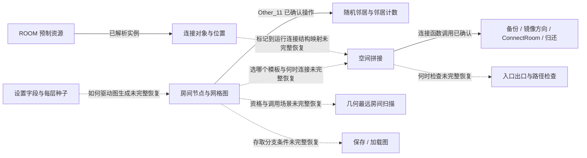

# 地牢生成：房间拓扑、预制模板、连接与最远房间

[总目录](README.md) · [证据范围](00-evidence-and-scope.md) · [世界地图](01-world-map.md)

本模块研究地牢怎样表示房间、连接、参数与生成阶段，并详细说明已确认的“几何最远房间”算法。发货资源、原生调用和字段访问已经支持若干结构结论，但完整拓扑生成算法、全部房间资格与失败重试规则仍未恢复。本文自包含地给出证据与演算；本机调查链接只是可选复核材料。

## 1. 从玩法问题到工程问题

用户关心随机地牢怎样避免重复、怎样让任务目标位于深处，以及怎样把手工设计的房间拼成可通行地图。这里可以分成相互关联但不同的职责：

| 职责 | 已确认的证据 | 尚未回答的内容 |
|---|---|---|
| 参数与类型 | 设置结构含 DungeonType、QuestType、Tier、FloorNumber、HasLoop 等字段 | 各参数取值、权重、对应规则 |
| 每层种子 | FloorSeedGenerate 关联世界地牢记录、WriteSeedInGlobalmap、FloorSeedSet | seed 公式、PRNG、全部重设时机 |
| 拓扑表示 | controller 事件有房间节点、网格写入、随机邻居、邻居计数和洗牌调用 | 是否 DFS/BFS、树/环如何构造、每次选择概率 |
| 作者模板 | ROOM 保存多类房间及内部连接对象 | 哪些资源仍被使用、房间池完整过滤条件 |
| 连接操作 | 主房间拼接、全图连接、连接备份/归还直接调用 | 端口匹配、走廊布置、失败回滚的全部含义 |
| 距离偏好 | 一段函数比较 point_distance 并保留最大值 | 候选角色过滤、调用场景是否用于全部 boss/任务 |
| 可通行检查 | 入口/出口、自由碰撞位置与 scrIsPossiblePath 关联 | 检查覆盖所有目标吗？失败后重生成吗？ |
| 保存与恢复 | controller 事件有 GetSaveGraph/LoadGraph 等调用 | 存储布局、版本兼容、恢复分支条件 |

目标为 GameMaker YYC x64，原生代码在 EXE，容器没有 CODE chunk。`data.win` 大小 109,736,736 字节，SHA-256 为 `84034525fcdef3c6fd9803628b8de6c43fea479c930e168a95906de37a2ae19c`。地址与证据层级见[证据范围](00-evidence-and-scope.md)。

## 2. 拓扑、模板、画布是不同层次

“房间相连”至少有两个问题：逻辑上希望哪些节点连通，空间上具体采用哪个房间、哪个口、怎样避免碰撞。已有 controller 调用支持这些职责分开理解：

- Other_11（**0x142a90570**）直接调用 CreateRoomNode（`0x142a91f26`）、GraphGridWriteCell（`0x142a91fca`）、GraphGridGetNeighborRandom（`0x142a92b28`）、array_shuffle（`0x142a92def`）、GraphGridGetNeighborCount（`0x142a935e3`）。这确认节点、网格图与随机邻居操作关联于该事件。
- Other_12（**0x142a994a0**）存在 GetSaveGraph、LoadGraph、FloorSeedSet、CanvasResize、ConnectAllRoomInGraph、SpawnDebris、RoomDraw 直接调用，以及 astar_get_cell、collision_add、wallgrid_add、tile_add 等地图数据操作。
- 这两段支持“逻辑房间图”和“地图实例/碰撞表示”不是同一种数据，但仅按 call 指令的排列不能还原所有运行分支和时序。

下图是职责关系图，虚线明确表示尚未确认的跨阶段关系，不是原游戏源码流程图。



可选证据：[第一轮调查](../../../_reference/stoneshard-study/dungeon-findings.md)、[原生调用摘要](../../../_reference/stoneshard-study/generation-native-evidence.json)、[Other_11 指令](../../../_reference/stoneshard-study/native-disassembly/gml_Object_o_dungeon_controller_Other_11.txt)、[Other_12 指令](../../../_reference/stoneshard-study/native-disassembly/gml_Object_o_dungeon_controller_Other_12.txt)。

## 3. 参数与连接结构：输入不只是一个随机数

`ctr_dungeonSetting` 起点 **0x1406e2330**，EXE 文件偏移 **7,214,896**；已观察字段如下。字段访问说明这些概念进入结构，不能从字段名推出所有业务规则。

| 字段组 | 已观察的字段 | 解释边界 |
|---|---|---|
| 内容选择 | DungeonType、QuestType、Tier、FloorNumber | 提供类型/任务/层级/楼层概念，取值表未知 |
| 特殊结构 | HasSecretRoom、HasLoop | 存在秘密房与环的参数，触发算法未知 |
| 表现与环境 | FloorSprite、LightColor、FloorDecals、Modification | 表现/修改项进入设置，具体效果不凭名判断 |
| 随机 | Seed | 保存种子概念，未恢复 PRNG 或 seed 推导 |

可复核加载点：Tier **0x1406e30d0**，HasSecretRoom **0x1406e31ea**，HasLoop **0x1406e3362**。

`ctr_connectorStruct` 起点 **0x141d290d0**，文件偏移 **30,573,776**；字段有 Clone、Id、X、Y、Type、Size、Modified、HasCorridor、IsSecret、HasDoor、IsDebrice（保留目标拼写）。Type 的标识加载在 **0x141d29800**、Size 在 **0x141d2985b**、HasCorridor 在 **0x141d29911**、IsSecret 在 **0x141d2996c**。

这是比“有连接口名字”更强的表示证据：连接包含坐标、类型、尺寸与附加标记。但还没确认 Type 的枚举值、Size 的单位、门/走廊的生成条件、Modified 的生命周期，以及连接资源对象如何转换成该结构。尤其不能把 Clone/备份/归还直接解释为完整事务回滚机制。

可选证据：[设置结构指令](../../../_reference/stoneshard-study/native-disassembly/gml_Script_ctr_dungeonSetting.txt)、[连接结构指令](../../../_reference/stoneshard-study/native-disassembly/gml_Script_ctr_connectorStruct.txt)。

## 4. 真实资源例子：入口房间里的显式连接口

ROOM chunk 头在 **12,457,840**，payload 从 **12,457,848** 开始，含 **1067** 个房间记录指针。已读全部房间的名称、尺寸和记录偏移，选定五个房间进一步解析实例表。布局依据是房间 +48 的实例表指针；实例 +0/+4 是 X/Y，+8 是对象索引。[格式序列化实现](https://raw.githubusercontent.com/UnderminersTeam/UndertaleModTool/master/UndertaleModLib/Models/UndertaleRoom.cs)

| 真实房间资源 | ROOM 偏移 | 资源宽×高 | 实例数 | 连接观察 |
|---|---:|---:|---:|---|
| `r_prb_t1_entrance04` | 29,682,024 | 546×468 | 239 | 三个 Midle 连接标记与一个地牢入口标记 |
| `r_prb_hubloop_02` | 29,802,184 | 884×624 | 578 | 八个 Midle 连接标记 |
| `r_prcav_cavern_hub01` | 32,862,952 | 650×494 | 372 | 五个 BigCave 连接标记，另有两个 ore spawner |
| `CRYPT_TEMPLATE` | 22,893,944 | 3042×2002 | 434 | 两类 roomConnectTrigger 对象 |
| `r_dungeon_generate` | 14,881,068 | 2210×2600 | 2 | 本次筛选没有找到上述连接标记 |

### 入口房间的四个关键实例

| 对象 | 实例文件偏移 | 房间内坐标 |
|---|---:|---:|
| `o_roomConnectTriggerMidle` | 29,685,536 | (0,312) |
| `o_roomConnectTriggerMidle` | 29,685,584 | (520,312) |
| `o_roomConnectTriggerMidle` | 29,685,632 | (286,442) |
| `o_position_starter_dungeon_enter` | 29,694,944 | (299,168) |

这些是真实模板实例位置，证明作者数据内确实保存入口与多个连接点。位置在房间内部的边缘附近，但还没有解析端口方向、尺寸匹配、走廊间距规则；不能因一个点位于右侧就宣称实际连接算法总是向东连接。

洞穴 hub 的五个 BigCave 实例为 **32,873,284 / 32,873,332 / 32,873,380 / 32,873,428 / 32,881,972**，位置为 **(624,208)、(0,234)、(26,0)、(104,390)、(416,468)**。不同模板确实能带不同数量、类型和位置的连接标记。

### 名称分类能说明什么

按精确前缀统计：r_prc_ 173，r_prcat_ 151，r_prb_ 94，r_prcav_ 93，r_prce_ 186。它们是发货资源计数，不能当作一次生成的房间数量，也不能证明每个都仍被运行版本调用。入口、hub、bossroom、secret、厨房、生活房、监狱等名称有助于形成调查候选，但不能单凭名字确认生成概率与房间效果。

可选证据：[1067 房间元数据](../../../_reference/stoneshard-study/room-metadata.json)、[五个房间实例摘录](../../../_reference/stoneshard-study/generation-room-evidence.json)。这些文件是位置/名称等调查记录，没有完整房间资产导出。

## 5. 已确认算法：扫描合格节点，保留几何距离最大者

`scr_dungeonGetFarthestRoom` 起点 **0x1413252c0**，文件偏移 **20,072,128**，函数范围 **4179 字节**。这是本次地牢调查最清楚的距离选择算法。

### 输入、输出、内部状态

| 项目 | 已确认的部分 | 未确认的部分 |
|---|---|---|
| 候选输入 | 通过 ds_map 遍历的房间条目 | 参数顺序、所有角色/资格过滤规则 |
| 参考位置 | 在计算前读取的一组 X/Y | 所有调用场景中参考节点是否都是入口 |
| 候选位置 | 另一组 X/Y | 是图格坐标还是地图单位的全部类型信息 |
| 内部状态 | 当前条目、保留距离、保留候选 key | 初始距离、无合格候选时返回值 |
| 选择结果 | 当新距离更大时替换保留的 key | 所有 caller 如何使用结果 |
| 相等距离 | 已分析更新分支使用 jle，因此相等不替换 | map 枚举顺序是否固定 |

### 运算步骤与指令证据

1. 通过 ds_map_size、find_first、find_value、find_next 枚举条目。
2. 经过前置候选筛选后读取两组 X/Y，标识加载点是 **0x141325db6 / 0x141325ddc / 0x141325e01 / 0x141325e27**。
3. 选择 `point_distance`，标识加载点 **0x141325eb8**；dispatcher 调用 **0x141325ede**，四个实参对应两点坐标。
4. 将距离结果与保留值比较，比较点 **0x141325f0b**。
5. `jle` 在 **0x141325f12** 跳过不更大的候选；更大时更新距离（**0x141325f2c**）和候选 key（**0x141325f46**）。

GameMaker 的 point_distance 是两点向量长度，因此正常平面坐标下为 **d=√((x₂−x₁)²+(y₂−y₁)²)**。[官方 point_distance 文档](https://manual.gamemaker.io/lts/en/GameMaker_Language/GML_Reference/Maths_And_Numbers/Angles_And_Distance/point_distance.htm) 它解释数学运算，不能补出游戏内部的候选过滤规则。

### 局部行为伪代码

下面保留原入口未知的初始化和资格条件，只表达正常数值输入下的已恢复最大值更新规则：

```text
bestKey = original_initial_candidate_not_yet_recovered
bestDistance = original_initial_distance_not_yet_recovered

for entry in original_room_map_iteration:
    if entry does not pass the original eligibility checks:
        continue
    distance = point_distance(referenceX, referenceY, entry.X, entry.Y)
    if distance > bestDistance:
        bestDistance = distance
        bestKey = entry.key

# 后续返回语义、空候选处理和调用者用途尚未全部恢复。
```

这段不能直接执行成一个完整生成器，因为初始值和资格条件仍未知。它明确表达了相等不替换，也没有用图搜索或路径代价替换 `point_distance`。

### 逐步演算与相等处理

以下是构造的合格候选，不是运行时房间图。假设参考点为 (0,0)，进入演算前已保留一个距离 0 的合格节点；后续按 A、B、C 顺序枚举：

| 步骤 | 节点位置 | 几何距离 | 比较 | 保留结果 |
|---:|---|---:|---|---|
| 1 | A=(3,4) | √(9+16)=5 | 5>0 | A，距离 5 |
| 2 | B=(6,0) | √36=6 | 6>5 | B，距离 6 |
| 3 | C=(0,6) | √36=6 | 6≤6 | 继续保留 B |

这里只指定起始保留值来解释更新规则，不声称目标实际初始化就是 0。若 A 未通过资格筛选，即使其距离更大也不会进入这段更新逻辑；资格问题与距离问题必须分开。

### 几何距离与游戏路线长度的区别

假设另一张我们构造的图中，入口与 B 之间只有一条直接边，但到 A 要经过六条边。上述函数仍可能选 B，因为 B 的直线距离 6 大于 A 的 5。按图上的最短步数选深处则可能选 A。两者解决不同问题，不能互换。

所以本轮确认的是**对已合格候选做几何最大值扫描**，没有证明沿房间连接图的最短路径距离、最长路径或 DFS/BFS。官方日志描述任务/boss 房处于地牢深处，是设计方向；它不能证明这个函数就是所有目标房放置的全部实现。

可选证据：[最远房间指令](../../../_reference/stoneshard-study/native-disassembly/gml_Script_scr_dungeonGetFarthestRoom.txt)、[第二轮演算报告](../../../_reference/stoneshard-study/second-world-findings.md)。

## 6. 拼接与可通行：已确认局部调用，未恢复完整算法

### 主房间连接与全图连接

| 函数 | 起点 VA / 文件偏移 | 已确认调用 |
|---|---|---|
| `scr_dungeonConnectMainRooms` | 0x14051e0d0 / 5,362,896 | GetLesslesRoomStructByRole 于 0x14051eb3a；WeldingTwoRooms 于 0x14051f6e5 |
| `scr_dungeonConnectAllRoomInGraph` | 0x1403b6850 / 3,890,256 | BacupConnectors 于 0x1403b7334；GetMirrowDirection 于 0x1403b802d；ConnectRoom 于 0x1403b81e3；ReturnConnectors 于 0x1403b887a |

这些是实际直接 call 指令，能确认按角色取房间结构与拼接操作关联，连接处理中还关联连接备份、方向与归还。原名称拼写保留用于精确定位。不能将这一表的排列自动当作每次都会顺序执行的事务，或宣称所有失败都会恢复全部状态。

### 用坐标理解端口对齐：独立设计演算

可以利用真实端口数据解释我们自己的对齐设计，但要明确这不是已恢复的目标对齐算法。假设自创模板 A 的右端口为 (520,312)，自创模板 B 的左端口为 (0,312)，A 原点为 (0,0)。若我们采用“端口点重合”的规则，则 B 原点应为 **A 原点+A 端口−B 端口=(520,0)**。两端口的世界位置都变成 (520,312)。

这只完成点对齐。它没有检查房间矩形重叠、门宽、走廊长度、方向、可通行和秘密房权限；真实入口模板宽 546 也说明端口位置不能替代整个资源占地规则。我们必须另行规定这些约束，而不是把这一坐标演算当作 Stoneshard 的 ConnectRoom 复刻。

### 可通行检查的已确认输入输出

`scr_dungeonCheckRoomsPassability` 起点 **0x141f204a0**，文件偏移 **32,635,040**，范围大小 **3081 字节**。已确认：GetEnterExit（`0x141f20738`）关联入口/出口；GetRoomFreeCollision（`0x141f20b1c`）关联自由碰撞位置；`scrIsPossiblePath`（`0x141f20c86`）接收五个参数，对应两点 X/Y 与 undefined。调用结果经布尔转换并存入结果集合，array_push 对应 dispatcher 调用在 **0x141f20dda**。

可确认的局部结构是“取得待检查点→调用可达性判断→保留测试结果”。尚未确认 scrIsPossiblePath 的搜索算法、每次检查使用的碰撞 grid、是否覆盖全部房间和任务目标，以及整个集合如何汇总为通过/失败。即使函数里出现路径检查，也不能宣称整个地牢生成已保证所有目标可达。

构造行为例子：如果某次路径调用返回 false，这一结果会进入收集流程；目标上层是重新连线、重新选模板、重生成还是只输出诊断，仍需要追踪 caller。我们独立实现时可以选择“入口到每个必需目标都通过，否则明确失败”，但这是我们的完整性规则。

可选证据：[主房间连接](../../../_reference/stoneshard-study/native-disassembly/gml_Script_scr_dungeonConnectMainRooms.txt)、[全图连接](../../../_reference/stoneshard-study/native-disassembly/gml_Script_scr_dungeonConnectAllRoomInGraph.txt)、[可通行检查](../../../_reference/stoneshard-study/native-disassembly/gml_Script_scr_dungeonCheckRoomsPassability.txt)。

## 7. 种子、保存与生成状态

`scr_dungeonFloorSeedGenerate` 起点 **0x140004190**，文件偏移 **13,712**，范围大小 **3240 字节**。调用 CurrentFloorNumber（`0x1400043bf`）、globaltile_dungeon_get（`0x14000451c`）、WriteSeedInGlobalmap（`0x140004a54`）、FloorSeedSet（`0x140004ca9`），同时能识别 dungeonSeed、globalSeed、floorSeed、floorSeedArray 字段访问。

这证实地牢层种子与世界地图地牢记录关联；尚未恢复种子推导公式、列表索引、什么情况下生成新种子，以及何时保存或恢复既有结果。不能把它解释为“同一个 globalSeed 永远生成完全一样的地牢”，因为版本、随机状态和输入也可能参与。

controller Create_0 起点 **0x142a84f70**，文件偏移 **44,581,744**：创建 list/map/grid，获取连接与对象白名单/黑名单，存在 FloorSeedGenerate、SetSettings、版本校验、SmoothReroll、ManualRestart 的调用。Other_12 又有关联保存/恢复的调用。可以先形成以下待确认状态问题：

| 状态问题 | 已有线索 | 不能直接给出的答案 |
|---|---|---|
| 新地图还是恢复已有图？ | GetSaveGraph、LoadGraph | 分支判断和未保存时 fallback |
| 设置与层 seed 何时生效？ | SetSettings、FloorSeedSet | 所有生效顺序与重复调用 |
| 参数不满足时怎么办？ | SmoothReroll、ManualRestart | 自动重试次数、失败退出规则 |
| 版本变更如何兼容？ | GeneratorVersionValidator | 兼容版本表、迁移或弃用旧图行为 |

这些是已观察线索引出的具体问题，不是已经恢复的状态机。我们自己的状态机可以明确为“输入验证→生成拓扑→绑定模板→连接→验证→保存→完成”，并把失败与恢复单独表示；其步骤与转移条件由我们独立设计。

可选证据：[每层种子指令](../../../_reference/stoneshard-study/native-disassembly/gml_Script_scr_dungeonFloorSeedGenerate.txt)、[controller 创建事件](../../../_reference/stoneshard-study/native-disassembly/gml_Object_o_dungeon_controller_Create_0.txt)。

## 8. 官方设计方向与独立实现选择

2024 年官方地牢日志说明按类型和层级改变布局/预设，让目标房处于远端，侧室从主路分叉；还说明初次进入生成、保存后保留布局，并减少单格窄口。这些声明可帮助理解问题，但不能补出本机版本的未恢复控制流与参数。[官方地牢生成日志](https://store.steampowered.com/news/posts/?appids=625960&enddate=1718042193&feed=steam_community_announcements)

| 想解决的设计问题 | 我们可独立选择的机制 | 与目标证据的区别 |
|---|---|---|
| 主线有方向，探索有支路 | 自己构造必经路径，再添加自创侧室 | 尚未确认目标主路生成策略 |
| boss/任务位于深处 | 以图最短距离或预计耗时选择目标节点，并明确资格规则 | 本次已确认目标函数使用几何距离 |
| 空间有类型特色 | 独立制作不同房间池与端口契约 | 不使用目标模板、坐标布局或美术 |
| 连接失败可诊断 | 保存连接尝试、拒绝原因、重试预算与明确失败状态 | Bacup/Return 的完整恢复语义未知 |
| 必需目标可达 | 对全部必需目标验证，并保留路径失败原因 | 目标检查覆盖范围尚未确认 |
| 存档稳定 | 保存生成版本、输入摘要、图与必要空间状态 | 目标存储布局/兼容规则未知 |
| 房门不支配所有战斗 | 设计通道宽度、视线、敌人聚集与侧向空间 | 需要我们自己的战斗验证，不能只复制房间形状 |

例如“必经路径加侧室”的自有演算：入口 E→A→B→目标 Q 是三条必经边，再从 A 添加可选支室 S，从 B 添加可选支室 T。若以后增加 S↔T 的环，需要重新验证距离目标与碰撞，而不能只因多一条边就认为布局更好。这是我们提出的设计例子，目标 HasLoop 字段与图调用不足以证明它采用这套算法。

## 9. 核心证据表、未知与下一轮问题

| 关键声明 | 原始地址/资源偏移 | 可选证据 |
|---|---|---|
| 作者房间有显式连接口 | 入口 ROOM 29,682,024；三个端口 29,685,536/584/632 | [实例摘录](../../../_reference/stoneshard-study/generation-room-evidence.json) |
| 设置含 Tier、Secret、Loop | 0x1406e30d0、0x1406e31ea、0x1406e3362 | [设置构造](../../../_reference/stoneshard-study/native-disassembly/gml_Script_ctr_dungeonSetting.txt) |
| 连接结构含位置、类型、尺寸 | 0x141d290d0；Type 0x141d29800，Size 0x141d2985b | [连接构造](../../../_reference/stoneshard-study/native-disassembly/gml_Script_ctr_connectorStruct.txt) |
| 节点/网格/邻居关联于 controller | 0x142a91f26、0x142a91fca、0x142a92b28 | [Other_11](../../../_reference/stoneshard-study/native-disassembly/gml_Object_o_dungeon_controller_Other_11.txt) |
| 最远候选使用几何距离 | 0x141325ede、0x141325f0b、0x141325f12 | [距离扫描](../../../_reference/stoneshard-study/native-disassembly/gml_Script_scr_dungeonGetFarthestRoom.txt) |
| 有显式路径检查并收集结果 | 0x141f20c86、0x141f20dda | [通行检查](../../../_reference/stoneshard-study/native-disassembly/gml_Script_scr_dungeonCheckRoomsPassability.txt) |
| 层 seed 关联世界地牢记录 | 0x14000451c、0x140004a54、0x140004ca9 | [seed 函数](../../../_reference/stoneshard-study/native-disassembly/gml_Script_scr_dungeonFloorSeedGenerate.txt) |

下一轮应逐个回答：

1. 选一个真实地牢类型与 tier，恢复房间池筛选、房间角色与目标资格，不把名称分类当权重表。
2. 解最远房间函数的完整输入、前置筛选、初始值与空候选返回，跟踪一个真实 caller。
3. 解一个连接对的端口类型/尺寸/方向、占地碰撞、失败分支，明确 ConnectRoom 的成功结果与状态变更。
4. 解 Other_11 的循环和工作容器，判断实际拓扑构造策略及加环条件。
5. 追踪可通行结果汇总和 controller 失败转移，确认覆盖范围与重试预算。
6. 从一个生成图/存档读取节点、坐标与连接，核验几何距离选择与实际行走距离的差异；不从一张地图推出分布概率。

未做及原因：本文仅整理已有静态资源与调用证据，没有运行游戏、读取存档或做布局/性能分布实验；尚不需要这些动作来支持已列出的局部算法。没有生产代码变更，未运行构建或测试。没有导出完整房间、素材或恢复代码用于销售产品。

风险：模板可能包含未使用资源；函数调用不代表每条分支实际执行；字段不等于全部业务语义；局部可通行检查不证明全图有效；几何距离不等于路线深度。我们可用这里的行为原则独立设计，但必须自行实现拓扑、模板、校验、保存与资产，并用自己的产品需求验证。
