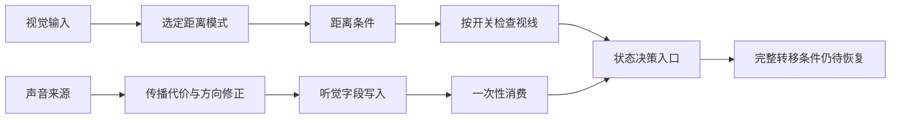

# 敌人视觉听觉与感知信号

[返回拆解目录](README.md) · [证据范围](00-evidence-and-scope.md) · [技能与协作](05-enemy-skills-cooperation.md)

敌人感知至少包含三项不同职责：计算空间条件、把感知结果写入或返回、让状态决策消费结果。视觉入口已有距离与可选遮挡检查的代码证据；听觉则已有声音生产、传播检查、一次性信号消费的连接证据。两者都不能简化成“玩家进入半径，敌人立即攻击”。

本篇侧重敌人获得信息。玩家当前视野与历史探索见 [23](23-player-vision-and-fog.md)，主动发现隐藏物见 [24](24-investigation-and-reveal.md)，玩家声音提示见 [26](26-player-hearing-and-noise-signals.md)。这些系统相邻，但不能共用一条未经核对的范围或发现公式。

## 输入状态和结果

| 数据 | 已确认的使用方式 | 需要保留的边界 |
| --- | --- | --- |
| `grid_x/grid_y` | 视觉距离计算、视线检查读取双方格坐标 | 不是屏幕像素距离 |
| `VSN` | 观察者视野限制，与选定距离结果比较 | 所有角色的取值及修正来源未恢复 |
| 距离模式参数 | 在两个不同距离入口间分支 | 仅其中一个模式的公式已恢复 |
| `is_vision_raycast_force` | 决定是否进一步检查视线 | 开关的全部设置时机未知 |
| `los_flags` | 传入视线入口 | 各位对应的材质或类别未全部恢复 |
| `noise_distance` | 射线路径累加的传播代价 | 不是直接等于直线格数 |
| `noise_is_barrier` | 一条传播检查中的屏障状态 | 原始标志的全部物理含义未知 |
| `noise_cell_factor` | 屏障状态成立时使用的累加项 | 运行值与材质对应表未恢复 |
| `is_noise_hearing` | 生产者置真，消费者读取后清除 | 不代表队列中保存了每一条声音 |
| 声音坐标、来源和持续数据 | 生产者登记，供其他处理使用 | 多声源覆盖策略和完整生命周期未知 |

## 视觉算法

### 选择距离计算方式

`scr_enemy_vision_check` 根据参数模式调用 `scr_tile_distance_math` 或 `scr_tile_distance_min`。第二轮恢复了前者的普通有限数值规则；后者虽然已有指令记录，完整业务度量仍未确定，不能直接命名成曼哈顿距离。

已恢复的计算顺序为：读取两对象的格坐标，计算两点距离，向下取整，最后与常数 1 取最大值。

```text
dx = observer.grid_x - target.grid_x
dy = observer.grid_y - target.grid_y
rawDistance = sqrt(dx * dx + dy * dy)
distance = max(1, floor(rawDistance))
```

这个公式说明数值阈值的行为，而非声明视觉范围为精确圆。以正常有限数值为前提，`floor` 会使某些实际距离略大于整数阈值的格子仍得到相同整数结果；具体哪些调用使用此模式还取决于入口参数。

### 距离门槛与遮挡门槛

观察者的 `VSN` 与计算结果比较。已核对的强制视线分支中，距离有序大于 `VSN` 或不可比较时不进入成功路径；通过距离条件才进一步调用 `scr_enemy_line_of_sight`。非强制分支可以直接返回距离比较结果。

这一局部流程可表达为：

```text
distance = choose_distance_mode(observer, target, mode)
if requireLineOfSight:
    if distance is not comparable or distance > observer.VSN:
        return failure
    return check_line_of_sight(target.grid_x, target.grid_y, observer.los_flags, ...)
else:
    return the_distance_comparison_result
```

这里的 `failure` 概括不成功路径；不替代 GameMaker 的完整返回值类型或异常规则。非强制分支的伪代码保留比较结果，不自行把所有特殊值转换成简单布尔。

### 遮挡检查涉及格状态和射线

视线函数实际调用格数据、距离、`astar_get_cell` 和 `scr_raycast_mod`，并有临时碰撞处理的清除与恢复调用。可以确认它使用地图状态检查视线。清除哪些碰撞、为何临时处理，以及关门、斜角和特殊遮挡标志怎样影响射线，仍未完全恢复。

因此不能依据这些调用写出“门必定挡视线”或“斜角一定可看见”。我们能解释模块边界，但无法用未知的材质和角落规则生成保证相同的独立实现。

### 具体演算

假定观察者在 `(0,0)`，目标在 `(3,4)`，并使用上述已恢复模式：

1. `dx² + dy² = 9 + 16 = 25`。
2. 两点距离为 5，向下取整仍为 5。
3. `max(1,5)=5`。
4. `VSN=4` 时不通过距离门槛；`VSN=6` 时通过。
5. 如果调用要求视线检查，通过距离后仍可能被遮挡拒绝。

同格输入得到 1，而非 0。另一个构造例子是 `(0,0)` 到 `(2,2)`：原始距离约 2.828，取整结果为 2；在此模式的距离比较阶段，`VSN=2` 可通过。它们是公式演算，不是实际运行中观察到的相遇场景。

## 听觉算法

### 声音参数与声音产生

声音类别对应不同参数入口。已核对的 `scr_noise_crossbow_reload` 返回 6，`scr_noise_door` 返回 4。这些值会进入后续传播与修正，不能直接解释为 6 格或 4 格的最终半径，也没有证据把它们换算成现实分贝。

声音来源处理调用声音生产入口。生产者对接收分支调用 `scr_noise_is_hear`；结果通过后设置 `is_noise_hearing=true`，并写声音坐标、来源和持续数据。听觉传播与信号消费是不同函数，299 字节的消费者本身不计算墙壁衰减。

### 射线路径累计传播代价

距离检查开头把累计代价设为 0、屏障状态设为 false，然后使用地图网格和射线回调处理路径。

回调读取沿途网格值，已核对的条件涉及值是否有定义及与数值 4 有关的格标志检查；这里不把 4 命名成某种墙材质或位序号。条件满足后写 `noise_is_barrier=true`。普通累加项是 1；屏障状态为真时改用 `noise_cell_factor`，然后加到累计代价中。

```text
distanceCost = 0
barrierSeen = false

for each callback visit on the ray:
    cell = read_noise_grid_cell(...)
    if recovered_barrier_condition(cell):
        barrierSeen = true
    stepCost = noise_cell_factor if barrierSeen else 1
    distanceCost += stepCost
```

`recovered_barrier_condition` 的名字只概括已见条件，不是已恢复的完整墙材质分类。屏障状态在一次路径开始时清除，已核对的回调没有每格重置它。若首个屏障后仍为真，后续格也走屏障累加分支；不能把它改写成“只对墙所在格加一次惩罚”。

射线的格访问顺序、是否计入源格和目标格，以及网格读取的全部条件仍待核对。下面演算直接假定回调访问序列，不把格数量当作实际距离结论。

### 方向修正与门槛比较

`scr_noise_is_hear` 使用角度相关的三角函数修正输入强度：双方两轴都不同时，有 `max(abs(dsin(angle)), abs(dcos(angle)))` 形式的因子；轴对齐的对应分支使用 1。修正后的强度经 `math_round` 进入门槛比较，传播代价以有序小于等于方式检查。

在已核对的局部正常数值路径中，可理解为：

```text
directionFactor = recovered_direction_adjustment(...)
threshold = math_round(inputPower * directionFactor)
heard = ordered_less_or_equal(distanceCost, threshold)
```

全部参数的来源、角度助手约定与其他调用路径未完全建立，因此这里不提供一条适用于所有声音的“最终听觉半径公式”。其中的 `inputPower` 也不能无条件用噪声类别入口的常量替换。

### 传播代价的构造例子

假定一次回调访问四格、屏障在第二次访问时成立、`noise_cell_factor=3`，则累计项为 `1+3+3+3=10`。如果四次都没有屏障条件，累计为 `1+1+1+1=4`。

这组系数和访问序列是演算假设，不是游戏材质表。若其他参数使门槛为 8，前一个序列不通过，后一个通过；它展示的是已恢复分支怎样影响结果，不能据此宣称某种真实墙一定消耗 3。

### 一次性信号消费

消费者先保存旧值，旧值为真时写回 false，最终返回旧值：

```text
oldSignal = npc.is_noise_hearing
if oldSignal:
    npc.is_noise_hearing = false
return oldSignal
```

真实字段名、读取、条件与写回都已确认。因此生产者刚置真时，第一次检查返回真；没有新声音的第二次检查返回假。声音不会仅因这个标志仍存在而无限触发相同判断。

这只证明标志的消费语义。多个声音在消费前产生时，是否保存最后一个、最大一个或多个记录，需要追踪其他字段写入与调用条件；当前不宣称已恢复声音队列或优先级。

## 感知怎样进入敌人决策

`scr_FSM_state_get` 有到视觉和听觉消费者的直接调用边。敌人对象的一个更新事件也调用视觉、警戒和 FSM 更新。这将感知与状态决策联系起来，超过仅发现同名脚本的证据。

但是听见声音后究竟搜索、警戒还是攻击，取决于状态函数的其他条件。当前没有恢复完整转移矩阵，也没有证明这些事件每帧或每回合执行。因此模型可以画成下述职责关系，不能把图中箭头理解为运行中固定顺序：



## 自研时可采用的结构

我们可以自行把感知模块分成空间查询、事件记录、决策消费三层，并为每次判断返回原因，例如超出范围、被遮挡、传播代价过高。具体度量、墙代价、角落规则和声音记忆时长应由自己的玩法决定，而不照搬尚未恢复的参数。

如果玩法要求敌人按多个声音的先后作出选择，独立设计一个明确的事件队列会比单一布尔标志更容易表达；这是自研选择，不是对 Stoneshard 实现的结论。若选择一次性标志，应明确同回合重复声音的覆盖规则。

可用于独立实现规格的检查案例包括同格距离、对角取整、刚好等于视野阈值、距离通过但遮挡拒绝、声音被消费两次，以及屏障状态影响后续访问。我们没有对原游戏执行这些运行时测试。

## 关键证据

| 入口或调用点 | 地址 | 支持的结论 |
| --- | --- | --- |
| `scr_enemy_vision_check` | `0x141ce6040` | 距离模式、VSN 与视线开关 |
| 距离比较 / 视线调用 | `0x141ce6924` / `0x141ce6b38` | 强制路径先过距离，再检查视线 |
| `scr_tile_distance_math` | `0x1417964a0` | 格坐标→两点距离→floor→max 1 |
| point_distance / floor / max 调用 | `0x14179682a` / `0x141796882` / `0x1417968ad` | 正常数值公式 |
| `scr_enemy_line_of_sight` | `0x14052f910` | 格状态与射线调用 |
| `scr_noise_produce` | `0x141d5afd0` | 传播检查与听觉字段写入 |
| `scr_noise_distance_check` | `0x1401b0e60` | 初始化累计代价和屏障状态 |
| 射线回调 / 累加调用 | `0x1401b2210` / `0x1401b28fa` | 屏障条件改变逐次累加项 |
| `scr_noise_is_hear` | `0x1409c3f50` | 方向修正、取整与门槛比较 |
| 装填弩 / 门参数入口 | `0x141d61680` / `0x141d63fd0` | 返回数值 6 / 4 |
| `scr_enemy_noise_hearing_check` | `0x1405d3310` | 返回旧标志并清除 |
| FSM 视觉 / 听觉调用 | `0x14176fec1` / `0x14176ff7b` | 决策入口确实消费感知 |

本机补充记录：[第一轮敌人](../../../_reference/stoneshard-study/enemy-findings.md)、[第二轮感知](../../../_reference/stoneshard-study/second-perception-findings.md)、[第二轮原生记录](../../../_reference/stoneshard-study/second-perception-native.json)。

## 尚待核对

优先缺口是另一距离模式、视线材质与斜角规则、噪声系数来源、多声源处理和感知到状态的完整条件。天气、光照或装备是否修改 VSN 与听觉，需要追踪字段生产者，不能从相关系统名称直接推断。运行时观察适合验证具体边界场景，但单次观察仍不能证明全部分支。
