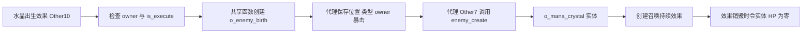

# 12. 召唤：目标格、出生代理、实体归属与生命周期

[总目录](README.md) · [证据范围](00-evidence-and-scope.md)

本章说明本机 Stoneshard 发行文件中的几个**局部召唤流程**。主要例子是 `o_summon_mana_crystal → o_enemy_birth → o_mana_crystal`，辅以 `o_summon_thrall_birth` 和 `o_wraith_summoning`，用于区分出生效果、具有技能逻辑的召唤物和另一条单位创建路径。依据是 `data.win` 的对象继承记录、EXE 注册函数和具体调用实参、字段读写、分支。没有运行游戏来观察这些路径。

已经确认：共享召唤函数先创建出生代理，代理后续事件才创建实际单位；法力水晶继承召唤实体基类，普通敌人 AI 开关关闭，但仍有自己的事件技能逻辑；出生代理会为这类实体创建一个带持续时间的效果对象，该效果销毁时将目标 HP 置零。共享效果更新入口已找到，但具体召唤效果的所有阶段绑定、销毁触发条件、数量上限、跨房间保存和主人死亡的完整处理尚未恢复。

以下伪代码是根据局部行为写出的规格，省略 Runner 的动态值管理和无关表现代码，不是原始代码，也不能直接当成我们游戏的实现。

## 1. 先区分四种对象

| 类别 | 本例对象 | 职责和可确认范围 |
|---|---|---|
| 技能配置实例 | `o_skill_mana_crystal`，OBJT 2092 | Create 设置技能标识 `Mana_Crystal`，组织属性，调用 `scr_skill_atr`，设置碰撞过滤回调 |
| 施法出生效果 | `o_summon_mana_crystal`，1217；`o_summon_thrall_birth`，4752 | 持有 owner、目标点或主人记录的召唤坐标，执行一次生成请求 |
| 通用出生代理 | `o_enemy_birth`，3982 | 保存将要创建的对象类型、位置、owner、表现和回合标记；后续 Other7 创建实际单位 |
| 实际实体 | `o_mana_crystal`，2699；`o_proselyte_thrall`，2431 | 有单位字段和生命周期。两者继承链不同，不能共享套用全部规则 |

“召唤物”是玩法分类，并不等于所有对象都继承 `o_summoned_entity`。不能因为名字含 summon 就给对象添加寻路、跟随主人、寿命或主人死亡联动等解释。

### 对象继承证据

OBJT 对象索引只在本次发行文件内有意义。表中 record offset 是 `data.win` 的十进制文件偏移；父对象来自该记录的 parent 字段，而不是根据名称猜测。

| 索引 / 对象 | record offset | 直接父对象 |
|---|---:|---|
| 2092 `o_skill_mana_crystal` | 10000040 | 6426 `o_skill_arcanistics` |
| 6426 `o_skill_arcanistics` | 11510480 | 6199 `o_skill` |
| 1217 `o_summon_mana_crystal` | 9725024 | 5338 `o_spellbirth` |
| 4752 `o_summon_thrall_birth` | 10845560 | 5338 `o_spellbirth` |
| 46 `o_wraith_summoning` | 9361216 | 5338 `o_spellbirth` |
| 3982 `o_enemy_birth` | 10587928 | 5343 `o_spellimpact` |
| 2699 `o_mana_crystal` | 10185584 | 1409 `o_summoned_entity` |
| 1409 `o_summoned_entity` | 9782312 | 3805 `o_enemy` |
| 3805 `o_enemy` | 10530088 | 3804 `o_unit` |
| 2431 `o_proselyte_thrall` | 10101544 | 3808 `o_proselyte` |
| 3808 `o_proselyte` | 10533016 | 3807 `o_vamp` |
| 3807 `o_vamp` | 10532592 | 3806 `o_Dead_March` |
| 3806 `o_Dead_March` | 10532384 | 3805 `o_enemy` |
| 3362 `o_b_summoned_entity` | 10390648 | 5949 `o_invisible_buff` |
| 3555 `o_pass_skill_lingering_incantations` | 10448568 | 6432 `o_skill_passive` |

`o_spellbirth`、`o_spellimpact` 均继承 3110 `o_spells`。法力水晶是真正的 `o_unit` 后代；出生代理走的是法术效果继承链。它们不是同一个实例的改名。

### 本次实际追踪的事件绑定

下表按EXE注册函数的对象名/事件名绑定与函数体核对。事件名仅标识调查入口，不自动证明所有实例都在运行中触发了它。

| 对象 / 事件 | 函数入口VA | 本次确认的业务职责 |
|---|---|---|
| `o_skill_mana_crystal.Create0` | `0x14306a150` | 技能ID、属性与过滤回调配置 |
| `o_summon_mana_crystal.Other10` | `0x142da0320` | 单次请求和水晶实际对象类型实参 |
| `o_enemy_birth.Create0` | `0x1437d58c0` | 初始化出生代理和保存生成位置 |
| `o_enemy_birth.Other7` | `0x1437d7b50` | 创建实际单位、转移状态、添加召唤持续效果 |
| `o_summoned_entity.Create0` | `0x142e2c190` | 召唤实体的基础字段初始化 |
| `o_mana_crystal.Create0` | `0x143263a80` | 继承后设置水晶自身字段与技能 |
| `o_mana_crystal.Other10` | `0x143265ae0` | 水晶独立目标和技能处理路径 |
| `o_b_summoned_entity.Destroy0` | `0x14345a9b0` | 效果销毁后令目标HP清零 |
| `o_mana_crystal.Destroy0` | `0x1432649e0` | 死亡表现，随后调用继承Destroy |
| `o_summoned_entity.Destroy0` | `0x142e2cac0` | 更新仍以被毁实体为目标的敌人 |
| `o_summon_thrall_birth.Other10` | `0x143beeaf0` | 主人召唤坐标加13，传入thrall类型 |
| `o_wraith_summoning.Other10` | `0x142926220` | 共享选格后直接创建ghost单位 |

## 2. 数据流：生成前需要什么状态

| 输入或状态 | 所属对象 | 使用点 |
|---|---|---|
| `owner` | 出生效果、出生代理、实际实体 | 生成前检查、创建后的归属转移、阵营判断和持续时间被动检查 |
| `point.x / point.y` | 法力水晶出生效果引用的 point | 直接作为法力水晶生成请求的 x/y |
| `skill_summon_x / skill_summon_y` | thrall 出生效果的 owner | 读取后各加 13，作为 thrall 生成请求的 x/y |
| `creating_unit` | 通用出生代理 | 实际创建类型：水晶 2699，thrall 2431 |
| `spawn_x / spawn_y` | 通用出生代理 | 后续 Other7 传给 `scr_enemy_create` |
| `is_execute` | 具体出生效果 | 防止同一个出生效果重复发出生成请求 |
| `is_crit` | 出生效果 / 代理 | 水晶路径会转移此字段；创建召唤实体效果时参与基础持续时间计算 |
| `skip_turn` | 代理 / 实际实体 | 创建后转移的回合标记。它不是寿命倒计时 |
| `is_full_destroy` | 实际实体 | Destroy 中部分死亡表现与其他单位重新选择目标的前置条件 |

RValue 的 type 13、数值 0/1 在这里按布尔 false/true 解释，不能把 type 13 的零叫做 undefined。真正的 undefined 是独立的动态值来源；本章在实参存在该来源时保留 `undefined`，不把它自动替换为 false。

## 3. 目标格辅助函数：返回能否使用，坐标写入调用者

`scr_skill_summon_get_tile` 在 `0x141df9dd0`。本次确认 `o_wraith_summoning.Other10` 在 `0x142926518` 调用它，随后读取当前效果实例的 `point_x / point_y`。法力水晶和 thrall 的已追出生路径没有调用这个辅助函数，它们读取已有 point 或主人坐标；因此不能说所有召唤都使用同一种选格算法。

该辅助函数的四个参数缺省分别是 false、1、false、false。它还读取调用者的 `target`、`owner` 和 `id`。按控制流可以分成以下步骤：

1. 根据第四参数选择参考实例：false 时使用 owner，true 时先用当前实例 id；保存当前 target。target 不存在时，用参考实例替代 target。
2. 如果参考实例也不存在，直接返回 false。参考实例存在时先把 `point_x/y` 初始化为它的 x/y，避免所有后续分支都没有坐标。
3. 以 target 和其余参数调用 `scr_tile_around_target`。本次确认 11 个实参被传入，其中包含搜索参数、布尔开关和三个 undefined；**未恢复该被调用函数的完整碰撞过滤、搜索顺序和择优规则**。
4. 返回数组非空且 target 仍存在时，将数组索引 0/1 分别加到 target.x/y，写成 `point_x/y`，并暂置成功标记为 true。这里数组是至少两个分量的偏移结果，不能把它直接描述为一组可随机选择的多个候选格。
5. 分别比较点坐标与参考实例坐标除以 26 后的整数商。如果两个轴都落入同一格，成功标记改为 false。
6. 成功时用内联的 `scr_round_cell` 路径对两个轴取整格，默认格大小 26，返回成功标记。对本例非负坐标，该路径等价于 `trunc(value / 26) * 26`，不会在这里加 13。

```text
选择召唤格(参数0=false, 搜索参数=1, 参数2=false, 使用自身=false):
    reference = 使用自身 ? self.id : self.owner
    target = exists(self.target) ? self.target : reference
    if not exists(reference): return false
    self.point = reference.position

    offset = 周边格查询(target, 搜索参数, 其他已传入开关)
    success = length(offset) > 0 and exists(target)
    if success:
        self.point = target.position + [offset[0], offset[1]]
    if 同一个26像素格(self.point, reference.position):
        success = false
    if success:
        self.point = 各轴截断到26的整倍数(self.point)
    return success
```

证据：参考对象选择 `0x141dfa550–0x141dfa5a2`；存在性失败返回 `0x141dfa796`；周边查询 `0x141dfa92f`；非空和 target 检查 `0x141dfa98c–0x141dfaa07`；偏移相加 `0x141dfaba9 / 0x141dfacd5`，加法 helper 的数值分支在 `0x1400038c0`；同格拒绝 `0x141dfad25–0x141dfaf02`；26 格取整默认值 `0x141dfb150`。

**构造演算，非游戏运行观察**：参考实例在 `(260,260)`，target 在 `(312,260)`。假定周边查询成功返回偏移 `(26,0)`，结果点是 `(338,260)`，格坐标 `(13,10)`，与参考格 `(10,10)` 不同；取整后仍是 `(338,260)`，返回 true。若得到 `(260,260)`，两个轴都与参考实例同格，返回 false。偏移 `(26,0)` 是演算输入，不代表已证明查询总按这个方向选格。

## 4. 法力水晶：一次请求，两个实例阶段

### 4.1 技能配置与出生效果的证据边界

技能对象 `o_skill_mana_crystal.Create0` 在 `0x14306a150`，设置 `skill = "Mana_Crystal"` 的读写位置为 `0x14306a4d2`，字符串初始化映射在 `0x14306b643`；`scr_skill_atr` 调用为 `0x14306ab2d`。它还将 `filter` 设为 `scr_water_full_collision_barrier_filter` 的函数引用，位置 `0x14306ab3c–0x14306ab4e`。

这证明了实际技能配置对象与筛选回调的绑定，但本章未恢复技能属性表中**从这个技能标识选择 OBJT1217 出生效果**的完整桥接。因此下文完整链从已存在的 `o_summon_mana_crystal` 出生效果开始，不伪造玩家点击技能后的全部步骤，也不把筛选函数名当成所有水域和障碍规则的证据。

### 4.2 出生效果执行生成请求

`o_summon_mana_crystal.Other10` 在 `0x142da0320`：

1. 若 `is_execute` 为真，结束此次处理。
2. owner 不存在时，结束此次处理。
3. 从效果引用的 point 读取 x/y 到 `xx / yy`。
4. 设置 `is_execute = true`。
5. 以 8 个实参调用共享生成函数：

```text
scr_enemy_summon(xx, yy,
    creating_unit = 2699,        // o_mana_crystal，OBJT 类型
    birth_sprite = 12306,        // 精灵资源索引，不是单位类型
    owner = effect.owner,
    gain_xp_k = 1,
    设置灯光开关 = true,
    skip_turn = undefined)
```

6. 在返回的出生代理实例上下文中，将原效果的 `is_crit` 复制给代理。之后还有暴击相关被动效果分支，本章没有完整解释其战斗收益。

守卫在 `0x142da0461–0x142da04c1`；point 读取 `0x142da04d8–0x142da05a1`；执行标记 `0x142da05c1`；类型实参 2699 在 `0x142da06a0`，精灵实参 12306 在 `0x142da06b7`；共享调用 `0x142da0749`；暴击标记转移 `0x142da07ed–0x142da0824`。

### 4.3 共享生成函数创建的是出生代理

`scr_enemy_summon` 在 `0x14025f060`。它将 x、y、深度、**OBJT3982** 传给 `instance_create_depth`，调用位置 `0x14025f89a`。这个 3982 是 `o_enemy_birth`，不是 2699。

随后它在新代理上写 owner、creating_unit、sprite_index、skip_turn、gain_xp_k 等字段；满足开关时调用灯光设置；返回代理。创建类型写入发生在 `0x14025fb08`，owner 在 `0x14025f8d1`，skip_turn 在 `0x14025fbb8`。sprite 参数属于表现层，不能按同值的 OBJT 索引查出另一个对象后误称创建了那个对象。

代理的 Create0 (`0x1437d58c0`) 将实例创建时的 x/y 保存为 `spawn_x/y`，字段读取和写入在 `0x1437d5d92–0x1437d5e25`。它还初始化多项表现和可选后处理字段。

### 4.4 后续事件创建实际实体并转移状态

代理 `Other7` 在 `0x1437d7b50`，以如下 5 个实参调用 `scr_enemy_create`：

```text
entity = scr_enemy_create(proxy.spawn_x, proxy.spawn_y,
                          proxy.creating_unit, proxy.is_check,
                          undefined)
entity.owner = proxy.owner
// 之后转移其他状态、注册碰撞/雾可见性，执行类型相关后处理。
```

实参组装在 `0x1437d7e1e–0x1437d7f46`，owner 转移在 `0x1437d8084–0x1437d80bb`。`scr_enemy_create` 自身的 `instance_create_depth` 入口在 `0x14111c5d7`，它还包含创建前后判断；因此本例须以创建成功为前提，不保证任何非法目标点都能生成。

出生代理还调用碰撞注册 `0x1437d874d`、雾可见性更新 `0x1437d8811`，把 `skip_turn` 状态转移到创建出的实例（`0x1437d9411` 起）。本次按注册函数事件号 `Other7` 标识触发点；没有通过运行测量从施法到该事件经过几帧、是否会被房间切换打断。



## 5. 归属、阵营与独立行动逻辑

水晶 Create0 在 `0x143263a80`，首先调用继承事件（`0x143263b32`）。基类 `o_summoned_entity.Create0` 同样先继承 `o_enemy` 的创建行为，再明确写 `ai_is_on = false`（`0x142e2c221–0x142e2c246`），以及 Poison_Immunity、Lifesteal_Immunity 等字段。

水晶自己的 Create0 又设置 `Body_Parts_Exist=false`、`is_life=false`、`is_life_anim=false`、`is_flying=true`、`is_flying_anim=false`，组织 `Mana_Crystal_Bolt` 技能映射，并操作 `lock_turn`。这些是字段与技能配置证据，不代表“飞行”字段必然导致自主移动。

水晶自己的 Other10 足有独立的目标与技能逻辑：读取 owner 的属性，依据距离查询和 array_length 等整理目标数组，使用 `scr_skill_set_value`（`0x143268aca`）、`scr_use_skill_or_not`（`0x143268bb2`）等接口。这里只确认它有事件驱动的技能处理，未在本章恢复全部攻击优先级、命中与选敌公式。不能由 `ai_is_on=false` 推出“水晶从不攻击”，也不能由这些接口推出“水晶会跟随主人寻路”。

基类 Other10 在 `0x142e2d8c0` 有明确归属修复和阵营规则：

```text
继承处理后:
    if not exists(owner) and exists(o_player):
        owner = o_player.id
    is_neutral = is_player(owner)
    is_player_enemy = not is_neutral
```

对应 owner 检查和修复 `0x142e2d94d–0x142e2d9e2`；玩家对象是 OBJT5376；阵营写入 `0x142e2da24–0x142e2dad0`。这是基类事件的规则，不是“主人死亡立即销毁”的规则。水晶有覆写的 Other10，实际执行哪些继承分支须按其调用链判断；不能仅因继承关系就声称每次事件都会自动执行父体全部逻辑。

## 6. 生命周期：持续效果创建与实体死亡联动

代理创建实体后使用 `object_is_ancestor(entity.object_index, 1409)` 做类型分支，调用在 `0x1437d8ea7`。水晶 2699 满足这一继承关系，thrall 2431 不满足。

该分支计算基础持续值 `8 + 8 * proxy.is_crit`（`0x1437d8f5a–0x1437d8f98`），调用 `scr_skill_get_duration(基础值, entity.owner)`（`0x1437d908c`），再创建效果：

```text
if entity 是 o_summoned_entity 的后代:
    base = 8 + 8 * proxy.is_crit
    duration = scr_skill_get_duration(base, entity.owner)
    scr_effect_create(3362, duration, entity.id, entity.owner,
                      undefined, undefined, undefined, undefined, undefined)
```

创建效果的 9 实参调用为 `0x1437d91b8`。3362 的 metadata 名为 `o_b_summoned_entity`。

持续值 helper 还会检查 owner 是否拥有 OBJT3555 `o_pass_skill_lingering_incantations`（`0x1420dc70f`）；成功时把输入增加 20%，再调用 `math_round`（`0x1420dc7f5`）。已复核该取整接口对普通有限数的路径是 `sign(x) * floor(abs(x) + 0.5)`：绝对值 `0x141895247`，加0.5 `0x141895266`，floor `0x1418952a6`，sign与乘法 `0x1418952e5 / 0x1418952fd`。因此无该被动时持续值8/16，有该被动时10/19。这里不是固定“8 回合召唤”：持续值有暴击与被动分支，完整回合倒计时机制仍未在本章确认。

最强的生命周期证据在该效果的 Destroy0 (`0x14345a9b0`)：先调用继承事件，进入效果 target 的实例上下文，把 `target.HP = 0`（`0x14345aa67–0x14345aa91`），再改 target 的 corpse_sprite。因此**效果销毁联动实体生命值清零**已经可确认。

### 共享持续效果接入点

与[11. Buff 和状态效果](11-buffs-and-effects.md)的调查合并，可以继续连接通用生命周期，但不能省略阶段条件：

1. `scr_effect_create` 把第二实参写入 duration（`0x1411b9743`）、第三实参写入 target（`0x1411b968b`）、第四实参写入 owner（`0x1411b96e7`）。持续效果父类 Create 有 `have_duration=true` 的默认初始化（`0x1443533ce`）。duration等于-1时会将 have_duration=false（`0x1411b985a`）。
2. effect创建函数中还存在符合多项条件时 duration增加1的分支（`0x1411b9ef8`），以及 max_duration 等条件参与的其他分支。**所以本章推导的8/16或10/19是传入的持续值，不保证等于创建后存储值，更不能直接等同玩家感受到的回合数。**
3. `scr_states_duration_dec` 在 `0x141ae5c20`，输入包含单位选择器、phase 和减量，减量默认1。在 phase 为真、have_duration 为真并符合可选filter时，duration减去减量（`0x141ae673e`）；duration小于1后调用实例销毁（`0x141ae675f / 0x141ae6799`）。
4. 父类 Destroy 会从 target.buffs 中移除自身id并标记属性需要更新（`0x1443550a4 / 0x1443550de`），随后召唤效果本身的销毁行为使target.HP清零。

```text
符合持续更新阶段的效果:
    if phase and effect.have_duration and 符合可选filter:
        effect.duration -= decrement  // 默认1
        if effect.duration < 1:
            destroy(effect)
            // 3362销毁事件的局部结果：target.HP = 0
```

共享入口说明了“递减—移除效果—让实体进入死亡处理”的结构。具体3362在何时进入哪个phase、是否经过创建时加1补偿、其他原因是否提前移除它，仍须按完整调度链或运行证据确认。本章不会把默认减量1扩展成每一个游戏回合无条件减1。

### 一个完整局部演算

构造输入：水晶出生效果 owner 是存在的玩家实例 P，point 为 `(338,260)`，is_execute=false，is_crit=false，P 不拥有被动3555。假设生成位置被 `scr_enemy_create` 接受。

1. 出生效果读取 `(338,260)`，设置 is_execute=true，请求类型2699。
2. 共享函数先创建3982出生代理 B。B 记录 owner=P、creating_unit=2699、spawn=(338,260)，暴击标记从效果传给 B。
3. B.Other7 创建2699实体 C，将 C.owner 设置为 P。C.Create 继承召唤基类并关闭普通 AI 开关，同时建立水晶自己的技能逻辑。
4. C 的继承满足1409分支。基础持续值是 `8+8*0=8`，无3555被动加成，交给 `math_round(8)`，将所得持续值传给3362效果 E，E.target=C、E.owner=P。
5. 当 E.Destroy 被执行时，已确认会把 C.HP 置0。后续死亡事件、碰撞移除和存档处理不在这个局部演算中假定。
6. 同一个出生效果再次进入 Other10 时因 is_execute=true，不再次发出生成请求。这是“单次效果不重复生成”，不是“玩家最多只能有一个水晶”。

把 is_crit 改成 true，基础持续值变成16；拥有3555时分别先变成9.6或19.2，取整得到10或19。这些数字来自已确认的分支演算，没有证明实际游戏某次施法获得了该状态。

## 7. 销毁时还会处理其他单位的旧目标

实际水晶 Destroy0 在 `0x1432649e0`：`is_full_destroy` 且 visible 为真时生成死亡动画、粒子和声音；之后调用继承 Destroy（`0x143264ec9`）。

召唤实体基类 Destroy0 在 `0x142e2cac0`：调用父事件后，只有 `is_full_destroy` 且 owner 仍存在，才遍历 `o_enemy` 实例；对 target 等于被销毁实体 id 且 state 是 `attack` 或 `npc combat` 的单位，将其 target 改成销毁实体的 owner。随后根据 owner 是否玩家调用 `scr_stateAttackLogic` 或 `scr_stateNPCCombat`，玩家分支还写 skip_turn=false。

```text
召唤实体完整销毁后的局部处理:
    if not is_full_destroy or not exists(owner): return
    for enemy in o_enemy实例:
        if enemy.target != destroyed_id: continue
        if enemy.state 不属于 {attack, npc combat}: continue
        enemy.target = destroyed_owner
        if is_player(destroyed_owner):
            更新攻击逻辑(enemy)
            enemy.skip_turn = false
        else:
            更新NPC战斗逻辑(enemy)
```

守卫 `0x142e2cbb5–0x142e2cc13`；遍历类型3805 `0x142e2ccd9`；目标比较 `0x142e2cd4b–0x142e2cd70`；状态字符串常量由初始化 `0x142e2d514 / 0x142e2d533` 解析；重新指向 owner `0x142e2ce87–0x142e2ceb8`；两种更新接口 `0x142e2cf26 / 0x142e2cfbd`。

这表明生命周期结束不仅影响召唤物自身，还要修复其他单位持有的目标引用。未恢复玩家召唤数量槽位、资源返还或所有列表移除流程，不能把这段旧目标修复写成完整资源释放。

## 8. 两条对照路径：thrall 与 wraith

### Thrall：相同出生代理，不同实体继承

`o_summon_thrall_birth.Other10` 在 `0x143beeaf0`，同样检查未执行和 owner 存在，读取 owner.skill_summon_x/y；两个轴各加13后调用 `scr_enemy_summon`，实参实际类型是2431，精灵索引3649，owner沿用施法者（`0x143beef44 / 0x143beefea`）。整数加13 helper 的 `addsd` 在 `0x14000bdbf–0x14000bdc7`。

例如主人记录的目标格原点是 `(338,260)`，出生请求位置变成 `(351,273)`。13是26像素格的一半；“用格中心作为出生位置”是这组算术的合理解释，但坐标来自前置技能模块的单位契约仍未完整恢复。

2431走 proselyte→vamp→Dead_March→enemy 继承链，不能套用上述1409后代的水晶持续效果分支。thrall的 Create 确有自己的属性和被动技能创建接口、Destroy 有死亡表现逻辑；本章没有因此证明其完整寻路、攻击选择或召唤寿命。

### Wraith：绕过共享代理，直接创建实际单位

`o_wraith_summoning.Create0` 将 spawn_unit 设置为3998（`0x142925f43–0x142925f7b`），该OBJT是 `o_ghost`，父对象为3994 `o_Specter`。Other10使用上述选格 helper，随后在 `0x142926fcc` 直接调用 `scr_enemy_create`，并不通过本例 `scr_enemy_summon`。

生成后的局部写入可确认：owner从效果转移，gain_xp乘0.1（`0x142927289–0x1429272b6`），can_drop_loot=false（`0x1429272e0–0x142927307`），isSummoning=true（`0x1429273fb–0x142927428`）。这与水晶的基类持续效果分支不同，不能概括成“所有召唤物没有经验、没有战利品、都有同一寿命”。本次没有恢复3998完整行动和死亡联动，生物型单位的精确行为仍是未知。

## 9. 已覆盖的边界与未确认事项

| 问题 | 当前结论 |
|---|---|
| 出生效果重复处理 | is_execute已为真时跳过生成请求，有明确守卫 |
| 生成前主人不存在 | 水晶与thrall出生效果跳过生成，有明确存在性检查 |
| 选格没有结果或参考对象不存在 | helper返回false；不能据此假定调用方全部失败补偿行为 |
| 选出的格与参考实例同格 | helper明确拒绝 |
| 查询返回短数组 | 本机代码有数组类型/索引边界诊断路径，不能承诺静默容错 |
| 水晶是否自主移动/跟随主人 | 普通AI开关false；独立施法事件存在；具体移动规则未知 |
| 主人死亡是否立即清除召唤物 | 未证明；基类局部事件反而有owner缺失时转给玩家的路径 |
| 最多同时召唤多少个 | 未恢复数量上限。is_execute限制的是一次出生效果，不是总数量 |
| 水晶持续时间 | 传入值8/16或10/19、效果销毁令HP0和共享递减入口已确认；创建时补偿与具体phase完整接入、所有销毁原因未确认 |
| 距离主人太远/跨房间 | 未恢复；不编造自动传送、离屏模拟或保存规则 |
| 资源释放 | 确认死亡表现与敌人旧目标修复；完整占格/列表/数量槽位释放未知 |

## 10. 我们自己游戏可借鉴的设计

以下是**独立设计建议，不是本次已经证明的 Stoneshard 实现**：

- 把施法请求、出生表现、战斗实体分成不同生命周期，记录请求id和最终实体id，避免特效重复事件生成两次单位。
- 选格返回明确的成功/失败原因与格坐标；把单位中心偏移作为一个统一坐标边界处理，不在每种技能里散落半格常量。
- 把“普通移动AI”“独立技能AI”“阵营”“owner”分开建模。静态炮台可以没有寻路，但仍参加目标筛选和技能回合。
- 使用一个显式寿命组件来发出到期事件；死亡清理时同时释放占格、移除注册列表、更新召唤数量，并通知持有该目标的单位。
- 主人死亡、主人离屏、目标房间卸载、寿命到期应是可测试的不同原因。是否转移归属、消失或保留，由我们自己的玩法决定。

不能照搬本章数值、专有对象资源或恢复代码作为产品实现。本章可作为局部行为规格和设计参考；独立实现应使用我们自己的规则、代码与资产。

## 11. 本机复核入口

正式文档只保留行为说明、资源标识和关键地址。可再生成的本机证据在：

- [本轮对象继承与注册函数](../../../_reference/stoneshard-study/third-summon-object-metadata.json)
- [已解码函数与覆盖范围](../../../_reference/stoneshard-study/third-summon-native.json)
- [字符串初始化映射](../../../_reference/stoneshard-study/third-summon-constant-initializers.json)
- [本轮调查结论](../../../_reference/stoneshard-study/third-summon-findings.md)
- [14. 回合与伤害中的公共取整算法](14-combat-turns-and-damage.md)

地址是本机文件的静态VA，另一版本不保证相同。本轮未启动游戏、未修改游戏目录或存档、未验证动画时序与持续效果实际倒计时。主要剩余风险是把局部分支误推广到全部召唤技能，因此全文按具体对象、前置条件和继承关系限定结论。
