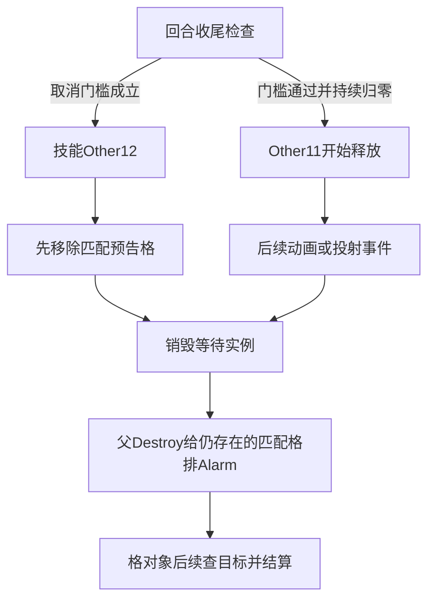

# 预告技能被控制后：取消条件、清理顺序与资源边界

[总目录](README.md) · [控制重叠](36-control-overlap-and-action-locks.md) · [预告执行](13-telegraphed-attacks.md) · [资源提交](16-skill-commit-and-ai-gates.md)

本篇继续研究巨魔的Shockwave与Rock_Toss：控制状态产生动作锁以后，什么条件会取消已经创建的预告，预告格怎样退出，以及已提交的MP/冷却是否补偿。**新增闭合的是实际类别字符串与取消比较：两招运行实例的class写为skill，所查循环用lock_skills匹配skill、lock_spells匹配spell。只有lock_turn非空不够，另需is_movement真。**

本篇解释已定位的静态路径，不报告一场游戏实测。取消检查发生在所查逻辑收尾消费点，不等于控制状态刚创建那一刻立即执行取消；已经发射的投射物也不能由等待对象的取消规则直接推定结果。

## 1. 身份、时间与方法

目标为 `E:/Steam/steamapps/common/Stoneshard` 的GameMaker YYC Windows x64制品。第十轮摘要核对时间为2026-10-12 23:22:57 PDT（2026-10-13 06:22:57 UTC）：

| 制品 | SHA-256 |
|---|---|
| StoneShard.exe | d45797505f04b9112c5fbb8e85c0f8cda2fa60aee954b4e108bad8a0dc514afa |
| data.win | 84034525fcdef3c6fd9803628b8de6c43fea479c930e168a95906de37a2ae19c |

摘要与前轮一致。REA MCP/provider不可用沿用00记录，本轮仍用本机PE/对象索引与Capstone5.0.9静态fallback，没有重装工具或伪造REA Evidence。新解码包含8个选定入口和两个Create补查；字节范围可解析不等于全部动态行为已恢复。没有启动/附加游戏、修改制品/存档、读取新存档或监测网络。

## 2. 哪个对象被取消，哪个对象实际执行伤害

| 对象 | ID | 本篇职责 |
|---|---:|---|
| o_shockwave | 5515 | 等待/释放的技能实例，class=skill |
| o_rock_toss | 5528 | 投石等待/释放实例，class=skill |
| o_aoe_spell_multiturn | 5513 | 两者父类，Create建立skill_duration与is_movement |
| o_aoe_spell | 5337 | 父Destroy对仍存在的对应范围格排Alarm |
| o_skill_aoe_zone | 5677 | 按main_owner筛选的预告/执行格 |
| o_shockwave_tile | 5518 | 冲击波格表现，与伤害格不同 |
| o_troll_rock | 5529 | 已发射的视觉投射体，与投石等待实例不同 |
| o_troll_rock_aoe_inducator | 5530 | 投石附加提示对象 |

两招Create调用继承行为，多回合父Create在 `0x143fef318` 取得skill_duration写槽，`0x143fef346–0x143fef350` 写数值2；is_movement默认false。技能表也有is_movement=0，但表值与本段运行属性分别核对，不能只靠表列推定全部实例生命周期。

每个预告格的main_owner在本取消检查中与技能实例的owner比较。**比较键是施法者归属，未见以独立施法实例ID作这段筛选。**这会影响同一施法者多个预告的构造例子，见第6节；不能直接保证游戏允许同时存在这些实例。

## 3. 类别现在已经绑定，不能再保留成匿名常量

13/16的前轮局部结果曾保留“类别槽A/B”。本轮将比较槽、初始化和实际技能写入连起来：

| 生产/消费 | 位置 | 核准值 |
|---|---|---|
| 回合结束法术类别字符串槽 | 0x1498841c0 | spell；文本0x1471316f7，构造调用0x1419c54a2 |
| 回合结束技能类别字符串槽 | 0x1498841d0 | skill；文本0x1471316fd，构造调用0x1419c54c1 |
| Shockwave自身class写引用 | 0x143ff095a | 后续复制skill槽 |
| Shockwave类别实参 | 0x143ff0969 | 槽0x1498e5ae0，文本0x147bc646b，构造调用0x143ff0b32 |
| Rock_Toss自身class写引用 | 0x143ffe881 | 后续复制skill槽 |
| Rock_Toss类别实参 | 0x143ffe890 | 槽0x1498e5bb0，文本0x147bc6a5a，构造调用0x143ffec62 |

两个Create首入口为 `0x143ff0810 / 0x143ffe660`。这里不是从未承载原始字节的BSS槽猜值，而是核对了字符串构造的文本、目标槽以及Create传参。

因此两招的这条默认初始化路径属于skill，不是spell。后续是否有特殊入口重写class，应另查；本篇不假设所有技能类别永不变化。

## 4. 公共收尾的判定算法

入口 `scr_global_turn_end(0x1419c0e50)` 的相应遍历明确选择5513多回合父类。输入是每个等待实例与其owner的当前锁列表，局部行为重新组织如下：

```text
如果owner实例不存在：取消
否则如果owner.lock_turn非空，并且技能.is_movement真：取消
否则如果owner.lock_spells非空，并且技能.class=="spell"：取消
否则如果owner.lock_skills非空，并且技能.class=="skill"：取消
否则：
    若skill_duration真值成立，减1
    若skill_duration与0比较相等，派发Other11开始释放

取消分支：
    派发本技能的Other12
    然后销毁本技能实例
    继续处理其他实例
```

| 步骤 | 关键位置 |
|---|---|
| owner字段与存在性门槛 | 0x1419c1771及其后调用/分支 |
| lock_turn与is_movement | 列表引用0x1419c17f0；is_movement读取0x1419c187f |
| lock_spells列表空检查 | 0x1419c18d7、引擎列表调用0x1419c194e |
| spell类别比较与相等取消分支 | 0x1419c19c6、0x1419c19e2 |
| lock_skills列表空检查 | 0x1419c1a24、引擎列表调用0x1419c1a9b |
| skill类别比较 | 0x1419c1b13及其后分支 |
| 取消事件user2→Other12 | 0x1419c1bde |
| 取消后销毁 | 0x1419c1c01 |
| 持续减1、比较0、释放user1→Other11 | 0x1419c1baa、0x1419c1c90、0x1419c1ce3 |

事件助手 `0x1451ef5b0` 将user索引加10、采用Other事件类型，因此user2=Other12、user1=Other11。名称对应来自本机制品的助手指令与事件元数据。

几个影响实际结论的边界：

- 锁列表查的是空/非空，本段不要求成员是某个特定控制状态ID。锁的生产、删除位置和重叠见36。
- 行动锁只在is_movement真时触发这一项取消；它不自动代表所有技能都被打断。
- owner不存在是实例存在性，不等于HP≤0；尸体仍有实例时不能直接套此取消原因。
- 比较经过本机动态值助手；数值持续与零的容差、异常类型不能全部替换为宿主语言比较。
- 未核准此检查相对于每种控制创建、角色收尾、动画派发的精确相位。静态存在此调用不能证明“控制命中立刻消除提示”。

## 5. 为什么取消和正常Destroy结果不同

父 `o_aoe_spell.Destroy(0x143e48c60)` 遍历5677，读取main_owner和外层owner（`0x143e48d4b / 0x143e48d5e`），相等比较 `0x143e48d7b`。匹配时在 `0x143e48dc5` 给该格写alarm[1]=1。

这是正常释放链的一部分：格Alarm1再派Other11，在格上找当前对象并派技能伤害，详见13/20。**销毁等待对象不必然等于“攻击已经安全取消”。**所查取消分支先Other12清掉预告格，再销毁等待实例，使父Destroy面对的可用格集合不同。



此图表达已见分支关系，不表示两技能后段完全相同，也不表示空集合仍会结算攻击。

### Shockwave取消

`Other12(0x143ff3240)`先选择古代巨魔3962并申请aIdle动画；所查这段按对象类型遍历，没有把其动画选择统一描述为只操作当前owner。之后遍历5677：

1. 格main_owner与取消技能owner比较，位置 `0x143ff3574`。
2. 相等才销毁该格，实际调用 `0x143ff359f`。
3. 在后续视觉循环将5518格表现的is_idle写false（`0x143ff3601 / 0x143ff3628`）。本局部未见逐视觉实例再次比较main_owner，不称为所有表现精确按施法ID隔离。

它没有在这个取消主体调用技能Other10来直接制造本次范围伤害。

### Rock_Toss取消

`Other12(0x144000450)`先遍历5677并比较归属（`0x1440005e1`），匹配时销毁（`0x144000605`）。随后选择古代巨魔3962申请aIdle动画（`0x144000779`），再遍历5530提示对象并销毁（`0x14400083b`）。最后这组提示删除的所查循环没有同一main_owner比较，不能声称它只清某个独立施法的提示。

5529已发射的o_troll_rock是另一个类型，不在上述5530提示删除循环中。要证明“发射后受到控制会消灭飞行石块”，还须找到5529删除或其有效性门槛，不能把5530提示销毁当成投射体已经销毁。

## 6. 三个明确前提的例子

以下是按真实局部规则构造的状态，不是运行截图；所有列表成员、实例ID和回合消费位置均为演算输入。

### A. 只有行动锁，当前两招并非移动技能

Shockwave已创建，skill_duration=1、class=skill、is_movement=false；owner存在。构造lock_turn=[true]，lock_skills和lock_spells为空。

lock_turn虽然非空，但is_movement是假，此项不取消；其他两项也不取消。持续1→0，派Other11开始释放。这个例子说明所查取消合同，而不是宣称原作某个名为“眩晕”的状态只添加lock_turn。真实Stun/Stasis会怎样写各列表，由36另外解释。

### B. 等待投石遇到技能锁

同样是持续1、class=skill、is_movement=false且owner有效；改成lock_skills=[true]。类别比较命中skill，先派Rock_Toss.Other12，移除归属匹配的5677预告格，处理动画与5530提示，再销毁等待实例。此轮不继续走持续减1→Other11释放分支。

如果锁是由36中的实际状态创建路径添加，来源就能接到这个消费者；若控制已解除但另一个状态的技能锁仍留在列表，这里仍按非空判断。删除位置的运行值与状态解除先后须沿36的限制处理。

### C. 同一owner的两个预告实例

构造技能S1与S2的owner同为M，另一个技能S3的owner为N；格Q1/Q2分别服务S1/S2但main_owner均为M，Q3的main_owner=N。S1进入所查取消事件后，5677筛选只比较main_owner=M，所以Q1/Q2都符合，Q3不符合。

**这证明的是所查筛选键的作用域，而不是已经观察游戏能同时维持S1和S2。**角色行动占用是否阻止这个状态、同owner格生命周期是否另有保护，需继续追生产者与运行场景。独立设计如果允许多预告并存，应明确选择按施法者还是按单次施法身份清理。

## 7. MP与冷却：取消链闭合不等于退款链闭合

16已确认普通敌人施法的选定路径先请求冷却写入、再提交MP，之后才创建出生/技能对象。Rock_Toss真实表输入MP=80、KD=10；这两个值仍不自动等于修正后的提交量。

沿用一个明示条件算例：提交前MP120，有效花费80、下限不抬高40、冷却写入为K。提交后MP40、KD=K，等待对象建立。它进入本篇取消路径后，**所读两个Other12和父Destroy主体未见直接把MP加回80或将KD重置0的写入/已命名调用**。

因此局部证据支持“本取消主体负责终止后续预告并清理，未直接补偿提交成本”。全GameMaker Destroy/CleanUp派发、其他状态回调、被动和异常处理尚未全部闭合，不能将这句扩大成全游戏取消无退款规则，也不能报告玩家实战最终MP必定40。

## 8. 已回答、部分与下一步

| 问题 | 本轮状态 |
|---|---|
| 两招究竟是spell还是skill | 已绑定Create、字符串构造与取消比较：所查初始化为skill |
| 行动锁是否无条件打断两招 | 已回答本循环：需is_movement真，默认false不满足这一项 |
| 技能锁怎样取消预告 | 已闭合非空检查→类别匹配→Other12→销毁 |
| 取消为何不会直接等同正常释放 | 已解释预告格先移除、父Destroy对剩余格排Alarm的顺序 |
| 清理范围是否一招一个独立ID | 所查格按owner归属筛选；部分表现循环更宽，未证明全生命周期隔离 |
| 取消是否退款 | 所列主体未见直接补偿；完整回调/运行终值未回答 |
| 已发射石块会不会中止 | 未闭合，需追5529所有退出和有效性消费 |
| 控制命中到画面取消间隔 | 未运行，创建/收尾/动画精确相位未回答 |

下一步可选“已经进入Other11但尚未Other14时施加控制”，对照“投射体5529已经创建之后”。记录等待对象、预告格、投射物各自是否存在与事件派发，才能说明准备、释放和飞行三个阶段的打断边界。本轮没有执行这些运行实验。

## 9. 独立借鉴、证据与风险

独立实现可明确分开动作资格锁、预告生命周期和投射物生命周期，定义控制在准备/释放/飞行哪一段生效；为每次施法建立自己的标记归属和取消原因，显式规定退款政策。是否采用这些规则由我们的游戏需求决定，不将其说成原作开发意图。

本机可选证据：[选定入口解码](../../../_reference/stoneshard-study/tenth-interrupt-native.json)、[类别绑定](../../../_reference/stoneshard-study/tenth-interrupt-class-bindings.json)、[指令目录](../../../_reference/stoneshard-study/tenth-interrupt-disassembly)、[本轮制品身份](../../../_reference/stoneshard-study/tenth-target-identity.json)。正式正文已保留必要参数、地址、输入与限制，本机产物不随仓库克隆。

已做静态名称/输入/分支/调用核对、状态演算和文档验证。未运行REA产品测试或原游戏实验，未提交推送；本次未改REA运行逻辑。主要风险是把所查收尾时点当即时中断，把归属键当单次施法ID，把提示删除当投射体删除，或把有限取消主体当全局无退款契约。

条件演算的可复核记录见 [锁/取消/格挡状态例子](../../../_reference/stoneshard-study/tenth-derived-examples.json)，目录及地址定位见 [本轮文档验证](../../../_reference/stoneshard-study/tenth-document-validation.json)。
