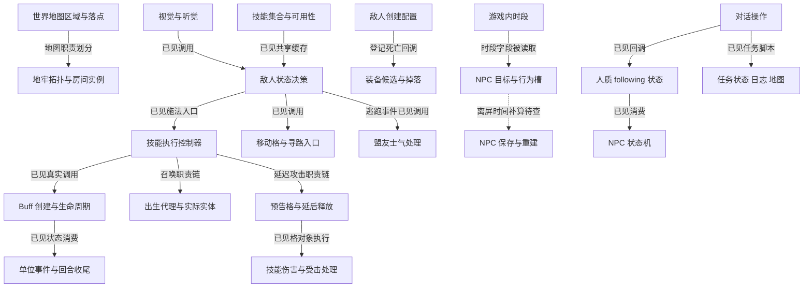

# 紫色晶石拆解文档目录

本目录拆解 Stoneshard 的地图生成、敌人 AI、NPC、战斗技能、Buff、召唤、延迟范围攻击、迷雾探查、肢体伤势与背包交互，帮助团队学习设计思路并独立实现自己的游戏。战斗增量还包括连锁传播、远程选位、投射物、资源吸取、混合伤害、属性流水线、地形实体和盟友响应；背包新增拖拽/掉落、堆叠拆分和尺寸整理。已确定局部算法、真实配置和跨对象执行链；完整生成器、完整 AI 权重、离屏调度、墙角遮挡与全部伤害公式仍是局部完成。

详细描述以这一个本机安装制品的资源和机器指令为依据。每篇把真实对象配置、构造演算和自研设计分开；伪代码是行为说明，不是原始代码交付。先读证据范围，再按自己的玩法兴趣选模块即可。

## 文档目录

| 文档 | 主要问题 | 已建立的具体内容 |
| --- | --- | --- |
| [00 调查证据与阅读范围](00-evidence-and-scope.md) | 哪些结论可以确定，怎样复核 | 制品摘要、地址约定、资源与存档证据、未知项和研究边界 |
| [01 世界地图与随机落点](01-world-map.md) | 地点怎样从区域候选中产生 | 区域扫描、候选列表、tilemap 掩码、随机整数范围、十项随机序列与城镇标记 |
| [02 地牢拓扑与房间拼接](02-dungeon-generation.md) | 房间图与实际地图怎样分层 | 房间模板、连接标记、图与实例职责、几何最远候选和连接验证入口 |
| [03 敌人视觉听觉与感知信号](03-enemy-perception.md) | 怎样判断看见和听见 | 距离模式、VSN、条件视线、传播代价、方向修正和一次性听觉消费 |
| [04 敌人装备与死亡掉落](04-enemy-equipment-loot.md) | 初始配置与掉落是否是一套规则 | 强盗弩手的弹药、使用与掉落对象、装备候选查询、Duration 和概率助手边界 |
| [05 敌人技能决策与盟友协作](05-enemy-skills-cooperation.md) | 技能怎样登记与限制，敌人怎样相互影响 | 技能集合、去重、评分缓存、装填门禁、盟友过滤和士气请求公式 |
| [06 NPC 作息与睡眠](06-npc-schedule-sleep.md) | NPC 怎样按时间切换工作和睡觉 | 四时段、继承覆写、目标槽、睡眠目标优先级及退出清理 |
| [07 NPC 持久化与跟随](07-npc-persistence-following.md) | 离开地图后保存什么，跟随怎样进入状态机 | 保存与重建、真实铁匠快照、人质 following/waiting 与跟随消费分支 |
| [08 对话与任务状态](08-dialogue-quests.md) | 对话怎样触发持久行为和任务 | 对话阶段与操作容器、护送状态回调、葡萄园任务首次初始化、日志和地图入口 |
| [09 可以继续研究的相关系统](09-related-systems.md) | 下一轮能继续找到什么 | 已有缺口的补齐路线及新系统入口、问题、所需证据和完成标准 |
| [10 战斗技能执行与资源冷却](10-combat-skill-execution.md) | 技能怎样从配置变成执行对象 | Taking Aim 真实表行、控制器事件、资源与冷却入口、玩家与敌人路径区别 |
| [11 Buff、状态持续时间与属性汇总](11-buffs-and-effects.md) | 怎样添加、维持、更新和移除效果 | Taking Aim、effect_create、持续时间阶段、销毁清理与属性缓冲累加 |
| [12 召唤物、出生代理与寿命](12-summoned-units.md) | 召唤怎样产生实体并管理归属 | 实体与出生动画区别、thrall 与 mana crystal 不同继承、寿命 Buff 与实体死亡联动 |
| [13 怪物预告攻击：拍地板与投石](13-telegraphed-attacks.md) | 怎样先预告，延后释放并命中格内单位 | 巨魔冲击波/投石、逻辑倒计时、动画结束、格对象执行、命中去重与取消 |
| [14 战斗回合与伤害触发链](14-combat-turns-and-damage.md) | 上述系统怎样接入回合和伤害 | 玩家 alarm 排程、全局计数、格子门禁、扣血与受击触发、局部格挡与真实取整 |
| [15 预告攻击生产、行动占用与落点结算](15-telegraph-production-chain.md) | 准备动画怎样创建攻击，投石怎样触发实际结算 | birth 生产门禁、施法占用计数、独立终点碰撞、浮点比较容差与表现/结算关联 |
| [16 技能提交、取消补偿与 AI 门禁](16-skill-commit-and-ai-gates.md) | 何时写冷却和扣 MP，取消与防重复证据到哪里 | 两招真实表行、正常提交顺序、有限取消主体检查、不可选中状态与出生幂等区别 |
| [17 保存、恢复与逻辑时钟的边界](17-persistence-and-clock-boundaries.md) | 战斗状态保存、NPC 时钟和地图重现有哪些证据 | 角色 state/技能/Buff 保存、冻结时间门禁、噪声接收器条件清理、楼层 seed 与图恢复的不同层次 |
| [18 换位与移动攻击](18-swap-and-mobile-attacks.md) | 秘术换位、移动后攻击怎样分步执行 | Planar Exchange、Crippling Lunge、Heroic Charge 的实际对象与位置/攻击事件 |
| [19 猛踹、拉拽与公共击退](19-kick-pull-and-knockback.md) | 谁被移动、怎样判概率、逐格遇阻怎样处理 | Power Kick、Tongue Pull、反向位移、控制输入与概率助手边界 |
| [20 AOE 形状、格对象与目标筛选](20-area-shapes-and-hit-selection.md) | 长宽如何展开为格子，重复目标怎样处理 | normal/line/pyramid 候选循环、即时 Step 定位、共享目标数组与仍待查的映射 |
| [21 秘术缚索与斧类钩取](21-arcane-tether-and-hooking-cut.md) | 玩家法术和武器拉拽是否同一算法 | Arcane Tether、Wide Cut 的属性公式、伤害/控制顺序与技能类别索引 |
| [22 值得继续研究的特殊技能](22-special-skill-candidates.md) | 还有什么机制值得深查 | 连锁目标、符文实体消费、反射/格挡响应、静滞、分身、尸体与特殊移动等 11 类候选的证据和下一问 |
| [23 玩家视野、探索记忆与战争迷雾](23-player-vision-and-fog.md) | 当前看见和曾经探索怎样区分 | VSN、墙体/射线/队列、当前网格与历史网格、开格与保存恢复、世界地图边界 |
| [24 主动探查与隐藏物揭示](24-investigation-and-reveal.md) | 搜索怎样发现陷阱和秘密门 | Trap_Search 实际配置、当前可见性参与机会、普通/网陷阱差异、状态写入与动画分离 |
| [25 身体部位抽选与肢体伤势](25-body-part-hit-selection-and-injuries.md) | 一击打哪里，为什么受伤或流血 | 默认连续判定、技能限定候选、部位护甲接入、Condition 损失、伤势等级与流血局部公式 |
| [26 玩家听觉提示与声音来源](26-player-hearing-and-noise-signals.md) | 听见是否等于看见，提示怎样维持 | 特殊门禁路径、PRC 范围、owner 复用、随机寿命、来源跟随、淡出与假提示边界 |
| [27 各身体部位的伤势减益](27-body-part-injury-debuffs.md) | 头、躯干、手和腿各影响哪些属性 | 六部位三级贡献表、普通与稳定版本、疼痛贡献、命中/EVS实际消费者与解除 |
| [28 流血与持续损伤](28-bleeding-and-blood-loss.md) | 持续怎样修正，重施怎样处理，怎样扣血 | 部位独立实例、Condition/Fortitude修正、同部位加时、缓存伤害、状态倍率与Condition−1 |
| [29 绷带治疗与物品提交](29-bandages-and-wound-treatment.md) | 绷带解除什么，是否补生命或肢体状态 | 选部位查流血实例、销毁与清理、默认charge2、排程与条件消费链 |
| [30 夹板与伤势稳定](30-splints-and-injury-stabilization.md) | 稳定是否就是治愈，怎样恢复与替换 | 即时Condition+35/上限100、普通→稳定销旧建新、降级门槛和条件消费 |
| [31 伤势恢复与生命治疗](31-injury-recovery-and-health-restoration.md) | 治疗量怎样分给生命与部位状态 | 恢复条、治疗比例和上限、剩余治疗量、未满部位归一化、稳定降级与直接正增量 |
| [32 一次物理剑击的伤害计算](32-physical-attack-damage-resolution.md) | 格挡、护甲、穿甲、抵抗怎样改变伤害 | Drifter Sword真实表行、Slashing七实参、格挡前总基数、多阶段取整、18/12/10算例与BodyPartHit |
| [33 弩手技能评分与动作选择](33-arbalester-skill-scoring-and-action-choice.md) | 瞄准、爆头、治疗怎样进入最终竞争 | 两个真实评分回调、当前新版FSM、使用许可、消费品/技能顺序与平分规则 |
| [34 敌人自救与生存判断](34-enemy-self-treatment-and-survival.md) | 弩手有没有药，选中后怎样消费和治伤 | 概率资源生产、评分、当前选择到代理执行桥、头/躯干优先、charge扣除与敌人夹板Condition+35 |
| [35 一次攻击的结果与事件顺序](35-attack-results-and-event-order.md) | 命中、格挡、失手、暴击怎样组合，HP怎样应用 | 多次机会与标志转换、结果优先级、critBlock、伤害/状态/HP阶段、保护回退与50→32/38/40条件算例 |
| [36 控制重叠与动作锁](36-control-overlap-and-action-locks.md) | 两种控制并存、解除一项后还剩哪些限制 | Stasis/Stun五锁列表生产、解除位置的未知值、台词标量与免疫恢复、实际消费者与条件例子 |
| [37 预告中断、取消与清理](37-telegraph-interruption-and-cancellation.md) | 控制怎样取消拍地/投石，取消与正常销毁有什么区别 | skill/spell真实类别绑定、锁条件、Other12先清格后销毁、归属范围、退款与已发射投射物边界 |
| [38 格挡响应与真正反击](38-block-reactions-and-counterattack.md) | critBlock怎样触发响应，何时真的再次攻击 | Riposte/Deflect与通用反击分开、冷却/属性/格挡比例恢复、Alarm6排程与重新验证、HP前后阶段 |
| [39 反射重定向与来源归属](39-reflection-redirection-and-source-ownership.md) | 反射选谁，调用者怎样采用新目标，伤害归谁 | 首个合格无封印候选、距离/可见/传送门禁、Planar Exchange消费、reflection_attacker转交与清除 |
| [40 连锁闪电与下一跳传播](40-chain-lightning-target-propagation.md) | 谁能被连锁、同距如何选择、下一跳怎样继续 | 两种状态资格、八格距离、成对数组、严格最小距离、marker与新载体；硬跳数仍未知 |
| [41 远程 AI 选位与危险格](41-ranged-ai-position-scoring.md) | 射击位置、危险格和路径怎样进入选择 | 格类型/权值、验证门禁、候选替代入口与targetTile消费者；完整评分仍局部 |
| [42 投射物碰撞与目标改变](42-projectile-collision-and-target-changes.md) | 丢目标、反射、碰撞和连发怎样衔接 | Fire Barrage真实子类/父类链、终点代理、13像素门禁、反射后追踪与销毁后继 |
| [43 吸血、吸魔与资源结算](43-life-and-energy-drain.md) | 恢复按输入伤害还是最终扣血计算 | HP应用前的伤害基数、治疗倍率、有效上限、每次取整与负资源请求区别 |
| [44 混合伤害、暴击与失误](44-mixed-damage-crit-and-fumble.md) | 各类型怎样分配防御预算，倍率在哪一步生效 | 13类型系数与抵抗、Fire的0.66、共用原始分母、18/29/7/15条件算例 |
| [45 装备、Buff与属性流水线](45-equipment-buff-attribute-pipeline.md) | 配置、贡献缓存和当前角色字段怎样连接 | 重建加法、缺失零、两种组合查询、命中5/150钳制、临时属性与装备解析边界 |
| [46 战斗地形与实体消费](46-combat-terrain-and-entity-consumption.md) | 符文巨石怎样占格、被抛投或爆破、退出清理 | 实体与占格、参数拷贝、−4退出归因、Destroy/CleanUp职责；自动到期仍未知 |
| [47 盟友技能与群体响应](47-ally-skills-and-group-response.md) | 号令怎样通知犬类，人数收益给谁 | Huntmaster/Sic Em、目标挂状态、士气与伤害消费者、Protect Hive施法者收益 |
| [48 远程选位竞争与无路处理](48-ranged-position-selection-and-path-failure.md) | 路径候选和九格分数怎样决定输出 | 视线失败搜索、默认1/1/0.6因子、16°/22预算、最少路径点数、九格竞争、特殊实体单次−40及原地覆盖 |
| [49 连锁跳数与标记寿命](49-chain-lightning-hop-budget-and-marker-lifetime.md) | 次数字段真用于链预算吗，marker何时移除 | count字段全代码节指定形式引用、其他技能预算分离、marker父链/共享时钟/列表删除；硬上限仍未知 |
| [50 投射物墙体与终点选择](50-projectile-wall-blocking-and-endpoint-selection.md) | 发射前怎样检测阻挡，目标怎样变成障碍/代理 | wallgrid掩码3、真实代理OR写mask2、目标到偏移射线、size截获、终点生产与飞行碰撞分层 |
| [51 巨石自动到期核对](51-runic-boulder-turn-expiry.md) | duration20是否真是寿命，HP破坏和到期如何区分 | 更广duration引用、父/本体事件、Buff容器边界、HP通知和破坏销毁；自动到期未闭合 |
| [52 背包拖拽、放置与空白掉落](52-inventory-ui-drag-placement-and-dropping.md) | 点击空槽、UI外和阻挡UI为何不同 | 选中/高亮/占格、End Step提交、完整覆盖计数、菜单/GUI排除、世界掉落数据转移与退出 |
| [53 堆叠、拆分与数量转移](53-item-stacking-split-and-transfer.md) | 满栈余数、源销毁、滑条和保存数量如何衔接 | 实例资格、abs溢出余数、源数量提交、拆分预览+1、新实例选中、Stack地图及100/250/499桶 |
| [54 自动整理与矩形放置](54-inventory-autosort-and-grid-packing.md) | 整理按什么排序、怎样找格，失败怎么办 | 先堆叠、idName分组、宽/高/面积三次排序、列优先first-fit、4×3例与forced_drop失败分支 |

## 推荐阅读顺序

如果优先研究敌人 AI，先读 03 的感知，再读 05 的技能与协作，随后读 04 的装备与掉落。这样能区分“获得信息”“决定动作”和“角色携带或产生物品”，避免把它们合成一个难以验证的大函数。

如果优先研究有日常生活的 NPC，先读 06 的时间和行为槽，再读 07 的持久化与跟随，最后读 08 的对话操作。需要特别区分实体的当前行为、保存状态和离屏更新：已经找到保存/重建，不等于已经证明离屏每回合完整寻路。

如果优先研究随机地图，先读 01 的合法位置选择，再读 02 的地牢拓扑与模板。世界地点落点与地牢房间拼接是不同问题；两者虽然都用随机数，约束和结果的数据结构不同。

如果优先研究战斗，先读 10 的技能配置与执行，再读 11 的状态生命周期；随后选 12 的召唤或 13 的怪物预告技能。14 把逻辑回合、动画排程和伤害触发连起来。已有 05 聚焦 AI 的选择与协作，与 10 的“选中以后怎样执行”分属不同问题。

预警攻击的增量证据继续读 15 与 16：前者补出生生产、行动占用与终点碰撞，后者补配置、资源提交与取消检查。13 保留前轮局部覆盖，新确认与仍未闭合的相位以增量篇的明确范围为准。

涉及预告读档、离屏 NPC、听觉清理或地牢返回时，再读 17。该篇区分角色保存与独立技能对象保存、日程时间与行动机会，以及 seed、结构图和动态快照；目前不能据此保证预告完全恢复或所有地牢访问稳定重现。

本轮继续技能机制时，先按 21 的类别索引选实例：18 区分交换位置与自身移动攻击；19 解释目标受力位移及概率；20 解释范围候选、格对象和重复目标；21 则详细比较两种玩家拉拽。各篇均给出具体演算，并把请求距离与实际移动、伤害输入与最终扣血分开。配置中的英文 Lunge、Charge、knockback 标签不能单独建立行为结论。

想继续找特殊技能时读 22。该篇先做候选评估，优先建议符文巨石联动、Chain Lightning 和反射/格挡响应；随后可选球状闪电、静滞、幻象和石刺。已经核对关键事件，不表示各组的完整数值、触发频率和退出规则都已恢复。

研究战争迷雾和探查时，先读 23 的当前可见与探索记忆，再读 24 的隐藏物机会与成功状态。03 是敌人感知，26 是玩家提示；听觉提示、发现陷阱、揭开本地图格和世界地点已知各有不同状态。部位战斗读 25：默认抽选与猛踹限定候选不等概率，所选部位接入防御后，伤害再驱动 Condition 和伤势。

医疗系统先读25的部位状态生产，再读27的伤势贡献与副作用，接28的持续流血。29说明绷带选部位解除流血，30说明夹板即时恢复与稳定替换，31说明治疗剩余量和状态降级。生命、Condition、流血实例和伤势实例各有自己的状态，停止流血、稳定伤势和解除全部减益不能互换。

两个连续战斗例子新增在32–35：“一把剑的一次攻击”先读35的结果判定和事件阶段，再读32的格挡/护甲数值；“一个受伤弩手的一回合”先读33的竞争选择，再读34的资源和治疗执行。这里确认真实配置与局部规则，数值场景仍明确标为构造演算，不当作实战截图或完整模拟器。

控制和响应的交互继续读36–39：36解释动作锁的生产/解除与状态叠加边界，37接到预告取消；38把格挡收益与延后反击区分，39追反射返回值如何真正进入换位和伤害归属。这里最需要保留的是触发时点、作用对象和退出顺序，不能把名字相近的行为当作一个公共机制。

本轮八个战斗方向在40–47。连锁与飞行先读40/42；AI空间选择接33→41；属性和数值接45→44→43；实体消费和盟友联动读46/47。每篇至少包含一个明示条件的具体例子，并把输入请求、局部结果和最终HP分开。部分方向仍有完整评分、自动寿命、全部墙体和特殊副作用缺口，不能把八篇调查完成理解为八套系统全部复原。

第十二轮把四项战斗缺口推进到48–51：48恢复真正路径竞争和九格数值，49扩查跳数与marker时钟，50补网格位生产到射线拒绝，51区分自动到期与HP破坏。连锁数字硬上限和巨石到期仍未取得完整链，不能用候选耗尽或一般销毁替代答案。

背包先读52的选中/预览/提交，再读53的数量和源实例退出，最后读54的整理与矩形布局。空槽、UI外空白、GUI遮挡不同；堆叠压缩与二维排格也不同。每篇都有具体例子和失败边界，适合据自己的产品需求独立实现。

## 系统关系

下图是依据已有证据组织的阅读关系与职责划分，不是已经恢复的全游戏架构或固定运行顺序。边上的“已见调用”只表示存在静态调用证据；“待查关系”保留为下一轮问题。

## 确定程度速查

| 类别 | 可直接用于行为讨论的局部规则 | 不能据此推定的完整规则 |
| --- | --- | --- |
| 地图 | 合法候选枚举后选索引；几何距离严格更大才替换最远候选 | 全部生成失败回退、所有过滤条件、全地图稳定重现 |
| 感知 | 一种距离计算；特定路径的视线门槛；听觉置位与消费 | 所有材质、角落规则、所有角色参数、警戒到攻击的完整条件 |
| 装备技能 | 弩手弹药范围；指定掉落候选；未装填拒绝 ranged；技能集合处理 | 精确最终掉率、全部装备参数含义、每种技能完整评分 |
| 协作 | 阵营与感知过滤；按 Tier 比例产生士气请求 | 编队、包抄、保护远程单位或统一指挥 |
| NPC | 具体小时分段、铁匠回调绑定、睡眠清理、保存与护送状态 | 固定床位、无条件准点抵达、离屏逐回合更新、跨地图持续跟随 |
| 对话任务 | 指定回调修改状态；任务尚未开始才初始化 | 全部台词选项、完整任务生成器和所有目的地规则 |
| 技能 Buff | Taking Aim 表行与 Buff 字段；持续时间消费、销毁清理、属性逐项累加；同部位流血加时、临时属性同来源同键刷新与有限多份贡献 | 全技能结算、最终命中率、主Buff全部叠层策略、按施法者独立并存 |
| 召唤 | 出生代理创建实体；不同继承链；mana 寿命 Buff 销毁导致 HP=0 | 每类召唤同一 AI、全体主人死亡处理、跨地图转移 |
| 延迟攻击 | 巨魔两技能的倒计时、释放、格内目标查询、去重和伤害入口 | 创建当轮起算与画面上精确间隔；全部打断与地形边界 |
| 战斗公共处理 | alarm最大值、turns加一、选定攻击的多标志/结果顺序、Slashing格挡/护甲/抵抗公式、HP局部应用与保护 | 武器到聚合属性的完整生产者、未知运行槽、全部类型修正/回调和所有最终伤害 |
| 弩手行动自救 | 两技能评分、治疗锁门禁、分阶段平分、资源代理消费；普通attack后的条件装填、入口刷新和现场评估 | 全技能权重、独立移动/装填评分、完整实际场景、逃跑触发、所有重新评分时点和离图保存 |
| 控制与预告取消 | 五锁列表生产、部分消费者、真实skill/spell类别、Other12先清格再销毁 | 删除位置运行槽、所有使用门禁、精确时序、已发射载体和完整退款 |
| 格挡响应与反射 | 响应属性/资源路径、独立反击排程/检查、封印候选排除与返回值/归属消费 | 全部反击许可来源与重入、所有技能适用性、并行覆盖、无伤害退出和遍历顺序 |
| 位移技能 | 选定换位与移动攻击事件、猛踹/拉拽输入、公共反向位移调用 | 全技能的墙角/免疫/取消、实战每一帧与中文名称对应 |
| 范围形状 | 普通与金字塔候选循环、即时定位 Step、重复目标的替换分支 | 表字段到运行参数的全部映射、候选格全部有效、所有技能全链只伤害一次 |
| 迷雾视野 | 当前 fogmap 与历史 fogTiles 分离、开格、保存与恢复链 | 完整墙角/透明障碍、更新事件先后、动态光源和像素明暗 |
| 探查揭示 | 普通活动机会100、网陷阱机会公式、陷阱与秘密门不同状态 | 概率实际下限、精确行动成本、界面名称、发现保存与秘密门物理变化 |
| 玩家听觉 | 选定入口范围/机会、按 owner 复用、寿命计数和淡出 | 全部正常入口、默认距离模式、准确显示回合、假提示完整生成 |
| 肢体伤势 | 连续部位判定、限定候选顺序、状态损失、0/25/50局部等级与流血输入 | 运行概率下限、Condition 下界、物种例外/完整最终减益、完整 HP 终值 |
| 伤势减益 | 六部位三级基础贡献、稳定保留同级贡献、附加疼痛与部分行为锁、命中/EVS应用 | 全部字段最终换算、专属副作用的完整资格、替换重算时序 |
| 流血医疗 | 部位持续与重施、缓存伤害、绷带解除选定流血、夹板即时加35与稳定替换 | 实测有效回合、完整消费/取消、保存与特殊伤害覆盖 |
| 部位恢复 | 恢复条请求、治疗剩余量为正才进入部位恢复、数量归一化与状态系数 | 所有满血/越上限/回调组合、完整睡眠和药物、离屏与保存时序 |
| 连锁与投射物 | 状态/距离资格、严格最近与同距、Fire Barrage飞行/反射/终点/后继 | 链硬跳数与并发marker、所有墙体、全部取消和动态帧间隔 |
| 远程选位 | 实际新版查询消费、陷阱负值、单位路径类型验证与候选门禁、临时标记/解除 | 完整空间评分、盟友占位准则、全部无路回退与DLL内部 |
| 资源与混合伤害 | HP前吸血吸魔、每调用取整、13类型系数、Fire实参与暴击/失误倍率位置 | 未知资源/伤害下限、全武器资格、全部副作用和最终HP |
| 属性流水线 | 状态缓冲重建、组合查询、命中钳制、临时贡献/立即重算门禁、物品解析 | 全装备槽、基础字段生产、全部百分比阶段和动态刷新时序 |
| 实体与盟友联动 | 巨石占格/消费/清理、Sic Em犬士气和伤害响应、Protect施法者人数收益 | 自动到期、复制参数最终消费、犬FSM、冷却默认类别与全体协作 |
| 续查空间与墙体 | 最少路径点数、九格严格最大与原地覆盖、特殊实体单结果罚40；wallgrid位写入和mask3检测 | 全部布尔生产、全部末尾覆盖、DLL内部、墙种类与射线角点 |
| 背包交互 | 手持状态与高亮、空白掉落门禁、部分合并/拆分/源退出、尺寸分组与逐件first-fit | 全特殊物品与缩放/失焦、兼容键、排序平分、异常回滚和完整输入时序 |

## 后续调查的优先顺序

用于独立项目的局部重构评审时，优先读 [11 状态重复施加与来源](11-buffs-and-effects.md)、[36 重叠控制与移锁](36-control-overlap-and-action-locks.md)，以及 [33 弩手动作竞争](33-arbalester-skill-scoring-and-action-choice.md)、[34 治疗代理](34-enemy-self-treatment-and-survival.md) 的新增收敛小节。它们把已闭合的实例、明示条件演算和自研建议分开；其他项目仍需按自身契约和实现决定是否采用，不能直接把原作局部规则当作重构要求。

技能评分与最终动作的选定链已推进到33，敌人治疗到34；后续优先补移动格与寻路代价、NPC离屏更新调度、装备参数表与死亡掉率。技能方向继续补其余权重、目标变化与完整场景，不能把Taking Aim和Headshot两实例扩大为全部AI。

战斗技能、Buff、召唤和预告攻击见10–17，部位医疗见25、27–31，一次攻击和弩手自救见32–35，控制/格挡响应/反射见36–39，第十一轮八个方向见40–47。第十二轮续查见48–51：已推进远程角度候选、九格竞争与失败返回，以及墙体阻挡位生产/检测；全部末尾选位覆盖、连锁数字硬上限、巨石自动到期仍未闭合。背包交互、堆叠和整理见52–54，后续优先补拆分滑块上限生产、全部堆叠兼容条件、取消输入，以及整理异常清理/回滚。其他战斗问题还包括具体武器的完整暴击修正/清理、预告真实起算和运行异常。调查问题与完成标准见 [09 相关系统](09-related-systems.md)；入口存在不代表算法已经恢复。

## 文档与本机证据的位置

本目录为正式可维护文档，不包含原始游戏二进制、完整存档、专有资源或恢复源码。模块的关键步骤和定位信息在正文保留；各篇末尾还提供本机 `_reference/stoneshard-study` 的补充证据链接。这些本机文件被 Git 忽略，仓库克隆后可能没有，详见 [00 证据范围](00-evidence-and-scope.md)。

早期报告作为调查历史保留：[第一轮总报告](../../../_reference/stoneshard-study/report.md)、[第二轮简版模块例子](../../../_reference/stoneshard-study/module-examples.md)。新的详细说明以本目录的明确证据与限制为准，不把早期“尚未核对”自动理解为现在依然全部未知。
